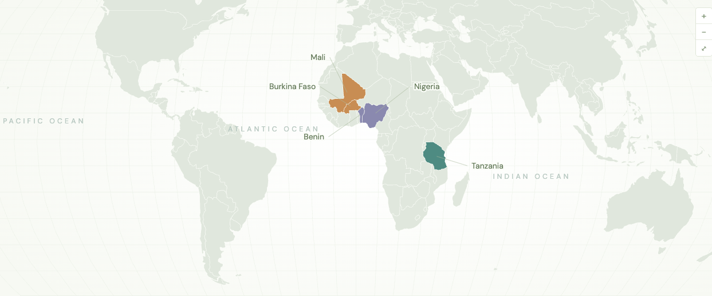

# Malaria Atlas

**Team:** HackKiller  
**Members:** ZiyaoDai, Chloe Wang, Kevin Qian, Yuqing Ji, Xinyi Zhao  
**Challenge:** Visualize 2 — How does the effect of malaria prevention vary by setting and over time? (PATH)  
**Pitch slides:** https://dazyyyyy.github.io/Hackiller_V2PATH/pitch/  
**Live demo:** https://dazyyyyy.github.io/Hackiller_V2PATH/pitch/product/  
**Team development repository:** https://github.com/DAzyyyyy/Hackiller_V2PATH

## What it does

Malaria Atlas helps malaria programme teams and researchers inspect prevention evidence by setting, comparator and follow-up. It combines a five-country map, country timelines, source-linked trial results and a budget-and-coverage scenario planner.

The pitch includes a live product, offline backup captures and a supporting table of R21 and RTS,S + SMC results. The live demo uses the reviewed, bundled snapshot.

## How we used the System Public Graph

We scanned 1,999,877 associations from the fixed Harvard Dataverse v2.1 snapshot. Concept neighbourhoods for malaria, mosquito nets and malaria vaccines were combined with variable-name searches for nets, seasonal malaria chemoprevention and vaccines. We joined study records and PubMed metadata, distinguished uptake and acceptance studies from malaria health outcomes, and checked selected results against abstracts and papers.

The supplied bundle contains 481 candidate associations from 273 papers, plus 20 paper anchors and 33 abstract-reviewed comparisons. Fifty-two of the 53 reviewed comparisons are displayable. These are comparisons with differing review levels, and candidate and reviewed collections overlap. The pipeline retains comparator, population, outcome, follow-up, source and verification fields. Invalid numeric effect intervals are excluded from plots. Country trends from WHO and MAP and sampled resistance context from Pf8 remain separate data layers.

## How to run it

Python 3 is sufficient to serve the bundled frontend. From this team folder, run the following command.

```sh
python3 -m http.server 8000 --directory frontend
```

Open http://localhost:8000/ for the team's main application, http://localhost:8000/pitch/ for the presentation, or http://localhost:8000/pitch/product/ for the exact product snapshot used in the pitch. The frontend requires no installation step or API key. Its data, D3 and presentation fonts are included. Paper links open the original online sources.

For optional research-pipeline reproduction, install the research requirements and download the large publisher originals with checksum verification.

```sh
python3 -m pip install -r what-works-where/requirements.txt
python3 scripts/download_system_snapshot.py
```

The download script retrieves associations, studies, variables and concepts into `data/restored/system/` and verifies their SHA-256 values against the included publisher manifest. It downloads hundreds of megabytes and observes the publisher's CC BY-NC 4.0 terms. The frontend and included result tables can be inspected independently of this download.

For Graph enrichment, create a private local `what-works-where/.env` file containing your own `SYSTEM_API_KEY` value, using `.env.example` as the field template. The pipeline loads this file or the environment. Then run the research pipeline.

```sh
bash what-works-where/pipeline/run_all.sh
```

The standard-library cleaning stage can regenerate processed Pf8 JSON exports from the included raw Pf8 tables with `python3 scripts/clean_data.py`. The large `pf8_drug_classifications.json` is omitted from the submission under the official single-file limit; its CSV representation and source TSV are included. Further input provenance, review rules and validation commands are in `what-works-where/docs/`, `reports/` and `metadata/`.

## Data sources

- [System Public Graph](https://www.system.com/public), fixed [Harvard Dataverse v2.1 snapshot](https://doi.org/10.7910/DVN/7V6JDO) and System Public API. Graph-derived data retain CC BY-NC 4.0 terms. The publisher file manifest and dataset metadata are included.
- [WHO Global Health Observatory](https://www.who.int/data/gho/data/themes/malaria), country indicators. Original responses and applicable WHO attribution and terms are retained.
- [Malaria Atlas Project](https://data.malariaatlas.org/), release 202608 country trends. Original responses, release metadata and the access guide are included; metric-specific source terms apply.
- [MalariaGEN Pf8](https://zenodo.org/records/18681980), sample and resistance-marker data. The publisher README and license information are included. Dataset metadata identify CC BY 4.0.
- [PubMed](https://pubmed.ncbi.nlm.nih.gov/) and [Europe PMC](https://europepmc.org/), article metadata and available full text. Individual article licenses remain in the supplied XML permissions sections.
- Natural Earth geometry, D3.js and locally packaged Google Fonts. Third-party license notices are retained alongside the relevant assets.

Code follows the official repository's MIT default. Graph-derived datasets carry their own CC BY-NC 4.0 terms, and other third-party data and assets retain their source licenses.

## Limitations

Evidence coverage is selective and review depth varies across records. Multiple papers and follow-ups can describe one trial. Publication year is distinct from follow-up duration, and national setting labels are coarse navigation groupings. Different outcomes, effect measures, populations and comparators require separate interpretation.

Country malaria trends and sampled molecular markers provide context. The budget planner calculates funded enrolments and expected completed or used packages from user-entered costs, coverage and completion assumptions. It does not estimate cases averted, establish optimal programme allocation or provide clinical guidance.

## AI coding tools

Yes. Claude Code (Anthropic) assisted with the evidence pipeline and documentation. Codex (OpenAI) assisted with research and source checks, frontend implementation and fixes, the HTML pitch, speaker script, deployment and testing. The bundle retains review-level labels, source quotations where available and correction notes so readers can inspect the basis of displayed results.

## Screenshot



The English speaker script is in `frontend/pitch/speaker-script.md`. The presentation's findings page includes the Vaccine & SMC results button, linking the three supporting estimates to their papers.
