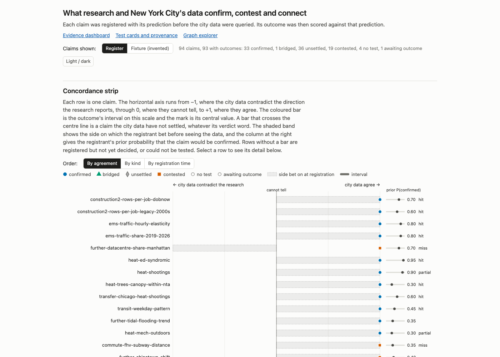

# NYC Concordance

**Team:** Hypergraph
**Members:** Ida Benedetto and Jeff Nickerson
**Challenge:** Build Challenge 4
**Pitch slides:** the slide source for the talk is in `deck2/` in this folder (the earlier, longer deck is in `deck/`); a hosted link will be added before the deadline

## What it does

NYC Concordance treats each link between two variables in the System Public Graph as a running meta-analysis and adds a registered test on New York City's open data to it. The tests show which findings the city data confirm, which they contest, and which they connect. It is for city analysts, researchers and funders who want to know which research findings hold in New York, which do not, and what research is missing. Each of the 94 hypotheses was written down and committed before it was scored, and 93 have outcomes. For 87 of the 93 a referee agent that did not see the registrant's reasoning re-estimated the deciding number. Two claims were not blind tests, and the Limitations section says which. Twelve claims have a replication package.

## How we used the System Public Graph

We read the graph before looking at any city data. For each question we searched concepts (`/v1/concepts`). Concept search matches whole words only, so we also searched study variables by name, which often found more matches. For each pair of concepts we read the relationship's findings (associations): the statistic, its interval, the study and its PubMed id. `concord/sysgraph.py` is the client and caches every response; `tools/graph_evidence.py` prints the evidence for a pair of concepts. We also loaded the Dataverse deposit of the graph (v2.1) to describe the graph as a dataset (`docs/graph.md`).

A finding counted as evidence only if the direction of its effect could be read for the two concepts as the graph names them, and every finding a claim relied on was checked against its PubMed abstract. Many records differed from their abstracts. Of 62 records on heat, medicines and chronic conditions, 14 were wrong and 12 had lost a qualifier that changes the reading (`docs/heat_drugs.md`). Of 114 records on city interventions, 6 were wrong and 19 had lost a qualifier (`docs/all_boats.md`). Examples are a reference group stored as the exposure and "81% reduced odds" stored as an odds ratio of 0.81. We excluded those records and list them in the outcomes. We also excluded findings that the abstract did not support, findings whose variables were negations grounded to the positive concept, and relationships that pool opposite measurements under one concept.

We combined the graph's findings with city data in three ways, which match the challenge's three kinds of relationship. A confirmation predicts that a finding holds in New York. A conflict predicts that it does not, and says what would settle the disagreement. A bridge chains two or more findings into a prediction that no single dataset contains, such as heat to shootings to ambulance demand, and is checked against city data that were not used to build it. We multiplied the graph's effect sizes along each chain to estimate in advance whether a city test could detect the predicted effect. `docs/what_the_graph_adds.md` gives seven uses of the graph, each with its result.

The city side came from NYC Open Data and data.ny.gov (with each table's `rowsUpdatedAt` and the exact SoQL recorded for every query), NOAA weather stations, the city's Environment and Health Data Portal, TLC trip records, Census files and NAIP aerial images. The full list is under Data sources.

## How to run it

The folder runs without a System API key. A key is needed only to send new queries to the graph.

1. Create an environment and install the requirements (Python 3.12; the list was produced by `uv pip freeze`):
   ```
   uv venv --python 3.12 .venv
   uv pip install --python .venv/bin/python -r requirements.txt
   ```
   or `python3.12 -m venv .venv && .venv/bin/pip install -r requirements.txt`.
2. To send new queries to the graph, create a file called `.env` in this folder containing
   ```
   SYSTEM_API_KEY=your-key-here
   ```
   `concord/sysgraph.py` reads it. Cached responses are not included, so analyses that read the graph send new queries.
3. Check that no registration was edited after it was committed:
   ```
   .venv/bin/python -m concord.claims check
   .venv/bin/python -m concord.claims list
   ```
4. Open the dashboard and the other pages. The pages read files from `../figures` and `../docs`, so serve this folder, not `viz/` alone:
   ```
   .venv/bin/python -m http.server 8000
   ```
   Open http://localhost:8000/viz/hypergraph.html first. It shows the 69 links, their findings and the city tests. `viz/comics.html` shows seven changes to an edge as strips of frames, among them five rival conjectures for heat and shootings with a registered test that narrows them (`docs/conjectures.md`); the drawing rules are in `docs/comics.md`. The other pages are `viz/heat_drugs.html` (heat, medicines and chronic conditions), `viz/index.html` (claims dashboard), `viz/evidence.html` (test cards, review changes and provenance), `viz/levers.html` (city levers), `viz/explorer.html` (graph explorer), `viz/explore.html` (neighbourhood explorer) and `viz/simulate.html` (toll simulator). Every page has the same navigation bar. The dashboard and the explorer load D3 from cdnjs.cloudflare.com.
5. Re-run one claim from pinned inputs. Each of the twelve packages in `replication/` reruns the deciding number of one claim and prints MATCH, DRIFT or MISMATCH:
   ```
   cd replication/heat-shootings
   PYTHON=../../.venv/bin/python ./run.sh
   ```
   `./run.sh --refetch` also compares the pinned inputs with the live sources. Each package has its own, shorter `requirements.txt`.
6. Fetch the city data. The repository's 3 GB cache of query results is not included. `download_data.py` re-runs the recorded queries:
   ```
   .venv/bin/python download_data.py --list
   .venv/bin/python download_data.py --claim heat-shootings
   ```
   The analysis scripts are in `analyses/<topic>/` and run as modules from this folder. After the command above, `.venv/bin/python -m analyses.heat.shootings` runs from the fetched data without a key. Other scripts need intermediate files in `data/derived/` that earlier scripts in the same topic write. Some also query the graph and so need a key.

## Data sources

- System Public Graph, API v1.0 (queried 12 and 13 November 2026; the API returns no version identifier; the challenge names the July 1, 2026 release), and the Harvard Dataverse deposit v2.1, doi:10.7910/DVN/7V6JDO, released 22 July 2026. CC BY-NC 4.0.
- NYC Open Data (data.cityofnewyork.us): 51 tables, including NYPD shooting incidents (833y-fsy8, 5ucz-vwe8), EMS incident dispatch (76xm-jjuj), motor vehicle collisions, DOB permits and job filings, certificates of occupancy, 311 service requests, street trees, PLUTO, restaurant inspections (43nn-pn8j) and hyperlocal temperatures (qdq3-9eqn). Each outcome in `claims/outcomes/` records the dataset id, `rowsUpdatedAt` at fetch time, the SoQL and the fetch time. NYC Open Data Terms of Use.
- New York State Open Data (data.ny.gov, health.data.ny.gov): MTA subway ridership and stations, MTA congestion-zone speeds, SPARCS prevention quality indicators, retail food stores, liquor licences. NY Open Data terms of use.
- NOAA GHCN-Daily, NCEI, doi:10.7289/V5D21VHZ, stations Central Park, LaGuardia and JFK, with each file's Last-Modified header; NOAA CO-OPS tide gauge 8518750 (The Battery). US Government works, public domain.
- NYC Environment and Health Data Portal, github.com/nychealth/EHDP-data at commit 547482b9df589006543e13e8cdf6546e00ed9998. Terms as published by the NYC Health Department.
- NYC TLC trip record files (yellow, green, FHV and high-volume FHV parquet files), cited by URL, ETag and Last-Modified. NYC Open Data Terms of Use.
- US Census Bureau: ACS 5-year table-based summary files (2022, 2023), 2020 PL 94-171, 2020 Gazetteer, LEHD LODES8 2021. Public domain.
- USDA NAIP 2022 aerial images through the Microsoft Planetary Computer STAC API. Public domain.
- NYU Furman Center CoreData neighbourhood indicators (file dated 5 May 2026). Furman Center terms of use.
- NYISO load data, Gold Book and Power Trends 2026; US EPA AQS pre-generated files; US DOT national transportation noise map 2020.
- OpenStreetMap, via the Overpass API. ODbL 1.0.
- Open data from Chicago (data.cityofchicago.org and the Chicago Health Atlas), Los Angeles, Phoenix, Tucson, Dallas, Austin and Philadelphia, for tests outside New York. Each city's open data terms.
- Internet Archive copies of the restaurant inspection table, and Underlay collection nyc/restaurant-inspections v1.0.0 (`docs/underlay_drift.md`).
- Two collections we published on the Underlay (`docs/underlay_publish.md`):
  - [system-community/nyc-concordance-claims](https://www.underlay.org/system-community/nyc-concordance-claims) v1.0.0: 94 claims, 93 outcomes and 88 revisions (ARK `https://underlay.org/ark:12345/ulcb4ksbc7h2v96n.v1.0.0`).
  - [system-community/nyc-restaurant-inspections-2026-11](https://www.underlay.org/system-community/nyc-restaurant-inspections-2026-11) v1.0.0: the city's inspection table as of 12 November 2026, with 2,388 restaurants it has since removed (ARK `https://underlay.org/ark:12345/ulcb4v9t8nfrhs62.v1.0.0`). City open data; no licence restriction.

The complete list for each claim is in `claims/outcomes/<id>.json` under `sources`, and `python download_data.py --list` prints it.

## Limitations

The method is to register each prediction before reading the data that test it, and the record shows that we did not always do this. `docs/lineage_audit.md` checked every data fetch against the registration time. In 46 of the 84 claims with a recorded fetch time, some city data were fetched before registration. In 33 of the 46 the early fetches were exposure data, design or pre-period reads, or metadata, which do not decide the verdict. In two claims, afford-gentrification-prevalence and heat-extremes-downturn, the outcome data were read before registration; both registrations say so, and neither verdict can be presented as a blind test. For afford-poor-count-shift the record cannot settle whether the outcome was seen. In ten claims the outcome data were already in a shared cache from an earlier claim, and in four of these the earlier result partly revealed the deciding number. Most analysis scripts were first committed together with their outcome, so for those claims only the registration text and file times, not git history, show whether the plan came before the data.

Placebo tests turned some confirmations into unsettled results. Two claims that were first scored confirmed (rlc-expansion-rearend and ems-taxi-2026-onset) became unsettled under rule 11 when the registered placebo year met the support condition by itself. The two turn-calming confirmations would also be unsettled had their placebo been registered, and the docs say they should not be counted as agreement with the research. Referee review changed 11 of 93 scored verdicts: eight moved toward unsettled, one moved from unsettled to contested, and two changed label (to bridged and to no test). Six outcomes have no referee report. Each topic write-up in `docs/` has a section of corrections after review.

Many results are unsettled. Of 94 registered claims, 33 are confirmed, 19 contested, 36 unsettled, 4 had no possible test, 1 bridge is reported as bridged, and 1 (construction-2022-rush-units-2027) waits for 2027 data. Unsettled means the registered conditions for support and refutation were both unmet. Several confirmations are narrower than their titles. For example, the vacant-lot screen counts lots that pass a filter (1,116 by the registrant's count and 1,087 by the referee's), and a check of 40 of them against aerial images found that 28 were not vacant blighted land. These counts are as of 13 November. Three more claims were registered and scored on 14 November (moon-full-emergencies, heat-inside-outside and heat-inside-outside-2006; `docs/conjectures.md`), which makes 97 registered and 96 scored.

The graph itself limits what can be tested. It is mainly clinical, and congestion pricing, building permits, electricity demand and for-hire vehicle pricing have no findings in it. In the two largest audits, 26 of 62 and 25 of 114 records checked against abstracts were wrong or incomplete, and only the records a claim relied on were checked. The API carries no version identifier, so a cached response is the only record of what it returned. The city rewrites its tables in place, so a re-fetched table can differ from the one used (`docs/underlay_drift.md`); only the twelve replication packages hold pinned copies of their inputs, and 81 scored claims have none.

## AI coding tools

Yes. The work was done with Claude Code agents (Anthropic's Claude) under Jeff's direction. Agents wrote the analysis code, registered and scored the claims, and drafted the write-ups and pages. Separate blind referee agents, which had the registration, the outcome, the code and the data but not the registrant's reasoning, rebuilt the deciding number of 87 of the 93 outcomes with their own code and wrote the reports in `critique/`; the answers are in `critique/ANSWERS.md`. The decisions on what to test, which corrections to accept and what to present were Jeff's.

## Screenshot



The screenshot is the claims dashboard (`viz/index.html`); the page to open first is `viz/hypergraph.html`. The dashboard plots each claim, with its interval, by its stance: how far the city evidence agrees with the direction the research found. Each claim opens to its registration, outcome, sources and referee report.

## What is in this folder

- `claims/registered/` and `claims/outcomes/`: the 94 registrations and their outcomes. `critique/`: the referee reports and answers.
- `concord/`: clients for the graph, NYC Open Data and NOAA, and the claim register. `tools/`: page builders and the replication packager. `analyses/`: the analysis scripts by topic. `sim/`: the policy simulator's model.
- `viz/`: the pages and their data. `figures/`: the figures the documents and pages use. `docs/`: the report (`REPORT.md`), `what_the_graph_adds.md`, the audits and the topic write-ups.
- `replication/`: twelve packages that each rerun one claim from pinned inputs (`docs/replication.md` lists them).
- `deck/`: the source of the presentation slides.
- `download_data.py`: re-runs the recorded city data queries. `LICENSE`: which files are under which licence.

This folder is a selection from the project repository, built by `tools/build_submission.py`.
