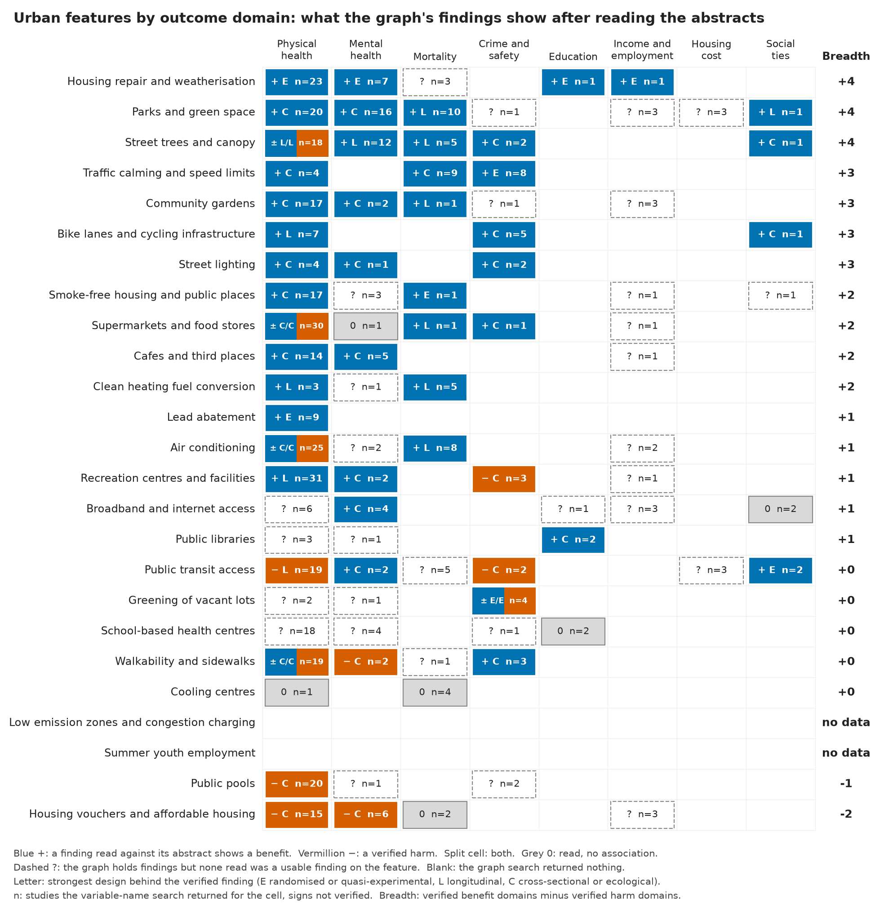

# Urban features that improve many outcomes at once: what the graph holds

This note was written on 13 November 2026. The question was which features of a city improve many outcomes at once and for everyone. No single paper answers it, because a paper studies one feature and a few outcomes. The System Public Graph (a database of findings extracted from published research, called the graph below) can be asked the question in another form: for one feature, list every outcome that research links to it, with the sign of each link. This note reports that list for 25 features, a check of the findings against their abstracts, and one registered test on New York data. A registered test is a prediction whose conditions for support and refutation were committed to the repository before the outcome data were read.

The registered test is unsettled, and after a referee's review of 13 November 2026 (`critique/all-boats-trees-rent.md`) its reading is narrower than the first version of this note gave. These data cannot say whether street trees raised rents. The measure of trees is only partly a measure of planting, the size of the association changes several-fold with the form of the model, and under several adjustments it cannot be told from zero.

## Method

The graph has no usable concepts for most urban features, so each feature was searched by the names of study variables (for example "tree canopy", "air conditioner", "speed hump"). For each of 25 features the variables with the shortest matching names, 30 to 60 per feature, were retrieved with their associations: 1,448 associations in all, from 873 requests to the graph. A keyword rule placed the other variable of each association in one of eight outcome domains, and 793 associations fell in a domain. The graph does not record which variable is the exposure or whether a name is negated, so the signs it returns cannot be used unread. I therefore read 114 findings against their PubMed abstracts, at least one for most cells that held any finding, and coded for each whether the record was correct, whether the feature was the exposure of a human outcome, the study design, and the direction the abstract reports. The breadth score of a feature is the number of domains with a verified benefit minus the number with a verified harm. The numbers in this section and the next two are descriptive. They were not registered.

## What the records were worth

Of the 114 records checked, 89 were correct, 19 had lost a qualifier that changes the reading (a subgroup, one of two towns, a non-significant estimate chosen over the main one) and 6 were wrong in value, sign, exposure or reference group. The share wrong or incomplete is 22% (25 of 114), which is within the range found elsewhere in this project. A further 16 records (14%) were correct but did not describe an effect of the feature: the feature was the outcome (people with low literacy less often have internet access), or the record compared populations (residents of public housing with other residents). The keyword rule for signs was wrong more often than the records were. It classed a trial of lead hazard control as a harm, and it classed 21 of 24 swimming pool associations as harms because most concern drowning or chlorination. Of the 98 usable findings, 12 came from randomised or quasi-experimental studies, 21 from cohorts and 65 from cross-sectional, case-control or ecological studies.

## The matrix

The figure has 200 cells, and the search returned nothing for 110 of them. Of the 90 with findings, 46 hold a verified benefit (5 of these also hold a verified harm), 7 hold only a verified harm, 6 hold a finding of no association, and in 31 no finding read was usable.

| Feature | Breadth | Verified benefit (strongest design) | Verified harm |
|---|---|---|---|
| Housing repair and insulation | +4 | wheeze and self-rated health, mental health, school days, work days (all experimental) | none found |
| Parks and green space | +4 | health, mental health (cross-sectional), cancer mortality, children's prosocial behaviour (cohort) | none verified; three studies of higher house prices not read |
| Street trees and canopy | +4 | distress, cardiometabolic disease, mortality (cohort); shootings, loneliness (cross-sectional) | asthma and pollen sensitisation in a New York birth cohort |
| Traffic calming, bike lanes, street lighting, community gardens | +3 each | injuries (experimental for speed humps), activity, and one or two other domains | none verified |
| Smoke-free rules, supermarkets, cafes and third places, clean heating fuel | +2 each | heart attack deaths after a state law (experimental); the rest cohort or cross-sectional | obesity near supermarkets (cross-sectional) |
| Air conditioning | +1 | death in heat waves (cohort and case-control), heat illness | asthma and office respiratory symptoms |
| Recreation centres, lead abatement, broadband, libraries | +1 each | activity; blood lead above 15 (trials); student stress; reading to infants | assault and injury near recreation sites (case-control) |
| Transit access, vacant lot greening, walkability | 0 | loneliness (free bus passes, quasi-experimental); gun violence (randomised trial) | pedestrian collisions at bus stops; domestic crime near remediated lots (difference in differences) |
| Cooling centres, school health centres | 0 | none | none; heat alerts showed no lower mortality |
| Public pools, housing vouchers | −1, −2 | none | bladder cancer; depression and obesity among assisted households |
| Summer youth employment, low emission zones | no data | no variable matched | |

Housing repair is the only feature the graph supports as broad on experimental evidence. One cluster randomised trial of insulation in New Zealand reports less wheezing, better self-rated health, fewer days off school and fewer days off work, and a controlled study in Glasgow reports better mental health. Street trees and green space are broad on observational evidence: the tree findings for distress, cardiometabolic disease and mortality come from cohorts, and none from an experiment. Traffic calming is narrow and well supported, with two quasi-experimental studies of speed humps. Air conditioning is narrow and strong where it applies: a working unit had an odds ratio of 0.2 for death in the 1999 Chicago heat wave, and a cohort of 72,740 people had 42% lower hot-weather mortality with central air conditioning and no benefit from room units. Cafes and third places rest on two cross-sectional studies, one of senior centres in rural Korea and one of Japanese adolescents; the graph has no finding on coffee shops and any outcome in the eight domains except diet.

The negative scores for public pools and housing vouchers are artefacts and should not be read as harms. The pool findings concern private pools and chlorination. Households that receive housing assistance are selected for need, and the two randomised voucher studies read found no overall effect on child mortality or drinking.

The empty cells show where research is missing from the graph. Education has a verified finding for 2 of 25 features and income or employment for 1. Housing cost has none: a search from the feature side returned no finding that links any of the 25 features to rents, prices or displacement. A search from the price side found six studies in which house prices rise with park access, green infrastructure or transit, none in PubMed and none read. The harm most often claimed for urban greening is therefore nearly absent from the graph, as are summer youth employment and low emission zones.

## A test on New York: street trees and rent

The street tree censuses of 2005 and 2015 give the change in living street trees for each census tract (the 2025 census is not on NYC Open Data). The city gained about 77,000 counted trees, and the gain was larger in poorer tracts: 55 trees per tract in the lowest third of 2008-12 rent against 10 in the highest. The claim `all-boats-trees-rent` asked whether rents rose faster where more trees were added. A Portland study (Donovan and others 2021) found a tract's median sale price 131 dollars higher six years after each tree planted, which implies about 0.044 log points of rent per 100 trees (0.018 to 0.070). Before the rent changes were related to trees, a simulation on the real design gave a standard error of 0.0049, so the test could separate that prediction from zero (discrimination D of 13 to 80, where 4 is required). The registration was pushed alone to `prereg/all-boats-trees-rent` (commit f960e5d).

The registered result is unsettled. On the registered model, across 2,048 tracts the change in log median gross rent from 2008-12 to 2018-22 rose by 0.0127 per 100 added trees (95% interval 0.0018 to 0.0235), with baseline trees, rent, white share, density and borough held constant and errors clustered by neighbourhood. The interval is neither wholly above 0.009 nor wholly below 0.018, which were the registered conditions. These data cannot say whether street trees raised rents. Three findings of the referee, who rebuilt the tree counts and the rents with separate code and reproduced the registered estimate, lead to that reading.

First, the measure is only partly planting. The net change in living trees mixes new planting, the loss of existing trees and differences between the two censuses. Across the tracts it correlates 0.31 with the number of trees of 3 inches or less in diameter in 2015, which must have been planted after 2005, and -0.35 with the 2005 count. In Queens and Staten Island, which hold 37% of the tracts, the correlation with young trees is 0.29 and 0.10, so the measure there mostly records losses or census differences. In the 2005 file 8,840 trees have a longitude of zero and fall in no tract, which is 12% of the counted gain. The change in trees of 12 inches or more, which cannot be planting, carries at least as much of the association (0.020, 0.002 to 0.039) as the change in smaller trees (0.010, -0.003 to 0.023).

Second, the size is not stable. Over forms of the model that can each be defended, the slope per 100 trees ranges from 0.007 (-0.004 to 0.018), when baseline rent is corrected for its sampling error, to 0.033 (0.013 to 0.053), when tracts that changed by 200 trees or more are left out, and the intervals reach 0.057. Forty-seven large tracts with changes of 300 trees or more, twenty of them on Staten Island, pull the registered slope down; without them it is 0.0245 (0.0096 to 0.0395). Per square km the slope corresponds to 0.045 per 100 trees in a tract of median area, which is the Portland figure. The first version of this note said that the estimate was 29% of the Portland figure. That holds for the registered form only, and the comparison with Portland is not robust. The Portland figure itself rests on an assumed median price of 300,000 dollars, concerns sale prices of houses and not rents, and counts trees planted and not a net change. All these variants were chosen after the data and decide no verdict.

Third, the lower limit is not robust. The interval includes zero without baseline rent as a covariate (0.0084, −0.0027 to 0.0196), with population change added because new buildings must plant street trees (0.0085, −0.0022 to 0.0193), with fixed effects for 60 districts (0.0095, −0.0005 to 0.0196) and with the correction for error in baseline rent. No borough taken alone has an interval that excludes zero, and the Bronx, where the count of trees rose 40%, shows no association (−0.001, −0.014 to 0.013). Whether trees went where rents were already rising could not be tested, because the project holds no rent before 2008-12. Within thirds of baseline rent the slopes are 0.003 (−0.025 to 0.032), 0.006 (−0.010 to 0.022) and 0.010 (−0.002 to 0.022), so the data do not show a larger rent association in poorer tracts.

No outcome could be tested for improvement. Health indicators do not exist by tract over this period. For violent crime the prediction from the literature was about 1% fewer crimes per 100 young trees, and the simulated standard error was 0.7%, so D was 2.3 and the measure was declared in advance unable to decide anything. Its exploratory slope has the opposite sign: murders, robberies and felony assaults in 2016-18, given the 2006-08 count, were 6.2% higher per 100 added trees (3.2 to 9.2), and 5.0% within neighbourhoods. Violent crime fell 8% in the lowest-rent third and 19% in the highest, and trees went to the poorer tracts, so this slope most likely reflects where trees were planted. It is not evidence that trees raise crime, and it gives no support to a benefit.

## Distribution

Few findings report whether a benefit differs by income. Two that do both find a larger benefit in poorer places. The association of tree cover with depressive symptoms was larger in formerly redlined neighbourhoods (odds ratios 0.63 to 0.72 against 0.91 to 0.93 overall). A simulation of raising tree cover to 40% gave the largest reductions in shootings in deprived neighbourhoods. The insulation trial was run in low-income communities. For air conditioning the distribution concerns access: in a New York survey low-income respondents had three times the odds of having no air conditioner. In New York the net gain in counted trees was larger in poorer tracts. The referee found that this reflects where few trees stood in 2005 and where trees were lost more than where young trees were planted, and the rent association there was not larger.

## Limits

The search took the shortest variable names, 30 to 60 per feature of up to 362 matching, so an empty cell means the search found nothing and not that no study exists. One coder read the abstracts, mostly one or two per cell, and read abstracts only. Domains with a verified benefit count equally whether the evidence is one cross-sectional survey or a trial; the design letter in the figure carries that difference. The rent test compares two censuses taken by different methods, its measure of trees is a net change and not a count of plantings, and rent-stabilised housing damps rent change where street trees are dense. A new registration could use trees of 3 inches or less per square km as the measure and 2000 census rent to test for a prior trend.

The code is in `analyses/all_boats/`, the data in `data/derived/all_boats/` (the coding of each finding read is in `verification.csv`), and the figure in `figures/all_boats/`.
