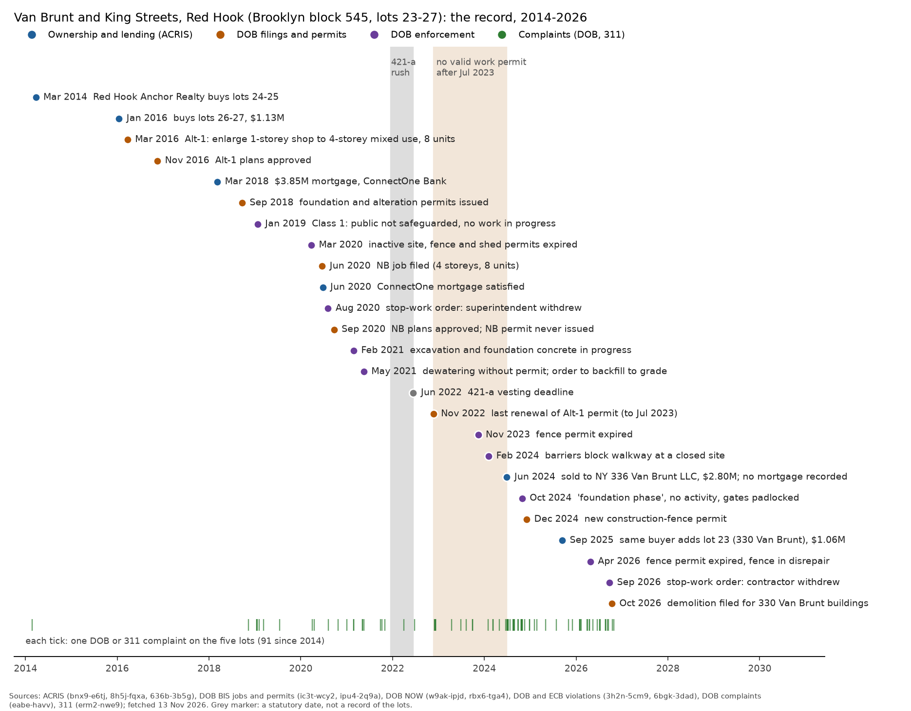

# A stalled foundation at Van Brunt and King Streets, Red Hook

At the north corner of Van Brunt Street and King Street in Red Hook, Brooklyn, a fenced site holds a foundation, a sign promising a mixed-use building and city notices of coming work. This note assembles every city record for the site and reconstructs its history. It is a description of one case. It is exploratory and reports no registered test.

All city data were fetched on 13 November 2026 by `analyses/stalled/lot_334_records.py`. The records and the dataset versions are in `data/derived/stalled/lot_334/` (`records.json`, `sources.json`, `ecb_by_bin.json`).

## Which lots these are

The address 334 Van Brunt Street is tax lot 25 of Brooklyn block 545 (BBL 3005450025). It is one of five adjoining lots that form the corner and now have one owner, NY 336 Van Brunt LLC, in PLUTO 26v2 (64uk-42ks):

| Lot | Address | Area (sq ft) | PLUTO class |
|---|---|---|---|
| 23 | 330 Van Brunt St | 2,295 | O8, two-storey building |
| 24 | 332 Van Brunt St | 1,544 | V1, vacant |
| 25 | 334 Van Brunt St | 1,509 | V1, vacant |
| 26 | 336 Van Brunt St | 1,548 | V1, vacant |
| 27 | 142 King St | 2,105 | V1, vacant |

Lots 24 to 27 (6,706 sq ft) are the construction site. The DOB jobs are filed under 336 Van Brunt Street (lot 26, BIN 3008477). Lot 23 was bought in 2025 and has demolition filings from October 2026. All five lots are zoned R5 with a C1-3 commercial overlay, and all five are flagged in both the 2007 flood insurance rate map and the 2015 preliminary map (PLUTO `firm07_flag`, `pfirm15_flag`). No zoning change for the block was checked.

## The record, in order of date

### Assembly, 1996-2016

In the 1990s lots 24 to 27 were a vacant lot and a one-storey commercial building, owned by the Markoglu family through Van Brundt Realty Corp. DOB and ECB violations from 1991 to 2009 record the vacant part used for parking and storing trucks without a certificate of occupancy.

Red Hook Anchor Realty LLC bought lots 24 and 25 on 24 March 2014, with a $425,000 mortgage from a group of private lenders (ACRIS bnx9-e6tj, 636b-3b5g). It bought lots 26 and 27 on 15 January 2016 for $1,133,275 from Van Brunt Street Realty Corp, which had bought them for $1,100,000 in November 2014. A zoning lot description covering lots 24 to 27 was recorded in September 2016.

### An enlargement, then a new building, 2016-2021

On 23 March 2016 the owner filed an Alteration Type 1 job (ic3t-wcy2, job 321357232) to extend the existing one-storey commercial building into a four-storey mixed-use building with eight dwelling units. The plans were approved on 16 November 2016. Sprinkler, fire-alarm and sidewalk filings followed in 2016 and 2017.

On 8 March 2018 the owner took a $3,850,000 mortgage from ConnectOne Bank. Foundation, earthwork, alteration and fence permits were issued on 21 September 2018 (ipu4-2q9a). In January 2019 an inspector recorded a site at the demolition phase with no work in progress and the public not safeguarded (ECB Class 1, $10,000 penalty). In March 2020 an inspector found an inactive site with expired fence and shed permits.

On 19 June 2020 a new-building (NB) job was filed for the same site (job 340737741, four storeys, eight units). Its plans were approved on 22 September 2020. No NB permit was ever issued. On 24 June 2020 the ConnectOne mortgage was satisfied, and no later mortgage on these lots appears in ACRIS. On 5 August 2020 the Borough Commissioner stopped all work under the alteration permit because the construction superintendent had withdrawn; the order was rescinded on 16 December 2020.

In February 2021 inspectors saw excavation, concrete forming and support-of-excavation work in progress. In May 2021 they found a dewatering pump discharging into the drainage system without permits, and work not matching the approved excavation-support plans. On 18 May 2021 DOB ordered work stopped and the excavation backfilled to grade under supervision, because dewatering was needed and no design for it had been filed. That violation was dismissed in August 2022.

### The stall, 2022-2024

The last renewals of the alteration and foundation permits ran to January 2022, and the alteration permit was renewed for the last time on 22 November 2022, to 21 July 2023. The 421-a vesting deadline of 15 June 2022 falls in this period. The fence permit expired in August 2023. From November 2023 to August 2024 inspectors recorded expired permits, jersey barriers blocking the sidewalk at "a closed construction site", fence panels missing, and an "abandoned site" that the public could enter. Eight ECB penalties issued between November 2023 and October 2024, $52,875 in all, are recorded as unpaid (6bgk-3dad, `balance_due`).

### Sale and a second attempt, 2024-2026

On 28 June 2024 Red Hook Anchor Realty sold lots 24 to 27 to NY 336 Van Brunt LLC for $2,800,000. No mortgage was recorded with the sale. In October 2024 an inspector described "a 4 story building at foundation phase" with no activity and padlocked gates. A new construction-fence permit was issued in DOB NOW on 3 December 2024 (B01087560), on a filing that again lists eight units. On 12 September 2025 the same buyer bought lot 23 (330 Van Brunt Street) for $1,060,000. In April 2026 the fence permit had expired and the fence was in disrepair. On 23 September 2026 the Borough Commissioner stopped work under the fence permit because the contractor had withdrawn. On 12 October 2026 full-demolition jobs were filed for the two-storey building and the rear structure on lot 23 (B01453569, B01453578).

The DOB and 311 complaint records hold 91 complaints on the five lots since 2014, most of them after 2023: sidewalk condition, construction, dumping and snow. No certificate of occupancy exists for any of the lots (bs8b-p36w, pkdm-hqz6). The site does not appear in the DOB Stalled Construction Sites list (i296-73x5) under any of its five BINs. That list, which is driven by complaints, holds 787 complaints from March 2009 to December 2024.

## Why it stalled: an inference from the record

The records support four causes, in this order of weight. Each is an inference.

1. Financing. The only construction-scale loan, $3.85 million from ConnectOne Bank in March 2018, was satisfied in June 2020, two years after the foundation permits and before most foundation work was done. No replacement loan was recorded. Work after 2020 was intermittent: a superintendent withdrew in 2020 and a contractor withdrew in 2026. The 2024 sale also has no recorded mortgage. A project that loses its construction lender and does not replace it stops at the stage it has reached, which here was the foundation.
2. Ground water. The site is in the 1% floodplain, a few blocks from the Red Hook shore. In 2021 the excavation needed dewatering, the contractor pumped without a permit or a design, and DOB ordered the hole backfilled. A foundation that needs a dewatering design and a discharge permit costs more and takes longer than the approved plans assumed.
3. The route through the permit system. The project was filed in 2016 as an enlargement of an existing one-storey building, not as a new building. The existing building appears to have been demolished under that alteration (a 1992 violation was dismissed in 2025 as "demolished under permit"). A new-building job was then filed in 2020 and approved, but never permitted, so the foundation work of 2021 was done under the alteration permit. Because of this the site does not appear in counts of new-building permits or of NB foundation starts, including the cohorts in `docs/stalled.md`.
4. The 421-a deadline. The NB filing in June 2020 and the foundation work of 2021 fall before the 421-a vesting deadline of 15 June 2022, and activity stopped after 2022. That timing fits an attempt to vest. Whether the owner applied to HPD for 421-a is not in the data used here, so this cause is the least supported.

Ownership change is a consequence rather than a cause. The 2014-2016 owner sold at $2.8 million eight to ten years after assembling them; the only recorded purchase price is $1,133,275 for lots 26 and 27, and the 2014 deed for lots 24 and 25 records no amount. The new owner is enlarging the site with lot 23, which suggests a different, larger building than the eight-unit plan.

## What would settle the open points

- HPD's record of 421-a applications for block 545, which would show whether the 2021 foundation work was meant to vest the project.
- The DOB BIS inspection history for job 321357232, which records what was poured.
- A dated aerial photograph from 2023 or later (the city's 2024 orthophotos) to show the state of the excavation.
- The plans on the new owner's filings, to see what building is now proposed for lots 23 to 27.

## Files

- Script: `analyses/stalled/lot_334_records.py`; figure script `analyses/stalled/figures.py`.
- Records: `data/derived/stalled/lot_334/records.json`, `sources.json`, `ecb_by_bin.json`.
- Figure: `figures/stalled/lot_334_timeline.png`.
