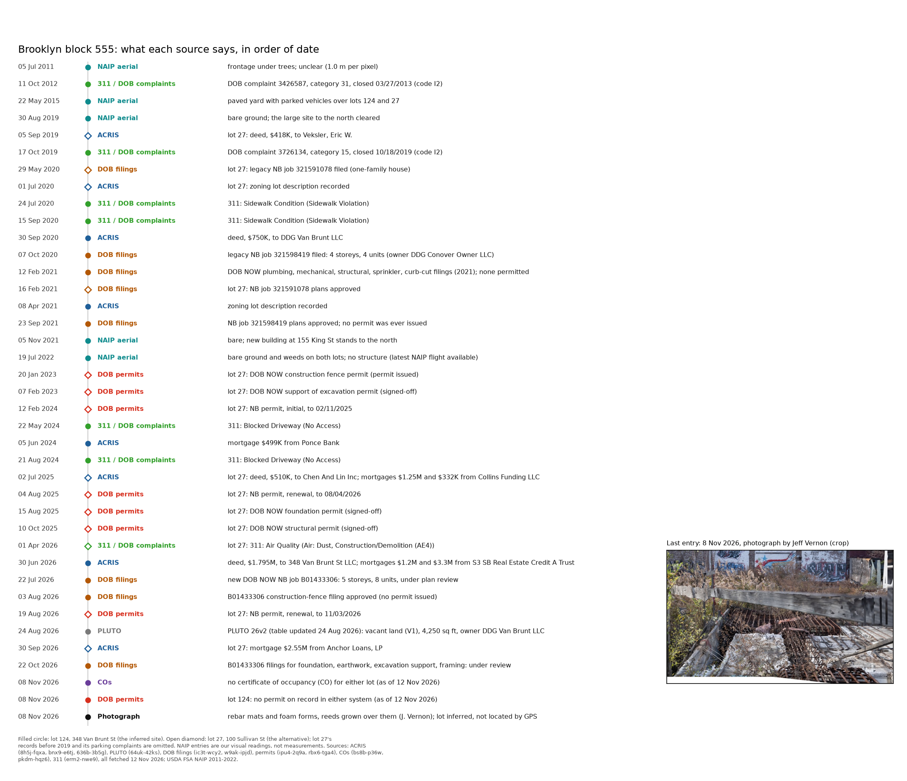
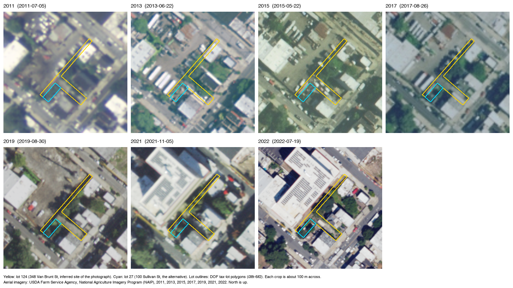

# One lot in Red Hook: what the records say and what the photograph shows

On 8 November 2026 Jeff Vernon photographed a vacant lot in Red Hook, Brooklyn. The photograph shows rusted rebar mats and foam forms, with reeds grown up through them, in front of a brick wall. It was posted on Instagram on 12 November (https://www.instagram.com/p/Dfp3jfQIKsQ/). This note traces the lot through every city record we hold, in order of date, and compares the records with the aerial photographs and the photograph. The presentation opens with this lot as an example of records that differ from what can be seen.

All city data were fetched on 12 November 2026. The script is `analyses/construction2/red_hook_records.py`, and the records and their dataset versions are in `data/derived/construction2/red_hook/`. This note describes one case and reports no registered test.

## Which lot this is

The identification is an inference. The photograph has no GPS position. The post's notes place it at 348 Van Brunt Street (block 555, lot 124) because Jeff recognised the neighbouring buildings at 344 and 346 Van Brunt Street. The alternative is 100 Sullivan Street (lot 27 of the same block).

The tax-lot outlines (DOF, i38t-6if2) show that the two lots touch. Lot 124 has a frontage on Van Brunt Street about 7.4 m (24 ft) wide between numbers 346 and 350. A strip about 3 m wide runs from it along the rear of 342 to 346 Van Brunt Street and around the north side of lot 27. A photograph taken from the edge of one lot could therefore show part of the other.

The records do not settle the choice, and one of them favours lot 27. The photograph shows foundation materials. The only foundation permit on the two lots is for lot 27, issued on 15 August 2025 and since signed off. Lot 124 has never had a permit. Either the photograph shows lot 27, or the materials on lot 124 were brought there without a permit on record. The reeds grown through the rebar suggest that the materials have lain untouched for at least one growing season; this is also an inference. A visit with a camera that records its position, or a photograph that shows a house number, would settle the identification.

## The record, in order of date

The aerial readings below are visual judgements made for this note of the USDA NAIP photographs at 0.5 to 1.0 m per pixel. They are inferences, not measurements. NAIP flights over the block exist for 2011, 2013, 2015, 2017, 2019, 2021 and 2022. No later flight is available from the Planetary Computer catalogue, so no aerial photograph covers 2023 to 2026.

From 2011 to 2017 the frontage of lot 124 and all of lot 27 lay inside a larger paved yard. In the 2015 photograph vehicles are parked over both lots. In ACRIS (8h5j-fqxa) lot 124 has no document before 2020. Its first document is a deed of 30 September 2020, for $750,000, from King Street Owner, L.L.C. to DDG Van Brunt LLC. The lot number above 100 and the absence of earlier documents suggest that lot 124 was cut from a larger lot around 2020. The tax-map history was not checked, so this too is an inference.

In the 2019 photograph the large site to the north, 155 King Street, has been cleared. By November 2021 a large new building stands there, and PLUTO records its year built as 2020. Lot 124 is bare in both photographs.

In October 2020 an architect filed a new-building (NB) job for 348 Van Brunt Street in the legacy DOB system (ic3t-wcy2, job 321598419). It proposed four storeys and four dwelling units. The owner on the filing is DDG Conover Owner, LLC, not the DDG Van Brunt LLC named in ACRIS. A zoning lot description was recorded in ACRIS in April 2021. Between January and October 2021, six DOB NOW filings were made for plumbing, mechanical, structural, sprinkler and curb-cut work. Four were approved and two received objections. The NB plans were approved on 23 September 2021. No permit was issued, then or later, in either the legacy permit table (ipu4-2q9a) or DOB NOW (rbx6-tga4).

The July 2022 aerial photograph shows bare ground and weeds on lot 124 and on lot 27, with no structure on either. In June 2024 DDG Van Brunt LLC took a $499,000 mortgage from Ponce Bank. In May and August 2024 two 311 complaints of a blocked driveway were made at 348 Van Brunt Street, and the police issued summonses for both. The complaints suggest that someone used the lot for access or parking in 2024; this is an inference.

On 30 June 2026 DDG Van Brunt LLC sold the lot for $1,795,000 to 348 Van Brunt St LLC. On the same day the buyer took two mortgages, of $1.2 million and $3.3 million, from S3 SB Real Estate Credit A Trust. On 22 July 2026 a new NB job was filed in DOB NOW (B01433306) for a five-storey building with eight dwelling units. The deed and mortgages were recorded on 27 July. A subsequent filing for a construction fence was approved on 3 August. Filings for support of excavation, foundation and earthwork, and structural framing were made on 22 October and were under plan review on 12 November. No permit had been issued by that date.

PLUTO version 26v2 (64uk-42ks, table updated 24 August 2026) lists lot 124 as vacant land (building class V1) of 4,250 sq ft, owned by DDG Van Brunt LLC. It does not yet show the June sale. No certificate of occupancy exists for either lot (bs8b-p36w, pkdm-hqz6).

The alternative lot has a fuller record. NB job 321591078 for a one-family house on lot 27 was filed in May 2020 and approved in February 2021. DOB NOW permits followed for a construction fence (January 2023), support of excavation (February 2023, renewed twice), foundation (August 2025) and structural work (October 2025). The NB permit itself was issued on 12 February 2024 and renewed twice, most recently to 3 November 2026. In April 2026 three 311 complaints, two of them marked as duplicates, reported construction dust at 100 Sullivan Street. On 30 September 2026 the owner took a $2.55 million mortgage from Anchor Loans, LP.

Jeff's photograph of 8 November 2026 is the last entry. It shows rebar mats and foam forms lying on the ground, overgrown, and no sign of current work.

## Where the sources disagree

1. Money without a permit. Lot 124 carries $4.5 million in construction lending from June 2026 and a $499,000 mortgage from 2024, but it has never had a building permit. Lending usually precedes a permit, so this is not a contradiction in itself. It does mean that a count of construction loans and a count of permits describe different stages of the same project.
2. Approval without a permit. The 2020 NB job had its plans approved in September 2021 and never received a permit. The building it described, of four storeys and four units, was not built. Its records do not say that it was abandoned. A second NB job for a different building, of five storeys and eight units, was filed in 2026.
3. Different numbers of units. The 2020 job proposes four units. Its second document, a legacy filing of November 2020 for foundation and excavation-support work, and three of the 2021 DOB NOW filings describe a building of four storeys and five units. The 2026 job proposes eight units.
4. Different owners. ACRIS names DDG Van Brunt LLC as owner from 2020 to 2026. The DOB filings for the same years name DDG Conover Owner, LLC, BHLD LLC and Redhoek Construction LLC. PLUTO, two months after the 2026 sale, still names the seller.
5. A broken key. Some rows of the legacy filing table carry the BBL 3000000 instead of 3005550124. A search by BBL misses them. The lot has no house number in PLUTO or ACRIS, so a search by address depends on the house number that DOB uses.
6. Recorded and seen foundation work. The only recorded foundation work on the two lots is the signed-off foundation permit for lot 27. The photograph shows foundation materials that have not been used, on a lot we identified as lot 124. If the identification is right, the materials are there without any permit. If it is wrong, the unused materials lie on lot 27, whose foundation permit DOB has signed off. This conclusion depends on the identification, which is an inference.

## What the System graph says about vacant land

The graph's findings on vacant land come from studies of older industrial cities, mostly Philadelphia (`data/derived/neighbourhood/graph_vacant.json`). One study found more assaults in block groups with more vacant properties (incident rate ratio 1.18, 95% interval 1.12 to 1.25; PMID 23814668). Another found lower odds of adolescent homicide near maintained vacant lots (odds ratio 0.17; PMID 26954939). One finding uses the variable "percent vacant land for 36 months or longer" (PMID 36716893). Our claim `nbhd-vacant-shootings` found the same direction in New York City: an adjusted rate ratio of 1.17 (1.12 to 1.22) for shootings per quintile of vacant-land share across census tracts (`docs/neighbourhood.md`).

This lot's tract, Brooklyn census tract 53.01, is in the top quintile. Vacant land makes up 6.5 percent of its lot area (80 of 594 lots), all of it privately owned. The tract had one shooting from 2019 to 2024 among 2,352 residents.

The lot fits two of the graph's categories. By land use (PLUTO code 11) and by the aerial photographs, it has been vacant since at least 2019, so it would count as vacant for 36 months or longer. By the DOB and ACRIS records, it has been planned for construction since 2020, with approved plans, a new filing and $4.5 million in loans. The graph's measures, and our tract analysis, cannot tell a lot held for construction from a lot left vacant. The registration of `nbhd-vacant-shootings` named this as an alternative explanation, and this lot is an example of it.

## What would settle the open points

- A visit to the block with a camera that records position, to fix which lot the photograph shows.
- A later aerial photograph: the city's 2024 orthophotos (0.15 m per pixel) or a NAIP flight after 2022, to see when the rebar and forms arrived.
- The DOB NOW permit decision on job B01433306, and the DOB inspection records for the lot 27 foundation sign-off.
- The DOF tax-map history of block 555, to confirm when lot 124 was created.

## Files

- Records and sources: `data/derived/construction2/red_hook/records.json`, `sources.json`, `timeline.csv`, `aerial_meta.json`, `aerial_<year>.png`.
- Scripts: `analyses/construction2/red_hook_records.py`, `red_hook_aerial.py` (uses the aerial-imagery skill, `diagrams/dtk/aerial.py`), `red_hook_timeline.py`.
- Figures: `figures/construction2/red_hook_timeline.png`, `red_hook_aerial_grid.png`, and the photograph `red_hook_slide01.jpg` (1440 x 1123, sRGB, copied unchanged from the Instagram post folder).

Aerial imagery: USDA Farm Service Agency, National Agriculture Imagery Program (NAIP), 2011, 2013, 2015, 2017, 2019, 2021 and 2022. Photograph: Jeff Vernon, 8 November 2026.
