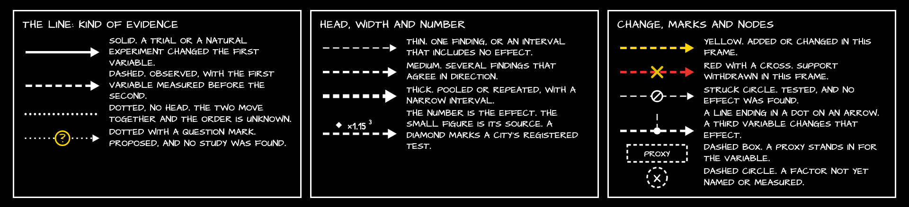
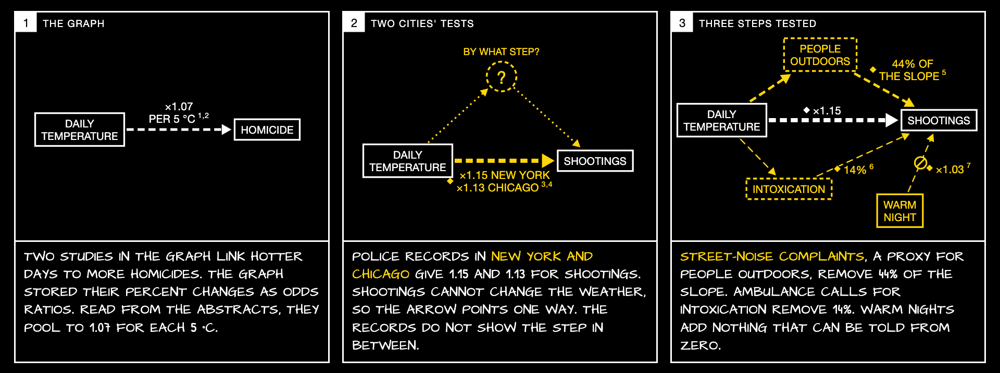
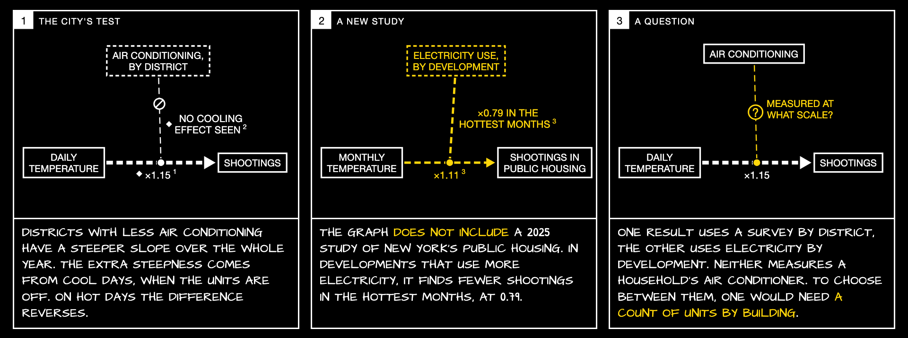
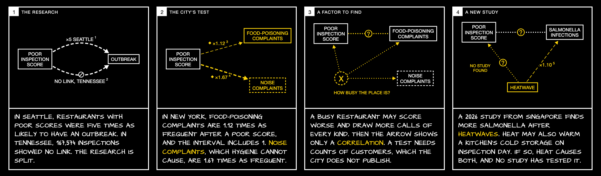
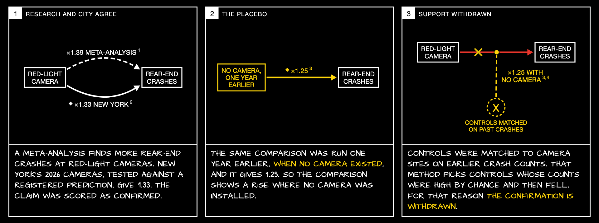
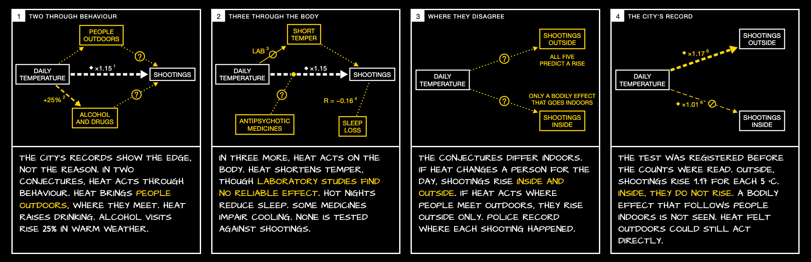
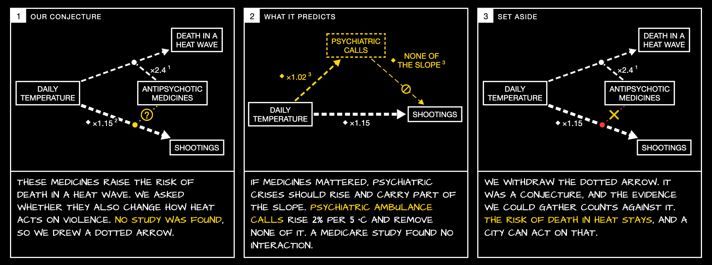
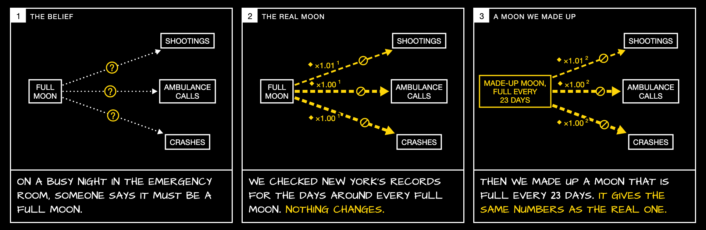
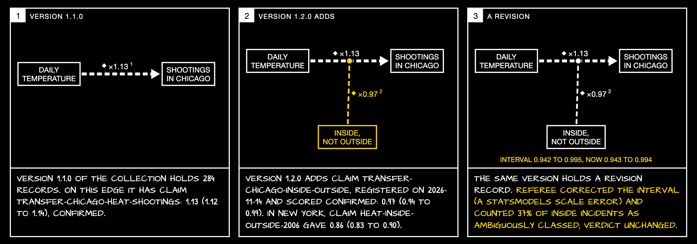

# Strips: showing how an edge changes

A graph of findings is never finished. A new study arrives, a city publishes a new table, a referee withdraws a confirmation, or a replication project removes support from many findings at once. A picture of the graph at one time does not show any of this. The page `viz/comics.html` shows a change as a strip of frames, in the manner of a comic. Each frame is a small diagram of a few variables and the edges between them, with a caption of one to three sentences lettered in capitals underneath.

The idea is Jeff Vernon's (14 November 2026). This note fixes the drawing rules, describes the four strips built so far, and says how strips could be produced from versions of the graph.

## The grammar of arrows

An edge has five properties that a reader needs, and each is drawn with one visual channel. No channel carries two meanings.

| Property | Channel | Values |
| --- | --- | --- |
| Kind of evidence | Line style | Solid: a trial or natural experiment changed the first variable. Dashed: observed, with the first variable measured before the second. Dotted with no head: the two move together and the order is unknown. Dotted with a question mark: proposed, and no study was found. |
| Direction of influence | Arrow head | One head, two heads, or none. |
| Certainty | Line width | Thin: one finding, or an interval that includes no effect. Medium: several findings that agree in direction. Thick: pooled or repeated, with a narrow interval. |
| Size of effect | Number on the line | A ratio is written with a multiplication sign (×1.15). A share is written as a percent. The unit is in the source list when it does not fit. |
| Source | Small figure after the number | An index into the numbered list under the strip. Each entry is a paper with its DOI or PubMed identifier, or a registered claim with its test card and dataset versions. A diamond before the number marks a city's registered test. |

Three further marks say what happened to an edge:

- The figures are white on black. Yellow means the edge or node was added or changed in this frame. White means it was carried over. Red with a yellow cross means its support was withdrawn in this frame. Figures are lettered in Helvetica and captions by hand.
- A struck circle on a line means the edge was tested and no effect was found.
- A question mark in a circle means the edge is open: either no study exists or the studies disagree.

Nodes have three forms. A box is a measured variable. A dashed box is a proxy that stands in for a variable (311 street-noise complaints for people outdoors). A dashed circle holding X or a question mark is a factor not yet named or measured.

A line that starts at a node and ends in a dot on another arrow means that the node changes that arrow's effect. This is how a modifier is drawn, and it is the reason the project is called Hypergraph: the edge is itself the object that something else acts on.

Width shows certainty and not effect size, because the two are often confused. A large ratio from seventeen deaths (Kaiser 2001, 14.0 with an interval of 1.8 to 633) should be drawn thin.

## Kinds of frame

Each frame has a heading that names its kind. The strips so far use six.

1. The graph or the research: what was known before.
2. A city's test: a registered test on open data is added to the edge.
3. A new study: a paper that is not yet in the graph.
4. A placebo or a control: a test of the test.
5. A factor to find: the frame adds X and proposes what it is.
6. A question: the frame ends on the measurement that would decide.

A strip can end in three ways. The evidence agrees and the edge becomes thicker. The evidence conflicts and the frame shows both edges with a question mark. Or support is withdrawn and the edge turns grey. The third is the case that a large replication project would produce many times at once.

## The seven hand-drawn strips

All numbers come from registered claims in this repository or from abstracts read in PubMed. Each strip's source list is on the page.

**Heat and shootings.** The graph's edge from temperature to homicide pools to 1.07 per 5 °C. New York and Chicago give 1.15 and 1.13 for shootings. Three steps between heat and shootings were tested: people outdoors (removes 44% of the slope, confirmed), intoxication (14%, unsettled) and warm nights (1.03, unsettled). The strip had a fourth frame, a conjecture about medicines, until 14 November; that conjecture now has its own strip below.

**Air conditioning.** The city's registered test by community district did not show a cooling effect. Roberts et al. 2025 (J Urban Health, PMID 40106209), which is not in the graph, finds fewer shootings in the hottest months in public-housing developments that use more electricity (0.79, 0.63 to 0.98). The two results use different units and different proxies, and the strip ends on that question. The abstract does not state the unit of the 0.79.

**Inspection scores and food poisoning.** Research is split between Seattle (five times) and Tennessee (no association). New York's test gives 1.12 with an interval that includes 1, and the placebo, noise complaints, gives 1.67. The third frame replaces the arrow with a correlation and adds X, how busy the restaurant is. The fourth adds Aik et al. 2026 (Singapore, salmonellosis 1.10 after heatwaves; PMID 41483715, not in the graph) and proposes heat as a second common cause. No study linking temperature to inspection violations was found, so that edge is drawn as a conjecture.

**Red-light cameras and a placebo.** A registered test gave 1.33 for rear-end crashes, in line with a meta-analysis. The same design run a year earlier, with no cameras, gave 1.25. The last frame withdraws the edge and names the cause: controls matched on earlier crash counts.

**One edge, five conjectures.** A strip can hold several rival conjectures at once. Two run through behaviour (people outdoors, alcohol and drugs) and three through the body (short temper, sleep loss, medicines that impair cooling). The third frame draws a measurement on which some of them disagree, shootings inside against outside. The fourth gives the registered result: 1.17 per 5 °C outside and 1.01 inside. The result rules out a bodily effect that follows people indoors and leaves a direct effect of heat felt outdoors open. The reasoning is in `docs/conjectures.md`.

**A conjecture we set aside.** We had proposed that medicines which impair cooling might explain part of the rise in shootings with heat. The second frame shows what the conjecture predicts and what the city's record gives: psychiatric ambulance calls rise 1.02 per 5 °C and carry none of the slope. The third frame withdraws the dotted arrow in red and keeps the edge to death in a heat wave. The conjecture was never a registered claim; it is withdrawn as a line of work.

**The full moon and a moon we made up.** Three frames with short captions, made to open the talk. The first draws the belief as dotted arrows. The second gives New York's record for the days around every full moon: no change in shootings, ambulance calls or crashes. The third replaces the moon with one we made up, full every 23 days, which gives the same numbers. The made-up moon is the claim's registered placebo. An earlier version had a frame on what the graph holds and one on an unexplained dip the referee found; both were removed because they distracted from the comparison.

## Colour and lettering variants

The style above was chosen on 14 November from three variants (`figures/comics/variants/`). The earlier style is still available: `comics.html?theme=light` draws black on cream with red for additions and grey for withdrawals, `theme=light,blue` uses blue for additions, and `theme=hand` letters the figures by hand.

## Strips generated from the Underlay

`tools/strip_from_diff.py` draws a strip from the difference between two versions of an Underlay collection. It calls `GET /api/collections/system-community/nyc-concordance-claims/versions/<to>/diff?from=<from>`, which needs no key, and writes `viz/data/comics_generated.js`. Frame 1 is the edge as the earlier version holds it. Frame 2 is what the later version adds, in yellow, or withdraws, in red. Frame 3 is a revision record from the same difference, with the interval before and after and the referee's reason. Captions are filled from templates and are not edited.

Two differences have been drawn. Version 1.0.0 to 1.1.0 (nine records added on 14 November) gives a strip for the full moon and one for shootings inside and outside in New York. Version 1.1.0 to 1.2.0 (three records) gives the Chicago replication, and its second frame quotes New York's number from the earlier version.

The numbers, verdicts, dates and reasons are read from the records. The names of the two variables are not, because the collection has no field that says which variable is the exposure. They are typed in `viz/data/strip_nodes.json`. With an exposure field the strip would need nothing typed by hand.

## From versions to frames

The strips were drawn by hand from `viz/data/comics.js`, in which each frame lists its nodes and edges and marks each as new, kept or gone. Those marks are a difference between two states of the same edges. If the graph and the claims are published as versions, as the two Underlay collections now are, the difference between two versions gives the same marks: findings added, findings removed, verdicts changed. A strip is then a rendering of a version history, and the caption is the only part a person or a model has to write.

Three things are needed that the System graph does not yet store. The first is which variable is the exposure, without which no head can be drawn. The second is study design for every study (it is recorded for 20 of 615), without which the line style is unknown. The third is a record of withdrawal, so that an edge can turn grey. These are the same three requests the deck makes for other reasons.

## Writing rules

Captions follow `skills/clear-writing/comics.md`. A caption says what the diagram cannot show: what changed and why. It has at most 33 words. It is written in ordinary case and lettered in capitals by the page. The script is in `notes/comic_script.txt`, and the editor's version with reasons is in `notes/comic_script_edited.txt`.

## Files

- `viz/comics.html`: the page and the drawing code.
- `viz/data/comics.js`: the grammar legend and the strips.
- `tools/export_comics_figures.py`: writes `figures/comics/*.png` (sRGB, 1920 px wide).
- `notes/comic_sources.md`: the search for recent studies outside the graph.
