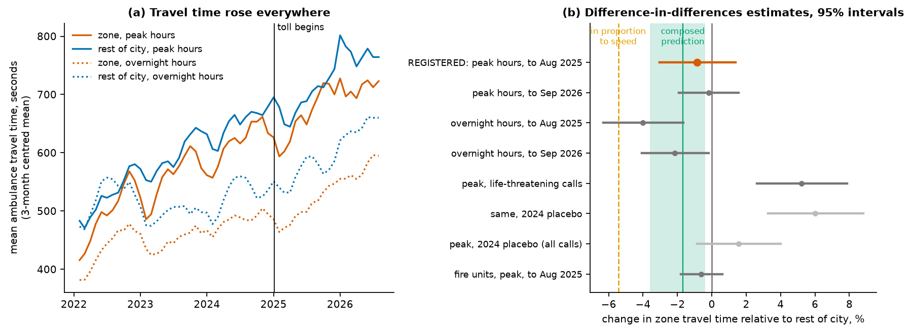
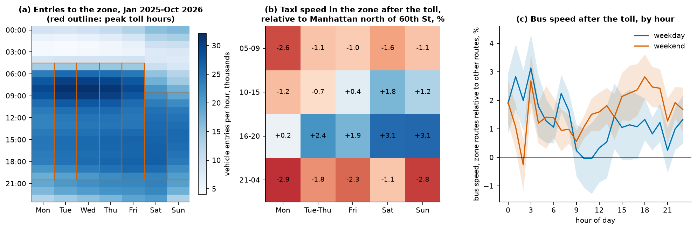

# Tradeoffs of the congestion toll: business, ambulances and timing

Since 00:00 on 5 January 2025, vehicles entering Manhattan south of 60th Street (the Congestion Relief Zone, called the zone below) pay a toll. A car pays $9 once a day in peak hours (05:00 to 21:00 on weekdays, 09:00 to 21:00 at weekends) and $2.25 overnight, and taxi and app-dispatched trips pay $0.75 and $1.50. The start planned for 30 June 2024 was paused on 5 June 2024 and the lower toll was announced on 14 November 2024 (MTA toll schedule and Governor's press releases). This note asks four questions of open data. Did business in the zone fall? Did ambulances get faster, and what would that be worth in lives? Where in the week does the toll change traffic most? Could it matter for shootings on hot nights?

Two results are registered claims: predictions with conditions for support and refutation, pushed to their own git branches before the outcome data were read. The other numbers are exploratory and are labelled as such. A placebo below means the same comparison run with a false start in January 2024, before the toll. `data/derived/congestion/parameters.json` lists every estimate with its interval and source.

Both registered results were reviewed by a referee on 13 November 2026 (`critique/crz-storefront-vacancy.md`, `critique/bridge-crz-ems-travel.md`, answered in `critique/answers_round6_crz.md`), and this note was corrected. The vacancy claim stays confirmed, and it covers less than its first wording said. A rise of 1.2 points relative to the whole rest of the city is ruled out, and smaller rises are not. The ambulance claim is now unsettled. Its test could not tell the predicted small improvement from no effect, the data do not show that ambulances got faster, and the number of lives has no determined sign.

## What the graph supplies

The System Public Graph (a database of findings extracted from published research, called the graph) has no record for congestion pricing, cordon pricing or low emission zones, and no finding that links a toll or traffic speed to retail trade, restaurants or ambulance travel time. It does have findings on what slower ambulances cost. A search of study variable names for response time and time to defibrillation returned 91 findings from 60 studies with a survival outcome. I read the PubMed abstracts of seven. Five give the odds of survival after cardiac arrest per minute of shorter response: 1.02, 1.08, 1.12, 1.22 and 1.24. Three of the seven graph records differ from their abstracts; one stores "odds improved by 24% (4% to 48%)" as an odds ratio of 0.24 (0.04 to 0.48).

## 1. Retail and restaurant business

The registered claim `crz-storefront-vacancy` predicted that storefront vacancy in the zone would not rise relative to the rest of the city, and it is confirmed on that comparison only. Vacancy in the zone itself rose by 0.2 points; it rose more elsewhere. Local Law 157 requires owners to report each storefront as vacant or not on 31 December. Of the zone's 15,083 registered storefronts, 12.33% were vacant at the end of 2024, and of 15,442 at the end of 2025, 12.50% were vacant. Outside the zone vacancy rose from 7.50% to 8.15%. The change in the zone minus the change outside is −0.47 percentage points (−1.08 to +0.17; bootstrap over 8,190 zone and 25,640 outside properties). The registered conditions were an estimate of at most +0.5 and an upper bound below +1.2, and both are met. The test was designed to detect a rise of 1.2 points, about 180 storefronts or a tenth of the zone's vacancies, and cannot detect a smaller one. The figure of 1.2 is the resolution of the test, chosen from the design run before the 2025 values were seen. It does not come from the retail literature, and the two papers cited in the registration, on London and Stockholm, were cited from memory and have not been checked. The same difference was −0.45 in 2024, the one earlier year in which the registry was filed as it is now. The values for 2022 and 2023, −0.74 and −1.40, are not a usable trend: from reporting year 2023 the registry replaced one August filing with a June filing and a separate February filing of vacant storefronts, and with the February rows added the 2023 value is +1.14. Against Manhattan from 60th to 110th Street the difference is −0.23 (−1.33 to +0.88). Against downtown Brooklyn and Long Island City (2,100 storefronts) it is +1.09 (−0.60 to +2.85), which does not exclude a rise of 1.2 points. The registered interval counts the sampling of properties only. With the year-to-year movement of the difference added, the 2025 value is 0.39 points above the mean of 2022 to 2024 with an upper bound of +1.66, which does not exclude 1.2 either. Commercial leases commonly run five to ten years, so one filing cannot tell no effect from a delayed one, and sales and rents are not measured.

The remaining measures are exploratory and measure activity, not sales. The restaurant inspection data hold only restaurants that are open now, so I could not count closures. Among restaurants now open, the zone's share of the city's first inspections of new restaurants was 33% in 2023, 29% in 2024, 27% in 2025 and 30% in 2026. Subway entries at stations in the zone rose 14% on weekday evenings and 15% at weekends (January 2025 to October 2026 against 2023 and 2024). Relative to the rest of the city these rises are 0.9% (−1.5 to +3.4) and 2.7% (0.1 to 5.4), smaller than the 3.3% and 4.7% of the 2024 placebo. Yellow-taxi drop-offs in the zone on weekday evenings rose 4.2% (1.8 to 6.7) relative to Manhattan north of 60th Street, against 4.0% in the placebo. The state publishes taxable sales for New York City as one jurisdiction, so the zone's sales cannot be compared with other areas. None of these measures shows a fall in the zone relative to other areas (`figures/congestion/business.png`).

## 2. Ambulance response

I first computed whether a test could fail. The earlier claim `mob-crz-traffic` found zone taxi speeds 5.7% higher (3.0 to 8.6) relative to the rest of the city in January to August 2025. Before the toll, from October 2019 to December 2024, a 1% rise in the zone's relative taxi speed went with a 0.32% fall in its relative ambulance travel time (five regression specifications give 0.14 to 0.49). The project's bridge composer (`kit/bridge.py`), which multiplies such links by simulation, gives a predicted fall of 1.8% (0.4 to 3.6). The expected standard error of the city estimate, from placebo years, was 1.3%. The project requires a discrimination statistic D of at least 4, where D is the squared distance between the prediction and the alternative in standard errors. D is 1.8 against no effect and 8.3 against a fall of 5.4%, which is what a 5.7% rise in speed gives if travel time moves in proportion. The test cannot show whether travel time improved; it can show whether ambulances gained as much as taxis did, and I registered it on that condition alone. The referee pointed out that the project's rule for such tests (rule 8 of `concord.claims.PRECEDENCE`) measures D against no effect and gives the verdict unsettled when it is below 4, whatever alternative the registration names.

The registered claim `bridge-crz-ems-travel` predicted a change close to −1.8% and far from −5.4%. Its registered condition was met and it was first recorded as confirmed. The verdict is now unsettled: at the endpoint D against no effect is 0.14, and the referee's simulation shows that the registered rule would have returned confirmed with probability 0.80 if the toll had done nothing to ambulances. The outcome is mean travel time from dispatch to arrival, over EMS incidents with a valid response time (about 125,000 a year in the zone at peak hours). In peak hours from 5 January to 31 August 2025, against 2023 and 2024, zone travel time changed by −0.9% (−3.0 to +1.4) relative to all other ZIP codes, with a standard error of 1.1%. The estimate is 0.7 standard errors from the prediction and 4.2 from the proportional fall, so on the registered estimator ambulances did not gain in proportion to traffic speed. That exclusion does not survive a linear trend in the two years before the toll: the estimate is then −3.1% (−7.5 to +1.4), which is 1.0 standard error from the proportional fall. The registered interval is also too narrow. The same estimator started at 17 false dates in 2023 and 2024 gives values from −0.2% to +4.9%. The interval includes zero, and to September 2026 the estimate is −0.2% (−1.9 to +1.6). Three exploratory results argue against reading a small improvement into this estimate. Overnight, when the toll is a quarter as large, the zone's relative travel time fell more, by 4.0% (1.7 to 6.3), so peak hours did worse than the night by 3.3% (1.4 to 5.2). For life-threatening calls the zone's relative peak travel time rose by 5.2% (2.6 to 7.9), continuing a rise of 6.0% in the 2024 placebo. Fire units at peak hours show −0.6% (−1.8 to +0.6). Mean ambulance travel time in the zone at peak hours rose from 617 seconds in 2024 to 712 in January to September 2026 (15%), and from 647 to 772 in the rest of the city (19%). A hospital inside the zone, Mount Sinai Beth Israel, closed in 2025, which may have lengthened travel at all hours.

I did not run a test of deaths at the scene, because it could not fail. Of about 1,330 cardiac-arrest calls a year that an ambulance reached in the zone at peak hours, 43% end with the patient pronounced dead at the scene. The prediction is 6 seconds saved per call and a change of 0.04 points in that share, against a standard error of 1.5 points, so D is 0.002. The share rose from 42.7% to 47.3% in the zone and from 48.4% to 49.9% outside, a difference of 3.0 points (0.0 to 6.0). The same difference between pairs of earlier years has a standard deviation of 3.1 points, and I draw no conclusion from it.

The number of lives is a composition and is exploratory. The five graph findings have a median odds ratio for survival of 1.12 per minute of shorter response, and I used their range, 1.02 to 1.24, as the interval. Survival to discharge is not in the city's data and was drawn uniformly from 3% to 10%. With the predicted 1.8% fall in travel time the composition gives 0.7 lives a year (0.0 to 2.5) among cardiac arrests in the zone at peak hours. With the measured change it gives 0.3 (−0.7 to +2.0) to August 2025 and 0.1 (−0.9 to +1.2) to September 2026. These are not results, and they are not a range from 0.3 to 0.7. The answer depends on which measured change is used: the difference of peak and overnight hours gives −1.4 (−4.1 to −0.2), and total response time, which is what the survival studies measure, gives −0.3 (−4.6 to +2.9). The count of 1,330 calls includes the 43% pronounced dead at the scene, and odds ratios measured over minutes are applied to about 3 seconds. The toll's effect on survival is between about −1.5 and +2 lives a year, with the sign not determined.

## 3. Day of week and time (exploratory)

The MTA's entry counts begin with the toll, so they cannot give the fall in entries by hour. From January 2025 to October 2026 an average of 486,000 vehicles entered the zone each day, 76% of them in peak hours and 38% of them taxis or for-hire vehicles. Mondays have 8.1% fewer entries than Tuesday to Thursday and Fridays 2.0% more. Between 06:00 and 10:00 Monday and Friday are both about 7.5% below midweek, but after 19:00 Friday is 10.1% above it. The 14% deficit of Monday and Friday subway entries against midweek appears in vehicle entries on Mondays only.

Yellow-taxi speed on trips inside the zone, relative to trips inside Manhattan north of 60th Street, changed by +0.1% (−1.2 to +1.4) on weekdays from 08:00 to 18:00, by +2.0% (0.5 to 3.4) in weekend peak hours and by −2.2% (−3.6 to −0.8) overnight (January 2025 to June 2026 against July 2023 to December 2024). Bus speeds on routes that enter the zone, relative to other routes, rose 0.6% (−0.6 to +1.7) on weekdays from 10:00 to 16:00, 1.9% (1.3 to 2.6) in weekend peak hours and 1.1% to 1.3% overnight. Taxis gained most from 16:00 to 21:00 on Saturday and on Sunday (3.1% each) and least on Mondays (−2.9% to +0.2% across four blocks of the day). Per dollar of the $9 peak toll, a weekend afternoon gains about 0.3% in taxi speed and a weekday midday gains nothing measurable. Overnight the two measures disagree: buses gain about 0.5% per dollar of the $2.25 toll and taxis lose.

## 4. Hot nights (exploratory)

On the 103 summer nights (21:00 to 05:00, June to August, 2019 and 2021 to 2026) that followed a day of 32 °C or more, overnight ambulance travel time was 2.8% longer (0.4 to 5.3) in the zone and 4.1% longer (2.5 to 5.8) elsewhere than on the other 541 summer nights. Total response time, which includes the wait for a free unit, was 8.5% and 10.1% longer, so the wait grew more than the drive. Zone travel time between 21:00 and 05:00 averages 470 seconds, against 404 at the quietest hour and 626 between 10:00 and 19:00, so removing all of the night's congestion would save at most 14%. The zone receives 5% of the city's overnight gunshot calls, one every four summer nights, so a toll could not change gunshot survival on hot nights by an amount these data could show (`figures/congestion/hot_nights.png`).

## Limits

The area north of 60th Street carries traffic bound for the zone, may itself gain from the toll, and diverged from the zone in 2024 on several measures. Mean travel times are sensitive to long delays, and grouped queries do not return medians. The zone is defined by ZIP code, and the list includes Roosevelt Island (10044), which is outside the toll zone; excluding it changes the vacancy estimate by 0.01 points, and with the zone defined by ambulance dispatch areas, which exclude it, the ambulance estimate is −0.8% (−3.1 to +1.6). Ambulance travel time rose citywide by 7% to 8% a year from 2023, and the share of incidents without a valid response time, which the analysis drops, rose from 4.4% in 2023 to 9.5% in 2026. The exploratory intervals do not allow for the choice among several measures. Code is in `analyses/congestion/`, and the registrations are on branches `prereg/bridge-crz-ems-travel` and `prereg/crz-storefront-vacancy`.
