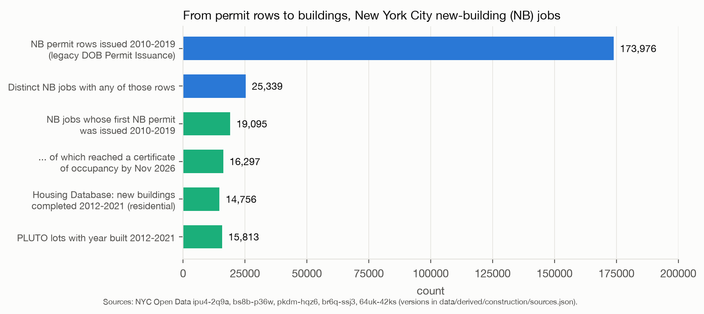
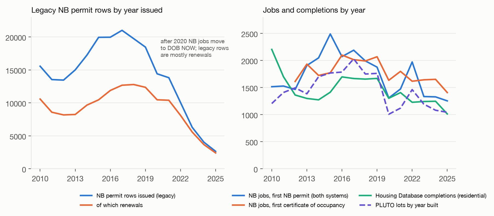
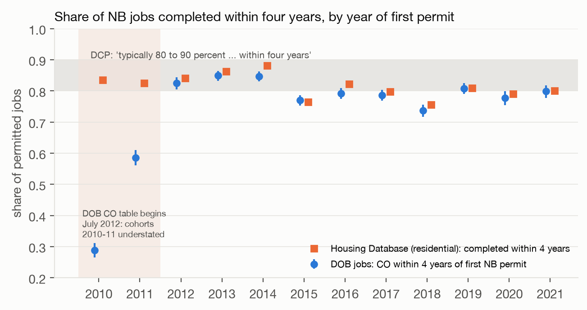
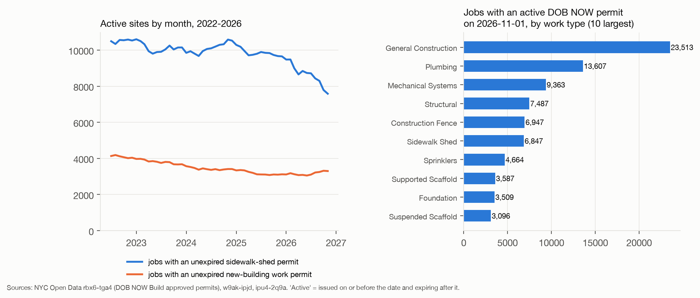
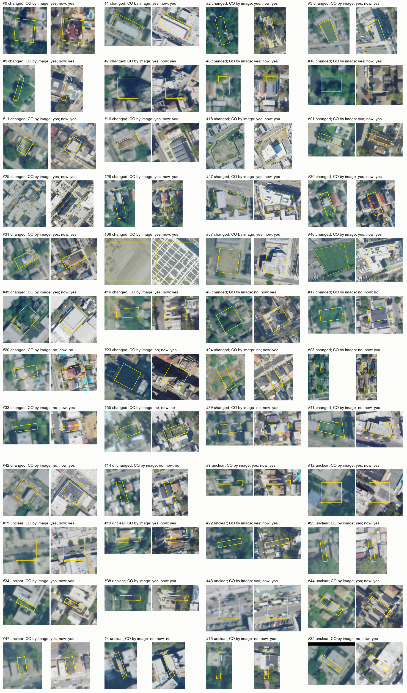

# Construction: what is written, what the permits say, and what was built

This note reports four registered claims about new construction in New York City. Each claim was registered and committed before any city data for it were queried (commits 0c48949, eb942af, 58226fd and 2a0a439). The outcomes are in `claims/outcomes/construction-*.json`, the scripts in `analyses/construction/`, the derived tables in `data/derived/construction/`, and the figures in `figures/construction/`. Dataset versions (Socrata `rowsUpdatedAt`, the exact SoQL and the fetch time) are in `data/derived/construction/sources.json`. All city data were fetched on 12 November 2026.

## The question

Construction appears to be everywhere in New York City, but the city's records of new buildings show fewer of them than the street suggests. Both observations can be correct if most visible construction is not new building, and if the counts that get quoted are permit rows rather than buildings. Claims 1 to 3 test these two explanations. Claim 4 tests the permit and certificate records against a third source, aerial photographs.

## What the research says

The System Public Graph holds very few findings on housing supply. A search of 13 terms (construction, vacant, permit, housing, building, zoning, demolition, renovation, scaffolding, completion, development and plurals) found no finding on permits, permit-to-completion ratios, lags or lapse. The concept "construction" (COEFxSZVXO) has three relationships in all. The graph treats buildings and land as exposures for health and crime, for example vacant lots and pedestrian injury. One association cited in the registrations, aFGrNWb1i5, is not in the Dataverse v2.1 CSV, and its abstract (Kvik et al., Prev Med 2022, PMID 36228876) shows that it was mis-extracted: the reported -0.068 is the change in emergency-department visits, and demolitions showed no significant change in crime. It played no part in any test here.

The published figures used here therefore come from three other sources. The Census Bureau states that construction starts on all but a very small percentage of units authorized by permit. The NYU Furman Center reports a median of about 1.9 years from new-building permit to certificate of occupancy for buildings permitted in 2009 to 2014. The Department of City Planning wrote in 2022 that "typically, 80 to 90 percent of permitted projects are completed within four years."

## Finding 1: permit rows outnumber completed new buildings about ten to one

Claim `construction-permit-funnel`, verdict confirmed.

The legacy DOB Permit Issuance table (ipu4-2q9a) has 572,035 rows with job type NB. They belong to 95,784 distinct jobs. A job gets a separate permit row for the building, the foundation, the plumbing and the equipment, and a new row at each renewal. Renewals are 309,782 rows, or 54 percent of the total.

For permits issued in 2010 to 2019, the 173,976 rows belong to 25,339 jobs, 6.87 rows per job. In those years 19,095 jobs received their first NB permit. By November 2026, 16,297 of them (85 percent) had a certificate of occupancy (CO). Over 2012 to 2021, the DCP Housing Database records 14,756 completed residential new buildings, and PLUTO has 15,813 lots with a year built in that range. The 173,976 rows are about 11 times the 16,297 jobs that reached a CO. The 19,095 permitted jobs are 17 percent more than those 16,297 completed jobs. (The 25,339 jobs with rows in 2010 to 2019 include jobs first permitted before 2010.)

In each year the rows far outnumber the jobs. NB jobs with a first permit ran between 1,300 and 2,500 a year, and first COs between 1,600 and 2,100. Since 2021, NB jobs are filed in DOB NOW (w9ak-ipjd), and the legacy rows after 2021 are mostly renewals of older jobs. A query of the legacy table alone after 2021 therefore undercounts new jobs and shows mostly old ones being renewed.

Two Brooklyn cases on block 555, looked at before the claims were registered, show how the records behave. Job 321591078, on lot 27 of the block, has three NB permit rows: the initial permit of 12 February 2024, a renewal of 4 August 2025 issued six months after the first permit expired, and a renewal of 19 August 2026 that expired on 3 November 2026. The job has no CO. The Red Hook lot at 348 Van Brunt Street (lot 124 of the same block, BBL 3005550124) has no rows in either the legacy table or the DOB NOW approved-permits table since 2022, which agrees with what DOB NOW showed earlier.

## Finding 2: about 81 percent of new-building jobs reach a CO within four years

Claim `construction-four-year-completion`, verdict confirmed, with a qualification.

For each NB job the analysis takes the date of its first NB permit and the date of its earliest CO, temporary or final, in either CO table (bs8b-p36w for the legacy system, pkdm-hqz6 for DOB NOW). For cohorts 2013 to 2017, 8,641 of 10,712 jobs (0.807, 95% interval 0.799 to 0.814) had a CO within four years. The median time to the first CO was 1.97 years, close to Furman's 1.9 years. Cohorts 2012 to 2021 lie between 0.74 and 0.85. The Housing Database, measured independently from its own permit and completion dates, gives 0.76 to 0.88 for residential cohorts 2010 to 2021. Both measures fall at or just below the DCP range of 0.80 to 0.90.

The registered statistic pooled cohorts 2010 to 2017 and gave 0.734 (0.727 to 0.741). That value falls between the registered thresholds for support (0.75) and refutation (0.65). The pooled value is low because the legacy CO table begins in July 2012. COs issued before then are missing, so cohorts 2010 and 2011 show 0.29 and 0.59. The Housing Database gives 0.84 and 0.83 for the same cohorts. The confirmation therefore rests on a cohort restriction chosen after the data were seen. The restriction has a documented reason, and the Housing Database, the second measure named in the plan, supports it.

Of jobs permitted 2012 to 2017, 91 to 93 percent have a CO by November 2026, so 7 to 9 percent have none after at least nine years. The Census Bureau reports that nearly all permitted units are started nationally. The two figures cannot be compared directly (units against jobs, starts against COs), and the question is listed as research needed.

Weighted by units, four-year completion is lower in years with a tax-exemption deadline. In the Housing Database, 0.67 of units permitted in 2015 were completed within four years, and 0.66 of units permitted in 2022 had been completed by July 2026. Both years saw a rush of permits before a 421-a tax-exemption deadline (DCP counted about 58,600 permitted homes in the first half of 2022). Jobs permitted in those years were larger: 29 proposed units per job in 2015 and 53 in 2022, against 7 to 23 in the other years of 2010 to 2021. A plausible reading, not tested here, is that large projects permitted to meet a deadline finish on time less often. Job counts do not show this, because each large project is one job.

## Finding 3: sheds outnumber new-building sites about two to one

Claim `construction-sheds-outnumber-nb`, verdict confirmed.

On 1 November 2026, 7,585 jobs held an unexpired sidewalk-shed permit (6,880 if signed-off permits are excluded). On the same date 3,301 jobs held an unexpired NB work permit, 2,712 in DOB NOW and 589 in the legacy system (3,180 excluding signed-off permits). The ratio is 2.3 (2.2 excluding signed-off permits). Only 10 percent of the lots with a shed also had an active NB job. From July 2022 to December 2025 the monthly counts ran from 9,650 to 10,600 shed jobs and 3,080 to 4,190 NB jobs; in 2026 shed jobs fell to 7,585. All four registered quantities fell inside their predicted ranges.

Sheds are only part of what a pedestrian sees. On the same date, 59,249 DOB NOW jobs held at least one active permit, and 2,712 of them were new buildings. Construction fences (6,947 jobs), supported scaffolds (3,587) and suspended scaffolds (3,096) are also visible from the street. Most of the construction visible from the street is alteration, facade repair and protection of the sidewalk, not new building. This would account for the city looking full of construction while 1,300 to 2,500 new-building jobs are permitted, and 1,600 to 2,100 receive a first CO, each year. No claim here measured what people see; that is listed as research needed.

Active shed permits fell from about 10,000 at the start of 2026 to 7,600 in November. This may be removal under the city's Get Sheds Down plan, or renewals not yet entered. The question is listed as research needed.

## Finding 4: aerial photographs show change on most permitted lots, but the sample could not test agreement

Claim `construction-aerial-triangulation`, verdict unsettled.

I drew 48 NB jobs at random (seed 20261112) from the jobs first permitted in 2018 to 2020. For each lot I cut the USDA NAIP aerial photographs of the New York flights of August to September 2017 (1.0 m per pixel) and July to October 2022 (0.6 m), with the lot outline from the DOF tax-lot polygons (i38t-6if2). The registration named PLUTO's geometry column, but that column is empty on Open Data. Four lots had no polygon and were drawn as a 24 m box at the permit's coordinates; three of these boxes fell on a street. I judged each pair as changed, unchanged or unclear on sheets that showed only an index number, and committed the judgements (commit 7755daf) before joining the CO status.

Of the 48 lots, 33 changed (0.69, Wilson 95% interval 0.55 to 0.80), one was unchanged and 14 were unclear, so 33 of the 34 judged pairs changed. Eleven lots had changed by 2022 without a CO by the image date; eight of these received a CO later. No lot with a CO was judged unchanged. Cohen's kappa between visible change and CO status was -0.07 (0.11 on the judged pairs only). Kappa is near zero because almost every readable lot changed. The sample therefore contains almost no unchanged lots, which are the cases where the two records could agree beyond chance. The registered support rule required a kappa above 0.2, so the claim is unsettled.

The aerial photographs also show buildings that have no CO. Five sampled jobs still had no CO in November 2026. Three of them (#17, #20 and #35) show a new building or a frame on the 2022 photograph, one is unclear and one is unchanged. These buildings were built or nearly built four years ago and have no certificate, so either they are occupied without one or they are unfinished. A visit to each site would settle which is the case.

A pixel measure, the mean absolute difference of standardised grey levels inside the lot, did not separate changed from other lots (AUC 0.45 against the visual judgement). The likely reason, not tested, is the 1.0 m resolution and blur of the 2017 New York flight. Only the visual judgement is reported as a measure.

Aerial imagery: USDA Farm Service Agency, National Agriculture Imagery Program (NAIP), 2017 and 2022.

## Verdicts

| Claim | Kind | Prior | Verdict | City result |
|---|---|---|---|---|
| construction-permit-funnel | confirmation | 0.75 | confirmed | 6.87 NB permit rows per job, 2010-2019 |
| construction-four-year-completion | confirmation | 0.35 | confirmed (qualified) | 0.807 (0.799-0.814) of 2013-2017 jobs with a CO within 4 years; DCP 0.80-0.90 |
| construction-sheds-outnumber-nb | confirmation | 0.60 | confirmed | 7,585 shed jobs against 3,301 NB jobs on 1 Nov 2026 |
| construction-aerial-triangulation | bridge | 0.45 | unsettled | 33 of 48 lots visibly changed; kappa not testable |

## Research needed

- Follow the 2022 421-a cohort by units to 2027 and to the extended 2031 deadline (Housing Database, DOB NOW CO). This is the main open question about whether permits in deadline years become buildings.
- Find out why 7 to 9 percent of NB jobs permitted in 2012 to 2017 have no CO after nine years: abandoned, built without a CO, refiled under another number, or merged.
- Repeat the aerial test on a sample stratified by CO status, using the city's own 0.15 m orthophotos or a later NAIP flight, with two independent raters.
- Survey residents on how much construction they see, and relate the answers to nearby sheds, scaffolds and fences.
- The System graph holds no finding on housing supply. Planning and urban-economics studies of permits, starts and completions would need to be added before the graph can speak to this topic.

## Sources

- NYC Open Data: DOB Permit Issuance (ipu4-2q9a), DOB Certificate of Occupancy (bs8b-p36w), DOB NOW: Certificate of Occupancy (pkdm-hqz6), DOB NOW: Build Job Application Filings (w9ak-ipjd), DOB NOW: Build Approved Permits (rbx6-tga4), Housing Database Project Level Files (br6q-ssj3), PLUTO (64uk-42ks), TAX_LOT_POLYGON (i38t-6if2). Versions in `data/derived/construction/sources.json`.
- USDA NAIP via the Microsoft Planetary Computer STAC (collection `naip`); the item ids are in `sources.json`.
- System Public Graph API v1.0 and the Dataverse v2.1 CSV (doi:10.7910/DVN/7V6JDO); search results in `data/derived/construction/graph_search.json`.
- U.S. Census Bureau, New Residential Construction methodology, https://www.census.gov/construction/nrc/.
- NYU Furman Center, 2019 data on New York City's housing stock, https://furmancenter.org/thestoop/entry/2019-data-on-new-york-citys-housing-stock.
- NYC Department of City Planning, New Housing Permits in the First Half of 2022, as quoted at https://atlanticyardsreport.blogspot.com/2022/11/dcp-expiration-of-421-tax-break-drove.html.
- NYC Department of Buildings, Get Sheds Down, https://www.nyc.gov/site/buildings/dob/get-sheds-down.page.
