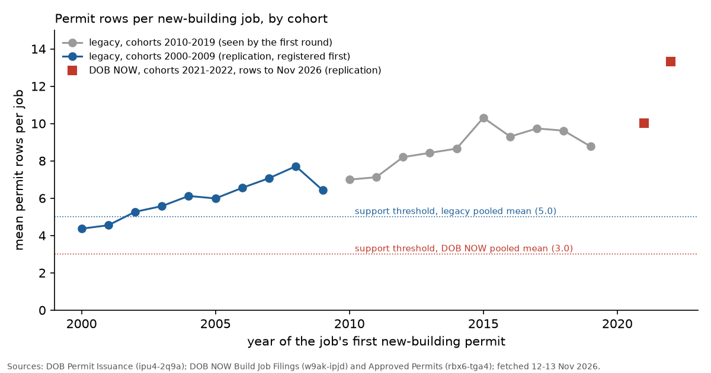

# Construction: out-of-sample replications

The first critique round (`critique/ANSWERS.md`) changed two construction claims from confirmed to unsettled. In both, the measure that decided the verdict was chosen after the data were seen. The two measures were the share of new-building (NB) jobs with a certificate of occupancy (CO) within four years, cohorts 2013-2017 (0.807), and the lifetime number of permit rows per NB job, cohorts 2010-2019 (7.0 to 10.3). This note asks whether either measure can be tested on data the first round did not look at.

The lifetime rows measure could be tested, and two replications were registered in commit 6159cf6 before any new value was computed. Both were confirmed. The four-year measure could not be tested, because every cohort with a complete four-year window had already been examined. No test was registered for it.

## What the first round had already seen

The first round's tables are in `data/derived/construction/`. For the four-year share, `cohort_completion.csv` gives the share for every cohort from 2010 to 2022, in both filing systems combined. The cohorts 2018 to 2021 are there (0.737, 0.808, 0.778 and 0.799), and `docs/construction.md` reports that cohorts 2012 to 2021 lie between 0.74 and 0.85. The Housing Database shares for residential cohorts 2010 to 2021 are in `funnel_summary.json`.

The DOB NOW cohorts suggested as an out-of-sample test do not help. DOB NOW holds no NB job with a first permit before 2021 (`funnel_by_year.csv`). Its 253 jobs first permitted in 2021 entered the 2021 cohort figure of 0.799. The 2022 cohort (0.777) has also been computed, and its four-year window is not yet complete. Earlier cohorts cannot be measured either. The legacy CO table (bs8b-p36w) starts in July 2012, and the Housing Database covers jobs filed or completed from 2010, so cohorts before 2010 lose their early completions. The first cohort with an unseen and complete window is 2023, whose window ends in 2027. A prospective registration for the 2023 cohort is listed under research needed.

For rows per job, the first round computed lifetime rows by cohort for legacy cohorts 2010 to 2026, rows per job within each calendar year 2010 to 2019, and an all-time figure of 5.97 rows per job over 95,784 jobs. It did not compute any value for a single cohort before 2010. From the published aggregates one can derive that the roughly 72,900 jobs first permitted before 2010 average about 5.1 rows each. I derived that figure before registering and stated it in the registration. The first round counted DOB NOW jobs holding active permits on given dates (`analyses/construction/sheds.py`). It did not count permit rows per DOB NOW job.

## Replication 1: legacy cohorts 2000-2009

Claim `construction2-rows-per-job-legacy-2000s`, verdict confirmed.

The test used the DOB Permit Issuance table (ipu4-2q9a), job type NB, all permit types and filing statuses, as fetched on 12 November 2026. A job's cohort is the year of its first NB permit, or of its first permit of any type if it has no NB permit. This is the first round's definition. The registered rule was support if the pooled mean is at least 5.0 rows per job and every cohort mean is at least 4.0, and refutation if the pooled mean is below 3.0 or three or more cohorts fall below 3.0.

The 49,959 jobs first permitted in 2000 to 2009 have 294,033 rows, a mean of 5.89 rows per job (95% bootstrap interval 5.85 to 5.92). Cohort means rose from 4.37 in 2000 to 7.71 in 2008, and fell to 6.43 in 2009. Both support conditions were met. The registered magnitude, 5 to 10 in every year, was missed in 2000 (4.37) and 2001 (4.55). Renewals made up 42 percent of rows in 2000 and 66 percent in 2008. The rise for 2007 and 2008 is consistent with the registered alternative that jobs stalled by the 2008 crash were renewed for years, but this was not tested.

## Replication 2: DOB NOW cohorts 2021-2022

Claim `construction2-rows-per-job-dobnow`, verdict confirmed.

The cohort is the 1,528 DOB NOW NB jobs (w9ak-ipjd) whose earliest first-permit date falls in 2021 or 2022. Rows were counted in DOB NOW: Build Approved Permits (rbx6-tga4) with a new SoQL aggregation by filing number, work type and filing reason, for permits issued from 2020 on. The registered rule was support if the pooled mean is at least 3.0 with a lower interval bound of at least 2.5, and refutation if the mean is below 2.0.

The pooled mean was 12.8 rows per job (95% bootstrap interval 12.2 to 13.3), and the median was 10. The 2021 cohort averaged 10.0 and the 2022 cohort 13.3. Nineteen jobs had no rows. The support condition was met. The mean lies above the registered range of 4 to 12, so the magnitude was scored partial. Of the 19,513 rows, 9,031 (46 percent) are renewals. This contradicts the registered alternative that DOB NOW updates a permit row at renewal instead of adding one. DOB NOW issues a separate permit for each work type, such as general construction, foundation, structural, earthwork, plumbing and mechanical systems. That accounts for its higher count. These jobs are still renewing, so their counts will rise.

## What follows

Permit rows overstate new-building jobs by a factor of about 4 to 13 in every cohort tested, in both filing systems. This now rests on registered tests. It does not change the verdict of `construction-permit-funnel`, whose registered rule concerned rows per job within each calendar year. The four-year completion share remains unsettled, and no unseen data can test it before 2027.

## Research needed

- Register now a prospective test of the four-year CO share for NB jobs first permitted in 2023 (DOB NOW and legacy), to be scored in January 2028 against the DCP range of 0.80 to 0.90.
- Compare row counts for jobs that moved from the legacy system to DOB NOW, to see how much of the difference between systems comes from how permits are split by work type.

## Files

- Registrations: `claims/registered/construction2-rows-per-job-legacy-2000s.json`, `claims/registered/construction2-rows-per-job-dobnow.json`; outcomes in `claims/outcomes/`.
- Scripts: `analyses/construction2/register.py`, `replicate.py`, `outcomes_replication.py`, `fig_replication.py`.
- Data: `data/derived/construction2/legacy_rows_per_job_2000_2009.csv`, `dobnow_rows_per_job.csv`, `replication_summary.json` (with source records).
