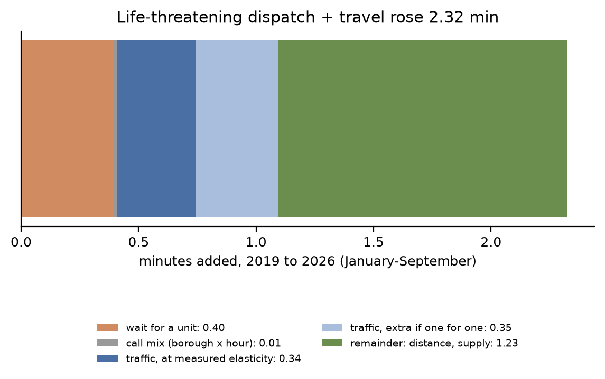
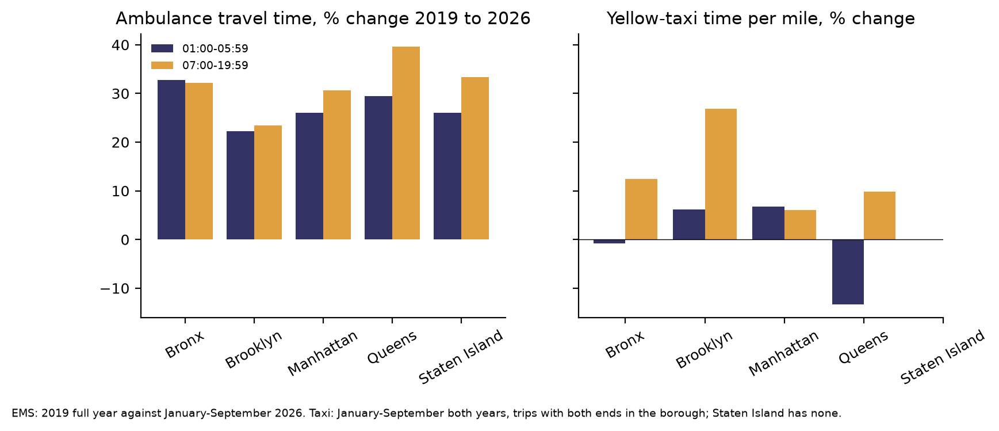
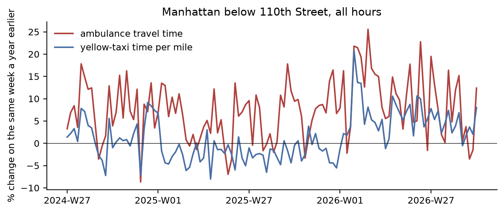
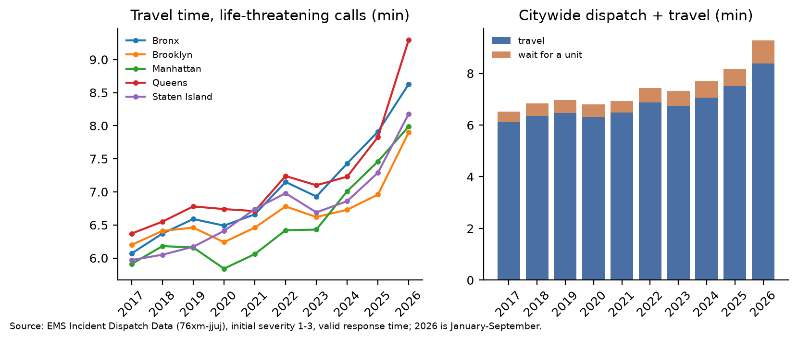

# Why ambulances take longer to arrive in New York

Ambulances reach life-threatening calls more slowly than before, although the congestion toll should have helped them. Mean dispatch plus travel time for incidents of initial severity 1 to 3 was 6.96 minutes in 2019 and 9.28 minutes in January to September 2026, a rise of 2.32 minutes (EMS Incident Dispatch Data, 76xm-jjuj, version of 7 October 2026). This note asks how much of that rise comes from traffic, from call mix, and from ambulances being farther away, and what is known to shorten response.

Three claims were registered before the deciding data were computed (`claims/registered/`, branches `prereg/ems-traffic-hourly-elasticity`, `prereg/ems-traffic-share-2019-2026` and `prereg/ems-taxi-2026-onset`, commit d75fa5e). The estimators were committed first (f44ab0b). All three are confirmed. Other numbers are exploratory and are labelled so. Code is in `analyses/ems_response/` and derived data in `data/derived/ems_response/`.

## Corrections after review

A referee rebuilt every deciding number with separate queries (`critique/ems-traffic-hourly-elasticity.md`, `critique/ems-traffic-share-2019-2026.md`, `critique/ems-taxi-2026-onset.md`). Two verdicts stand; one changes.

1. The hourly elasticity reproduces (0.636 against 0.633) and stays confirmed, but its size is not identified. The next-week placebo could not detect same-hour causes, and a calibration on 2017-18 had shown it would pass. Taxi pace two hours later still predicts ambulance travel (0.075, 0.03 to 0.12), and with neighbouring hours entered the current-hour estimate falls to 0.50. The reading "ambulances slow about two thirds as much as taxis" is therefore an upper estimate, not a measured causal effect.
2. The traffic share reproduces (0.333) and stays confirmed. The split of the 2.32 minutes adds up, but the remainder of about 1.2 minutes is a residual. Ambulance locations are not observed, so it cannot be called distance to a free unit; that is the most likely reading, not a measurement.
3. The 2026 onset test changes from confirmed to unsettled under rule 11: the registered placebo year itself meets the support condition. The slope rests largely on three winter weeks. The statement that "the 2026 step in Manhattan is traffic" is withdrawn.
4. The night comparison is exploratory and does not show that traffic cannot produce the night rise; it shows that taxi pace at night changed less than ambulance travel at night.

## 1. The decomposition

The rise has four parts. The figures below are for the city, 2019 (full year) against January to September 2026, initial severity 1 to 3, incidents with a valid response time (`decomposition.json`, `citywide_share.json`).

| Part | Minutes | Share of 2.32 |
|---|---|---|
| Wait for a unit to be assigned (0.50 to 0.89 min) | 0.40 | 17% |
| Call mix, by borough and hour (call type gives the same) | 0.01 | under 1% |
| Traffic, at the measured elasticity of 0.49 | 0.34 | 15% |
| Traffic, further amount if ambulances slowed one for one with taxis | 0.35 | 15% |
| Remainder: longer distances to a free unit, and any slowing of ambulances not shared with taxis | 1.23 | 53% |

Travel time itself rose from 6.46 to 8.39 minutes (30%). Traffic accounts for 17% of that rise at the measured elasticity and for at most 36% if ambulance pace moved one for one with taxi pace. The citywide traffic figures are exploratory, because yellow taxis are a thin measure outside Manhattan. Staten Island has no taxi measure and was given the mean of the other boroughs. In Manhattan the same quantity was registered and is confirmed (section 2).

### Call mix and call volume

Call mix explains almost nothing. Holding the 2019 travel time of each borough and hour and applying the 2026 distribution of calls changes the mean by 0.7 seconds. Doing the same with the initial call type changes it by 0.9 seconds. Call volume is a different matter, because it works through supply. Life-threatening incidents counted by the MMR rose from 567,757 in fiscal 2019 to 633,361 in fiscal 2024 and were 610,771 in fiscal 2026. All EMS incidents per ambulance in-service hour rose from 0.40 in fiscal 2021 to 0.47 in fiscal 2022 and 0.54 in fiscal 2026, because in-service hours fell from 9,442 to 8,891 and then to 8,109 a day (MMR, FDNY chapter, revised series in the FY2026 report). The share of life-threatening incidents without a valid response time rose from 1.8% to 3.2%, too little to explain the rise.

### Night against day

Traffic at 01:00 to 05:59 is light, so a rise in travel time at those hours is mainly distance. Citywide, life-threatening travel time rose 28% at night and 31% between 07:00 and 19:59. In the Bronx it rose 33% at night and 32% by day, while yellow-taxi time per mile at night in the Bronx did not change (−1%). In Queens it rose 29% at night, while taxi time per mile at night fell 13%. In Manhattan below 110th Street (January to September both years) it rose 33% at night, against a rise in taxi time per mile of 14% in the toll zone and 5% north of 60th Street (`night_day.json`). These comparisons are exploratory. The night rise is close to the day rise everywhere, which points away from traffic as the main cause, though it does not exclude it (see the corrections above).

### What the remainder is

The remainder is the part not explained by the wait, the mix or traffic. The most likely reading, not measured here, is fewer free ambulances: when fewer units are free, the nearest one is farther away. The open data do not record where the assigned unit was, so distance cannot be measured directly, and I could not compute the share of calls answered from outside their dispatch area. A rough scale (exploratory) follows from the rule that the distance to the nearest of randomly placed units varies with the inverse square root of their density. A 28% rise in night travel time would then correspond to about 39% fewer free units, which is plausible when in-service hours fell 14% from fiscal 2021 while incidents rose. The MMR names two further losses of supply: 11 hospital-based ambulances left the 911 system in fiscal 2026, and Mount Sinai Beth Israel closed in 2025. The remainder also holds any slowing of ambulances that taxis do not share, such as drivers failing to yield. No open data measure yielding, and the night rise, when few drivers are on the road, argues that it is not the main part.

### Uber and Lyft

I did not test ride-hail volumes. The TLC's aggregate report could not be downloaded (HTTP 403), and per-trip FHV files were not read in the time available. Any effect of ride-hail traffic on ambulances would act through traffic speed, which the taxi measure already captures, so it is bounded by the traffic share above: at most about a third of the rise even under one-for-one slowing. Erhardt et al. (2019, Science Advances) attribute much of San Francisco's growth in congestion to ride-hail. Whether the same holds for New York's fall in taxi speed from January 2026 is open.

## 2. Registered tests

### Does ambulance travel time follow traffic? (`ems-traffic-hourly-elasticity`, confirmed)

Within a day, ambulances in Manhattan below 110th Street are slower in hours when taxis in the same area are slower than usual. The unit is a date, hour and area (toll zone or 60th to 110th Street). The model absorbs each date and area, and each area, year, weekday and hour, so the comparison is between hours of the same day. Taxi pace is yellow-taxi hours per mile on trips that begin and end in the area (TLC trip files). Over 2019 to September 2026, without March 2020 to June 2021, the elasticity of mean ambulance travel time to taxi pace is 0.63 (0.60 to 0.66; standard errors clustered by week). Taxi pace in the same hour a week later, entered alongside, has a coefficient of 0.01 (−0.02 to 0.05), so the association is not a shared slow-moving cause of the kind that broke the hospital-turnaround test. For life-threatening calls the elasticity is 0.49 (0.46 to 0.52). It lies between 0.58 and 0.69 in every year. A calibration on 2017 and 2018, done before registration and not part of the test, gave 0.70.

An ambulance with lights and sirens is slowed by about two thirds as much as a taxi when traffic slows, and by half on life-threatening calls. A shared within-hour cause, such as a storm that slows traffic and also raises demand, is not excluded, although the hour's incident count is controlled.

### How much of the 2019-2026 rise is traffic? (`ems-traffic-share-2019-2026`, confirmed)

In Manhattan below 110th Street, life-threatening travel time rose 35.0% from January to September 2019 to the same months of 2026. Taxi time per mile, weighted by where and when the 2026 incidents happened, rose 10.5%. If ambulance pace moved one for one with taxi pace, traffic would account for 0.33 of the rise (0.29 to 0.37; day-block bootstrap). At the measured elasticity of 0.49 it accounts for 0.16 (0.14 to 0.18). The registered condition was an upper bound below 0.5, and it is met by 0.13. For 2019 against 2025 the one-for-one share is 0.20 (0.14 to 0.26).

### Did ambulances follow the January 2026 fall in taxi speed? (`ems-taxi-2026-onset`, confirmed)

The earlier reproduction of the MMR's taxi speed (`repro-mmr-cbd-speed`) found that taxi speeds fell across the city from January 2026, cause unknown. Week by week from July 2025 to September 2026, the change in Manhattan ambulance travel time against the same week a year earlier follows the change in taxi pace with a slope of 0.89 (0.54 to 1.25; Newey-West, 4 lags). The step from the second half of 2025 to 2026 was +3.4 log points for ambulances and +7.6 for taxi pace. Net of taxi pace the ambulance step is −3.4 points (−8.1 to +1.3), so the 2026 step in Manhattan is in proportion to the fall in taxi speed, but the registered placebo year passes the same test, and the verdict is unsettled (see the corrections above). The test separates this from the alternative that none of the step is traffic (D = 6.1). The same model for 2024-25 gives a slope of 0.68 and no step.

This result concerns Manhattan only and the step of 2026 only. The large 2026 rises were in Queens (7.83 to 9.30 minutes) and the Bronx (7.91 to 8.63), where yellow taxis give no usable weekly series. The step of 2026 in Manhattan is traffic; the rise from 2019 to 2025, which is larger, mostly is not.

## 3. Answer to the question

The congestion toll did not make ambulances faster in the zone (`bridge-crz-ems-travel`: −0.9%, −3.0 to +1.4, relative to the rest of the city). It could not have offset the rise, because most of the rise does not come from traffic. Of the 2.32 minutes added since 2019, about 0.40 minutes is the wait for a unit and about 1.2 to 1.6 minutes is travel that traffic does not explain. Both point to fewer free ambulances. The FDNY's own explanation in the MMR, fewer tour hours and fewer hospital ambulances, agrees with these numbers. Traffic is real but secondary: ambulances slow by half to two thirds as much as taxis do, and taxi speeds fell about 10% in Manhattan between 2019 and 2026. The fall in taxi speed from January 2026 accounts for the 2026 step in Manhattan, but not for the jumps in Queens and the Bronx, which were not tested.

## 4. What is known to improve response

The evidence was collected from the System Public Graph (148 uncached requests, 40 variable searches) and the literature (`data/derived/ems_response/levers.json`). The PubMed abstract was read for every graph finding used; six graph records differ from their abstracts, and the records say how.

The value of a minute is known. Odds of survival after cardiac arrest improve by 1.02 to 1.24 per minute of shorter response (five graph findings; O'Keeffe et al. 2011, 1.24, 1.04 to 1.48). Without treatment, survival falls by about 5.5 percentage points a minute (Larsen et al. 1993).

The levers fall into two groups: those that restore free ambulances, which address the larger part of the rise, and those that act on traffic or bypass the ambulance.

- Hospital offload: Offload delay takes units out of service. In Los Angeles one transport in eight waited more than 15 minutes for a bed, with a median of 27 minutes (Eckstein and Chan 2004). A hospital liaison programme cut offload time by 16% (Scharf et al. 2022), and a receiving area with an offload nurse cut the 90th percentile from 80 to 31 minutes (Manguil et al. 2026). The MMR reports that FDNY's Hospital Liaison Units cut turnaround by about 10.5 minutes. As arithmetic, not a result: 10.5 minutes on each of the 918,431 transports of fiscal 2026 would be about 440 unit-hours a day, 5% of in-service hours. California's 30-minute standard is not met on average (90th percentile 42.8 minutes; Feldmeier et al. 2024). No study measures the effect of an offload programme on response time. In Melbourne, workload and hospital delay in the previous hour predicted the 90th-percentile response (Nehme et al. 2016), which is the mechanism found here.
- Nurse triage of low-acuity calls: In a Washington DC trial, routing low-acuity callers to nurses cut ambulance dispatch from 97% to 56% of those calls and transport from 73% to 45% (Wilson et al. 2024). New York's programme reports more than 12,000 transports avoided from over 25,000 redirected calls (NYC Health + Hospitals, January 2025), about 1.3% of a year's transports. No study measures its effect on response times. Low-acuity calls now wait 16.7 minutes for a unit (`docs/health_gaps.md`), and these are the calls triage would remove.
- Dynamic deployment: Real-time relocation raised the share of urgent calls reached within 15 minutes from 94.4% to 96.0-97.3% in a 12-week uncontrolled pilot in Flevoland (van Buuren et al. 2018). Other evidence is from simulation. FDNY already posts units at street corners by historical demand (MMR FY2017).
- Signal pre-emption: Emergency-vehicle travel times fell 14% to 23% on equipped corridors in Houston and Denver (USDOT ITS benefits database, grey literature not read in the original). With an elasticity of 0.49 to 0.63, any traffic measure acts on roughly half of a traffic change.
- Motorcycle and bicycle responders: In Ljubljana a motorcycle paramedic arrived in 7.7 against 9.9 minutes for an ambulance, with survival to discharge of 18.7% against 13.0% (Skufca Sterle and Podbregar 2023). There is no peer-reviewed evidence for bicycles.
- Volunteer responders and AEDs: This group has the strongest evidence and does not depend on ambulance supply. Dispatching volunteers by phone raised bystander CPR from 48% to 62% in a randomised trial (Ringh et al. 2015). Across five European sites volunteer dispatch went with 30-day survival 1.22 times higher (1.07 to 1.39; Jonsson et al. 2023). In the Netherlands it cut call-to-shock time by 2.6 minutes (Stieglis et al. 2022). In Sweden drones delivered an AED before the ambulance in 67% of cases, a median 3 minutes 14 seconds earlier (Schierbeck et al. 2023). In London, responders accepted alerts in only 1.3% of arrests (Smith et al. 2022), so uptake limits the effect in a large city.

The evidence here is consistent with supply levers (in-service hours, offload, triage) for the general rise, though no lever's effect was measured, and volunteer and AED networks for cardiac arrest, where they shorten the time to defibrillation whatever happens to the ambulance. It does not support traffic measures as the main remedy: removing all of the traffic change since 2019 would recover about 0.3 to 0.7 of the 2.32 minutes.

## 5. Novelty and practicality

The finding that the rise is mostly supply and not traffic agrees with the FDNY's own explanation in the MMR, so it is a confirmation and not a discovery. What is new, as far as I found, is the size of the traffic effect on ambulances in New York, an elasticity of 0.63 (0.49 for life-threatening calls) estimated from open data with a placebo, and the bound it puts on traffic's share. The literature search found no published estimate of this elasticity; NYU's C2SMART work on FDNY ambulance speeds is known only from a press release. The result is practical in one narrow sense: it says that traffic policy, including the congestion toll, can recover at most about a third of the lost time, and that the larger part is in the number of free ambulances. It does not measure the effect of any lever. The arithmetic for offload and triage above is not a result.

## Limits

- The registered tests cover Manhattan below 110th Street, where yellow taxis measure traffic well. The citywide traffic share rests on thin yellow-taxi samples in Brooklyn, Queens and the Bronx and none on Staten Island.
- The elasticity is estimated from hour-to-hour variation. Applying it to changes over seven years assumes that ambulances respond to a lasting slowdown as they do to an hourly one. The one-for-one bound does not depend on that assumption, unless ambulances are slowed more than taxis.
- The remainder is a residual. Distance to the assigned unit, units free by hour, and transfer-of-care times are not public. With them the remainder could be measured instead of inferred.
- 2026 covers January to September and 2019 the full year in the citywide figures; the registered Manhattan comparison uses January to September in both years.
- On 13 November the TLC file host refused downloads for about 30 minutes. For July 2023 to December 2025 the Manhattan taxi series was read from `data/derived/congestion/taxi_speed_*.csv`, which uses the same areas, filter and files; the outcomes record the change.

## Research needed

- FDNY unit locations at assignment, to measure distance and speed separately.
- Units in service and units free by hour and borough.
- High-volume FHV trip speeds by borough and week for 2025-2026, to test whether the Queens and Bronx jumps of 2026 followed traffic.
- Transfer-of-care times by hospital, and the start dates of Hospital Liaison Units, for a before-after test of offload.
- The cause of the citywide fall in taxi speed from January 2026.
