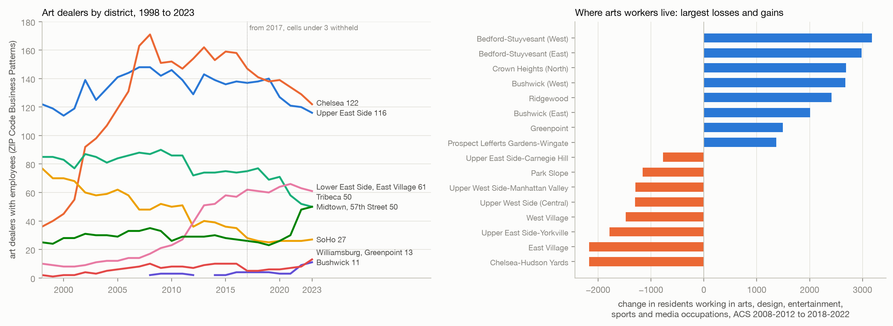
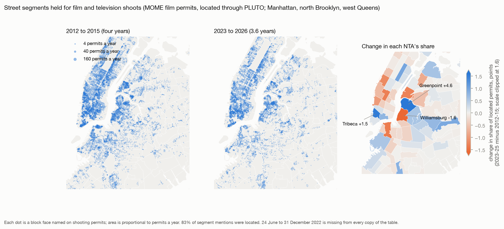
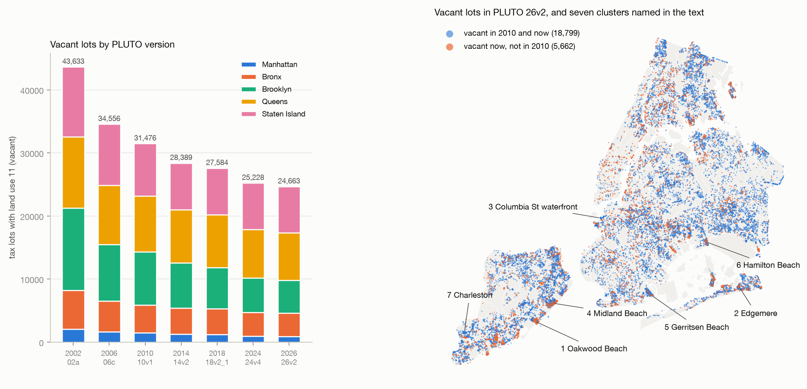
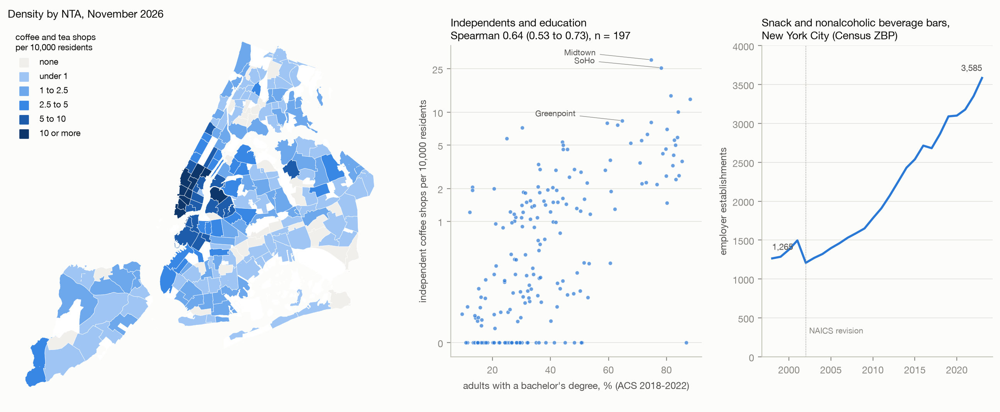

# Exploring the city with open data: film shoots, vacant lots, new shops, coffee and galleries

This note uses the city's open data to describe places, and it tests no hypothesis. Every number in it is exploratory: none was registered in advance, and none should be read as a confirmed result. The questions came from a photographer who wanted to know where productions shoot, where vacant land is, where shops are opening, what coffee shops go with, and where galleries and artists have moved. The findings are given in order of likely interest to a resident, and each section says how far its data can be trusted. The scripts are in `analyses/explore/`, the derived tables in `data/derived/explore/`, and each source with its version in `data/derived/explore/sources.json`. All data were fetched on 13 November 2026. A page that shows these measures for one neighbourhood at a time is at `viz/explore.html`.

Neighbourhoods are the 262 Neighborhood Tabulation Areas (NTAs) that the Department of City Planning drew for the 2020 census. Rankings use the 197 NTAs with at least 5,000 residents. PLUTO is the city's table of tax lots.

## 1. Galleries moved from SoHo to Chelsea, then to the Lower East Side and Tribeca

The Census Bureau's ZIP Code Business Patterns (ZBP) counts establishments with employees by industry and ZIP code for every year from 1998 to 2023. It is the only source found that has a real history of galleries. The industry "art dealers" (NAICS 453920, renumbered 459920 in 2022) had 459 establishments in the city in 1998, 635 in 2016 and 546 in 2023.

SoHo (ZIP code 10012) fell from 77 art dealers in 1998 to 27 in 2023. Chelsea (10001 and 10011) rose from 36 to 158 in 2016 and then fell to 122. The Lower East Side and East Village (10002, 10003, 10009) rose from 10 to 61. Tribeca (10013 and 10007) stayed between 23 and 35 until 2021 and reached 50 in 2023. The 57th Street ZIP codes fell from 85 to 50, and the Upper East Side stayed between 114 and 148. Brooklyn had 15 art dealers in 1998 and 45 in 2023, of which Bushwick had 11. The Bronx had 7 in 1998 and none reported after 2016.

These counts are reliable for galleries that have a payroll. They omit a gallery that its owner runs with no employees. From 2017 the Census Bureau withholds any cell with fewer than three establishments, so small districts drop to missing; the fall in the city total between 2016 and 2017 (635 to 576) is partly this rule. For Jersey City the series shows at most four art dealers in any year and no count after 2016.

The data show where artists live only roughly. The American Community Survey (ACS) counts employed residents in "arts, design, entertainment, sports and media occupations", a group that includes designers, editors and producers. Between the 2008-2012 and 2018-2022 surveys the count in Manhattan fell from 78,649 to 67,965 (9.2% to 7.6% of employed residents) and the count in Brooklyn rose from 56,384 to 83,323 (5.1% to 6.6%). The largest gains were in Bedford-Stuyvesant West (2,216 to 5,394), Bushwick West (1,351 to 4,027) and Ridgewood (589 to 3,006). The largest losses were in Chelsea-Hudson Yards and the East Village (each about 2,170 fewer). Hudson County, New Jersey, rose from 9,294 to 12,181 (2.9% to 3.2%). Margins of error were not computed. Changes of a few hundred in one NTA are within sampling error, and the 2008-2012 figures were moved from 2010 to 2020 tract boundaries by land area.

The other sources have little history. OpenStreetMap now maps 348 galleries in the city, 118 of them in Chelsea-Hudson Yards. It mapped 15 on 1 January 2018 and none on 1 January 2014, so its change over time reflects the growth of mapping. The Department of Cultural Affairs list (2,535 organisations) and the Facilities Database record non-profit organisations now on file, with no dates. No open source shows artists' studios, galleries without staff, or a building such as Mana Contemporary as a place where artists work. Loft and joint living-work quarters zoning was not analysed.

## 2. The blocks most used by productions are next to sound stages, and Greenpoint has gained

The film permit table (tg4x-b46p) now holds only 2023 onward. Two copies of its export in the Internet Archive supply 2012 to 24 June 2022. No copy holds 25 June to 31 December 2022. The merged file has 83,662 shooting permits from 2012 to August 2026, of which 59% are for television. Permits ran at 6,105 to 7,905 a year from 2012 to 2019 and at 3,535, 4,966 and 4,279 in 2023, 2024 and 2025.

The table has no coordinates. Each permit names street segments ("Monitor Street between Greenpoint Avenue and Norman Avenue"). The script locates a segment by finding, in PLUTO, where lots addressed on the street lie closest to lots addressed on each cross street. This located 83% of 293,828 segment mentions (58% in the Bronx, 78% to 85% elsewhere), and three segments checked by hand were in the right place.

The blocks named most often are service blocks beside studios. Kingsland Avenue and Monitor Street between Greenpoint and Norman Avenues were named on 2,777 and 2,664 permits. West 48th Street between Sixth and Seventh Avenues was named on 2,053, and 22nd Street between 43rd Avenue and Queens Plaza South on 1,788. These blocks adjoin sound stages in Greenpoint, Long Island City and Astoria, where productions hold the kerb for trucks. The studio names are from general knowledge and are not in the table.

Greenpoint had the most located permits in both periods: 709 a year in 2012-2015 and 590 a year in 2023-2025, which is a rise from 10.9% to 15.4% of the city's located permits. Shares also rose in Tribeca-Civic Center (2.5% to 4.1%), Carnegie Hill, Flatbush-Ditmas Park, Ridgewood and Glendale (12 to 43 permits a year). Shares fell in Williamsburg (307 to 117 permits a year), Downtown Brooklyn-DUMBO (173 to 50), Long Island City and Hell's Kitchen.

Filmed streets differ from other streets in land use and not in building age. On filmed segments 74% of lots were built before 1940, against 73% of all lots in the same boroughs. Of the lots on filmed segments, weighted by permits, 9.6% are industrial (0.9% of all lots), 18.7% are commercial or office (6.1%) and 13% are one- and two-family houses (39%). Still photography and commercials favour historic districts (40% and 31% of fronting lots, against 15% of all lots), and television does not (16%). The comparison group is all lots and a better one would be all street segments, so these contrasts are approximate.

## 3. Vacant lots have nearly halved since 2002, and the largest clusters are on the flooded shores

Seven PLUTO versions give the number of lots with land use 11 (vacant land): 43,633 in 2002, 31,476 in 2010 and 24,663 in version 26v2. City-owned vacant lots fell from 9,940 to 5,457. Vacant acreage did not fall (12,562 acres now), because a few very large lots dominate it and their recording has changed.

Of the 31,476 lots vacant in 2010, 18,925 (60%) are still vacant. A further 4,079 are now residential and hold 41,397 homes, 1,206 are parking, 1,159 are open space, and 5,431 lot numbers no longer exist, most likely because they were merged into development sites. The falls were largest in central Brooklyn: Bedford-Stuyvesant West (550 to 240), Ocean Hill (370 to 144) and Bushwick East (265 to 71). Counts rose in Oakwood-Richmondtown on Staten Island (453 to 747), where houses were bought out and demolished after Hurricane Sandy.

The script groups vacant lots whose centres lie within 150 ft of each other and finds 223 groups of eight or more. Seven that may repay a visit, none of which was checked on the ground, are these.

| Cluster | Lots | Vacant in 2010 | Near |
|---|---|---|---|
| Oakwood Beach, Staten Island (Fox Beach and Kissam Avenues) | 404 and 119 | 41% | 40.5533, -74.1162 |
| Midland Beach, Staten Island (Graham Boulevard, Seaver Avenue) | 432 | 81% | 40.5764, -74.0871 |
| Hamilton Beach and Spring Creek, Queens | 340 | 91% | 40.6544, -73.8300 |
| Edgemere, Queens (Beach 43rd to 45th Streets) | 183 | 93% | 40.5983, -73.7764 |
| Columbia Street waterfront, Brooklyn (Union Street, Hamilton Avenue) | 81 | 100% | 40.6850, -74.0063 |
| Charleston, Staten Island (Nielsen and Storer Avenues) | 59 | 100% | 40.5392, -74.2337 |
| Gerritsen Beach, Brooklyn (Noel Avenue and the courts) | 48 | 88% | 40.5863, -73.9215 |

The counts are solid as counts of a tax classification. A lot classed as vacant may be wetland, a paper street, a community garden or a construction site, and the Red Hook case in `docs/case_red_hook.md` shows how far a record can differ from the ground.

## 4. Coffee shops go with education more than with rent, and the timing against rent cannot be settled

The restaurant inspection table lists 2,215 inspected establishments with cuisine "Coffee/Tea", or 2.5 per 10,000 residents. A name with five or more outlets was classed as a chain: 714 are chain outlets (266 of them Starbucks) and 1,501 are independent. The city codes most Dunkin' outlets as "Donuts", so 562 of 628 are outside this count, and 199 shops have a tea name. Thirty-one of the 197 NTAs have none, including Far Rockaway-Bayswater (64,945 residents) and Brownsville.

Across NTAs, density has a Spearman correlation of 0.69 (95% interval 0.59 to 0.77, n = 197) with the share of adults holding a bachelor's degree and 0.72 (0.63 to 0.79) with the share in arts occupations. The correlations are 0.50 (0.37 to 0.61) with median rent, 0.42 (0.28 to 0.54) with rent change since 2008-2012 and 0.41 (0.28 to 0.52) with the share aged 25 to 34. In a regression of log density on all of these, education (0.45 per standard deviation, 0.31 to 0.58) and the share aged 25 to 34 (0.24, 0.16 to 0.32) keep their coefficients and rent (0.04, -0.12 to 0.20) and rent change (0.01, -0.07 to 0.10) do not. Midtown and the Financial District rank high because the measure divides by residents and most of their customers live elsewhere.

First inspection dates do not give opening dates back to 2012, because the table keeps only about three years of inspections for places now open. The history comes from ZBP, where "snack and nonalcoholic beverage bars" (coffee shops with doughnut, juice and ice cream shops) grew from 1,265 in 1998 to 2,071 in 2012 and 3,585 in 2023. Brooklyn doubled between 2012 and 2023 (525 to 1,040).

Whether coffee shops lead or follow rent was examined and not registered, so there is no verdict. Across 174 ZIP codes, growth in outlets from 2003 to 2011 had a correlation of 0.21 (0.06 to 0.35) with ACS rent growth over the following decade. Outlet growth during that decade had 0.36 (0.21 to 0.50, n = 148), and rent growth had 0.28 (0.12 to 0.45, n = 146) with outlet growth from 2019 to 2023. All three are positive and their intervals overlap. With Zillow's rent index, which starts in 2015 and covers 63 to 70 of these ZIP codes, no window showed earlier coffee growth predicting later rent growth (for example 0.06, -0.20 to 0.31). Coffee outlets and rents rise in the same neighbourhoods over the same years, and these data do not show which rises first.

The System Public Graph, a database of findings from published research, holds nothing that uses cafes or third places as a neighbourhood variable. A search of study variable names returned 27 findings for "cafe" (waterpipe cafes, smoking bans, diet), four each for "coffee shop" and "third place", none of them on neighbourhoods, and 28 for "galleries", most of which concern drug-injection sites.

## 5. New restaurants can be dated; other new shops cannot

Restaurant permit numbers are issued in sequence, and numbers from 50160000 were first inspected no earlier than 3 September 2024. By that rule 5,222 of 27,444 inspected establishments (19%) are new, and 4,038 more are registered but not yet inspected. Coffee and tea shops are the second largest group of new places (537) and 24% of them are new. Midtown-Times Square has the most new places (273). Among NTAs with at least 60 restaurants the highest shares are in Bath Beach (36%), Upper West Side-Manhattan Valley and Long Island City (30%) and Flushing (29%, 148 places), and the lowest are in Great Kills (5%) and Morningside Heights (8%).

The evidence in this section is weak. The restaurant table omits places that opened and closed inside the window. The consumer protection licence table has 10,134 premises licences created in two years, but it covers regulated trades (home improvement contractors, secondhand dealers, tobacco sellers), so it does not show ordinary shops. The state liquor licence file cannot date openings, because 87% of its "original issue" dates fall in 2025 or 2026. The Dining Out NYC table lists 2,539 sidewalk and roadway cafe licences and is shown in the explorer.

## The explorer and the data

`viz/explore.html` draws the NTAs as an inline map and colours them by any of 19 measures. For a chosen neighbourhood it lists the three most unusual measures, the rank on each, film permits by year, the most filmed blocks and the largest vacant cluster. It reads `viz/data/explore_data.js` by a relative path, and it was checked from the file system and from a local static server. `analyses/explore/build_explorer.py` rebuilds the data file.

The sources are NYC Open Data (film permits tg4x-b46p, PLUTO 64uk-42ks version 26v2, restaurant inspections 43nn-pn8j, licences w7w3-xahh, Dining Out NYC fpeh-f7ci, cultural organisations u35m-9t32, Facilities Database ji82-xba5), two Internet Archive copies of the film permit export, six archived PLUTO versions from the Department of City Planning, state liquor licences (data.ny.gov 9s3h-dpkz), Census ZBP files for 1998 to 2023, the Zillow rent index, OpenStreetMap through the Overpass API, and ACS summary files for 2008-2012 and 2018-2022. `data/derived/explore/sources.json` gives the update time and query for each, except the two ACS 2008-2012 sequence files, which `analyses/explore/acs_nta.py` downloads. Raw files are in `~/opt/nyc-concordance/explore/`.
