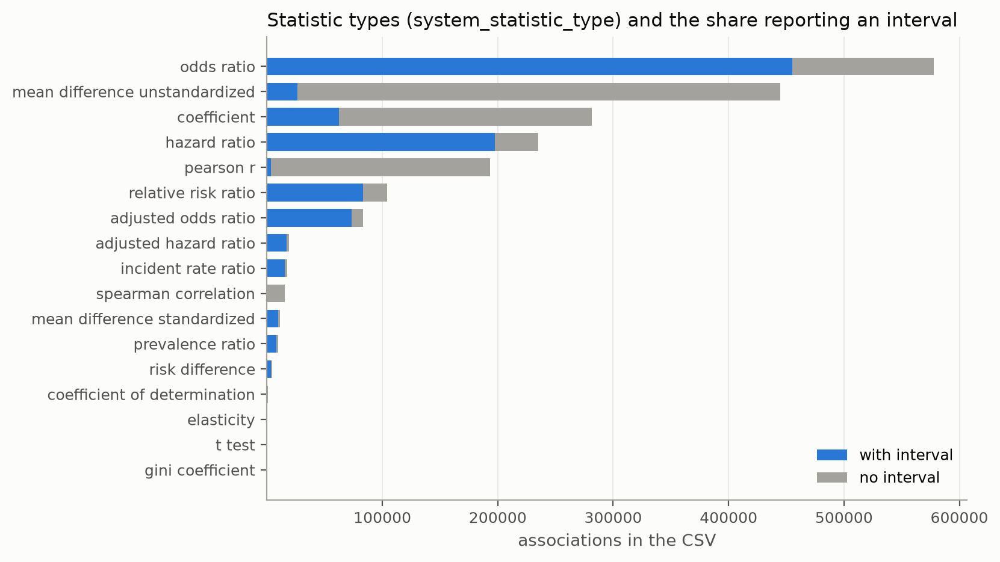
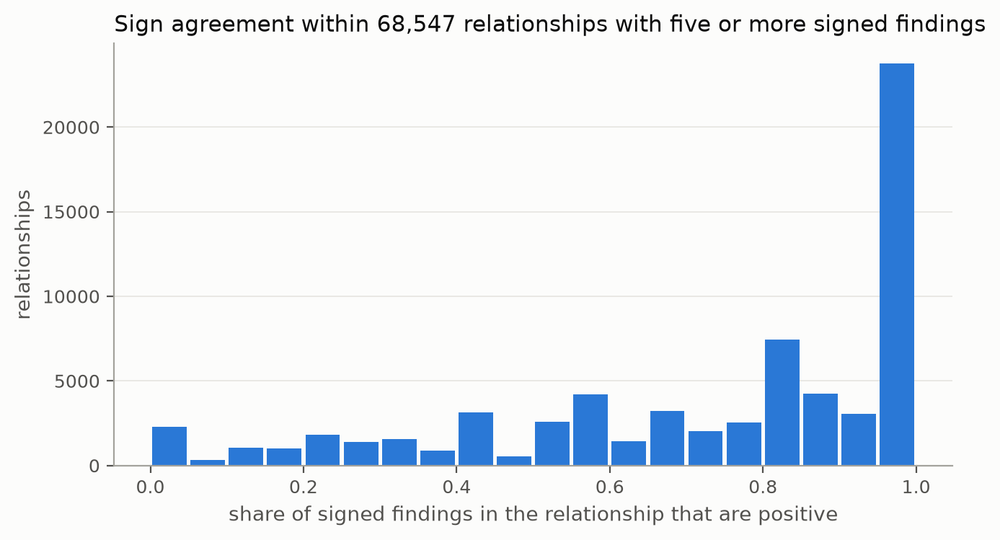
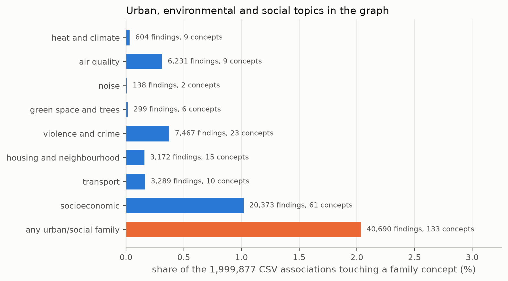
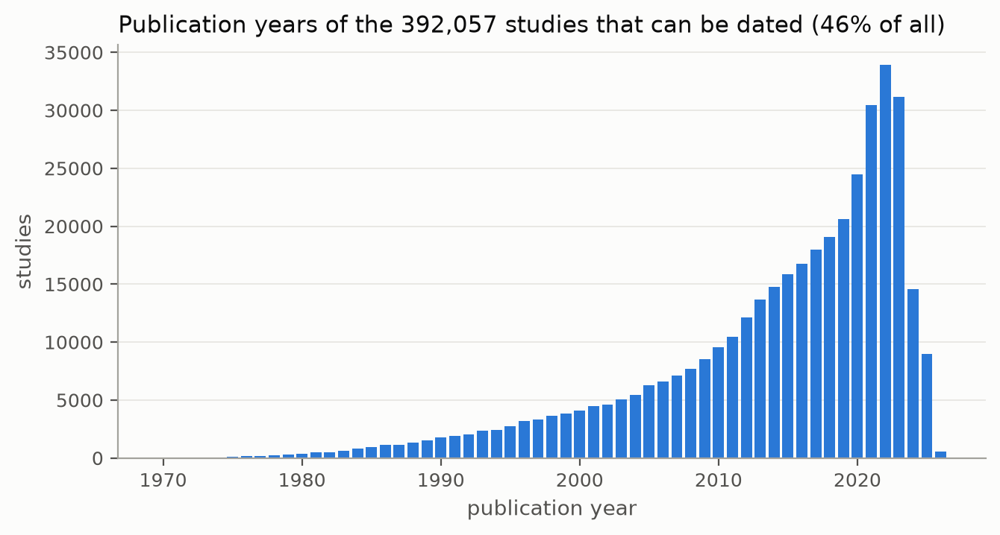
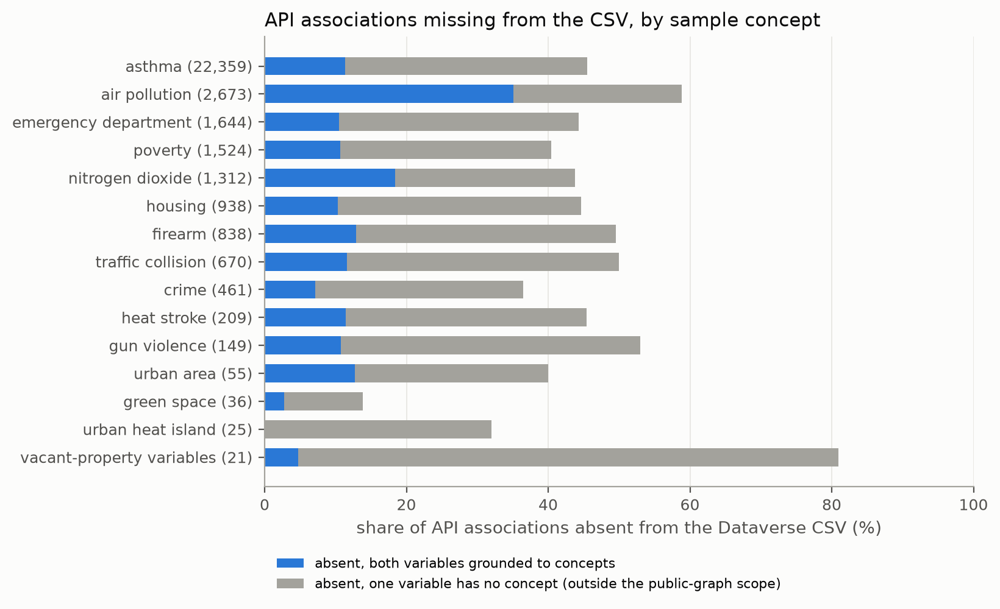

# The System Public Graph as an object of study

The System Public Graph is a set of statistical findings that the company System (system.com) extracted from published studies with language models. This note describes it as a dataset: what it contains, how it represents findings, which topics it covers poorly, and how its two distributions differ. It also describes a command-line tool that the project's agents use to read the graph's evidence for a pair of concepts, and a plan for publishing our register of preregistered claims (`claims/`, see `concord/claims.py`) on Underlay, a public registry for versioned data. All numbers below come from the Dataverse deposit or from System API calls made on 12 November 2026. The scripts are in `analyses/graph_audit/`, the derived tables in `data/derived/graph_audit/`, and the figures in `figures/graph_audit/`.

## Sources and versions

The graph is distributed in two forms. The first is a file deposit on Harvard Dataverse, doi:10.7910/DVN/7V6JDO, version 2.1, released on 22 July 2026 under CC BY-NC 4.0. The second is the API at `https://public-api.system.com`, version v1.0, which needs a key.

The deposit holds five CSV files and a `MANIFEST.json` generated on 8 July 2026. Dataverse ingests four of the CSVs as `.tab` files; the originals are fetched with `?format=original`. `analyses/graph_audit/build_dataverse.py` downloads them to `~/opt/nyc-concordance/dataverse/raw/`, checks each file's MD5 against Dataverse and its SHA-256 against the manifest, and loads them into DuckDB at `~/opt/nyc-concordance/dataverse/graph.duckdb`. All five checksums matched, and every row count equals the manifest's. The checks are recorded in `data/derived/graph_audit/dataverse_files.json`.

| File | Bytes | Rows | SHA-256 (first 12) |
|---|---:|---:|---|
| system-public-graph-v1-associations.csv | 442,463,948 | 1,999,877 | a9c8ba3db760 |
| system-public-graph-v1-relationships.csv | 394,497,184 | 839,872 | 258c155855bc |
| system-public-graph-v1-studies.csv | 133,629,122 | 844,435 | 0ec523dce16c |
| system-public-graph-v1-variables.csv | 125,171,395 | 1,774,551 | ab775cb9948e |
| system-public-graph-v1-concepts.csv | 7,780,684 | 45,721 | 1d594e97760d |

Dataverse answers HTTP 403 to the default `python-requests` User-Agent, so the loader sends its own.

## The data model, in numbers

The graph has 45,721 concepts, 1,774,551 variables, 1,999,877 associations, 844,435 studies and 839,872 relationships (Dataverse v2.1).

An association is one statistical finding from one study: two named variables, a statistic, and where reported an interval and a p-value. Each variable is mapped ("grounded") to one concept, which is a Wikidata item. A relationship is the set of associations whose first variable is grounded to concept A and whose second is grounded to concept B; its id is `A|B`. The sum of `num_findings` over all relationships is 1,999,877, which equals the number of associations, so every association belongs to exactly one relationship.

Most relationships are supported by few findings. Of the 839,872 relationships, 553,111 (66%) have one finding, 217,734 have two to four, 60,370 have five to nineteen, and 8,657 have twenty or more. Three relationships in four (76%) come from a single study. The median study contributes two associations.

Studies have little metadata. Every study has a DOI and 99.6% have a PubMed id, but `study_type` is empty for 754,707 studies (89%); the only value present is "Experimental Trial" (89,728). Studies have no publication date field (see Dates).

## Statistics, intervals and p-values

The CSV holds 9,119 distinct raw `statistic_type` strings ("OR", "odds ratio (OR)", "AOR" and so on), which System maps to 17 normalised `system_statistic_type` values. Odds ratios are the largest group (577,611), then unstandardised mean differences (444,825), coefficients (281,686), hazard ratios (235,030) and Pearson correlations (193,449).



Of all associations, 47.8% report an interval, 68.6% report a p-value, and 7.4% report neither. The confidence level is missing for 1,064,848 associations, including many that report the interval's bounds; where it is given it is almost always 0.95. The p-value qualifier (`=`, `<`, `>`) is missing for 1,798,974 associations, so a stored p-value of 0.001 may stand for "p < 0.001". Data checks found 863 ratio statistics at or below zero, 94 intervals whose lower bound exceeds the upper, and 80 estimates outside their own interval.

## How direction is represented

Direction appears in the graph in three places, and none of them is a field that says "increases" or "decreases".

The first is the order of a relationship's concepts. `A|B` means that variable 1 of each finding was grounded to A and variable 2 to B. The order is whatever the extraction produced, and the documentation says the extraction can swap independent and dependent variables. Of the relationships between distinct concepts, 57,354 pairs exist in both orders, as `A|B` and `B|A`, and the relationship table gives no way to combine the two. Another 7,606 relationships, holding 77,736 findings, join a concept to itself, for example "visual acuity" to "visual acuity" (710 findings), where a post-treatment measure is compared with a pre-treatment one (`data/derived/graph_audit/self_loops_top.csv`).

The second is the sign of the statistic against its null. For ratio statistics the null is 1; for coefficients, correlations and differences it is 0. On that reading 72.4% of associations are positive, 27.0% negative and 0.6% unsigned or exactly null. Of the signed associations with an interval or a p-value, 83.7% are significant at 0.05, which is consistent with the publication bias the documentation describes.

The third is the variable names, which often carry the real direction. A mean difference's sign depends on which group was subtracted from which, and the names say so only in text such as "[vs control rats]". Negations are common: "no usage of an air purifier" is grounded to "air purifier", and "negative temperature anomaly" to "thermodynamic temperature". A positive statistic between two such variables can therefore mean a negative relation between the concepts.

## What a relationship hides

A relationship reports `num_findings` and `num_studies`, but not how many findings point each way. For the 68,547 relationships with five or more signed findings, 25,230 (37%) have findings of one sign only, 43,317 (63%) have findings of both signs, and 35,927 (52%) have at least one significant finding in each direction. In 22,057 (32%) the minority sign is at least a quarter of the findings. Mean differences explain only part of this: with them excluded, 25,048 of 54,082 relationships still have significant findings both ways.



Some of the mixing reflects real differences between studies, and some comes from grouping different measurements under one concept. Below, A → B denotes the relationship `A|B`. "Socioeconomic status → mortality rate" has 207 findings: 145 positive (115 significant) and 62 negative (45 significant), because "low SES" and "high SES" are both grounded to the same concept. "Air pollution → asthma" is more consistent: 79 positive and 3 negative, none of the negatives significant. A count of findings alone does not distinguish these two cases. `tools/graph_evidence.py` reports the signs, and `data/derived/graph_audit/sign_mixing.csv` lists them for every relationship.

## Coverage of urban, environmental and social topics

The graph is mainly clinical and biomedical. The single concept "mortality rate" appears in 84,464 associations (4.2% of all), "survival rate" in 41,763 and "body mass index" in 38,449. A third of all concepts (15,778) are genes or proteins by their Wikidata description.

Urban topics make up a small part of the graph. I grouped concept labels into eight topic families (heat and climate, air quality, noise, green space and trees, violence and crime, housing and neighbourhood, transport, socioeconomic) with whole-word patterns and removed stray matches by hand ("tree nut allergy", "chromosome segregation", "sleep deprivation" and others; the list is in `describe.py`, the members in `families_members.csv`). Together the families contain 133 concepts (0.29% of concepts) and appear in 40,690 associations (2.0%) from 22,557 studies (2.7%). More than half of that is the socioeconomic family (20,373 associations). Heat and climate have 604 associations, green space and trees 299, and noise 138. "Heat wave" has exactly one association, with precipitation. "Urban heat island" has 19 and "green space" 31.



Several topics that matter to New York City agencies have no concept: there is no concept labelled vacancy, eviction, gentrification, street tree or rat infestation. Their variables exist, but they are grounded to other concepts, as the next section shows.

## Grounding errors

Errors in grounding determine what a query by concept returns. Related problems appear earlier, in concept search. The API search for "rat" returns "Gunn rat", "Brattleboro rat", "Kirsten rat sarcoma viral oncogene homolog" and "Harvey rat sarcoma virus oncogene", which are laboratory strains and oncogenes. Search for "traffic" returns "Golgi to ER traffic protein 4" first, and "heat" returns only heat shock proteins. The 612 variables grounded to the concept "rats" are laboratory animals ("Fisher rats [vs Lewis rats]"); none concerns rats in a city.

Grounding of variables has errors of the same kind (`data/derived/graph_audit/grounding_samples.csv`):

- 10,005 variables about patient survival ("2-year survival of patients undergoing elective EVAR") are grounded to "survival skill". That concept is the eleventh most frequent in the graph, with 14,227 associations.
- "Expiration of eviction moratoriums (in US states)" is grounded to *Eupatorium*, a genus of plants.
- "existence of pine tree" is grounded to *Pinellia*, another plant genus.
- "having one or more traffic infringements" is grounded to "traffic-related pollution".
- A variable named "Heatwave" is grounded to "heat stroke", and "during the heat wave [vs same period in the previous year]" to "hot".
- "vacant housing units" and "spatial density of vacant properties" are grounded to "housing" and "population density".

So a search by concept misses most of the urban evidence, and a search by variable name (`sysgraph.variables("vacant")`) finds more of it. The cost is that variable search returns unrelated senses, such as "a blank or vacant stare".

## Dates

Studies have no date field. A relationship's `last_published_date` is the date of its most recent study, so for a relationship with only one study that date is the study's date. Using these relationships, I assigned dates to 392,057 studies (46%). For studies with Elsevier DOIs, which carry a year, the date derived this way is within one year of the DOI year for 98.9% of 68,744 studies. The median publication year is 2017; 37% of dated studies appeared in 2020 or later and 9% before 2000. Counts peak in 2022 and fall in 2024 and 2025, which is consistent with a corpus frozen before the end of 2025. 22,548 relationships have no `last_published_date`.



`last_updated` is not a per-relationship edit time. In the CSV, 789,971 of the 839,872 relationships (94%) share one timestamp, 2024-12-12 13:25:37.319153 (Eastern), which suggests a single batch load. The rest range up to 2026-03-25. The API reports different `last_updated` values for the same relationships, mostly June to September 2024. Neither distribution names a graph version.

## The API and the CSV are different versions of the graph

The API documentation says that about 20% of API associations are mis-extracted, that these were removed from the CSV, and that API associations absent from the CSV should be dropped. I measured this for 16 urban and health concepts and for the 21 variables named "vacant" (`analyses/graph_audit/api_vs_csv.py`, 194 API calls). The sample has 32,625 distinct API associations.

Of these, 15,152 (46.4%) are absent from the CSV, more than twice the documented rate. Of the absent associations, 10,818 (71%) have one variable with no concept. The data-provenance page says such associations were removed from the public graph by its scope filter, which keeps only findings between two concepts, but the API still serves them. These account for most of the difference. Among associations whose two variables both have concepts, 4,334 of 21,805 (19.9%) are absent, which matches the documented 20%. The absent share varies by concept, from 14% for green space to 59% for air pollution and 81% for the vacant-property variables. The simple data checks do not separate the two groups: among associations with both variables grounded, only one has an estimate outside its own interval, and it is one of the absent ones.



The aggregates differ as well. For "air pollution → asthma" the API reports 125 findings from 56 studies and the CSV 87 from 39. Across 5,366 relationship records seen through the API in this session, 1,673 (31%) are absent from the CSV, and of those present, 21% have a larger `num_findings` in the API. API responses carry no version or snapshot identifier, so a result obtained through the API cannot be tied to a fixed state of the graph. For citation the CSV is the stable version: it has a DOI, a version number and checksums.

Offset pagination in the API is not stable. Paging through the 125 associations of "air pollution → asthma" with `limit=100` returned 150 rows, of which 125 were distinct. Paging asthma's 16,719 associations with `limit=1000` returned 342 duplicates, so about 2% of rows were missed. The measurement above deduplicates, but it may undercount slightly. `concord/sysgraph.page_all` should deduplicate and use the largest page the API allows.

Several of our preregistered claims (`claims/registered/`) cite graph evidence that is not in the CSV. The association aFGrNWb1i5 (vacant housing demolitions and crime), cited by our four claims about construction, is API-only. So is the Hasan et al. 2022 finding (NDVI and land surface temperature, Pearson r = −1.0, relationship `hsryqxdFzE|PCdVJWVRyS`) cited by two heat claims. A correlation of exactly −1 between a vegetation index and surface temperature is implausible, and the PubMed abstract (PMID 35060045) should be read before either claim relies on it.

## Tool: graph_evidence.py

`tools/graph_evidence.py` returns the research evidence for a pair of concepts. It reads the Dataverse CSV from DuckDB, adds the API's associations for the same pair, and marks each row `in_csv`. For each finding it reports the statistic type and value, the interval and level, the p-value and its qualifier, a normalised direction, whether the finding is significant, data-check flags, and the study's DOI, PubMed id and population. It prints a short summary and writes JSON.

```
~/.venvs/nyc-concordance/bin/python tools/graph_evidence.py A B [--expand] [--offline] [--api-only]
        [--csv-only-rows] [--json PATH|-] [--max-pairs N] [--rows N] [--quiet]
```

- `A` and `B` are concept ids (`k9BAffdSqv`) or search terms (`"heat wave"`). A term matches a concept label exactly, then an alias, then the shortest label that contains it as a whole word.
- `--expand` includes every concept whose label contains the term ("temperature" becomes ten concepts).
- `--offline` reads only the CSV and makes no API calls. `--api-only` skips the CSV, so `in_csv` is null.
- `--csv-only-rows` drops API rows that are absent from the CSV, as the documentation advises.
- `--json` sets the output path, and `-` writes the JSON to stdout. By default the JSON goes to `data/derived/graph_audit/evidence/<a>__<b>.json`.
- `--max-pairs` caps the concept pairs sent to the API (default 12). Each pair costs two calls when it is not cached.

`direction` is "+" or "−" against the statistic's null (1 for odds, hazard, risk, rate and prevalence ratios; 0 for the rest), or null for R² and Gini. `significant` is true when the interval excludes the null, or, without an interval, when p < 0.05. The flag `sign_depends_on_group_order` marks mean and risk differences. The direction applies to the variables as named, so read the names before turning it into a direction between concepts. From Python, `evidence("air pollution", "asthma")` returns the same dictionary.

Example:

```
$ ~/.venvs/nyc-concordance/bin/python tools/graph_evidence.py "air pollution" asthma --rows 3
A: air pollution (P6IzhScRdx)
B: asthma (EAshH_Ko3h)
  relationship P6IzhScRdx|EAshH_Ko3h [csv] air pollution -> asthma: 87 findings, 39 studies
  relationship P6IzhScRdx|EAshH_Ko3h [api] air pollution -> asthma: 125 findings, 56 studies
findings kept (in CSV): 89 from 40 studies; direction + 81 (significant 64), - 3 (significant 0), no sign 5
API-only findings (absent from CSV, advised to drop): 38
```

## Underlay

Underlay (underlay.org, Knowledge Futures, MIT-licensed code at github.com/knowledgefutures/underlay) is a registry for versioned, structured data. I read its docs, its protocol pages and its `llms.txt` on 12 November 2026.

A collection is a named sequence of versions owned by an organisation. A record is an `id`, a `type` and a JSON `data` value. Each type has one JSON Schema (draft-07), and references between types are written as `"x-ref-type"` on a string field.

A version is an immutable state of a collection: its schemas, records, files and metadata. It is named by a semver and by a content hash (`ulv2:` plus a SHA-256 of the version root). The registry assigns the semver: a major version when a type or schema changes, a minor version when records change, and a patch version for metadata only. Identical content gives an identical hash. A record's hash is the SHA-256 of its canonical form (RFC 8785 JSON), and `GET /api/records/:hash/provenance` lists every collection and version that holds that record. Publishing is a delta push: open a session against a base version, upload NDJSON records and deletes, then commit. Protocol v2 was frozen on 3 October 2026, and each collection's versions are kept in a signed, hash-chained log.

Neither the System Public Graph nor any System data is on Underlay. Searches of the 47 public collections for "system", "graph" and "health" returned nothing. Two NYC collections exist under the owner `nyc`: `nyc/restaurant-inspections` (v1.0.0, 112,747 records, Manhattan inspections since 2023) and `nyc/dog-licenses` (v1.0.0, 5,248 records). Their readmes say that Knowledge Futures imported them on 12 June 2026 as demonstrations, and that the City neither maintains nor endorses them. The collection `elifepathways/mira` uses types named Question, Claim and Evidence, which is the nearest existing model for our register.

Our claim register maps onto a collection with five types, defined in `tools/underlay_schema.json`:

- `Claim` is a registration. It holds the statement, prediction, plan, alternatives and prior, with the registration's SHA-256 and the git commit that first added the file, so a reader can check that the prediction was committed before the data were examined.
- `Outcome` is a verdict. It refers to its `Claim`, holds the city and graph effects, and lists `Source` ids.
- `GraphEvidence` is one cited graph finding, with `in_dataverse_csv` checked against the CSV.
- `Source` is a dataset version. For NYC Open Data that is the dataset id, `rowsUpdatedAt` and the exact SoQL. For the graph it is the Dataverse DOI, version 2.1 and the file SHA-256s. For NOAA it is the file's Last-Modified header. The API itself has no version to cite.
- `ResearchNeed` is one open question from an outcome.

`tools/underlay_export.py` writes these records to `data/derived/graph_audit/underlay/records.jsonl`, together with `schemas.json`, a `manifest.json` of record hashes computed by Underlay's hashing rule, and `push_session.json`, the body a first push would send. On 12 November it wrote 67 records: 14 claims, 1 outcome, 42 graph-evidence items, 7 sources and 3 research needs. All passed schema validation. Because the registry assigns versions, each push of the register would create a citable version, and an outcome would cite its inputs by `Source` record and those records by hash.

Nothing has been published and no account was created. The CLI (`@underlay/cli` 0.2.0) is not on npm, and its README says the npm name belongs to an older package. It can be built from the repository with pnpm and used locally (`underlay init`, `add`, `commit`) without an account, but I did not build it. Publishing needs an Underlay account (KF Auth sign-in) and a write key, and the decision to publish rests with the project lead, Jeff Vernon.

## Files

- `analyses/graph_audit/build_dataverse.py` downloads, verifies and loads the deposit.
- `analyses/graph_audit/api_vs_csv.py` runs the API-versus-CSV measurement.
- `analyses/graph_audit/describe.py` computes the numbers and figures in this note.
- `tools/graph_evidence.py`, `tools/underlay_export.py` and `tools/underlay_schema.json` are the tools described above.
- `data/derived/graph_audit/describe.json` holds every number quoted here.
