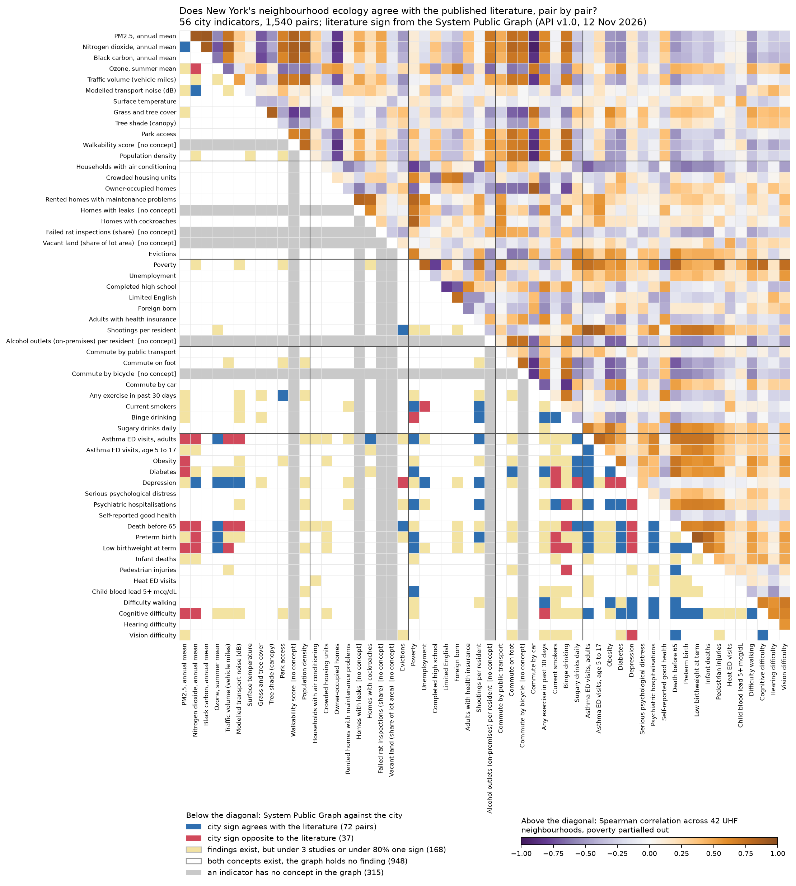
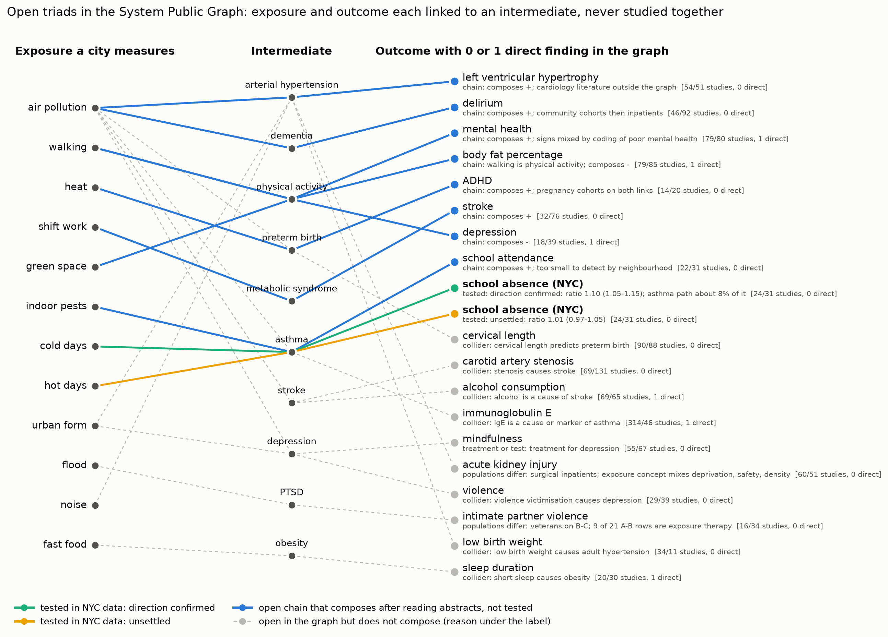
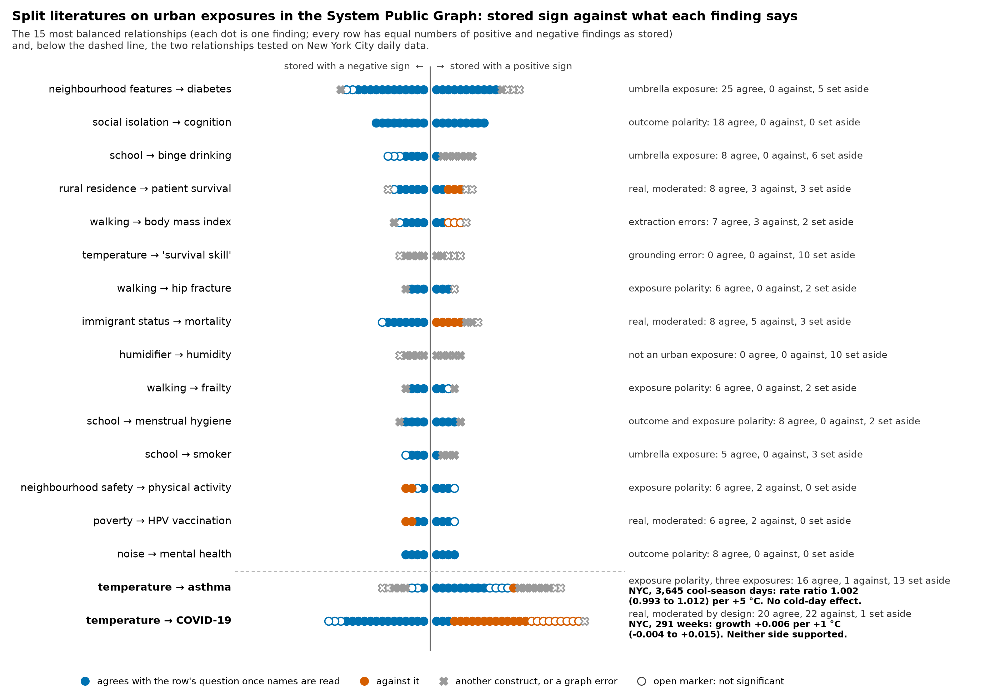

# Graph discovery: questions the System Public Graph makes askable of city data

## A concordance matrix: does New York's neighbourhood ecology agree with the literature, pair by pair?

Every earlier claim in this project compared one relationship chosen by hand. This study compares all of them at once. It takes 56 indicators that the city publishes for its 42 UHF neighbourhoods, maps each to concepts in the System Public Graph, and asks of every one of the 1,540 pairs whether the graph holds findings, which sign those findings have, and whether the correlation across neighbourhoods has the same sign. The code is in `analyses/graph_concordance/`, the data in `data/derived/graph/concordance/`, and the claim is `graph-concordance-matrix`.

### Method

Fifty-two indicators come from the Environment and Health Data Portal at the commit pinned in `analyses/mobility/ehdp.py`, each at its latest period with at least 40 areas reported. Four come from this project's tract tables (shootings per resident, vacant land, modelled transport noise, population density), aggregated to UHF42 by the tract's representative point. The mapping table `indicator_concepts.csv` gives each indicator's concepts and its polarity. Fifty indicators have at least one concept, 80 concepts in all. Six have none: walkability, leaks or damp, rodents, alcohol outlets, cycling and vacant land.

The literature's sign for a pair is the majority sign of the graph's findings between any concept of one indicator and any concept of the other, in either order. A finding counts when `tools/graph_evidence.normalise` gives it a direction and its statistic is not a group difference. The sign is multiplied by the two polarities and reversed for each variable name that carries a negation word. A pair qualifies when it has signed findings from at least 3 studies and at least 80% of them have one sign. The neighbours of the 80 concepts were read first, so only the 579 relationships that exist were fetched; they hold 8,792 findings. The findings come from the API and were not filtered against the Dataverse CSV, which is not on this machine.

The procedure was registered and pushed (branch `prereg/graph-concordance-matrix`) after the literature signs were computed and before any city value was loaded. The registration predicted agreement of 65% (55 to 75) for the deciding correlation and 78% (68 to 88) for the raw correlation, against a null of 50%. The deciding correlation is the Spearman correlation with poverty partialled out, and the raw correlation for pairs that include poverty. Five qualifying pairs overlap relationships the project had already analysed, and the registration lists them.

### Result

Of the 1,540 pairs, 315 have an indicator with no concept, 948 have concepts at both ends and no finding, 168 have findings that are too few or too mixed, and 109 qualify. In 105 of the 109 the literature's sign is positive.

The deciding correlation has the literature's sign in 72 of 109 pairs, 66.1% (bootstrap over neighbourhoods 59.6% to 78.0%). The raw correlation agrees in 79.8% (67.0% to 89.0%). When each indicator's values are shuffled across neighbourhoods, agreement falls between 40.4% and 58.7% in 95% of 2,000 shuffles. The registered support condition is met, and both predictions were within two points. Without the five previously analysed pairs the rates are 66.3% and 80.8%.

This agreement mostly reflects that adverse conditions occur in the same neighbourhoods. A rule that predicts a positive sign for every pair reaches 64.2% on the deciding correlation and 76.1% on the raw one. When the literature signs are shuffled among the qualifying pairs, the deciding agreement is not distinguishable from the shuffled range (p = 0.14); the raw agreement is (p = 0.003). The literature's sign adds two to four points to what the valence of the indicators already predicts, and the qualifying set has only four negative signs with which to show more.

Agreement differs sharply by kind of pair. Two health outcomes agree in 34 of 41 pairs (41 of 41 before poverty is partialled out). A social or housing condition with anything else agrees in 14 of 15. A behaviour (smoking, binge drinking, exercise, sugary drinks, walking to work) agrees in 14 of 26. Air pollution, traffic or noise agrees in 10 of 27, which is below chance. PM2.5 agrees in 1 of its 7 qualifying pairs, traffic in 1 of 4 and nitrogen dioxide in 3 of 9. Partialling out population density as well as poverty does not change this (10 of 27).

The strongest agreements are low birthweight with preterm birth (rho 0.91 after poverty; 44 of 48 findings positive), adult asthma emergency visits with shootings (0.91; all 10 findings between asthma and violence positive), NO2 with PM2.5 (0.90), adult with child asthma visits (0.79) and diabetes with death before 65 (0.75; 607 of 678 findings positive, 480 studies).

### The five strongest disagreements

These are exploratory leads. The file `qualifying_pairs_ranked.csv` lists all 109 pairs.

Nitrogen dioxide and ozone correlate at −0.73 across neighbourhoods, and the graph's sign is positive (8 of 9 signed findings). This one is a graph error. Six of the ten findings compare satellite NO2 from the Ozone Monitoring Instrument with ground NO2, and the instrument's name grounded them to ozone (PMID 29156623 and two others). A seventh, a Pearson r of 1.00 (PMID 17723619), is not in its abstract. The one correctly extracted finding is an inverse correlation of −0.68 (PMID 35232120), which the city matches. Nitric oxide from traffic removes ozone, so ozone is lowest where NO2 is highest.

PM2.5 and diabetes correlate at −0.55, against 17 positive findings of 19 from 14 studies. One checked abstract confirms its number (odds ratio 1.31, 1.22 to 1.41, per interquartile range; PMID 37229603, Taiwan). The likely explanation is ecological confounding by residential sorting. PM2.5 is highest in Manhattan's dense core, whose residents are younger and richer in ways that a poverty rate does not capture. The contrast is also small: neighbourhood means run from 5.7 to 8.8 µg/m3. Geocoded individual records with age and income would settle it.

Traffic volume and death before 65 correlate at −0.54, against 13 positive findings of 15. The checked finding is correct (mortality rate ratio 1.13 per doubling of NO2, PMID 22950554), but it measures traffic pollution at the home address. The city's indicator is vehicle miles driven through the area, with no area denominator, so measurement differs as well as population. Traffic counts on the residents' own blocks, linked to deaths, would settle it.

Nitrogen dioxide and death before 65 correlate at −0.53, against 38 positive findings of 44 from 32 studies (for example relative risk 1.024 in the highest decile, US Medicare, PMID 33957920). The effects in the literature are a few percent per unit, and differences in who lives where are far larger than that between neighbourhoods. The explanation is the same sorting. A within-neighbourhood design, or people who move, would settle it.

PM2.5 and obesity correlate at −0.51, against 6 positive findings of 6 from 3 studies, all with large contrasts in exposure (odds ratio 1.43 per standard deviation in a Chinese cohort, PMID 37230219). This may be a real urban difference. In New York the dense neighbourhoods have both more pollution and more walking, and commuting on foot correlates with NO2 at +0.82. Density raises the exposure and lowers the outcome together. Accelerometer or commute data on individuals, with pollution at their addresses, would separate the two.

Binge drinking shows the same pattern in the behaviour group: it correlates negatively with death before 65 (−0.48), low birthweight and pedestrian injuries, against a consistently positive literature, because in New York it is most common in affluent neighbourhoods with many young adults.

### Pairs with no findings

Of the 1,225 pairs with concepts at both ends, 948 (77%) have no finding in the graph. `gaps_unstudied_pairs.csv` lists these and the 315 pairs with an unmapped indicator, ranked by the size of the city correlation; 229 of them have a correlation of at least 0.5 in absolute value. A pair with no finding in the graph may still be well studied. Poverty with self-reported health, preterm birth with infant death, and hearing with cognitive difficulty have no findings here although each has a large literature, because the findings are grounded to other concepts. A subject specialist has to read the list before it is used.

Some pairs on it look like open questions that a city could study. Household air conditioning correlates negatively, after poverty, with preterm birth (−0.63), infant death (−0.56) and low birthweight (−0.55). Evictions correlate with obesity (0.57), diabetes (0.49), infant death (0.47) and low birthweight (0.47). Grass and tree cover correlates positively with obesity (0.60), and commuting by car with diabetes (0.59) and death before 65 (0.53), which is the greener, car-dependent outer city. Child asthma visits correlate with shootings at 0.83. Limited English correlates negatively with asthma visits for children (−0.50) and adults (−0.47). Among the indicators with no concept, cycling to work correlates with obesity at −0.71 and with preterm birth at −0.59, and alcohol outlets per resident with obesity at −0.69. These are correlations among 42 areas and were not tested.

### Graph errors and limits

The errors found were the Ozone Monitoring Instrument grounding and the unsupported r of 1.00 above, and PMID 36402182, where percent changes in diabetes incidence (for example 11%) are stored as hazard ratios of 0.11, 0.13 and −0.30, which reverses their sign. Seven other abstracts matched the graph's number, direction and population. The search found no concept for cycling, walkability, damp, alcohol outlets, eviction or home ownership.

The negation rule reversed 513 of 8,290 signed findings and has false positives, such as "non-cystic fibrosis" and "compared to lowest quartile". Without the rule, 125 pairs qualify and agreement is 66.4%, so the result does not depend on it. Pairs share indicators, so 109 pairs are far fewer than 109 independent tests. The study has only 42 areas. Several indicators have no recent UHF42 release: pedestrian injuries and heat emergency visits date from 2014, infant deaths from 2013, housing conditions from 2017, tree shade from 2014 and walkability from 2011. The portal publishes no UHF42 measure of heart disease, hypertension, sleep or life expectancy, so those outcomes are absent. The registration text says 48 indicators have a concept; the number is 50. The study used 701 uncached API requests.

### What the graph made askable

No one would have posed 1,540 questions to a literature search, and no review covers air quality, housing, behaviour and birth outcomes in one frame. With the graph the whole matrix can be asked at once, and three questions come out of it that a single comparison could not raise. The first is where a city's geography agrees with published research and where it does not, by domain: here the answer is that health outcomes and social conditions agree and ambient exposures run the other way, so in a dense city where residents are sorted by income and age, a neighbourhood map of pollution does not show where its health effects fall. The second is how much of any "confirmation" is only the clustering of disadvantage; the always-positive benchmark measures that, and any city can compute it. The third is which pairs the city measures and the graph holds no research on. A city agency could take the ranked gap list, remove the pairs a subject specialist recognises as studied, and commission work on the rest, starting with air conditioning and birth outcomes, where the city already holds both records. A researcher could run the same matrix for another city with neighbourhood indicators (London, Chicago, Toronto) and compare which domains disagree; if ambient exposures disagree only in cities whose centres are rich, sorting is the explanation. The graph's owners could use the disagreements as an audit: the largest one here was a grounding error that the city data exposed.

## Do the results travel? Two New York results tested in Chicago

The New York results were tested in a second city, using the same code and the same model with the portal changed. The claims `transfer-chicago-heat-shootings` and `transfer-chicago-weekday-pattern` were registered before any Chicago value was queried (local commits 0166e87 and 4bf91ba, pushed alone to the branches `prereg/transfer-chicago-heat-shootings` and `prereg/transfer-chicago-weekday-pattern`). Each registration fixed the New York estimate as the prediction and a band that counts as transferring: for the heat result, a Chicago rate ratio within 25% of New York's excess over 1 (1.110 to 1.183) with a lower limit above 1; for the weekday result, a Loop change in the Monday/Friday deficit within 25% of New York's 8.7 points (6.5 to 10.9) with an interval excluding 0. Outside 50% of New York's value (below 1.073 or above 1.219; below 4.4 or above 13.1 points) the registered verdict was "does not transfer". Scripts are in `analyses/transfer/`, data in `data/derived/graph/transfer_chicago/`, and the figure is `figures/graph/transfer_chicago.png`.

### Heat and shootings

The outcome series is the daily number of distinct cases with a gunshot injury in the City of Chicago's Violence Reduction victims dataset (`gumc-mgzr`, found through the portal's catalog search), 1 January 2010 to 31 August 2026. The dataset holds non-fatal shootings only from 2010, which is why the window is shorter than New York's. The weather is GHCN-Daily at Midway (USW00014819), missing on 0.03% of days. The model is the New York model: a negative binomial regression of daily counts on maximum temperature per 5 C with day of week, month, year, holiday and rain terms, and robust standard errors. It was fitted to 6,085 days and 41,063 cases, a mean of 6.7 cases a day against 3.2 in New York.

The Chicago rate ratio is 1.131 per 5 C (95% interval 1.120 to 1.143). New York's is 1.146 (1.130 to 1.163). The estimate lies inside the registered band and its lower limit exceeds 1, so the verdict is confirmed, which here means that the result transfers. The two intervals overlap only in the range 1.130 to 1.143, and the Chicago estimate is 0.015 below New York's, about a tenth of New York's excess. Eight pre-specified variants give 1.105 to 1.146: lags 0-1 gave 1.132 (1.120 to 1.145), minimum temperature 1.133 (1.119 to 1.147), May to September 1.105 (1.087 to 1.123), 2010-2019 1.142 (1.128 to 1.157), 2020 onward 1.116 (1.099 to 1.134), O'Hare in place of Midway 1.133 (1.121 to 1.144), gunshot homicides only 1.115 (1.091 to 1.139) and a count built from the Crimes dataset (`ijzp-q8t2`) 1.133 (1.122 to 1.144). Plotted without a model, the mean daily count by temperature bin follows nearly the same curve in the two cities (panel A of the figure).

The benchmark from the literature, Reeping and Hemenway's 1.158 on weekdays and 1.190 on weekends and holidays per 5 C, is higher than what the Chicago portal gives. In an exploratory split the Chicago weekday estimate is 1.126 (1.114 to 1.138) and the weekend and holiday estimate 1.140 (1.127 to 1.154); neither interval includes the published value. The same model restricted to their years, 2012 to 2016, gives 1.146 (1.126 to 1.167), which includes 1.158 but not 1.190. Their data came from newspaper reports and cover five years; the portal data cover sixteen. The weekend excess they report is not seen at this size in the portal data.

### The weekday pattern

The measure is the sum of turnstile entries per day over the stations of an area, from the CTA 'L' daily station entries (`5neh-572f`). The Loop was fixed before any ridership was read as the station ids whose stop coordinates, from the CTA stops table (`8pix-ypme`), fall in a box covering Lake to LaSalle/Van Buren and State to Wells; the rule selected 15 stations. The data end on 31 August 2026, so the recent period is the registered fallback, 1 September 2025 to 31 August 2026 (41 retained weeks); the baseline is 2019 (42 weeks). The week-exclusion rules and the bootstrap are those of New York.

In the Loop the Monday/Friday deficit against Tuesday to Thursday rose by 15.9 points (95% interval 12.0 to 22.7) from 2019 to the recent period. The recent deficit is 18.2% (17.1 to 19.3), with Monday at 16.4% and Friday at 20.1%. This is above the registered limit of 13.1, so the registered verdict is contested: the pattern transfers in sign and in its midweek plateau (range of Tuesday to Thursday 0.9 points) but not in size, which is about 1.8 times New York's 8.7 (6.9 to 10.9). Four pre-specified variants give 13.5 to 16.4 points (median across weeks 13.5, days only 13.6, calendar 2025 15.4, without the strike weeks of October 2019 16.1, wider box 16.4).

The 2019 baseline in Chicago is unstable. The week of 28 January 2019, the polar vortex, has a Wednesday entry count at 27% of the Tuesday to Thursday mean of that week, and the week-bootstrap interval for the 2019 deficit (-6.2 to 3.2 for the rest of the system, -4.0 to 5.8 for the Loop) is wide because of it. The placebo difference between 2019 and 2018 is -3.5 points (-10.2 to 0.3), which fails the registered check of 1.5 points. Dropping that one week is an analysis chosen after seeing the data, so it is exploratory and does not change the verdict. With it dropped the 2019 Loop deficit is 5.3% (4.7 to 5.9), almost the same as New York's 5.1% (4.3 to 6.0), and the Loop change is 12.9 points (11.6 to 14.2), just under the refutation limit. The best reading is that before 2020 the two downtowns had the same Monday/Friday deficit, and that since then the Chicago Loop has moved further.

The rest of the 'L' system rose by 8.8 points (5.1 to 15.3), or 6.0 (4.8 to 7.2) without the January week, against 4.2 (2.2 to 6.6) for the New York subway outside the CBD. The Loop exceeds the rest by 7.1 points (-1.1 to 15.7), so the ordering seen in New York is present in the point estimates but not established. The Monday deficit in the Loop (16.4%) equals New York's CBD figure (16.4%, 13.2 to 20.9). The Friday deficit does not: 20.1% in the Loop against 11.2% (10.3 to 12.1) in New York. That difference is the largest finding of the comparison and has no explanation in these data.

### What the graph says about transfer

The question for the graph is how much of the literature on these two topics comes from large dense US cities at all, since that is the evidence on whether transfer should be expected. The relationship-level studies endpoint returns a free-text population for each study. I paired nine temperature and weather concepts with seventeen violence-side concepts in both directions (306 requests) and obtained 13 relationships and 23 studies. Of these, 8 studies concern interpersonal violence (homicide, intimate partner violence, firearm violence): 3 are US, 2 of those name a set of large US cities (Xu et al. 2020, nine cities including Chicago and New York; Lyons et al. 2022, the 100 largest), and 1 names Chicago or New York. Two more studies were found only by variable name, because their temperature and violent-crime variables are not grounded to concepts: Heo et al. 2024 (South Korea, 2016-2020) and Potgieter et al. 2022 (a township in Cape Town, South Africa, 2006-2016). The share of interpersonal-violence studies naming a large US city is 2 of 8 (25%, interval 7% to 59%), which is not below the 25% I registered as the upper bound; the registered prediction on this point is scored a narrow miss. The share for all violence-side studies including suicide and occupational injury is 3 of 23 (13%, 5% to 32%). The graph's one direct two-city contrast is in Xu et al.: homicide rises 9.5% (4.3 to 15.0) per 5 C in Chicago and 8.8% (1.5 to 16.6) in New York, which is as close as the two shooting estimates above (1.131 and 1.146). The graph's concept for gun violence has no relationship with temperature, so all evidence on shootings in it is one finding from Lyons et al., RR 1.17 (1.12 to 1.21) at the 84th percentile of temperature against the median, which I checked against the abstract and which is correct.

For telework and commuting, I searched study variables by name (the concept for telecommuting has few findings, and there are no concepts for telework, commuting or ridership). Variable names matching telework, remote work or work from home gave 84 variables and 76 studies; 74 gave a population. Of these, 15 are in Japan, 15 in Europe, 11 in the United States (15%, 9% to 25%), and none of the 74 names a city. Commuting variables gave 230 variables, of which I followed the first 110, and 90 studies: 16 of 87 with a population are US (18%, 12% to 28%) and one names a US city. Variables on transit ridership gave 11 studies; 5 have no population, and none is a ridership time series for a US city. Almost all telework studies are surveys of health and well-being during the first year of the pandemic. None measures where people travelled or on which weekday. The graph therefore holds no evidence on the weekday pattern in any city, and what it does hold on telework is drawn from East Asia and Europe more than from the United States. If the literature were the only guide, one would expect the New York weekday result to transfer to nowhere in particular; the Chicago test is the only evidence.

The population field is free text, was written by a language model from the abstract, and is sometimes a sample description with no place ("12,774 desk workers", 17 of 74 telework studies). I assigned regions by keyword rules in `analyses/transfer/graph_populations.py` and listed all the classified rows in `populations_classified.csv`; shares are approximate. Four findings I relied on were read against their abstracts by PMID: Lyons (36525273), Xu (32738768), Heo (38331944) and Potgieter (35061073) match on number, direction and population except as listed under errors.

### Graph errors found

The values for Xu et al. are stored as odds ratios 0.095 and 0.088 (and Rahman et al. as 4.9 and 6.2); the abstracts report percent increases per 5 C, so the true odds ratios are 1.095, 1.088, 1.049 and 1.062. The concept-level listing for "temperature" returns 643 relationships and lacks the temperature to homicide relationship, which exists and is returned by the direct lookup, so a neighbour search through the listing misses findings that a pair lookup finds; the true size of the listing is unknown. The two violent-crime studies (Heo, Potgieter) have variables that are not grounded to any concept, so the concept-level relationship tables cannot see them. Temperature to firearm has a single finding. Studies on temperature and gun violence that exist in the literature (Reeping and Hemenway 2020, for one) did not appear among the 23 studies. The population field is empty for 5 of the 11 ridership studies and 2 of the 76 telework studies, and generic for others.

### What did not work

The Chicago weekday test could not use hours, which the CTA dataset does not hold, so the hour-band secondary analysis registered for New York was not repeated. The 2019 baseline is damaged by one storm week, so the registered primary verdict rests on a number that is sensitive to a single week; the exploratory correction is borderline. The shooting unit is a case in Chicago and an incident in New York, which are close but not the same. Midway is 13 km from the Loop. The graph's population field could not say whether a study's setting is dense or large unless a city was named; the third column of the table is therefore a count of named large US cities, not of dense places. About 900 uncached requests were made to the graph API (606 counted by the study's wrapper and up to 250 in one interrupted run of the violence-variable search whose count was lost); other agents were using the same key and the cache grew by thousands of files while this ran. The Dataverse copy is not on this machine, so no finding was checked for presence in the quality-filtered deposit.

### What a third city would need

For the heat result a city needs a portal series of shooting or gun-injury incidents with a date, over about a decade (the Chicago model had 6,085 days and 41,063 cases; New York had 7,548 and 24,429), and a GHCN-Daily station within about 25 km. Cities that publish incident-level shooting or victim data on Socrata portals are candidates, and the portal's catalog search finds them in minutes; I did not check any. For the weekday result a city needs a daily count of entries by station, or by hour, with station coordinates, a continuous record through 2019, and enough weekday weeks (about 40 a year) after the holiday and storm exclusions. Chicago and New York publish this on their open data portals; some other systems publish station-level ridership only monthly or as annual averages, which would not allow the test. The registration fixes the Loop rule from coordinates, so a new city needs the stops table with coordinates and a stated definition of its core.

### What the graph made askable

Without the graph, the natural question to ask of a published result is whether it is correct for the city that produced it. The graph made a different question possible: how much of what is published about a topic was measured in cities like ours, and which of our results therefore have no outside check. For temperature and violence the answer is a handful of studies, of which two name large US cities and one contains both Chicago and New York; for telework and commuting it is about 160 studies and none that records where or when people travelled in a US city. That told us in advance which result had the better chance of travelling (the shooting result, because a multi-city study had already found Chicago and New York within one percentage point) and which had no precedent (the weekday result), and the outcomes follow that order: the shooting estimate is in the band and the weekday change is 1.8 times too large. The graph also allowed a test that no single paper can make, the comparison of two cities by one set of code and registered bands, with a stated ground in the literature for where to expect transfer and where not. A researcher can now ask, for any registered result, how many graph studies sit near it by place, population and measure, and register the transfer prediction with that number attached. A city agency could use the Chicago pair as a method for its own data: run an existing published model on its portal's series, with the band registered first, and report the departure as a finding about the city. The most useful next studies are the Friday deficit, which differs between the two downtowns by 9 points and which neither the literature in the graph nor these data explain, and a set of third cities for the shooting result, where the slope per 5 C can be compared across ten or twenty cities with one script and the heterogeneity examined against the study population fields the graph already holds.

## Untested chains: exposures and outcomes that the graph links only through a third concept

The oldest use of a graph of findings is literature-based discovery. If many studies link A to B and many link B to C, and none studies A and C together, the pair A and C is a candidate for a relationship that nobody has examined. This study listed such open triads for exposures that a city measures, read the abstracts behind the highest-ranked ones, and tested two composed predictions in New York City data. Scripts are in `analyses/graph_triads/`, data in `data/derived/graph/triads/`. Counts come from the API (v1.0) on 12 November 2026; the Dataverse copy is not on this machine, so no finding could be marked as present in the quality-filtered deposit. The study used 457 uncached graph requests.

### Building the list

Concept search was run for 47 terms and 51 concepts were chosen by label (`term_search.json`, `exposures.py`). Eight of them have no relationships at all in the graph: tree, urbanization, public transport, artificial light, food insecurity, poverty area, unemployment and, for practical purposes, heat wave (one finding). Eviction, cycling, alcohol outlets, walkability and commuting have no concept. The concepts were pooled into 15 exposure families (noise; air pollution; indoor air and pests; heat; green space; urban form; crowding; housing and homelessness; walking; shift work and light at night; flood; fast food; poverty and unemployment; crime; traffic collision), because a pair that is open for "traffic noise" may be closed for "noise".

An intermediate B is a concept with at least 5 studies linking it to a family. There are 269 such concepts after removing demographic covariates and all-cause mortality by hand; the 190 with the most studies were fetched with all their neighbours. A second, computed list of generic concepts was made from those 219 neighbour lists: a concept is generic if it is among the ten best-supported neighbours of at least a quarter of them. Five concepts qualify: mortality rate (53%), gender (51%), body mass index (32%), diabetes (29%) and smoking (28%). They were removed as intermediates and as outcomes. An outcome C is a concept with at least 10 studies linking it to B and at most one finding linking it to any member of the exposure family.

This gives 17,936 open triads, 14,531 of them with no direct finding at all (`open_triads.csv`). Air pollution has 2,515, urban form 2,462, housing and homelessness 1,942, walking 1,805 and heat 1,684. Green space has 114 and crowding none, because no concept is linked to crowding by five studies. Dropping outcomes whose Wikidata description marks them as a drug, a procedure, a test, a gene or a chemical leaves 9,597 triads and 4,405 distinct pairs of family and outcome (`open_triads_by_outcome.csv`).

The 45 pairs with the strongest weaker link, and 13 pairs chosen because New York measures both ends, had the findings on both links fetched (`triad_signs.json`). Each was scored as the number of studies on the weaker link times the lower of the two links' sign consistency, where consistency is the share of signed findings with the majority sign (`triads_scored.csv`).

### What the top 20 are

I read the variable names on both links of the 20 highest-scoring triads and 59 abstracts (`verification.csv`, `verification_samples.json`). Seven are colliders: C is a cause or predictor of B, not a consequence, so nothing follows about A and C. Examples are air pollution, preterm birth and cervical length; air pollution, stroke and carotid stenosis; air pollution, stroke and alcohol; urban form, hypertension and sleep apnea. Four have a treatment, a diagnostic marker or an in-hospital complication as C (warfarin, troponin, bleeding after stroke, mindfulness), which the description filter did not catch. Three join two names for one construct or two comorbid conditions (hypertension and arterial blood pressure, asthma and rhinitis, depression and migraine). Six are chains in which B plausibly leads to C. Two of those fail on population or on the exposure: "urban form to hypertension" mixes deprivation, perceived safety and population density under one concept, and its hypertension to acute kidney injury findings come from surgical inpatients. Two are chains through a near-synonym (walking, physical activity, and body fat or mental health). Two are substantive: air pollution to hypertension to left ventricular hypertrophy (54 and 51 studies, 96% and 95% sign consistency, no direct finding) and air pollution to dementia to delirium (46 and 92 studies, 93% and 99%, no direct finding).

So 2 of the 20 best-scored open triads are new chains that compose, and 4 more compose trivially or doubtfully. The graph's relationships are undirected, and a count of studies cannot tell a mediator from a risk factor of the intermediate; that reading has to be done on variable names, and it took a few minutes per triad. A web search found cardiology studies of air pollution and left ventricular mass that the graph does not hold, and only a thin literature on air pollution and delirium (a 2017 surgical series, a 2024 hip-fracture study with the opposite sign, a 2024 Mendelian randomisation), so the second is close to open outside the graph as well.

Among the 13 pairs chosen for New York, reading removed four more. Air pollution, depression and violence fails because the depression and violence findings are mostly violence victimisation leading to depression (59 of 59 positive, but in the reverse direction). Noise, hypertension and low birth weight fails because the findings are low birth weight leading to adult hypertension. Fast food, obesity and sleep duration fails because short sleep leads to obesity. Flood, post-traumatic stress and partner violence fails on population (flood survivors on one link, military veterans on the other). Chains that survive reading and that nobody on the team had thought of: heat in pregnancy to preterm birth to attention deficit hyperactivity disorder (14 and 20 studies, 95% and 97% consistent, no direct finding), shift work to metabolic syndrome to stroke (32 and 76 studies, no direct finding), and temperature or indoor pests to asthma to school attendance (24 or 22, and 31 studies, no direct finding).

### Two composed predictions tested by day

Composing a chain through a disease gives a small number. The predicted ratio for C is the ratio for B raised to the share of C that B accounts for, and that share is a few percent for most pairs here. For neighbourhood pairs such as cockroaches, asthma and school absence, or crime, depression and stroke, the composed difference between a high and a low neighbourhood is 1% to 2%, far below what 42 or 59 areas confounded by poverty can show. I therefore tested the one surviving triad whose two ends are measured by day: temperature, asthma and school attendance.

The temperature and asthma link has 40 findings, 32 positive and 8 negative, but the positive ones mix two exposures: heat in the hot season and cold in the cold season both raise asthma admissions. The sign consistency of 80% describes neither. I registered the two arms separately, each before any attendance data were queried, and pushed each alone (`prereg/graph-triad-hot-asthma-absence`, `prereg/graph-triad-cold-asthma-absence`). The hot link is a relative risk of 1.19 (1.06 to 1.34) for 30 °C against 27 °C (Hong Kong, PMID 27343213); the cold link is 1.64 (1.06 to 2.54) for the 5th percentile of temperature in children (Hefei, PMID 35817164). The second link is 2.21 (1.41 to 3.01) more days absent per year for children with asthma (Rochester, Minnesota, PMID 11487757), which with an assumed prevalence of 8% to 15% and 13 to 20 days absent per pupil gives asthma a 1.6% share of absences (0.8% to 2.6%). `kit/bridge.py` composes an absence ratio of 1.0026 (1.0007 to 1.0055) for hot days and 1.0073 (1.0008 to 1.0173) for cold days, and its discrimination check says that a test with a standard error near 0.017 cannot separate either from no effect (D = 0.02 and 0.22, against a threshold of 4). The registrations state this, and define support as a ratio above 1 with an interval excluding 1, with the share of the association that the asthma path can account for as a second registered quantity.

The outcome is the citywide absence rate on 2,158 school days from September 2006 to June 2019 (NYC Open Data daily attendance by school, five files), after the registered exclusions removed 218 days of low enrolment, mostly Regents examination weeks, and 9 days with absence above 30%. The model has fixed effects for school year, day of week and week of the year, indicators for rain, snow, days next to a day off and the last five days of the year, and Newey-West errors.

On cold days (Central Park maximum at or below 0 °C, 98 of 587 winter school days) the absence ratio is 1.101 (1.053 to 1.152). The verdict is confirmed for direction. The size is not the chain's: the interval lies wholly above the composed interval, and the asthma path accounts for about 8% of the log ratio (1% to 18%). Without snow days the ratio is 1.124 (1.070 to 1.181); with exposure on any of the previous three days it is 1.054 (1.021 to 1.087). Influenza is not controlled and is the main rival.

On hot days (maximum at or above 30 °C, 66 of 601 school days in May, June and September) the ratio is 1.009 (0.970 to 1.050). The verdict is unsettled. The interval contains the composed interval and contains 1. A linear term gives 0.991 per 5 °C (0.979 to 1.003).

Neither result is a confirmed composed prediction in the strict sense. The cold result shows that the open pair is a real association in New York, about ten percent more pupils absent on freezing days, and that the path the graph offered explains a small part of it. A web search found one study of temperature and school absence outside the graph (Keivabu 2024, England), which reports the opposite pattern: hot days raise absences and cold days do not.

### Graph errors

Of the 59 findings read for the top 20, 57 have the stored number in the abstract. Four attach it to the wrong variable: PMID 25669311 stores a September against January odds ratio for stroke as an air pollution effect; PMID 29792058 stores the odds ratio for a prior full-term delivery as that for a prior preterm birth; PMID 29551329 files asthma patients' discussions with a clinician about air quality alerts under air pollution and asthma; PMID 37612092 stores an odds ratio for a gene variant's carriers as one for alcohol intake. Two have the wrong statistic type (PMID 37121155, a hazard ratio stored as a relative risk; PMID 34237245, a prevalence ratio stored as a coefficient). PMID 32627662 is stored as severe depression leading to interpersonal violence; the abstract reports depression among women who experienced partner violence.

Grounding errors: 9 of the 21 findings between "flood" and post-traumatic stress disorder are trials of prolonged exposure therapy, grounded to flood through the therapy technique called flooding. The "hot" and "temperature" findings with asthma include unflued gas heaters, a heater in the bedroom and exhaled breath temperature. The relationship record for asthma and school attendance lists 31 studies and the API returns one finding; sleep and school attendance lists 24 and returns none; physical activity and walking lists 79 and returns 28.

### What did not work

No composed prediction was confirmed in size. Every chain through a disease that New York could test composes to a ratio within 2% of 1, and the city's neighbourhood data cannot detect that; the daily test could not either, and was run knowing so. The second test is the other arm of the same triad, not a second triad, because the other candidates failed reading or had no daily measure at one end. Scoring by study count and sign consistency put colliders and treatments at the top; 14 of the top 20 were not chains. Crowding, public transport, eviction, cycling and light at night could not be studied because the concepts are absent or empty, and their variable-name neighbourhoods were not built. The roles assigned to each triad are one reader's judgement.

### What the graph made askable

Without the graph nobody on the team would have asked whether air pollution is associated with delirium in hospital, whether heat in pregnancy is associated with attention deficit hyperactivity disorder through preterm birth, whether shift work has been studied against stroke directly (the graph has 32 studies to metabolic syndrome, 76 from there to stroke, and none across), or whether freezing days and school absence had been studied (no finding in two million, and a ten percent effect in thirteen years of New York attendance). The list of 4,405 open pairs is itself a new object: for any exposure a city measures it says which outcomes have been studied one step away and never directly, and after about five minutes of reading per triad it separates chains from colliders. A researcher could take the two substantive chains to cohort data that already hold both ends (air pollution and delirium in Medicare claims; heat and ADHD in birth cohorts with school records). The Department of Education and the health department could settle how much of the cold-day absence is asthma by joining daily absence by reason, or by pupil asthma status, to daily asthma visits of school-age children, which is a mediation analysis the open data do not allow. System could make this kind of search far cheaper by storing which variable of each finding is the exposure, which would remove the colliders before any reading.

## Split literatures the city can adjudicate

The graph audit found that 52% of relationships with five or more signed findings hold significant findings in both directions, and that a relationship record does not show this. This study listed the split relationships that involve an exposure a city health department measures, read the findings on both sides of the most balanced ones to see what separates them, and tested two of them on New York City daily data. Scripts are in `analyses/graph_splits/`, data in `data/derived/graph/splits/`, and the figure is `figures/graph/split_literatures.png`. Counts come from the API (v1.0) on 12 November 2026.

### Enumeration

I chose 81 concept labels in 14 families (air pollutants, noise, heat and cold, green space, active travel, urban or rural residence, crowding, housing, neighbourhood deprivation, unemployment, night work, social isolation, migration status, school) from the results of concept search, and listed each concept's relationships (`enumerate.py`). The listing returned 754 distinct relationships with at least 8 findings from at least 5 studies. It returned nothing for 26 labels. Some of these are concepts with no findings (public transport, for example), but school, unemployment, urban population, rural population, residence characteristics, migrant, emigration and immigration, cold and tree have relationships in the Dataverse table, and the API serves their associations when asked by relationship id. I therefore added the relationships of these labels from the audit's sign table (`data/derived/graph_audit/sign_mixing.csv`). To save requests I did not fetch the 292 listed relationships that the same table shows as one-sided (minority sign under 15%).

I fetched the associations of 587 relationships (`fetch_splits.py`). 283 have at least 8 signed findings from at least 5 studies, and 197 of those have a minority sign share of at least 25% (`splits.csv`). Urban or rural residence has 66 of them, school 28, heat and cold 25, active travel 21, social isolation 14, air pollution 12, migration status 8, neighbourhood deprivation 7, night work 5, noise 4, unemployment 4, housing 2, green space 1 and crowding none. The count by family follows the size of each family in the graph more than the state of each literature. Because one-sided relationships were skipped, 197 of 283 is not a rate of splitting; against all 575 relationships that met the count threshold in either listing it is about a third, which matches the audit's 32%.

### What separates the two sides

I ranked the split relationships that have significant findings from at least two studies on each side by minority share, took the first three in each family, and kept the top 15. All 15 have exactly as many positive as negative findings. I read the variable names of their 182 signed findings and 31 of the PubMed abstracts where the names were not enough, gave each relationship a question (for example "social isolation goes with worse cognition"), and coded each finding as agreeing with it, against it, or not about it (`coding.py`, `moderators.csv`, `coded_findings.json`).

Of the 182 findings, 119 agree with their row's question, 15 are against it and 48 are not about it. A stored split of 50% becomes 11% (15 of 134) once the names are read. The 15 relationships fall into four groups.

In seven the two sides say the same thing with opposite names. "Cognitive impairment" and "cognitive function" are one concept, so nine findings that isolation raises impairment and nine that it lowers function appear as a 9 to 9 split; all 18 agree. The same holds for noise and mental health (8 of 8 agree), walking and hip fracture, walking and frailty, school type and menstrual hygiene, neighbourhood safety and physical activity (6 of 8), and walking and body mass index, where two of the six positive findings are extraction errors.

In three the exposure concept is an umbrella. "Residence characteristics" holds deprivation and car dependence, which go with more diabetes, and green space, walkability and local resources, which go with less; 25 findings agree and none disagrees. "School" holds prevention programmes together with suspension, private schooling and years of education.

Two are not urban exposures. "Temperature" to "survival skill" is the body temperature of patients, horses and cats against survival, and "humidifier" to "humidity" is a set of bench comparisons of respiratory devices.

Three are real disagreements, and in each the abstracts name the moderator. Rural residence goes with worse survival after diagnosis in five cohorts (lung and colorectal cancer, medulloblastoma, drug-resistant tuberculosis) and with better survival in two (young small-cell lung cancer patients in California, oesophagogastric cancer in north-east Scotland); in the colorectal study tract income explains the rural effect entirely. Immigrants have lower mortality than the native-born in Canadian and Swedish cohorts, with the advantage shrinking with years since arrival and absent in the second generation, and higher mortality among Soviet immigrants to Israel except those with high income. Poor adolescents and adolescents in poor areas in the United States are more often vaccinated against HPV, which the authors attribute to free vaccine under the Vaccines for Children programme, while poor women aged 18 to 26 less often complete the series.

### Two tests on New York City data

I looked for split relationships whose two ends New York measures by day. The heat-and-cold family has them, because FDNY EMS dispatches and the Health Department's COVID-19 counts are daily. I recoded two relationships in full before registering anything.

Temperature and asthma has 22 positive and 8 negative findings from 17 studies. Seventeen findings are short-term effects of temperature level, and 16 of them say colder days bring more asthma visits or admissions; they are stored as positive because the variable is named "low temperature" or "cold (5th percentile)". Nine findings concern day-to-day change, where season decides the sign: in Shanghai a rise raises childhood asthma visits in the warm season and has no effect in the cool season. Three compare climates. Three of the 17 studies are from the United States; most of the time-series studies are from East Asian cities. I read all 46 abstracts of the two relationships. Temperature and COVID-19 has 26 positive and 17 negative findings from 29 studies, and recoding leaves it split: 20 findings say higher temperature goes with less transmission and 22 the opposite. Thirteen of the 22 are unadjusted correlations between daily temperature and case counts in one place over the first months of 2020. Thirteen of the 20 come from models of transmission with lags or controls.

Both claims were registered and pushed before their outcome data were queried (`prereg/split-temp-asthma-ems`, `prereg/split-temp-covid-growth`). The registrations disclose what the project had seen: the 2023 totals of every EMS call type, and the column list and date range of the COVID-19 file.

`split-temp-asthma-ems` predicted that from October to March colder days have more asthma dispatches, with a rate ratio of 0.95 to 0.99 per 5 C warmer. The data are 326,660 dispatches with an asthma call type (EMS Incident Dispatch Data, `76xm-jjuj`) on 7,275 days from October 2006 to August 2026, and Central Park mean temperature over the day and the three before it. The model is a Poisson regression with a fixed effect for every year-month, day of week and holidays, and Newey-West standard errors. The cool-season rate ratio is 1.002 per 5 C (95% interval 0.993 to 1.012; 3,645 days). The verdict is unsettled and the prediction missed: the interval excludes the whole registered range, so a cold day does not raise asthma dispatches within four days by even 1% per 5 C. Five sensitivity analyses give 1.001 to 1.006. The secondary prediction, that the slope is more positive from April to September, has the right sign but an interval that includes zero (difference of log rate ratios 0.009, −0.012 to 0.030; warm-season ratio 1.012, 0.993 to 1.032). The series starts in October 2006 and not January as registered, because the asthma call types first appear on 28 September 2006.

An exploratory look by calendar month shows why the half-year split averaged to nothing. The rate ratio per 5 C is 1.064 in June, 1.132 in July (1.079 to 1.187), 1.080 in August and 0.899 in September (0.869 to 0.931). The September value is confounded with the date: asthma rises after schools open while the days cool, and a month fixed effect does not remove a trend inside a month. The summer values are a lead for a registered test with ozone in the model.

`split-temp-covid-growth` predicted that weeks following warmer-than-normal weather have slower growth of hospital admissions, by 0.003 to 0.030 in weekly log growth per degree. The data are the daily counts of admissions and cases (`rc75-m7u3`, 29 February 2020 to 13 October 2025) and the Central Park temperature anomaly over days 7 to 20 before each week, in a regression of weekly log growth on the anomaly, lagged growth, year effects and seasonal harmonics. The coefficient is +0.006 per degree (−0.004 to +0.015; 291 weeks). The verdict is unsettled and the prediction missed. The interval excludes effects more negative than −0.004, which is the weak end of what the transmission models in the graph report, and its standard error (0.005) is too large to exclude the rest. The secondary prediction was that the raw correlation of daily temperature with daily cases within a calendar quarter, the design of the positive studies, takes both signs. Of 22 quarters, 5 have a significantly positive correlation (23%, just under the registered 25%) and 13 a significantly negative one; the values run from −0.79 in spring 2020 to +0.77 in spring 2024. A study that correlated temperature with cases in New York would have reported either sign depending on the quarter it used.

### What did not work

Neither city test confirmed its prediction. The most balanced relationships are balanced mostly because of naming, so ranking by minority share finds graph artefacts before it finds disagreements; of the 15 most balanced, three are real, and none of those three can be tested on NYC Open Data with a design better than a cross-section. Split relationships on air pollutants (particulates and birth weight, ozone and stroke) need daily pollutant series that NYC Open Data does not hold. Crowding, public transport, cycling as travel, alcohol outlets and commuting have no split relationships because they have almost no relationships. The local copy of the Dataverse deposit is not on this machine, so all sign counts are from the API and include findings the quality filter may have removed. The moderator coding is one reader's, unblinded.

### Graph errors

- The API's relationship listing for a concept is empty for school, unemployment, urban population, rural population, residence characteristics, migrant, emigration and immigration, cold and tree, and `GET /v1/relationships/<id>` returns 404 for their relationships (for example school to smoking, 52 findings in the Dataverse table), while `/v1/relationships/<id>/associations` returns the findings.
- Opposite-valence variables share a concept: cognitive impairment and cognitive function; poor and good mental health; walking difficulty and hours walked; low temperature and temperature; above and below the poverty line.
- PMID 35817164 (cold and childhood asthma, Hefei): four results are stored twice, giving 8 of the 30 temperature and asthma rows.
- PMID 35257688 (Netherlands): the abstract says higher temperature goes with lower COVID-19 reproduction; the row is +0.875.
- PMID 34375443: fever thresholds in nursing-home residents, grounded to ambient temperature against COVID-19.
- PMID 19782925: the abstract reports an inverse correlation of walking distance with body mass index; the row is +0.75. PMID 31893356: an odds ratio of 0.65 is typed as a coefficient, so its sign against zero is positive.
- PMID 17933419: rurality is a risk factor for decreased lung cancer survival; the row is an odds ratio of 1.42 for survival.
- PMID 25082349: foreign tourists in glacier crevasse accidents, grounded to "emigration and immigration". PMID 41348505: the effect of heatwaves on mortality among immigrants, stored as immigration to mortality.
- PMID 29351629: living in a walk-up building, grounded to "walking".
- Two concepts are labelled humidity ("Humidity" and "humidity"); one has no relationships and the other 286.
- Patient survival is grounded to "survival skill" (as the audit found), which creates the two relationships with that target in the top 15.

The study made about 740 uncached requests: 587 association fetches, about 85 relationship listings and about 70 concept searches and probes. The cache grew by more in the same period because other agents were writing to it.

### What the graph made askable

Without the graph a reader meets one side of a literature at a time, and a review reports heterogeneity as a number. With it one can ask which of several hundred urban relationships are in dispute, and then ask of each dispute whether it is about the world or about words; here the answer was that 12 of the 15 most evenly split relationships contain no disagreement. One can ask what the opposing studies have in common, and get answers that suggest a test: the colder-is-worse asthma studies are nearly all from East Asian cities and use lags to 21 days, which made it reasonable to ask whether a centrally heated American city shows the effect at all, and New York's EMS record says that within four days it does not. One can ask whether a split is produced by a study design, and then reproduce the design on a city's own data: New York's quarterly temperature and COVID-19 correlations take both signs, 13 negative and 5 positive, which is the split in the literature generated inside one city. None of these questions is in the papers themselves, because each paper is on one side. A researcher could next run the sign-recoding step over all 197 split relationships with a language model and a human check, so that the graph reports substantive rather than stored splits. The Health Department could test the three real splits where it holds the data: HPV vaccination by neighbourhood poverty and age from the Citywide Immunization Registry, mortality by nativity and years since arrival from vital statistics, and the summer rise of asthma calls with temperature against daily ozone. Any city with a daily EMS feed and a weather station can repeat the two tests here from the scripts.
