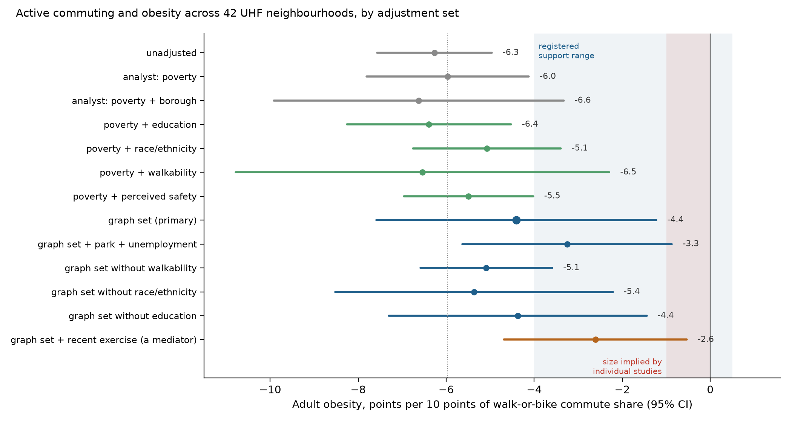
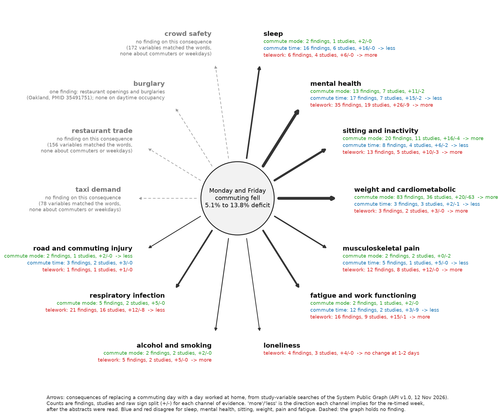
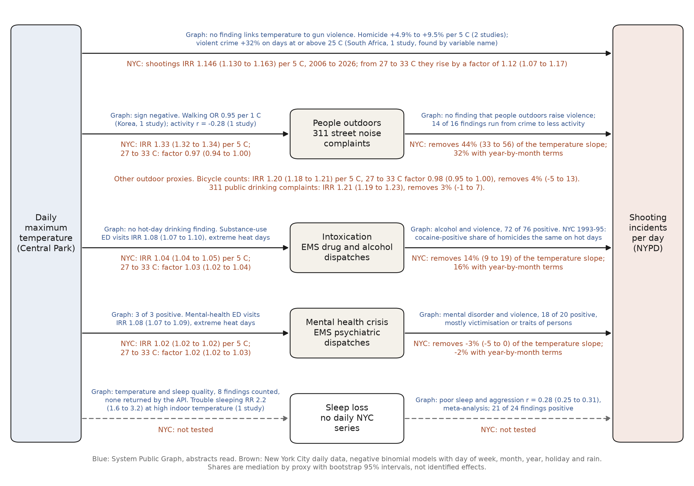
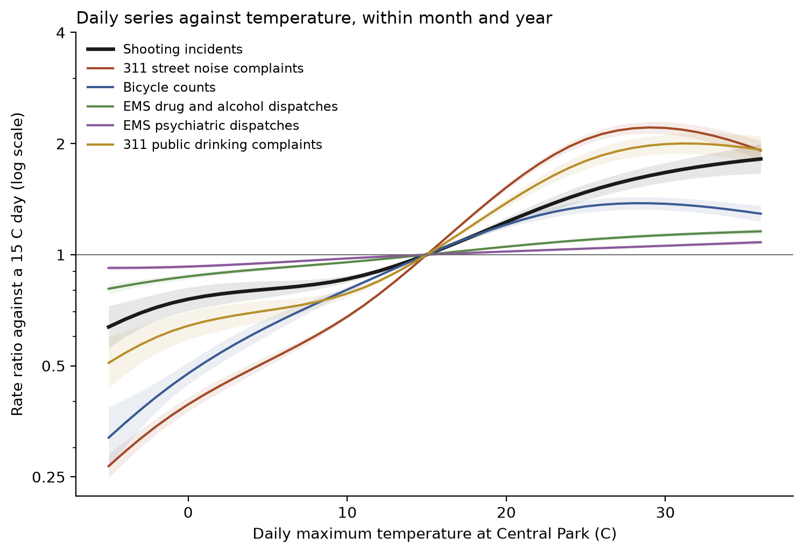

# Graph experiments: what the System Public Graph adds to city data

## Coverage: where the graph speaks to the claim set and where it is silent

This experiment queried the graph for both ends of each of the 44 registered claims. It tested nothing against city data and registered nothing. The term for each end, the concepts chosen for it and the variable-name queries are in `analyses/graph_coverage/termmap.py`; the scripts are `collect.py` and `make_outputs.py` in the same folder; the output is `data/derived/graph/coverage/coverage.csv` (one row per claim), `ends.json`, `pairs.json`, `end_gaps.json` and the figure `figures/graph/coverage.png`. Counts come from the API (v1.0) on 12 November 2026, with sign splits from `tools/graph_evidence.py --api-only`, so they include associations that the Dataverse quality filter may have removed. The run used about 450 uncached requests (411 distinct requests in the main run that were not in the cache when it started, plus about 40 exploratory concept searches; other agents wrote to the same cache at the same time, so the figure is approximate).

Each claim's cause and effect were mapped by hand to search terms, and concepts were chosen from the labels that search returned, not by taking the first hit. 14 of the 44 claims are record-keeping or measurement claims with no causal edge (reproductions, counts of permits); they are included because the question for them is whether the graph holds anything on the topic, and the answer is the same kind of coverage. Each end got one of three states: a relevant concept exists (27 of the 45 distinct ends), no concept but relevant study variables exist (8), or nothing usable (10). A claim was then classed by its worst end.

Six claims have concepts at both ends and at least one finding linking them, nine have both concepts and no linking finding, nine lack a concept at one end but have relevant variables, and 20 are silent because an end has no usable variable. Of the six linked claims, two carry volume: air pollution to asthma has 360 findings from 198 studies (324 positive, 26 negative, 229 positive and 12 negative significant; the relationships are air pollution, nitrogen dioxide and particulates to asthma), and physical activity or walking to obesity has 104 findings from 75 studies (14 positive, 14 negative among the 28 with a sign, because "physical activity" is a proxy for active commuting and the sign depends on how each study coded the comparison). The other four rest on one to three findings: maximum temperature to heat stroke (3 findings, 2 studies), temperature to EMS responses (3 findings), temperature to firearm shootings (1 finding, 1 study) and shootings to EMS (1 finding, from the same temperature paper's concept pair). Shared neighbours, which are the candidate mediators and confounders, exist only where the concepts are dense: 162 for air pollution and asthma (for example allergic rhinitis, low birth weight, pneumonia), 269 for physical activity and obesity (mortality rate, hypertension, diabetes, sleep, neighbourhood characteristics), and 11 to 35 for the heat claims. Where there is no direct link there were also no shared neighbours with two or more findings on each side (0 for all nine no-link claims), so the graph supplies no mediators for those chains either.

By topic, the graph covers health outcomes of environmental exposures: air pollution and asthma, temperature and heat illness, physical activity and obesity. It covers the violence and traffic topics only through variable names. Speed cameras (9 variables), vacant land (21), mouse allergen and rodent infestation (50), gentrification (17), commuting (over 100) and rat sightings (7) all exist as study variables with associations, and none is grounded to a concept that a concept query would find. It does not cover permits and construction at all (8 claims, no variable names containing "building permit", "sidewalk shed" or "construction permit"), nor electricity (two claims; "data center" matches only "Centers for Disease Control"; "electrification" has no match), nor congestion pricing (no variable with "congestion pricing" or "congestion charge"; the only match to "toll" is one variable, "toll booth removal"), nor for-hire vehicle pricing, nor the hour-of-day pattern of subway crime. Transit operations are nearly silent: the concept "public transport" exists but has no relationships in the graph (0 neighbours), so claims on subway ridership and crime have nothing to link to. Demography and displacement appear only as gentrification variables.

The gaps divide into grounding failures and real gaps at the level of ends. Eight ends are grounding failures: studies exist as variables but are ungrounded or grounded to the wrong concept. Examples: mouse allergen and rodent infestation (50 variables, the first ten with 13 associations, ungrounded or grounded to "rodent disease" and "rodent control"); vacant land (21 variables; "vacant properties" and "percent vacant land for 36 months or longer" ungrounded, "spatial density of vacant properties" grounded to "population density"); speed cameras (nine variables, for example "speed cameras on Barcelona's beltway", ungrounded); gentrification (17 variables, ungrounded); and commuting time (over 100 variables, ungrounded). Two further cases show the other kind of grounding fault: "neighborhood noise complaints" is grounded to "noise", and "frequent sightings of rats" is grounded to the laboratory-animal concept "rats". The reverse also occurred: concept search for "telework" and "teleworking" returns nothing, yet the concept "telecommuting" exists (it was found only because telework variables are grounded to it), so a concept search can miss a concept that is present. Ten ends are real gaps with no usable study variables at all or only thin ones: congestion pricing, building permits, sidewalk sheds, data centres, for-hire vehicle and taxi pricing, hour of day, aerial photography of buildings, and (thin) for-hire vehicle trips, loss of subway service and electrification. Separately, nine claims have both concepts but no link, which is a link gap, not a grounding gap in the sense above. For five of these the gap looks real: surface temperature to heat illness, street trees to surface temperature, vegetation to air temperature, tidal water level to street flooding, and traffic collisions to pedestrians. One of them is partly a grounding gap. "Street trees" are grounded to the concept "tree", and the graph does hold tree-canopy findings (for example tree canopy coverage with asthma exacerbation, "number of street trees" with hypertension, and "being near urban tree cover during outdoor activities" with being assaulted with a gun), but none is linked to temperature. That last finding concerns violence and trees, which none of the team's claims asked about.

Findings I relied on were checked against their PubMed abstracts. Maximum temperature to firearm shootings (PMID 36525273, Lyons 2022, 100 US cities) is a significant positive finding in the graph and in the abstract (relative risk 1.17, 95% CI 1.12 to 1.21 at the 84th temperature percentile). Temperature to heat stroke (PMID 33572074, Otani 2021, Tottori) is correctly positive (odds ratio 3.77, 2.19 to 6.51, for minimum temperature at or above 25 C). Temperature to EMS responses (PMID 30874455, Ramgopal 2019) is correctly positive (incident rate ratio 1.16 to 1.31 per 5 C). Three graph errors affect the sign or meaning. The graph's second "temperature to EMS" finding, with a negative sign, is PMID 2056542 (1991): the variable is the temperature lost by trauma patients in the emergency department against the operating room, grounded to the concept "temperature". Two of the three "temperature to heat stroke" findings are the same row repeated from PMID 31254102 and read "seasonal spike in heat stroke hospitalizations" to "regions with relatively similar annual temperatures", which is a regional synchronisation result, not a temperature exposure. In the air pollution to asthma set, negative significant findings come from PMID 37940200 (Mexico City), where the abstract reports negative associations in children under five only (relative risk 0.97 per 10 ug/m3 PM10 after adjusting for NO2) and positive ones in adults, and from PMID 35780885 (Seoul), where the NO2 relative risk of 0.84 is from a spatial model that the authors show to be biased and replace with a model giving 1.21. The graph lists both models as findings. Sign splits are therefore a count of extracted rows, not of independent conclusions, and population matters: a pooled sign hides the children and adult difference.

What the graph added. A literature search needs a question, and the claim set had questions only for topics the team already knew; looking the claims up end by end shows which topics the graph can say anything about before any city data are queried. Without the graph we would not have known that "tree" has findings on asthma, depression, hypertension and gun assault that no registered claim uses, that studies of mouse allergen, vacant lots, speed cameras and gentrification exist in large numbers but are unreachable by concept, or that the heat and violence evidence in the graph is only a few findings. The graph also supplies mediator and confounder candidates (162 shared neighbours for air pollution and asthma) where the evidence is dense, which a literature search would not enumerate. It did not help for 20 of 44 claims (permits, electricity, congestion pricing, transit pricing and operations) and gave only variable names for nine more. Its errors here were the grounding faults above (body-temperature loss as ambient temperature, rat strains for urban rats, noise complaints as noise), duplicated rows, signs that depend on population or on a deliberately biased model, and a concept search that misses a concept present under another name ("telecommuting"). Its value to this project is as a map of where the research exists, and as a source of variable names to search, more than as a count of findings to compare with city data.

## Confounders from the graph: can shared neighbours choose the adjustment set?

Three neighbourhood results in this project are thought to be confounded: street trees, surface temperature and heat-related emergency visits (claims `heat-trees-surftemp`, `heat-surftemp-ed`, `heat-trees-ed-chain`), active commuting and obesity (`mob-active-commute-obesity`), and vacant land and shootings (`nbhd-vacant-shootings`). In each the analyst chose the adjustment variables by judgement. This experiment asked whether the graph could choose them. For each pair I listed the concepts that have findings with both ends (`tools/graph_paths.py`, function `between`), read the variable names on both links for the top-ranked concepts and for lower-ranked ones with covariate-like labels, read 38 PubMed abstracts, and assigned each concept a role. I then registered and ran one re-analysis. Scripts are in `analyses/graph_confounders/`, data in `data/derived/graph/confounders/`.

### What the shared-neighbour lists contain

The ends were pooled concepts, because single urban concepts have few findings: green cover (tree, green space, NDVI, park), temperature (surface temperature, air temperature, urban heat island, heat wave, hot), heat illness (heat stroke, heat illness, heat exhaustion, hyperthermia), active travel (walking, public transport, motor car; cycling has no concept), obesity (obesity, overweight, body mass index), housing (housing, housing quality, urban renewal, neighbourhood characteristics; vacancy has no concept), and gun violence (seven concepts from shooting to crime).

| Pair | Direct findings | Shared concepts | Roles in the top 20 |
|---|---:|---:|---|
| green cover and temperature | 0 | 22 | 1 confounder, 1 mediator, 1 same construct, 6 consequences, 9 noise, 4 unreadable (all 22) |
| temperature and heat illness | 9 | 44 | 1 confounder, 4 mediators, 2 same construct, 6 consequences, 4 noise, 3 unreadable |
| green cover and heat illness | 0 | 12 | 4 confounders, 1 mediator, 5 noise, 2 unreadable (all 12) |
| active travel and obesity | 13 | 318 | 3 confounders, 2 mediators, 5 consequences, 10 noise |
| housing and gun violence | 14 | 204 | 5 confounders, 12 consequences, 3 noise |

Of the 94 concepts classified, 14 (15%) are plausible common causes, 8 are mediators, 3 are the same construct under another name, 29 are other outcomes of one or both ends, 31 are noise, and 9 have a confounder-like label that could not be read (see graph errors below). The ranking by number of findings puts outcomes and mediators first. For active travel and obesity the first four concepts are physical activity (a mediator), mortality rate, stroke and physical exercise; the concept "walking" is mostly clinical walking tests after stroke or knee replacement. For housing and gun violence the first three are mental depression, depressive disorder and mental health. The confounder-like concepts sit lower: for active travel and obesity they are age group (rank 5), gender (7), educational stage (13), ethnicity (22), park (43), built environment (45), crime (51), urban area (65), socioeconomic status (75) and population density (96).

The lists are not generic in the sense the task anticipated. I compared each pair's top 20 with the top 20 of five unrelated control pairs (smoking and lung cancer, breastfeeding and asthma, coffee and stroke, air pollution and preterm birth, noise and hypertension). Between 40% and 67% of a target pair's top 20 appear in at least one control's top 20, but only 2 of 92 concepts appear in three or more, and the mean Jaccard overlap of a target list with a control list is 0.05 to 0.10, against 0.06 between two control lists (`specificity.json`). Body mass index and sex do not dominate every list. The lists differ by pair; the difficulty is that most of what they contain is outcomes.

### Graph set against analyst set

For trees and surface temperature the analyst adjusted for poverty and percent Black. The graph supports neither by a readable finding. It names population density (Pearson r = 0.82 with land surface temperature and R² = 0.64 with urban heat island, both from studies without a PubMed id) and, through variables grounded to "urban heat island", built-up area, road area and urbanisation level. The analyst had listed building density as a rival explanation and did not adjust for it. The same variable list holds a finding "urban greenland → urban heat island, coefficient −5.6", which is the tree-cooling relationship itself, grounded to the concept "urban population".

For surface temperature and heat illness the analyst adjusted for poverty, percent Black and air conditioning. None of the three is a shared neighbour of this pair. Air conditioning has 25 neighbours in the whole graph and one finding with heat stroke. The graph names individual risk factors instead: age group, living alone (odds ratio 8.1, 1.4 to 48.1, Chicago 1999, PMID 11988377, and 42.3, 2.3 to 792.8, Adelaide 2009, PMID 27221967, both matching their abstracts), body mass index (3.63, 1.42 to 9.36, underground miners, PMID 10912377), overweight (hazard ratio 2.91, 1.38 to 6.17, US Army, PMID 29020197) and alcohol (11.2, 3.9 to 32.2, PMID 34547445). The health department's portal holds neighbourhood measures for older adults living alone (indicator 2146), adult obesity and diabetes, so this set could be tested. The populations (miners, soldiers, road-race runners) are far from a neighbourhood's residents, and much of the list is livestock and laboratory physiology.

For vacant land and shootings the analyst adjusted for poverty, population density and borough. The graph's concept-level list supports income (rank 20) and names ethnicity, employment, education, the Social Vulnerability Index (incidence rate ratio 1.74, 1.08 to 2.81, for low against very low vulnerability, Chicago tracts, PMID 37866068) and housing age through lead (housing before 1950 and blood lead, odds ratio 1.5, PMID 9445502; air lead and homicide, 4.12, 1.02 to 16.61, PMID 11343501). It does not name population density, and poverty ranks 138. The "housing" concept is about housing instability and homelessness, so this list says little about vacant lots.

For active commuting and obesity the analyst adjusted for poverty only, and the difference is largest. The graph names education (the highest educated walk less for transport, rate ratio 0.91, 0.82 to 1.01, Netherlands, PMID 28359269), ethnicity, population density and built environment, crime and safety, and parks. One of its density findings is a New York City study: population density and lower body mass index, β = −0.25, p < 0.001 (Rundle et al. 2007, PMID 17465178). It marks physical activity, physical exercise and sedentary time as the path from walking to weight. In none of the three cases had the analyst adjusted for something the graph marks as a mediator.

### The registered re-analysis

I registered `graph-confounders-commute-obesity` before querying any covariate (local commit 713f50e, pushed alone to branch `prereg/graph-confounders-commute-obesity`). The original poverty-adjusted slope, −5.97 points of adult obesity per 10 points of walk-or-bike commute share (95% CI −7.81 to −4.12), was disclosed as seen. The prediction was that the slope under the graph-derived set (poverty, high-school graduation, percent Black, Hispanic and Asian, walkability index, perceived neighbourhood safety, all from the Environment and Health Data Portal at UHF42) would lie between −4.0 and −1.0, with support requiring at least one third attenuation and an interval half-width of at most 3.0.

The primary estimate is −4.40 (−7.58 to −1.23), n = 42. That is 26% smaller than the original, short of the registered third, and the half-width is 3.18. The verdict is unsettled and the prediction is scored a miss. Secondary models, none deciding: adding park access and unemployment gives −3.25 (−5.63 to −0.87); dropping walkability gives −5.09 (−6.59 to −3.59); poverty with race and ethnicity alone gives −5.07 (−6.75 to −3.40); poverty with education alone gives −6.39 (−8.26 to −4.53). Race and ethnicity do most of the work. Education, the graph's highest-ranked readable confounder, moves the slope away from zero. The graph-derived covariates explain 80% of the variance of the commute share, so the adjusted slope is imprecise. Adding recent exercise, the mediator the graph ranks first, gives −2.61 (−4.69 to −0.54); a user who adjusted for the top of the ranked list without reading roles would report that figure and would have removed part of the effect under study. Every estimate remains several times the size that individual-level studies imply (below one point per ten).

### Graph errors found

Of 576 relationships whose findings I requested, 155 (27%) returned an empty list although the relationship record reports findings (674 in total). The failures concentrate in the concepts most useful as confounders: urban area (11 of 12 relationships empty), gender (17 of 21), ethnicity (15 of 18), psychological stress (15 of 17), recreational drug use (10 of 10), insurance (4 of 4). The six findings of "urban area → urban heat island" do not appear under the urban heat island variables either. The relationship table and the association table served by the API are therefore inconsistent (`empty_relationships.json`).

Of the 38 abstracts read, these disagreed with the graph. PMID 33035547 is stored as "presence of a neighborhood park → obesity, odds ratio 1.32"; the abstract says children without parks were more likely obese. PMID 19203354 is stored as "fear of crime → walking, 1.64"; the ratio is for the lowest tertile of fear. PMID 27773973 is stored as a "coefficient" of 1.3 for "neighborhood safety → obesity"; it is a prevalence ratio for unsafe neighbourhoods. PMID 36942421 is stored as an odds ratio of −0.34, which is a difference. PMID 12766217 is stored as a prevalence ratio of 0.2 for pre-1950 housing and elevated blood lead; 20% is the prevalence, and the abstract's ratio is 3.9. PMID 30922881 is stored as "neighborhood characteristics → obesity, 1.51"; the ratio is for Hispanic ethnicity among people with spinal cord injury. PMID 27807683 is stored as a direct odds ratio of 1.08 for population density and walking; the abstract reports an indirect effect. PMID 31336862 is filed under "socioeconomic status" with no direction; it is the odds of obesity for less than tertiary education. For PMIDs 33801836, 24552845 and 35060045 the stored number is not in the abstract; the last is the correlation of exactly −1.0 between NDVI and surface temperature that the audit had flagged. Eight of 38 is 21%, close to the documented rate. Grounding errors met on the way: "mild heat illness" is grounded to "hot", "urban greenland" to "urban population", trampoline parks and industrial parks to "park", and fracture toughness of heat-pressed dental specimens to "bone fracture".

### What could not be done

The Dataverse copy is not on this machine, so no finding could be marked as present in the quality-filtered deposit. Age structure and sex, which the graph names for the commuting pair, have no UHF42 measure in the portal and were left out. Vacancy and cycling have no concept, and I did not have the request budget to rebuild their neighbour lists from variable names. The role of each concept is my reading of names and abstracts, with no second reader. The heat and vacancy graph sets were not tested against city data. I used about 975 uncached graph requests.

### What the graph added

The graph gave a candidate list in a few minutes for each pair, and for active commuting it named four adjustment variables the analyst had not used (education, race and ethnicity, built environment, safety), a mediator to leave out, and a New York City study of density and body mass index that the project had not found. For heat illness it showed that the analyst's three covariates have no support in the graph and pointed to living alone, which the city measures by neighbourhood. I would not have thought to adjust the commuting result for perceived safety, or to treat housing age as a common cause of vacancy and violence, without it. It did not choose the adjustment set. The ranking favours outcomes and mediators, about one concept in seven among the top-ranked is a plausible common cause, the relationships to demographic concepts mostly return no findings to read, and one finding in five that I checked was wrong in direction, statistic or population. The roles came from reading, not from the graph. In the one registered test the graph-derived set moved the estimate a quarter of the way toward the research value, less than predicted, and left it far too large.

## Consequences of the re-timed week: what the graph says a lost commuting day does to people

This experiment starts from a change the city data measure (`transit-weekday-pattern`, confirmed): the Monday and Friday deficit in subway entries to the Manhattan business district, relative to Tuesday to Thursday, rose from 5.1% in 2019 to 13.8% in the 12 months to October 2026. Monday's deficit rose by 10.0 points and Friday's by 7.4, an average of 8.7 (6.9 to 10.9). The two days together lost 17.4 points of one commuting day, or 3.5% of a five-day commuting week. In the morning peak the average change of the two days is 15.2 points (13.0 to 17.8). If each affected worker gave up one day, about 17% of 2019 commuters now commute one day less; if the same workers gave up both days, between 7% and 10% commute two days less. The dose map built in parallel (`data/derived/transit/dose_map.csv`) gives the same quantity for each of 420 station areas: the median change is 4.0 points, the interquartile range 2.9 to 5.4, and 21 areas exceed 10 points.

I asked the graph what replacing a commuting day with a day worked at home should do to people. No city outcome was registered or tested, for the reason given under "Could a city test detect it". The scripts are `analyses/graph/retimed_week.py`, `retimed_week_concepts.py` and `retimed_week_table.py`; the data are in `data/derived/graph/retimed_week/`; the figure is `figures/graph/retimed_week_consequences.png`.

### What was searched

The exposures have almost no concepts. "Telecommuting" exists as a concept. "Public transport" exists and has no relationships at all. "Loneliness" appears as a neighbour of "social isolation" (16 findings) but the concept search for the word returns nothing. Commuting, commute time, working from home, daily steps and sitting time have no concept. The evidence is in study-variable names, so the 19 search terms were run against variable names. Variable search matches any word of a term: "working from home" returned "higher locus of control both at work and at home". The 19 searches returned 1,716 distinct variables, and a pattern for each of seven exposure families kept 1,134 (a variable can fall in two families). I fetched the findings of 596 variables (all 175 commuting, all 101 telework, 90 active commuting, and capped samples of 70, 40, 60 and 60 for sedentary time, daily steps, isolation and working hours). That gave 1,008 findings from 516 studies (`associations.csv`). The capped families are samples, so their counts are lower bounds.

The table uses the 311 findings from 140 studies whose exposure is commute time or distance, commute mode, or telework, and whose outcome falls in one of ten groups (`consequence_findings.csv`, `consequence_counts.csv`). I compared 31 PubMed abstracts with the graph's records (`abstract_checks.json`).

### The table of consequences

Signs in the count columns are the raw sign of each statistic for the two variables as named. The direction column is my reading after the abstracts, for a worker who replaces a commuting day with a day at home.

| Consequence | Commute time or distance: findings / studies (+/−) | Telework: findings / studies (+/−) | Commute mode: findings / studies (+/−) | Direction for the re-timed week |
|---|---|---|---|---|
| Sleep problems | 16 / 6 (16/0) | 6 / 4 (6/0) | 2 / 1 | commute channel: fewer; telework channel: more |
| Anxiety, depression, distress | 17 / 7 (15/2) | 35 / 19 (26/9) | 13 / 7 | commute: fewer; telework: more |
| Sitting and inactivity | 8 / 4 (6/2) | 13 / 5 (10/3) | 20 / 11 (16/4) | commute time: less; telework and mode: more |
| Weight and cardiometabolic | 3 / 3 (2/1) | 3 / 2 (3/0) | 83 / 36 (20/63) | commute time: less; telework and mode: more |
| Back, neck and shoulder pain | 5 / 1 (5/0) | 12 / 8 (12/0) | 2 / 2 | commute: less; telework: more |
| Fatigue and work functioning | 12 / 2 (3/9) | 16 / 9 (15/1) | 2 / 1 | commute: less; telework: more |
| Loneliness | none | 4 / 3 (4/0) | none | no change at one or two days |
| Drinking and smoking | none | 5 / 2 (5/0) | 2 / 2 | more |
| Respiratory infection | none | 21 / 16 (12/8) | 5 / 2 (5/0) | less |
| Road and commuting injury | 3 / 2 (3/0) | 1 / 1 | 2 / 1 (2/0) | less, mainly for cyclists |

The best findings for each row follow, with the abstract's numbers, population and design.

For sleep, commuting more than 5 hours a week against 1 to 5 hours raised the odds of sleep problems by 1.16 (1.00 to 1.35) within the same person, but only among people working more than 40 hours a week (Sweden, 20,376 workers, fixed effects, PMID 31836613). Commutes over 60 minutes against 10 or less gave 2.05 (1.33 to 3.17) for men and 1.63 (1.06 to 2.50) for women (Korea, 28,804 workers, cross-sectional, PMID 31890330). Teleworkers had odds of sleep disturbance of 1.52 (1.10 to 2.11) for men and 1.65 (1.28 to 2.14) for women against non-teleworkers (Korea, 28,633, cross-sectional with propensity matching, October 2020 to April 2021, PMID 36674241).

For mental health, commutes of 60 to 120 minutes against 30 or less gave odds of 1.23 (1.13 to 1.33) for depression and 1.43 (1.23 to 1.65) for anxiety (Korea, cross-sectional, PMID 37342827). Telecommuters had odds of anxiety of 2.82 (1.93 to 4.10) against daily commuters (Korea, 12,354 white-collar employees, cross-sectional, 2020-21, PMID 36959592). US adults who switched to working from home in April 2020 did not differ from those whose work was unchanged on any mental health measure (2,301 adults, cross-sectional, PMID 33643165).

For sitting and inactivity, commuting more than 5 hours a week raised the odds of physical inactivity by 1.25 (1.03 to 1.51) within person, again only among those working over 40 hours (PMID 31836613). Each doubling of commute distance gave 1.06 (1.04 to 1.09) (Sweden, 11,023, longitudinal, PMID 34081935). People working from home sat 92 minutes a day longer, 569 against 477, measured by a thigh-worn device (US, 53 desk workers, cross-sectional, PMID 36590365), and had odds of 2.68 (2.02 to 3.56) of sitting more than 8 hours a day, with no difference in leisure-time activity, 0.99 (0.75 to 1.31) (Brazil, 2,544, cross-sectional, PMID 36765304).

For weight and cardiometabolic outcomes, public-transport commuters had a BMI lower than car commuters by 1.10 (0.53 to 1.67) for men and 0.72 (0.06 to 1.37) for women (UK, cross-sectional, PMID 25139861). People who began commuting on a new light-rail line lost 1.18 BMI points relative to those who did not (Charlotte, before and after the line opened, PMID 20621257). Rail commuters had lower all-cause mortality than car commuters, hazard ratio 0.90 (0.83 to 0.97) (England and Wales, census-linked cohort of 394,746, PMID 32442494). Remote workers were more likely to report weight gain, prevalence ratio 1.23 (1.02 to 1.49) (Brazil, 2,152, cross-sectional, PMID 39936677).

For pain, commutes of 80 minutes or more gave odds of work-related low back pain of 1.96 (1.68 to 2.28) among workers with no sport or leisure activity (Korea, 28,202, cross-sectional, PMID 37940545). Working from home two to three days a week gave 1.58 (1.16 to 2.16) for low back pain, only among desk workers with a poor home workspace; with a good workspace there was no increase (Japan, 12,774, cross-sectional, PMID 35388539).

For loneliness, working remotely three to four days a week gave odds of 1.16 (1.08 to 1.26) of a higher loneliness category, and five or more days 1.09 (1.02 to 1.17). One to two days a week was not associated with loneliness (US Household Pulse Survey 2024, 87,317 employed adults, cross-sectional, PMID 41093174).

For drinking and smoking, telecommuting at least once a week gave odds of 1.29 (1.16 to 1.43) of increased drinking, and 1.53 (1.18 to 2.00) when the worker did not want to telecommute (Japan, 20,395, cross-sectional, PMID 35507292). Smokers working from home were more likely to smoke more, prevalence ratio 1.29 (1.17 to 1.41) (Osaka, 5,120 smokers, cross-sectional, PMID 33746148).

For respiratory infection, teleworking gave odds of SARS-CoV-2 infection of 0.65 (0.56 to 0.75) (France, case-control, 3,426 cases, PMID 34124709) and 0.30 (0.22 to 0.42) (Portugal, case-control, PMID 34805081). In the Portuguese study public transport use was not associated with infection, 0.98 (0.75 to 1.29).

For injury, cycle commuters had a hazard ratio of 1.45 (1.30 to 1.61) for hospital admission for injury and a rate ratio of 3.42 (3.00 to 3.90) for transport injuries, against car and public transport commuters. Among car and public transport commuters, commute distance was not associated with injury (UK Biobank, 230,390 commuters, cohort, PMID 32161038).

Three features of this evidence affect the prediction.

First, the graph holds two bodies of research on the same change, and they predict opposite signs for six of the ten consequences. The commuting studies say that less commuting means better sleep, less anxiety and depression, less back pain, less fatigue and less inactivity. The telework studies say that more work at home means worse sleep, more anxiety, more back pain, more fatigue and more sitting. A day moved from the office to home is both at once. A search on either question alone returns a one-sided answer.

Second, the two bodies differ in design. The commuting evidence includes one within-person fixed-effects study, one longitudinal study and one before-and-after study of a new rail line. The telework evidence in the table is cross-sectional or case-control, and 13 of the 16 telework abstracts I read describe surveys taken in 2020 or 2021, when working from home came with lockdown, school closure and fear of infection. The one telework study from after the pandemic (PMID 41093174, 2024) is also the one that reports no effect at one to two days a week, which is the dose of the re-timed week. The telework arrows on the map therefore describe 2020 more than they describe a hybrid week.

Third, two findings are conditional in ways that change the prediction. The within-person commuting effects on sleep and inactivity appear only among people working more than 40 hours a week. The telework effect on back pain appears only with a poor home workspace. Both conditions vary across New York neighbourhoods (long hours and small apartments), and the city data have no measure of either at the level of the person.

For New York the commute-mode channel deserves more weight than it gets in the usual account of hybrid work. A New York commute to the business district is a transit commute, and the graph's findings treat a transit commute as physical activity: lower BMI than driving, lower mortality than driving, weight loss after a rail line opens. On that reading a lost commuting day is a lost bout of walking for the worker, and the graph has no finding on whether people replace it.

### Where the graph has nothing

I checked four consequences that the plan (`docs/consequence_map.md`) expected to be gaps (`gap_checks.json`). For taxi demand, 78 variables match "taxi", "ride-hailing" or "ridesharing", and all concern drivers' health, crashes or child seats; none measures demand. For restaurant trade, 156 variables match, and they concern food environments, smoke-free laws and food poisoning; none links trade to commuters or weekdays. For crowd safety, 172 variables match "crowd" or "crowding", and they concern household crowding, emergency-department crowding and dental crowding; none concerns crowds in stations or streets. For burglary, five variables match and one finding is related: restaurant openings went with 5.3% more burglaries, rate ratio 1.05 (1.04 to 1.06), in Oakland (PMID 35491751). The graph holds nothing on daytime occupancy of homes and burglary. All four arrows are drawn dashed.

The seven concept checks (`concept_neighbours.json`) gave less than the variable searches. Walking has 460 neighbouring concepts and 1,627 findings, sedentary lifestyle 451 and 2,698, social isolation 356 and 1,120, sleep 806 and 3,874 (first 1,500 relationships), and physical activity 1,154 and 11,171 (first 1,500 relationships). The largest neighbour of each is mortality rate or a clinical measure. Walking and sleep share six direct findings (`_2dhcsFISl|nDIFXeS4Xr` and its reverse) and 83 shared neighbours; sedentary lifestyle and sleep share 25 direct findings (`ijI1H9tFwM|nDIFXeS4Xr` and its reverse) and 125 shared neighbours, led by depressive disorder, metabolic syndrome and cardiovascular disease. These lists do not separate mediators from confounders, and none of the shared neighbours is specific to commuting. For this question the concept layer of the graph did not help.

### Could a city test detect it

For each consequence I looked for New York data by area or by day.

| Consequence | New York data | Dose | Testable |
|---|---|---|---|
| Sleep | none on the Environment and Health Data Portal | | no data |
| Anxiety, depression, distress | Community Health Survey: depression and serious psychological distress by UHF neighbourhood, some years | station-area dose aggregated to UHF | underpowered; see `commute-time-depression`, unsettled |
| Sitting and inactivity | Community Health Survey "recent exercise" by 42 UHF neighbourhoods, yearly to 2022; no measure of sitting | as above | composed below: not detectable |
| Weight | Community Health Survey obesity by 42 UHF neighbourhoods, yearly to 2022 | as above | composed below: not detectable |
| Pain, fatigue, loneliness | none | | no data |
| Drinking | binge and heavy drinking by UHF; EMS dispatches (`76xm-jjuj`) by day and ZIP code | station-area dose; day of week | the graph gives no day-of-week prediction |
| Respiratory infection | emergency visits for influenza-like illness by day and ZIP code, published from 2020 | day of week | no 2019 baseline, and the day of a visit is not the day of infection |
| Road injury | crashes (`h9gi-nx95`) and persons (`f55k-p6yu`) by day, hour and place, 2012 to now | Monday and Friday against midweek, 2019 against now | composed below: not detectable |

I composed three predictions with `kit/bridge.py` (`compositions.json`). Each takes the dose, multiplies it by the research effect on the log scale, and compares the result with the standard error the city endpoint would have. The composer's rule is that a test is worth registering when D, the squared ratio of the predicted effect to the endpoint's standard error, is at least 4.

The first is obesity by neighbourhood. A BMI difference of 1.10 (0.53 to 1.67) between transit and car commuters corresponds to an obesity ratio of about 1.29 (1.13 to 1.48) for a full week of commuting. Neighbourhoods in the upper half of the dose map differ from the lower half by at most 5 points of Monday and Friday deficit (the interquartile range is 2.5), which is 2% of commuting days, and about 30% of adults commute by transit. The predicted difference in obesity prevalence between the two halves is a ratio of 1.0015 (1.0004 to 1.0030), about 0.04 percentage points. The survey's standard error for one neighbourhood in one year is 0.167 on the log scale, so the comparison of the two halves between 2019 and 2022 has a standard error of about 0.073. D is 0.0004. The survey would need about ten thousand times as many respondents.

The second is inactivity by neighbourhood. With the within-person odds ratio of 1.25 (1.03 to 1.51), applied to the workers who would fall below 5 hours a week of commuting, the predicted ratio is 0.9991 (0.9975 to 1.0000). The endpoint's standard error is about 0.026. D is 0.002.

The third is morning road injuries by day. Outside the business district, Monday and Friday morning entries relative to midweek fell to a ratio of 0.901 (0.872 to 0.926) of their 2019 value. The graph has no estimate of how road injuries scale with commuting trips, so I used the volume elasticity from the project's congestion-pricing bridge (0.9) times a share of morning road exposure that follows subway commuting (0.2 to 0.6, my assumption). The predicted change in the Monday and Friday share of weekday morning injuries is a ratio of 0.964 (0.930 to 0.991). A design query that pooled Monday to Friday, and so revealed nothing about the outcome, counted 15,426 persons injured on weekdays between 06:00 and 09:59 in 2018-19 and 12,689 in November 2024 to October 2026. With those counts the endpoint's standard error is about 0.032. D is 1.4. The test would separate the prediction from no effect only if the exponent were 0.61 or more, which is above the range I can defend. I did not register it.

None of the three reaches D of 4, so nothing was registered. The reason is the same in each case. One or two days a week, for the share of adults who commute to offices, multiplied by odds ratios between 1.1 and 1.3, gives population effects of a tenth of a percent, and the Community Health Survey resolves a few percent. The research the graph holds on these consequences comes from surveys of 10,000 to 90,000 individual workers. New York's open data have no person-level record that joins work arrangement to health. The research that would test the map is a question about days worked at home in the Community Health Survey, or a linkage of survey respondents to their workplaces.

One design is powered, and the graph does not supply its prediction. Any outcome that follows people on the same day can be compared between Monday and Friday and midweek, in 2019 and now, in the business district and in residential areas. EMS dispatches by ZIP code and hour are probably frequent enough for that; I did not count them. The comparison would measure where people are, not what the change does to their health, and the graph holds no finding on acute, same-day outcomes of working at home.

### Graph errors found

Of the 31 abstracts read, 20 matched the graph's record in number, direction and population. Five records were wrong. PMID 33643165 attributes four effect sizes for job loss to "switching to working from home", which the abstract says made no difference, and stores the p-value 0.087 as a loneliness coefficient. PMID 20621257 stores "81% reduced odds" as an odds ratio of 0.81; the odds ratio is 0.19. PMID 32442494 names the reference group (private motor vehicle) as the exposure, so that driving appears to lower mortality. PMID 36941934 stores the share of an effect mediated by work-family conflict (1.13, 1.12) beside the direct effects (1.39, 1.64) under the same variable names. PMID 25427691 is about travel time to a sport facility and was returned by the search for commute time. Six more records have the right numbers and a lost qualifier: the sign of a BMI difference (PMID 25139861), "low" in low well-being (PMID 37069812), the order of the two variables (PMIDs 34650000, 35491751), the condition "poor home workspace" (PMID 35388539) and the dose "five or more days" (PMID 34419985). Eleven of 31 is higher than the fifth that System's documentation reports, and four of the eleven would have reversed a sign in the table if I had not read the abstract. Two findings were stored twice under slightly different variable names (PMIDs 34639566, 34346148). The run was made through the API only, so none of these was checked against the Dataverse filter.

### What the graph added

Without the graph I would have searched for the health effects of hybrid work and found the telework surveys. The variable search returned the commuting literature and the telework literature side by side for the same ten outcomes, and that showed they predict opposite signs for six of them, that only the commuting side has within-person and before-and-after designs, and that nearly all of the telework side was measured during lockdown. I would not have thought to treat the subway commute itself as the physical-activity exposure until the commute-mode findings (BMI, rail and mortality, the light-rail study) appeared in the same table. The graph also supplied the effect sizes that showed, before any city data were queried, that no neighbourhood survey in New York can detect these consequences, and it confirmed that taxi demand, restaurant trade, crowd safety and daytime burglary have no research in it. It did not help in three ways. Its concepts were useless for these exposures: "public transport" has no relationships, commuting has no concept, and every result came from searching variable names and filtering them by hand. Eleven of the 31 records I checked were wrong or had lost a qualifier that changes the reading. And it holds no finding on a same-day or acute outcome of working at home, which is the only kind of outcome the city's daily data could test.

The run made 699 uncached API requests (19 variable searches, 559 for the findings of 596 variables and the outcome concept labels, 121 for concept neighbours and gap checks), counted inside the scripts and logged in `requests.json`. The cache directory grew by more than that during the run because other agents were writing to it.

## Mechanisms between heat and shootings: which steps the graph proposes and which the city data support

The claim `heat-shootings` found that daily shooting incidents in New York rise by a rate ratio of 1.146 (1.130 to 1.163) per 5 C of maximum temperature. Its registration named a rival it could not separate: heat may act through routine activity (more people outdoors, more drinking) or through physiology (irritability, sleep loss). The graph holds no finding that links temperature to gun violence. This experiment used the graph to list the steps that could lie between the two, and then tested the steps for which the city publishes a daily series. The scripts are in `analyses/graph/heat_mechanisms_*.py`, the tables in `data/derived/graph/heat_mechanisms/`, and the two registrations are `heat-mech-outdoors` and `heat-mech-intox`.

### What the graph gives

Concept search needed hand selection. The terms "hot weather", "ambient temperature" and "summer" return no concept, and "heat" returns fifty heat-shock proteins. I used seven temperature-side concepts (temperature, air temperature, heat wave, extreme heat, hot, weather, season) and sixteen violence-side concepts (violence, gun violence, homicide, assault, firearm, crime, violent crime, aggression, aggressive behavior, anger, irritability, hostility, shooting, domestic violence, intimate partner violence, injury). Weather, season, assault and shooting have no relationships at all, and heat wave has one. The two sides share 227 neighbouring concepts (`shared_neighbours.json`). Ranked by the weaker link, the list is led by preterm birth, mortality rate, age group, asthma, body mass index and myocardial infarction. These are the most studied outcomes in the graph and are noise for this question. The candidates for a step between heat and violence sit lower in the list, and I picked 26 of them by reading the labels.

For each candidate I fetched every association on both sides and read the variable names (`candidate_findings.json`). The table gives the findings that the API returned, with the sign split, and my classification.

| Shared neighbour | Temperature side: findings (+/−) | Violence side: findings (+/−) | Classification after reading names and abstracts |
|---|---|---|---|
| walking, physical activity | 3 (1/2) | 16 (2/14) | Candidate mediator, but the graph's sign is negative on the first arrow (heat reduces walking and activity) and the second arrow runs backwards (crime reduces walking) |
| alcohol consumption, drinking behavior | 2 (0/2) | 110 (105/4) | Second arrow well supported. First arrow absent: the two findings compare countries by climate (colder countries drink more) |
| cocaine, drug overdose | 5 (2/2) | 10 (10/0) | Candidate mediator with a New York study that argues against it (see below) |
| mental disorder, schizophrenia | 5 (4/0) | 41 (38/3) | Candidate mediator; first arrow consistent (emergency visits rise 7 to 8% on hot days) |
| suicide | 15 (14/1) | 37 (31/6) | Parallel outcome of heat, not a step toward shootings |
| sleep quality, somnolence | 2 (1/1) | 31 (28/3) | Candidate mediator. The relationship counts report 8 temperature findings for sleep quality; the API returns none of them |
| headache, fatigue | 3 (3/0) | 9 (9/0) | Candidate physiological steps, one or two studies each |
| cortisol, heart rate, blood pressure | 37 (20/17) | 45 (34/11) | Noise: laboratory and animal findings on body temperature |
| psychological stress, mental depression | 4 (2/2) | 125 (119/6) | Noise on the temperature side (see graph errors) |

A second search went through study-variable names instead of concepts: 410 variables whose names contain "ambient temperature", "heat wave", "extreme heat" or "hot days", with 645 associations (`variable_side.json`). It found what the concept search missed. One is a direct finding, violent crime up by as much as 32% on days at or above 25 C in Khayelitsha, South Africa (Potgieter 2022). Another is the first arrow for substance use, emergency visits for substance use disorders at a rate ratio of 1.08 (1.07 to 1.10) on extreme heat days in the United States (Nori-Sarma 2022). The third is a New York study, Marzuk and colleagues in JAMA in 1998. On days at or above 31.1 C in 1993 to 1995, fatal cocaine overdoses were 33% more frequent, but the share of 4,638 homicide victims with cocaine in their blood was 18.9% on hot days and 19.5% on other days (P = .69).

I read 27 abstracts. Three things in them changed the plan. The graph's only signed findings on heat and being outdoors are negative: the odds ratio of regular walking is 0.95 (0.94 to 0.97) per 1 C in rural Korea and 0.98 (0.97 to 1.00) in urban Korea (Kim 2022), and self-reported activity falls with temperature in three European countries (r = −0.28, Mora-Rodriguez 2016). The graph has no finding that people drink more on hot days. And the one study of intoxication among New York homicide victims found no change on hot days. So the graph's reading of the routine-activity account is that its first arrow should weaken or reverse on hot days. I registered that as a prediction about shape: the outdoor proxies should rise less from 27 to 33 C than from 15 to 21 C, while shootings, already known to keep rising, would not.

### The registered tests

Both claims were registered and pushed before any mediator series was queried. The shootings and temperature series and their relation had been seen, and the registrations say so. Each proxy M was tested in two steps: a negative binomial model of M on temperature with the calendar terms of `heat-shootings` (the first arrow), and the shootings model with log(1 + M) added. The attenuation A is the share of the log rate ratio of temperature that disappears when M is added, with an interval from 500 bootstrap resamples of calendar weeks. The registration fixed A of at least 0.25 with a lower limit above 0.10 as support for a pathway and A below 0.10 with an upper limit below 0.25 as evidence against it. This is mediation by proxy. A proxy measured with error pulls A toward zero, and a shared cause of the proxy and shootings that moves with temperature pushes it up.

| Proxy (days) | Rate ratio per 5 C | Change from 27 to 33 C | Share of the heat–shootings slope removed | With year-by-month terms |
|---|---|---|---|---|
| Shooting incidents (7,548) | 1.146 (1.130 to 1.163) | 1.12 (1.07 to 1.17) | | |
| 311 Noise - Street/Sidewalk (6,087) | 1.330 (1.317 to 1.343) | 0.97 (0.94 to 1.00) | 44% (33 to 56) | 32% (21 to 44) |
| Bicycle counts (4,508) | 1.197 (1.182 to 1.213) | 0.98 (0.95 to 1.00) | 4% (−5 to 13) | 5% (−3 to 15) |
| 311 Drinking (6,087) | 1.210 (1.191 to 1.229) | 1.04 (1.00 to 1.09) | 3% (−1 to 7) | 2% (−3 to 6) |
| EMS drug and alcohol dispatches (7,548) | 1.045 (1.041 to 1.048) | 1.03 (1.02 to 1.04) | 14% (9 to 19) | 16% (12 to 22) |
| EMS psychiatric dispatches (7,548) | 1.021 (1.019 to 1.024) | 1.02 (1.02 to 1.03) | −3% (−5 to 0) | −2% (−4 to 0) |

`heat-mech-outdoors` is confirmed by its registered rule. Street noise complaints rise 33% per 5 C, and adding them lowers the rate ratio of temperature for shootings from 1.151 (1.132 to 1.170) to 1.082 (1.060 to 1.104). The share removed is 44%, above the 10 to 35% I predicted; it is 32% with year-by-month terms, 34% without 2020 and 2021, 20% in May to September and 25% when the complaints are taken from the previous day. The second proxy does not agree. Bicycle counts rise 20% per 5 C and remove 4% of the slope. Public drinking complaints, registered under the other claim, rise 21% per 5 C and remove 3%. A series that rises with heat does not remove the slope for that reason alone. The noise complaints share day-to-day variation with shootings that the other two lack. That shared variation may be people gathered on residential streets in the evening, which is what the pathway proposes. It may also be events that produce both complaints and shootings on the same days. The data here cannot tell these apart.

The prediction about shape, which came from the graph, was met. From 15 to 21 C the complaints rise by a factor of 1.64 (1.61 to 1.67) and the bicycle counts by 1.24 (1.21 to 1.28). From 27 to 33 C the complaints change by 0.97 (0.94 to 1.00) and the bicycle counts by 0.98 (0.95 to 1.00), while shootings rise by 1.12 (1.07 to 1.17). An exploratory model, run after the outcome and not registered, fits the shootings curve with and without the noise proxy. The proxy lowers the rise in shootings from 15 to 21 C from 1.30 (1.25 to 1.36) to 1.15 (1.10 to 1.21) and leaves the rise from 27 to 33 C unchanged, at 1.13 (1.07 to 1.19) without it and 1.14 (1.08 to 1.20) with it. Street activity, as these proxies measure it, can account for a third to a half of the slope across cool and mild days and for none of it on hot days.

`heat-mech-intox` is unsettled. I predicted that intoxication would not be a measurable step. The first arrow matched the graph: drug and alcohol dispatches rise 4.5% per 5 C, inside the 1 to 6% that the graph's emergency-visit findings implied. The share removed is 14% (9 to 19), which is above the 10% ceiling I registered and below the 25% that would have contradicted the claim. It falls to 3% when the dispatches are taken from the previous day. Psychiatric dispatches rise 2% per 5 C and remove nothing.

### Graph errors found

Sun 2021 (PMID 34819309) reports a 7.9% (5.2 to 10.7) excess risk of emergency visits for mental disorders on extreme heat days; the graph stores a relative risk of 7.9 (5.2 to 10.7). The relationship aggregates for temperature and sleep quality report 7 findings in 4 studies and the association and study endpoints return none; for temperature and physical activity they report 13 and return 1. The concept "hot" holds hot flushes ("partner abusing alcohol" and "presence of hot flushes" is the graph's one link between heat and alcoholism), home oxygen therapy (abbreviated HOT), "hot/flammable objects" and laboratory conditions named HOT. The concept "temperature" holds body, rectal, eye and wattle temperature, and also "inverse temperature", a parameter of reinforcement-learning models, which gives the graph's two findings on temperature and depression (Pike 2022). "Sleep quality" is stored with a positive sign toward aggression where the abstracts mean poor sleep quality (Van Veen 2021). Kim 2022 gives odds ratios for rural and urban areas and the graph keeps only the rural one. The percent-as-odds-ratio errors on temperature and homicide and suicide (Rahman 2023) were already recorded under `heat-shootings`. Of the 27 abstracts read, one had a wrong number (Sun 2021), one was grounded to the wrong concept (Pike 2022), three carried a sign on an ambiguous label (the sleep quality findings) and one kept one of two strata (Kim 2022). The other 21 matched the graph in number, direction and population.

### What could not be done

Sleep loss and dehydration have no daily city series, so the physiological steps are untested. The hot-day excess that the outdoor proxies do not account for is consistent with physiology, but nothing here measures it. Pedestrian counters exist only from 2022 at two to eight sites and were not used. The Dataverse copy was not available, so counts are from the API and include associations that the quality filter may have removed. The run used 667 uncached graph requests.

### What the graph added

A literature search on heat and violence returns the papers that the first claim already cited, and they offer routine activity as the explanation. The graph could not be asked that question, because it has no such relationship. Asked for shared neighbours, it returned the findings on each arrow separately, from fields that do not cite each other. Exercise physiology and a Korean health survey say that heat reduces walking. An emergency-medicine study gives the size of the rise in substance-use visits. A 1998 toxicology study of New York homicide victims found no change in cocaine use on hot days. Without these I would have registered "outdoor activity rises with heat" as a single linear link. With them I registered that the link should flatten on hot days while shootings keep rising, and the city data show this: both outdoor proxies stop rising at about 27 C and shootings rise another 12% by 33 C. The better causal reading is that people outdoors can explain part of the slope on mild days and none of it on hot days, which leaves the hot-day excess to something else. The graph also sized the intoxication arrow before the data were seen (predicted 1 to 6% per 5 C, found 4.5%). What the graph got wrong or lacked: its second arrows are mostly reversed (crime reduces walking, violence disturbs sleep) or describe traits of persons and not days; it has no finding on drinking on hot days; the sleep findings it counts cannot be retrieved; its top-ranked shared neighbours are noise; and one of the 27 findings read was a percentage stored as a ratio.
