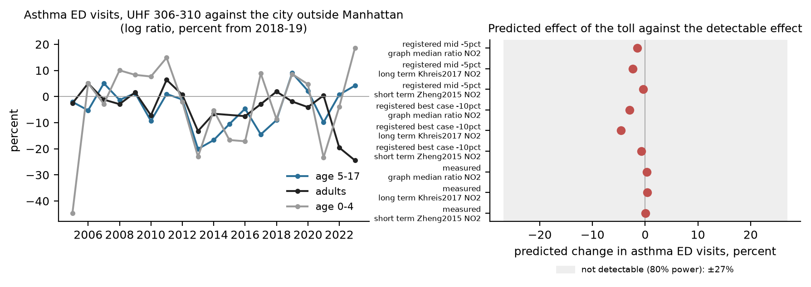
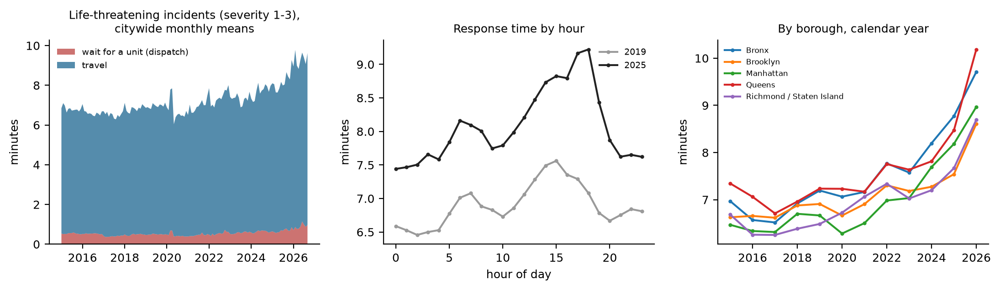
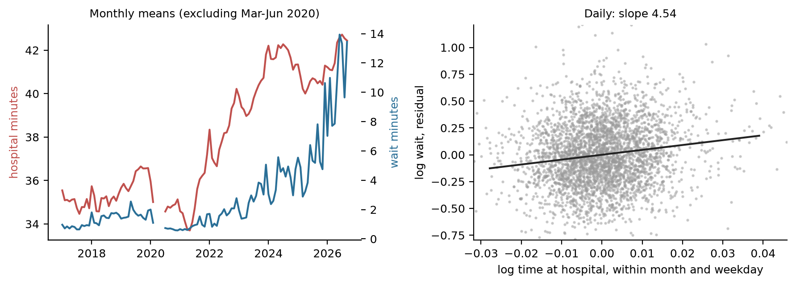
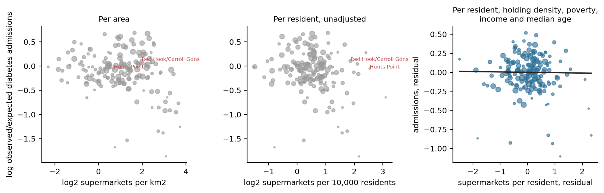

# Health questions the project had not asked: toll and asthma, ambulance waits, supermarkets and diabetes

The System Public Graph (the graph below) is a database of research findings, most of them on health. The project's claims so far have used it mainly for heat, air and traffic. This note asks three further health questions of the city's data. Two are registered claims: predictions committed to the repository and pushed to their own branches before the data that test them were read. For the third, a power calculation showed that the test could not be run, so no claim was registered. Code is in `analyses/health_gaps/`, derived data in `data/derived/health_gaps/` and figures in `figures/health_gaps/`.

## Corrections after review

A referee reproduced both deciding numbers with separate code (4.54 against 4.55; 0.995 against 0.995). Both verdicts follow from the registered support conditions and stand. Neither practical reading survived review (`critique/ems-hospital-turnaround-wait.md`, `critique/food-supermarket-diabetes-zcta.md`).

1. Ambulance waits. Weather, holidays and respiratory-call counts leave the estimate at about 4.5, and year-week fixed effects give 3.49 (2.22 to 4.75). A placebo fails: the next day's time at hospital predicts today's wait at 2.40 (1.20 to 3.60), more strongly than the previous day's, and with year-week fixed effects both are near zero. In half-day models, afternoon hospital time predicts the same morning's wait. The estimate rests on daily movements of about 1%, roughly 30 seconds, which a shared daily cause or late closing of incidents can produce. The data therefore do not show that hospital turnaround is a lever on response time. The descriptive results in section 2 stand.
2. Supermarkets and diabetes. Clustering by UHF42 area and a spatial error model still meet the support condition; residuals are spatially correlated (Moran's I 0.35), and unweighted or with stores counted within 2.5 km the lower bound falls to 0.88. The outcome measures poverty and access to care as much as diabetes: pneumonia and urinary-tract admissions show the same unadjusted gradient (0.885), and admissions do not track survey diabetes prevalence once poverty is held. At least 271 of the 1,212 stores counted are pharmacy, dollar-store or general-merchandise chains; removing them changes little. The result says that supermarket supply does not predict preventable diabetes admissions beyond income and density. It does not answer whether stores affect diabetes.
3. Toll and asthma. The power result stands. "About one hundredth" understates the gap: for the measured NO2 change the predicted effect is 60 to 450 times smaller than the smallest detectable one.

## 1. Congestion toll and asthma emergency visits: a test that cannot be run

The question was whether asthma emergency department (ED) visits fell in and near the toll zone after 5 January 2025, relative to the rest of the city. Before looking for post-toll data, I calculated the effect that the graph's findings predict.

The prediction starts from the measured change in air. The claim `mob-crz-air-nyccas` found that annual NO2 in the five United Hospital Fund (UHF) neighbourhoods south of 60th Street (UHF 306 to 310) changed by +0.9% (−2.2 to +4.2) relative to neighbourhoods outside Manhattan in 2025 against 2021 to 2024. At the zone's mean of 20.5 ppb this is +0.18 ppb (−0.46 to +0.86). Three published estimates of how asthma visits change with NO2 convert this into a change in visits (95% intervals in brackets):

- the pooled short-term time-series estimate, 1.018 per 10 µg/m³ NO2 (Zheng et al. 2015, cited in `mob-asthma-pollution`), gives +0.06% (−0.15 to +0.29);
- the graph's median ratio for NO2 and asthma, 1.16 (97 findings, 62 studies, mixed designs), read per 10 ppb, gives +0.27% (−0.68 to +1.29);
- the long-term incidence estimate, 1.05 per 4 µg/m³ (Khreis et al. 2017), used as an upper bound, gives +0.42% (−1.04 to +2.00).

If the toll had cut NO2 by 10%, the top of the range registered in `mob-crz-air-nyccas`, the three values would predict falls of 0.7%, 3.0% and 4.6%.

The year-to-year variation comes from the city's own annual asthma ED counts by UHF (EHDP indicators 2379, 2380 and 2048, 2005 to 2023, commit 547482b). The zone's five neighbourhoods had 493 visits at age 5 to 17 and 1,561 adult visits in 2023. Without any toll, the ratio of zone visits to visits outside Manhattan varies from one year to the next (log scale) with a standard deviation of 9.6% for ages 5 to 17, 8.9% for adults and 19% for ages 0 to 4. Random variation in the counts alone (Poisson noise) would give 6.4% for ages 5 to 17 and 3.6% for adults, so most of the variation is real change in the zone's share. With a standard error of 9.6%, a one-year difference-in-differences test has 80% power to detect only a change of about 27%.

The project's rules require a discrimination statistic D of at least 4 (rule 8 in `concord/claims.py`). D is the squared distance between the predicted effect and no effect, measured in standard errors. For the measured air change, D is below 0.003 under all three conversions. Under the most favourable assumption, a 10% fall in NO2 and the long-term coefficient, D is 0.23. Even with counting noise alone and every adult visit, D would be 1.6. A test of this kind could not distinguish a toll effect on asthma from no effect.

The data needed for a test are also not available. The EHDP asthma ED series by neighbourhood ends in 2023. The syndromic file by ZIP code on NYC Open Data (2nwg-uqyg) covers influenza-like illness and pneumonia only and was last updated in December 2022. The Health Department publishes no daily asthma or respiratory syndromic series by area. I therefore registered no claim. The finding is the power result: given what the toll did to measured air, a health effect on asthma is 60 to 450 times smaller than the smallest effect the city's neighbourhood data could detect. A health benefit of the toll will have to be argued from the air change and the research, not shown in emergency department counts.

## 2. Ambulance response

Ambulance response times have risen since 2022, faster than call volume. The Mayor's Management Report (FDNY chapter, FY2026) gives end-to-end ambulance response to life-threatening emergencies of 9:13 (minutes:seconds) in FY2015, 8:56 in FY2017, 9:22 in FY2019, 10:17 in FY2022, 10:52 in FY2024, 11:21 in FY2025 and 13:09 in FY2026. FY2026 counts calls upgraded to life-threatening from their original dispatch, so part of its jump is a change of definition. Life-threatening incidents rose 12% from FY2022 to FY2024 and then fell 4%; average ambulance turnaround at hospitals rose from 36:17 to 40:25; ambulance in-service hours per day fell from 8,891 to 8,109. The graph also records the cost of delay: five findings give odds ratios for survival after cardiac arrest of 1.02 to 1.24 per minute of faster response (`docs/congestion_tradeoffs.md`).

### Where and when (exploratory)

The figures below come from the EMS incident dispatch data (76xm-jjuj, version of 7 October 2026), incidents of initial severity 1 to 3 with a valid response time (`analyses/health_gaps/ems_explore.py`). Mean dispatch plus travel time was 6.97 minutes in 2019, 8.18 in 2025 and 9.28 in January to September 2026. Almost all of it is travel. The wait (the time from the call's creation to the assignment of a unit) was 30 seconds in 2019 and 53 seconds in 2026. A life-threatening call gets the nearest free ambulance at once, so a shortage of ambulances appears as a longer drive, not a longer wait.

The slowest hours in 2025 were 17:00 to 18:59, at 9.2 minutes, against 7.4 minutes after midnight; in 2019 the peak was at 15:00, at 7.6 minutes. Queens and the Bronx were slowest in 2026 (10.2 and 9.7 minutes for the year to September), Brooklyn and Staten Island fastest (8.6 and 8.7). Among the 31 dispatch areas with more than 3,000 such incidents in 2025, the slowest were the Bronx areas B3, B5 and B4 (9.2 minutes each) and Queens Q3 (9.1); the fastest was Brooklyn K2 (6.7). The largest increases since 2019 were in B4 and B5 (+2.1 minutes) and in Manhattan M3 (+1.7).

For calls of lower severity (4 to 8) the wait for a unit is the problem. It averaged 2.3 minutes in 2019, 8.5 minutes in 2025 and 16.7 minutes in January to September 2026, and dispatch plus travel rose from 12.6 to 31.2 minutes.

### Registered test: time at hospital and the wait for an ambulance

The claim `ems-hospital-turnaround-wait` predicted that callers wait longer on days when ambulances spend longer at hospitals after a transport, holding constant the day's call count, the weekday and the month. The script (commit 6278c85) and then the registration (be7f692) were committed before the daily data were fetched. Time at hospital is incident close minus hospital arrival for transported patients, trimmed to 0 to 4 hours; it averaged 36.1 minutes in 2019, 40.6 in 2025 and 41.9 in 2026. The model uses 3,437 days from January 2017 to September 2026, without March to June 2020, and year-month fixed effects, so it compares days within the same month and does not use the trend.

The elasticity of the daily mean wait to the daily mean time at hospital is 4.55 (3.21 to 5.88; Newey-West, 7 lags). On a day when ambulances stay 1% longer at hospitals, the mean wait is about 4.5% longer. The registered support condition, a lower bound above 0.2, is met, and the claim is confirmed. The estimate is above the registered range of 0.5 to 3. Part of it is probably a same-day common cause, such as a surge that crowds emergency departments and also brings calls the count does not capture, or incidents closed late on busy days. The previous day's time at hospital, which these affect less, gives 1.06 (0.13 to 1.99). The elasticity is 2.11 (0.95 to 3.27) for the wait on life-threatening calls and 4.94 (3.53 to 6.35) for other calls. The elasticity of the wait to the day's call count is 5.3, as expected of a system near capacity.

The trend is a separate matter and is exploratory. From 2019 to 2025 the mean wait over all calls rose from 100 to 329 seconds, a factor of 3.3, while time at hospital rose 12% and calls 5%. If the same-day elasticities applied to annual changes, hospital time would account for 0.53 and call volume for 0.27 of the 1.19 rise in log wait; with the previous-day elasticity hospital time accounts for 0.12. In 2026 the wait almost doubled again while time at hospital rose 3% and calls did not rise. That year matches the report's explanation, a 5% fall in ambulance hours in service and 11 hospital ambulances leaving the 911 system. Units in service are not in the open data, so the test could not include staffing.

The practical reading first drawn here, that time at hospital matters to waits, did not survive review (see the corrections above). The recent rise appears more a matter of fewer ambulances on the street. An offload standard (California sets 30 minutes from arrival to transfer of care) is a lever the city could act on through its hospitals. A test of it would need transfer-of-care times by hospital, which are not published.

## 3. Supermarkets and diabetes

The research on supermarkets is divided by design. Cross-sectional studies find more diabetes and obesity where food stores are scarce. The graph holds 109 such findings on food access, food deserts, supermarkets and food environments with a diabetes, glycaemia, obesity or weight outcome (`data/derived/health_gaps/graph_food.json`). One study gives odds ratios of 1.27 to 1.38 for diabetes incidence by distance to the nearest supermarket (PMID 36058428). Studies of new stores find little. A FRESH-subsidised supermarket in the Bronx did not change children's diet (Elbel et al. 2015), a Philadelphia opening did not change BMI (Cummins et al. 2014), and Allcott, Diamond and Dubé (2019) attribute about 10% of the nutritional gap between rich and poor households to supply. Jeff's question is the chicken-and-egg problem: a place such as Red Hook has few stores because few people live there, so a count per square kilometre confuses scarcity with emptiness.

The registered claim `food-supermarket-diabetes-zcta` (a conflict with the graph's cross-sectional findings) predicted that supermarkets per resident would not predict diabetes admissions once residential density, poverty, income and median age were held. The unit is the ZIP code tabulation area (168 in New York City with at least 5,000 adults). The outcome is adult hospital admissions for diabetes, the sum of the state's Prevention Quality Indicators 01, 03, 14 and 16 for 2021 to 2023, as observed over age-sex expected rates (health.data.ny.gov 5q8c-d6xq). Supermarkets are retail food stores of at least 6,000 sq ft, the FRESH minimum, on the state's current licence list (data.ny.gov 9a8c-vfzj). Covariates come from the ACS 2019 to 2023.

Unadjusted, a doubling of supermarkets per resident goes with an admission ratio 0.895 times as high (0.822 to 0.974). This is close to what the graph's findings imply, about 0.85 to 0.92. With residential density, poverty, income and median age held, the ratio is 0.995 (0.946 to 1.046). The registered support condition, an interval inside 0.90 to 1.10 with an estimate of at least 0.95, is met, and the claim is confirmed. The secondary models agree: adding race and ethnicity gives 0.993 (0.943 to 1.046), adding households without a car 0.987 (0.931 to 1.047), stores of 10,000 sq ft or more 0.978 (0.940 to 1.017), and all retail food stores 0.994 (0.923 to 1.070). Poverty carries the gradient: 10 points more poverty goes with an admission ratio 1.22 times as high (1.09 to 1.35).

The chicken-and-egg check works as Jeff expected. Supermarkets per square kilometre alone give 0.951 (0.905 to 0.999) per doubling. Holding residential density, the per-area measure becomes the per-resident measure, 0.895, and that association in turn disappears with poverty and income. Red Hook and Carroll Gardens (ZIP 11231) has 14 supermarkets for 39,700 people on 3.7 km², and its admission ratio is 1.11. That is 49% above what the model predicts from the ZIP's density, poverty, income and age (residual +0.40 on the log scale, against a residual standard deviation of 0.26). The ZIP joins affluent Carroll Gardens with the Red Hook Houses, so its median income understates the need of the part of it that is short of stores. ZIP-level averages cannot resolve this case.

The result is a cross-section. It cannot say what a new store would do; it says that in New York the ZIP codes with fewer supermarkets per resident do not have more diabetes admissions than their income and density predict. Admissions also measure access to primary care. Stores are counted by address ZIP from the list of October 2026, after the outcome years. Two deviations from the committed script were made before any outcome was read: the Census API now requires a key, so the same ACS variables were read from the Census summary files, and the county filter for the store list was corrected to upper case. The city publishes FRESH zoning boundaries (cgn7-aehz) but not the list of FRESH stores or their opening dates, which a test of the programme itself would need.

## Novelty and use

This section scores each result for novelty and practical use.

- Toll and asthma (a power result; no claim was registered). The result is novel for the project and, as far as I found, not stated elsewhere: given the measured air change, the predicted effect is a few hundredths of a percent, against a detectable effect of about 27%. It is practical as a caution. Claims of health benefit from the toll should rest on air measurements and the research, and the neighbourhood ED data cannot confirm or refute them.
- Time at hospital and ambulance waits (`ems-hospital-turnaround-wait`, confirmed, 4.55, 3.21 to 5.88). Studies in Canada (Lane et al. 2023, CJEM) already report the direction, so the result confirms it for New York and is not a discovery. Its size is uncertain because the same-day and previous-day estimates are 4.55 and 1.06. After review it does not name a lever: a placebo with the next day's hospital time fails (see the corrections above). The descriptive finding that the life-threatening delay is travel while the low-acuity delay is waiting is plain in the data, and I found it in no public summary.
- Supermarkets and diabetes (`food-supermarket-diabetes-zcta`, confirmed, 0.995, 0.946 to 1.046). The null after adjustment agrees with the intervention studies, so it is not new in kind. It is new for New York's administrative data, and it answers the chicken-and-egg question directly: per-area scarcity follows residential density, per-resident scarcity follows income, and neither predicts diabetes admissions once income is held. For FRESH it says only that supply does not predict preventable admissions beyond income and density; admissions measure access to care as much as diabetes (see the corrections above).
