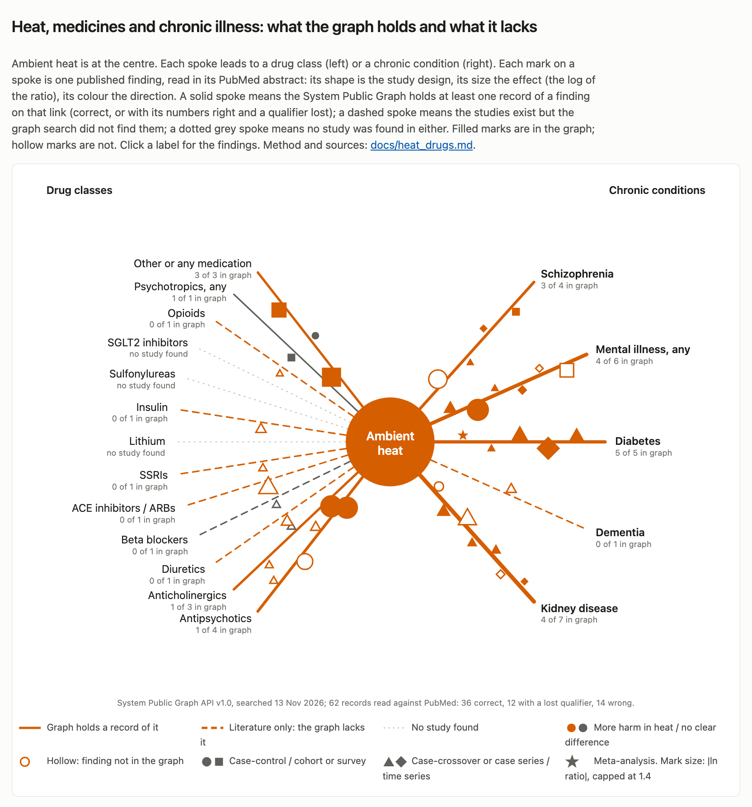

# Heat, medicines and chronic illness

Note of 14 November 2026: the idea that these medicines explain part of the rise in shootings with heat has been set aside (`docs/conjectures.md`). The health material below is unchanged.

A hackathon judge who works on temperature and health pointed out that some medicines change how heat affects people. Antipsychotics and anticholinergics reduce sweating and blunt the sense of heat, diuretics and ACE inhibitors deplete fluid or impair the kidney's response to it, and insulin is absorbed faster in heat. This note asks what the System Public Graph, a database of findings extracted from published research, holds on heat combined with these medicines and with four chronic conditions; what it lacks; and whether New York's open data can test any of it. Scripts are in `analyses/heat_drugs/`, data in `data/derived/heat_drugs/`, and the map is `viz/heat_drugs.html` (figure: `figures/heat_drugs/heat_drugs_map.png`).

No claim was registered, that is, no hypothesis was written down and committed before its New York data were read. The one design that New York's open data allow cannot distinguish the effect the literature predicts from no effect (D = 2.1, where registration requires 4; section 3).

## 1. What the graph holds

The search used variable names, because concept search returns little for these terms (`analyses/heat_drugs/graph.py`, run on 13 November 2026 against API v1.0). It ran paired searches of five heat words with 27 drug and condition words, the drug and condition words alone, and 13 heat-outcome phrases such as "heat-related illness" and "heatstroke". It followed the associations of 463 variables and kept 142 associations that name both heat or temperature and a drug class or condition (535 requests to the API). Many of the 142 were unrelated, for example heat-shock proteins, heat-pressed lithium disilicate dental crowns, foot temperature in diabetic neuropathy and kidney cooling in surgery. Targeted searches for the main studies found one more study, Martin-Latry 2007, under the variable "admission for heat-related pathologies".

I read the PubMed abstract of every record on heat and a drug or condition that I used or considered, 62 records in all (`analyses/heat_drugs/curate.py`, which lists each). 36 were correct. 12 had the right numbers but had lost a qualifier that changes the meaning. 14 were wrong. The 14 wrong records are 23% of those read, close to the 20% the API documentation warns of. With the 12 partial records, 26 of the 62 had a problem. The errors are of four kinds:

- A sign or season is lost. Goedel 2019 found more opioid overdose deaths after cold weather (odds ratio 1.3 at 0 °C against 11 °C); the graph record says "average ambient temperature on the day of fatal opioid overdose, OR 1.3". Yang 2016 and Yoo 2021 each have their cold estimate stored under a label that includes heat.
- A placeholder is stored as a result. Four records from Schmeltz 2017 give a risk ratio of 1.0 for schizophrenia, dementia, drug abuse and age over 40, where the abstract says these were associated with more heat-illness admissions and gives no number.
- A percentage is stored as a ratio. Sun 2021 reports a 30.4% excess risk of emergency visits for renal disease on extreme-heat days; the graph stores a risk ratio of 30.4.
- Labels are attached to the wrong number. Three records from Thongprayoon 2020 carry the same odds ratio of 3.5 for different exposures, none of which the abstract states, and two from Xu 2020 have their subgroup labels exchanged.

The 12 partial records do the most harm here, because some of them merge or drop the drug class. Martin-Latry 2007, a case-control study of the 2003 French heat wave, found odds ratios for heat-related emergency admission of 6.0 (95% interval 1.8 to 19.6) for anticholinergic drugs, 4.6 (1.9 to 11.2) for antipsychotics and 2.4 (1.3 to 4.4) for anxiolytics. The graph holds all three numbers under the single exposure "use of psychotropic drugs", so a query for antipsychotics and heat does not find the study's antipsychotic result, and a query for psychotropics returns three numbers with nothing to say which drug class each belongs to. Borg 2017 has seven renal estimates each labelled only "eight renal disease categories", and two Remigio 2019 estimates for Boston lack the city.

On the drug classes, the graph holds very little. Only one correct record links a specific drug class to heat, and it found no effect. In Mangoni 2017 psychotropic use, mainly antipsychotics, did not predict hospital length of stay for older medical patients admitted during heat waves (subdistribution hazard ratio 0.89, 0.69 to 1.14). Three correct records concern medicines in general: "persons under medication" in a survey in Odisha (adjusted odds ratio of heat illness 3.09, 1.15 to 8.29), the number of medicines among long-distance cyclists (odds ratio 1.1, 0.8 to 1.5), and long-term antihypertensive use among heatstroke patients in Lyon in 2003 (hazard ratio of death 2.17, 1.17 to 4.05). For diuretics, beta blockers, ACE inhibitors, SSRIs, lithium, insulin, sulfonylureas, SGLT2 inhibitors and opioids, the search found no correct record linking the drug to heat.

On the conditions, the graph holds more. Diabetes has five correct records, among them a meta-analysis of mortality during heatwaves (Moon 2021, risk ratio 1.18, 1.13 to 1.25) and a heat-dome emergency-department study (Wettstein 2024, incidence rate ratio of heat illness 3.19, 1.47 to 6.94). Mental illness has four, among them Stafoggia 2006 (odds of death at 30 °C against 20 °C apparent temperature 1.69, 1.39 to 2.07, among people with a previous psychiatric admission, against 1.34 for all residents) and Kaiser 2001, a case-control study of 17 deaths in the Cincinnati heat wave of 1999 (odds ratio 14.0, an imprecise estimate with interval 1.8 to 633). Schizophrenia has three: emergency visits on extreme-heat days (Nori-Sarma 2022, 1.05, 1.03 to 1.07), hospitalisations in Hefei, and a ward-temperature study in which all patients were taking antipsychotics. Kidney disease has records mostly on heat as a cause of kidney injury, and two on dialysis patients in three cities including New York (Remigio 2019: admission 1.27, 1.13 to 1.43; death 1.31, 1.01 to 1.70). Dementia has none that is correct.

## 2. What the graph lacks

Neither search found the following studies in the graph. I found them in PubMed and read their abstracts. The map page lists them, with links, under each drug class or condition.

- Layton et al. 2020 (PLoS One; PMID 33301532), a self-controlled case series of 9,721 Medicare beneficiaries aged 65 or over with chronic conditions who had a heat-related hospitalisation. Antipsychotic use carried a rate ratio of 1.37 (1.14 to 1.66) and anticholinergic use 1.16 (1.00 to 1.35) outside heatwaves; heatwaves raised the hospitalisation rate by 21% to 33% among users of each drug class; beta blockers were not associated; and the authors "did not observe meaningful synergistic interactions between heatwaves and medications".
- Kalisch Ellett et al. 2016 (PMID 27378245), a sequence symmetry analysis of 6,700 Australian veterans: admission for dehydration or heat illness was more likely after starting antipsychotics, antidepressants, anticholinergics and cardiovascular medicines, from 1.17 for SSRIs to 2.79 for an ACE inhibitor combined with a diuretic.
- Lee et al. 2023 (GeoHealth; PMID 36938119), deaths in British Columbia during the 2021 heat dome against deaths on the same dates in 2012 to 2020: schizophrenia odds ratio 3.07 (2.39 to 3.94), the largest of 26 chronic conditions; chronic kidney disease 1.36 (1.18 to 1.56).
- Chen et al. 2025 (Sci Rep; PMID 41044101), people with schizophrenia in British Columbia: an antipsychotic dispensed in the 30 days before the heat dome gave an odds ratio of death of 2.43 (1.52 to 4.01), and two or more antipsychotics 4.05 (2.41 to 6.98); the excess was driven by haloperidol, clozapine and zuclopenthixol.
- Bark 1998 (Psychiatr Serv; PMID 9712220), patients of New York State psychiatric hospitals in the New York City area, 1950 to 1984: twice the general population's risk of death during heat waves, highest in the 1970s when antipsychotic doses were high, and no higher than the general population's in 1980 to 1984.
- Page et al. 2012 (Br J Psychiatry; PMID 22661680): 4.9% (2.0 to 7.8) more deaths per 1 °C above the 93rd percentile among English primary-care patients with psychosis, dementia or substance misuse.
- Visaria et al. 2024 (Diabetes Care; PMID 38060348): among insulin users aged 65 or over in Medicare, odds of a serious hypoglycaemia visit 1.38 (1.28 to 1.48) on days with a heat index above the 99th percentile.
- Byun et al. 2025 (Int J Epidemiol; PMID 40795076): dementia admissions in South Korea, risk ratio 1.36 (1.19 to 1.57) at the 99th against the 50th percentile of temperature.
- Chang et al. 2023 (Environ Int; PMID 37897873): emergency visits for opioid use in California, odds ratio 1.041 (1.025 to 1.057) from the 50th to the 95th percentile of daily mean temperature.
- Bobb et al. 2014 (JAMA; PMID 25536257): Medicare admissions for renal failure 1.14 (1.06 to 1.23) on heat-wave days.

No study of lithium, sulfonylureas or SGLT2 inhibitors with ambient heat was found in the graph or in a short PubMed search. On the map their lines are dotted grey. A fuller search might find such studies.

Two points from the literature bear on any test. First, most of the drug evidence is of a main effect: people on these drugs are admitted for heat illness more often, in summer as a whole. The one study that tested whether heatwaves add more risk for users than for non-users (Layton 2020) found no meaningful interaction. Second, people with schizophrenia show a large excess of deaths in an extreme heat event (Lee 2023), but their emergency visits rise less on ordinary extreme-heat days than other mental-health visits (Nori-Sarma 2022: 1.05, 1.03 to 1.07, against 1.08, 1.07 to 1.09, for any mental-health condition).

## 3. A New York test: the power check

The design examined was the one proposed in the brief for this work: on hot days, do psychiatric ambulance calls rise more in ZIP codes where antipsychotics are prescribed more? It uses three data sets.

- Exposure. Medicare Part D Prescribers by Provider, data year 2023 (CMS dataset 42888afe-3b85-4a61-a4ee-091f00bd62bc), filtered to New York prescribers with New York City ZIP codes. The measure is antipsychotic claims for patients aged 65 or over as a share of all claims for patients aged 65 or over, by the prescriber's ZIP code (`exposure.py`). The drug-level file, which gives antipsychotic claims at all ages, takes about two minutes per query on the CMS API and was not used. The ZIP code is where the prescriber practises, not where the patient lives. The highest shares are in single-prescriber ZIP codes and in the Bronx (10454 and 10474 in the south, 10470 and 10471 in the north) and Queens (11004).
- Outcome. EMS Incident Dispatch Data (76xm-jjuj), the psychiatric call types EDP, EDPC, EDPM, EDPT, EDPE, EDPW and T-EDP, by ZIP code and date. The file has no diabetic call type, so the proposed diabetic arm cannot be built. HEAT is a call type.
- Temperature. Central Park daily maximum (GHCN-Daily), May to September 2006 to 2025, hot meaning 32.2 °C (90 °F) or more: 332 days.

For each day, the outcome is the number of psychiatric calls from ZIP codes in the top third by antipsychotic share, out of all calls from the top and bottom thirds. A binomial regression relates this share to a hot-day indicator, with terms for weekday, month, year, holiday and rain. The coefficient is the difference between the two thirds' hot-day log rate ratios. Before any dated call was read, `design.py` computed its standard error from the Fisher information with the expected daily counts, using only undated counts of calls by ZIP code and by year. The 189 ZIP codes with at least 1,000 claims and at least one call were split into thirds of 63. The call-weighted antipsychotic share is 2.58% in the top third and 0.55% in the bottom. The thirds hold 859,072 and 550,595 psychiatric calls in all years. The standard error is 0.0092 on the log scale. It ignores overdispersion, so it is too small and makes the test look more powerful than it is.

The predicted difference comes from a mixture. Let f be the share of a group's psychiatric calls made by or for people taking an antipsychotic, R1 their hot-day rate ratio and R0 everyone else's. The group's ratio is (1 − f) R0 + f R1. I assumed f = 0.35 citywide; no source gives this figure. I let f vary in proportion to the prescribing share, which gives 0.60 in the top third and 0.13 in the bottom. That assumes the prescriber's ZIP code stands in fully for the patient's, which also overstates the test's power. Three scenarios were computed:

| Scenario | R0 | R1 | Predicted difference | D |
|---|---|---|---|---|
| Central: Nori-Sarma 2022, any mental-health visit 1.08, schizophrenia 1.05 | 1.08 | 1.05 | −0.013 | 2.1 |
| Generous: the users' hot-day excess tripled, based on the schizophrenia odds ratio of 3.07 in the 2021 heat dome | 1.08 | 1.246 | +0.069 | 57 |
| Extreme: users' excess five times, f = 0.5 | 1.08 | 1.40 | +0.175 | 363 |

D, the measure set by rule 8 of the project's verdict rules (`concord/claims.py`), is here the squared ratio of the predicted difference to its standard error. The central scenario, which takes Nori-Sarma 2022's schizophrenia estimate as the estimate for antipsychotic users on ordinary hot days, gives D = 2.1. Its sign is negative, because people with schizophrenia have a smaller rise in emergency visits than other psychiatric patients. The registration threshold of D ≥ 4 is not met, so no claim was registered.

The generous scenario gives D = 57, well above the threshold. I did not register it as a fallback for two reasons. Its premise, a tripled hot-day excess for antipsychotic users, comes from deaths in an extreme event far hotter than New York's usual hot day, and Layton 2020 found no such interaction for hospitalisations. And the top third of ZIP codes by prescribing is not a population of antipsychotic users. Practices that prescribe antipsychotics to older people are concentrated near nursing homes and psychiatric clinics, and a steeper hot-day rise of psychiatric calls there could come from people living on the street, from the clinics themselves, or from any other difference between those ZIP codes. Such a test could reject a large interaction, but a positive result could not be read as a drug effect.

A second design used HEAT calls, comparing their share in the top and bottom thirds (6,131 and 3,874 calls). With Layton's rate ratio of 1.37 for antipsychotic users and 1.5% of residents taking one, scaled by the prescribing share as before, the predicted log difference is 0.0075 and D = 0.13; with 3% of residents, D = 0.53. This test cannot detect the effect.

The registration would have included two placebos: the same model on traffic-injury calls (MVAINJ), for which no interaction with antipsychotic prescribing is expected, and the same model with cold days in place of hot days. Neither was run.

What would make a test possible is a measure of where the patients live. Medicaid pharmacy claims record antipsychotic dispensing for each enrollee, whose address is on file, and the Health Department's syndromic surveillance records emergency visits by home ZIP code. A linkage of the two, or Medicare Part D event files under a data use agreement, would allow a case-crossover design within users, the design of Layton 2020 and Visaria 2024.

## 4. What a city or a health agency could do

The practical evidence is that people taking antipsychotics or anticholinergics, people with schizophrenia, and people on dialysis are at higher risk of heat illness and death, and that the excess is largest in extreme events. None of this is new: Bark 1998 showed it in New York's own psychiatric hospitals, the city's public heat guidance already names people with mental health conditions and people taking psychotropic and other medicines among those at higher risk, and the Health Department's health alerts to clinicians on extreme heat already point to its guidance on heat and medications.

Two points from the literature could sharpen what the city already does. The drug risk is present all summer, not only during declared heat emergencies (Layton 2020), so check-ins tied only to heat advisories will miss much of it. And during a severe event the risk concentrates in a group the health system can list: people with schizophrenia, especially those on two or more antipsychotics, clozapine or haloperidol (Chen 2025).

A practical step for the Health Department and the Office of Mental Health would be to give the assertive community treatment teams, supportive-housing providers and dialysis centres a heat protocol that starts with the first hot week of the season: a check of cooling at home, fluids, and the medicine list, with a pharmacist or prescriber asked about doses where an anticholinergic or more than one antipsychotic is prescribed. Pharmacies could add a heat warning label to these drug classes. Whether any of this reduces harm has not been tested. The New York data cannot test it at present, because no open data set links a person's medicines to where they live and to what happens to them in heat.

## Files

- `analyses/heat_drugs/graph.py`: the graph search. Output `data/derived/heat_drugs/graph.json`.
- `analyses/heat_drugs/abstracts.py`: fetches PubMed abstracts to `data/cache/pubmed/` (not tracked).
- `analyses/heat_drugs/curate.py`: each finding with its verdict against the abstract. Output `data/derived/heat_drugs/map.json` and `viz/data/heat_drugs.js`.
- `analyses/heat_drugs/exposure.py`: Part D prescribing by ZIP code. Output `data/derived/heat_drugs/zip_exposure.csv`. Raw CMS pages are cached in `~/Library/Caches/nyc-concordance-big/cms/`, outside Dropbox, because the drive for `~/opt/nyc-concordance` was not attached.
- `analyses/heat_drugs/design.py`: the power check. Output `data/derived/heat_drugs/prereg_design.json`.
- `analyses/heat_drugs/export_png.py`: renders the map to `figures/heat_drugs/heat_drugs_map.png` (1664 px, sRGB).
