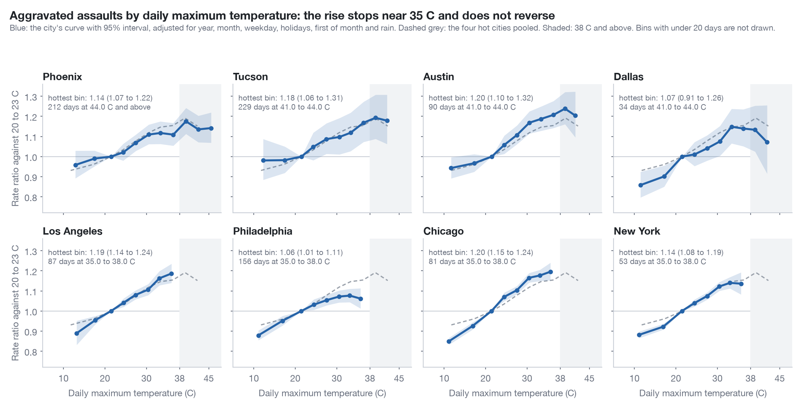

# Extreme heat and violence: does the rate turn down?

This note asks whether violent crime falls again when days become very hot. The outcome here is aggravated assault, the violent offence that every city in the study publishes by day; the earlier work in this project used shootings. That earlier work found that shootings in New York rise by 14.6% per 5 °C of daily maximum temperature and keep rising to 35 °C, and that Chicago shows the same pattern. Neither city has enough days above 35 °C to say what happens beyond it. This study adds six cities, four of which have hundreds of days at 38 °C and above. One test was registered: its hypothesis, conditions and scripts were committed and pushed to the branch `prereg/heat-extremes-downturn` (commit 96174c4) before any count was tabulated against temperature. A planned description is an analysis that the registration listed in advance as not deciding the verdict. Exploratory results were not listed in advance. Each result below is labelled as one of the three. Scripts are in `analyses/heat_extremes/`, data in `data/derived/heat_extremes/`.

## Corrections after the referee (13 November 2026)

A blind referee report changed how the result should be read; the verdict did not change (`critique/answers_round6_heat.md`). The corrected headline is: no downturn at 38 °C; the rate is level or slightly higher. The registered downturn is excluded under every variant the referee ran. The small rise is not secure: the lower limit of 1.008 falls to 1.00 or below with an interval suited to a pool of four cities (0.992 to 1.081), with night temperature in the model, with other weather stations, with a day counted from 06:00 to 05:59 (1.030, 0.994 to 1.068), and without any one of Phoenix, Tucson and Austin. The comparison of degrees with percentiles is withdrawn as evidence on adaptation. The New York heat-wave result is not found in Chicago or Philadelphia. The section before the limits gives the estimates under both definitions of the day.

## What the research predicts

The System Public Graph is a database of findings extracted from published papers. A search of its concepts found 13 relationships between temperature and violence from 23 studies, most of them on suicide and injury. A second search, by the names of study variables (1,283 variables whose names mention violence or temperature; I stopped it after 656 requests to the graph's interface to stay within the request budget, with 164 variables unread), added two studies. I read the PubMed abstract of each finding used below.

The graph holds both sides of the dispute. Xu et al. (2020, nine US cities) describe a linear association of temperature with homicide, and Rahman et al. (2023, California) a monotonic one. Lyons et al. (2022, 100 US cities) found that shootings rise almost monotonically with a local peak at the 84th percentile of each city's temperature range. Heo et al. (2024, South Korea, found only by the variable-name search and after the registration) report a curved relationship for violent crime in summer: the relative risk is 1.11 (1.09 to 1.15) at the 70th percentile of summer temperature, about 28 °C as a daily mean, and 1.04 (1.01 to 1.07) at the 90th. The graph stores both values correctly but without the percentiles, so the downturn is visible only in the abstract. The graph does not hold the papers that started the dispute. Rotton and Cohn (2000) found an inverted U for assaults in Dallas, and Gamble and Hess (2012) found that aggravated crime in Dallas turns down above a daily mean of 90 °F (32 °C), which corresponds to a daily maximum near 38 °C. Bushman, Wang and Anderson (2005) argued that the inverted U disappears when the hour of day is held fixed. Stevens et al. (2019) found that assaults in New South Wales rise more slowly above 30 °C.

The research therefore gives two rival predictions for days at 38 °C and above, a continued linear rise and a downturn. It also raises a second question: whether any turning point sits at a fixed temperature or at a percentile of the local climate.

## Data

Each city's counts come from its own official portal and are counted by the date on which the incident occurred. The offence is aggravated assault as each police department codes it. The series are: Phoenix (city open-data CSV, November 2015 to November 2025, 59,432 incidents), Tucson (police feature layers, 2018 to August 2026, 19,572), Dallas (`qv6i-rri7`, 2017 to August 2026, 22,960), Austin (`fdj4-gpfu`, 2003 to August 2026, 48,660), Los Angeles (`63jg-8b9z` and `2nrs-mtv8`, 2010 to 2023, 175,570), Philadelphia (city Carto table, by dispatch date, 2006 to August 2026, 175,314), Chicago (`ijzp-q8t2`, FBI codes 04A and 04B, 2006 to August 2026, 297,353) and New York (`qgea-i56i`, felony assault, 2006 to 2025, 423,096). Temperature is the daily maximum at one NOAA GHCN-Daily station per city. `sources.json` records each query and its fetch time.

The definitions are similar and not identical. In the Dallas file nearly every aggravated-assault row is coded as not involving family violence (39 family-violence rows among 28,238 rows for all dates), so family cases appear to be withheld. In Austin 47% of incidents carry a family-violence flag or a family or strangulation offence type. The four series of the test are therefore not the same offence. The difference does not explain the results: in Austin the ratio of the registered test is 1.039 (0.976 to 1.106) for family violence and 1.038 (0.976 to 1.104) for the rest. The Phoenix file has a break in September 2025: from 3 September it carries no time of day, and the monthly counts shift, which looks like a change of records system. The series was ended on 30 November 2025 for a reason that was not recorded, and ending it on 31 August 2025 gives the same estimate. Los Angeles changed its coding in 2016, and Philadelphia gives the dispatch date only. Each city is therefore compared with itself, and a separate term for each year absorbs changes in coding. Houston, San Antonio and Las Vegas were left out: I found no queryable interface for their incident data in the time available and did not examine their bulk files.

## The registered test (claim heat-extremes-downturn; verdict contested, meaning the registered hypothesis was refuted)

The hypothesis was the downturn: in cities with many very hot days, aggravated assaults are less frequent on days at 38 °C and above than on days at 32 to 35 °C. The four cities with at least 100 days in each bin were fixed from temperatures alone: Phoenix (1,132 days at 38 °C and above), Austin (710), Tucson (667) and Dallas (187). In each city a negative binomial regression compared days with terms for the year, the month and the day of the week, and with terms for holidays, the first day of the month and rain. The four rate ratios were pooled with random effects. The registered conditions were that an upper limit below 1 confirms the downturn, a lower limit above 1 refutes it, and anything else is unsettled. A simulation on the real calendars showed that the test could return each of the three verdicts (the squared distance between the rival predictions in standard errors, called D in this project, was between 5 and 24; the project's minimum is 4).

The pooled rate ratio is 1.035 (95% interval 1.008 to 1.063; 2,696 hot days and 2,277 reference days). The point estimate at 38 °C and above is 3.5% above that at 32 to 35 °C, and the registered condition for refuting the downturn, a lower limit above 1, is met at this threshold. The city estimates are 1.038 (0.994 to 1.084) in Phoenix, 1.062 (0.999 to 1.130) in Tucson, 1.040 (0.994 to 1.087) in Austin and 0.977 (0.906 to 1.052) in Dallas, and they do not differ more than chance allows (I², the share of variation between cities beyond chance, is 2%). The lower limit is above 1 by 0.008, which is less than one standard error (0.013). With year-by-month strata the ratio is 1.031 (1.003 to 1.061), in May to September only it is 1.044 (1.009 to 1.080), and without 2020 and 2021 it is 1.027 (0.997 to 1.057), which the registered rule would call unsettled. The referee found further variants under which the lower limit is at or below 1: a Hartung-Knapp interval, the usual correction for a pool of few estimates (0.992 to 1.081); the daily minimum added to the model (1.019, 0.984 to 1.056); second weather stations in Phoenix, Dallas and Austin (1.017, 0.987 to 1.049); a day from 06:00 to 05:59; leaving out 2018; and leaving out Phoenix, Tucson or Austin. No variant has a lower limit below 0.98, so the registered downturn band of 0.88 to 0.98 is excluded in all of them (z = 4.1). The reading is that there is no downturn at 38 °C and that the rate is level or slightly higher. The registration assigned a plateau to the verdict unsettled; the label contested follows from the literal condition, which a small rise meets.

The linear alternative also fails, in a comparison that the registration listed as a sensitivity analysis and that does not carry a verdict. Each city's slope below 35 °C, carried to the mean temperature of its hot days, predicts a pooled ratio of 1.075 (1.064 to 1.086). The observed 1.035 is below it by 2.6 standard errors. The rate at extreme heat is not lower than at 32 to 35 °C and is not as high as a straight line predicts.

## The shape of the curve (planned description)

The figure shows each city's curve in 3 °C bins against days at 20 to 23 °C. In the four hot cities pooled, the rate ratio is 1.12 (1.08 to 1.16) at 29 to 32 °C, 1.15 (1.11 to 1.18) at 32 to 35 °C, 1.15 (1.11 to 1.20) at 35 to 38 °C, 1.19 (1.15 to 1.23) at 38 to 41 °C and 1.15 (1.10 to 1.20) at 41 to 44 °C. Phoenix alone has days at 44 °C and above (212 days), with 1.14 (1.07 to 1.22). A piecewise-linear model gives a slope of 1.060 per 5 °C (1.046 to 1.073) from 20 to 35 °C and 1.003 per 5 °C (0.985 to 1.022) above 35 °C. Above about 35 °C the curve is close to flat: it gains a few percent by 38 to 41 °C and no more after that. Dallas is the only city whose estimates decline above 38 °C (slope 0.95 per 5 °C, 0.88 to 1.02), which agrees in sign with the two Dallas studies, on 187 days. Against days at 32 to 35 °C, days at 41 °C and above have a ratio of 1.007 (0.973 to 1.042), lower than the 1.041 (1.014 to 1.069) of days at 38 to 41 °C. With these numbers of days, a decline that starts at 41 °C cannot be told apart from chance.

The four cooler cities reach only 35 to 38 °C. Their last bins are 1.19 (1.14 to 1.24) in Los Angeles, 1.20 (1.15 to 1.24) in Chicago, 1.14 (1.08 to 1.19) in New York and 1.06 (1.01 to 1.11) in Philadelphia, In none of them is the last bin clearly lower than the bin before it. These cities do not have days hot enough to show whether their curves level off.

## Fixed temperature or local percentile (planned description)

The comparison in this section is not evidence on adaptation, and the statement that a curve in degrees fits better is withdrawn for that purpose. The referee showed that the bins were unequal: the degree bins hold 2,700 to 6,400 days each and two of the percentile bins hold about 11,500 each. With ten equal-count bins on each scale the difference is 43 points and not 496. A scale of degrees from each city's own mean, which is a relative scale, fits as well as absolute degrees or better. Among the hottest quarter of each city's days the two scales cannot be told apart, and in the four hot cities alone percentiles fit better by 5 points. The comparison shows that the curve is close to linear in degrees. The next paragraph is the original text, kept for the record.

If people adapt to their climate, the curve should bend at the same percentile in each city: at about 33 °C in New York and 44 °C in Phoenix, which are both the 95th percentile. Two models were fitted to all eight cities together (46,534 city-days), each with a full set of calendar terms per city. One gives every city the same curve in degrees and the other the same curve in percentiles of its own temperatures. The model in degrees fits better, by 496 points of the Akaike information criterion (279,942 against 280,438). The curves by percentile differ between cities: above the 98th percentile the ratio against the 50th to 70th is 1.18 in Chicago and 1.12 in New York and Los Angeles, and 0.99 in Phoenix, 1.00 in Dallas and 1.03 in Austin. Those percentiles are 35 to 37 °C in the first three cities and 41 to 47 °C in the last three. In the four hot cities the flattening sits near 35 °C, and the cooler cities are still rising at their own highest percentiles, which lie at about the same temperature. A turning point fixed in degrees fits this better than one fixed in percentiles. The Lyons peak at the 84th percentile and the Heo peak at the 70th are not reproduced as percentile effects. In Phoenix the percentile bin with the highest ratio is the 70th to 80th, which is where 38 to 41 °C falls in that climate.

## New York heat waves (exploratory)

This analysis was not registered. A hot day is a day with a Central Park maximum of 32 °C or more; there were 350 from 2006 to August 2026, of which 79 stood alone and 271 were in runs of two or more days. With the calendar terms and a piecewise-linear term for the day's temperature in the model, shootings on the first day of a run are 1.10 times (0.92 to 1.31) those on an isolated hot day, on the second day 0.92 (0.78 to 1.08), on the third 0.88 (0.75 to 1.04) and on the fourth and later days 0.81 (0.65 to 1.02; 45 days, 179 incidents). Days two and later together have 0.84 times (0.74 to 0.95) the shootings of first and isolated hot days at the same temperature. Felony assaults show the same direction and a quarter of the size: 0.96 (0.93 to 1.00). In New York, then, the later days of a heat wave have fewer shootings than first and isolated hot days of the same temperature. The grouping of days was chosen without a registration and the interval for shootings is wide. The referee ran the same code on the two other cities with shooting series, and the result does not replicate: Chicago gives 0.98 (0.91 to 1.06) and Philadelphia 1.04 (0.91 to 1.18). It also depends on the threshold: 1.02 at 29 °C, 0.97 at 30, 0.93 at 31, 0.84 at 32, 0.90 at 33 and 0.84 at 34, and only the interval at 32 °C excludes 1. It is a New York shootings result that two other cities do not show, and it remains a hypothesis for a registered test.

## Paris and other European cities

No daily or weekly open police data were found for Paris, London or any other European city. The French Interior Ministry publishes monthly counts of recorded offences by département; the series used here, called État 4001, runs from January 1996 to August 2022. London's Metropolitan Police and the national site police.uk publish months only. For Paris the question is whether a monthly count can separate a rise from a downturn. In August 2003 about 13 of 31 days were in the heat wave. If violence on those days followed the US curve (1.15 against 1.03 on a day at 23 to 26 °C), the month's count would be 4.8% above normal; if it fell to 5% below a mild day, the month's count would be 2.1% below normal. The summer months of Paris, with the heat-wave months left out so that the check does not look at the outcome, vary by 6.6% around their year and month averages for recorded assaults (the series' category 7, other intentional assault and battery, about 770 a month). The discrimination D is 1.1 for August 2003 and 2.3 for all six heat-wave months of 2003, 2019 and 2022, below the minimum of 4. The comparison was therefore not run for Paris. For metropolitan France as a whole D is 4.8, which is marginal. It rests on the assumption that the whole country was in the heat wave. The series also counts offences by the month in which they were recorded, and recording drops every August. That test would need its own registration and was left undone. A daily series from the Paris police prefecture or from the emergency services would allow the test that the monthly file does not.

## Calendar date against a day from 06:00 to 05:59

Incidents from 00:01 to 05:59 are 17% of the Phoenix series, 23% of Dallas and 28% of Austin, and the calendar date they are counted on reaches its maximum ten or more hours later. The registered scripts were run again on daily files in which those incidents are counted on the previous date (`analyses/critique/round6_six_am_extremes.py`). Tucson publishes no time of day and is unchanged, the Phoenix series ends on 31 August 2025, and Philadelphia has the dispatch time only. These refits are exploratory and decide no verdict. The registered condition would change side: the pooled lower limit is 0.994, which the registered rule reads as unsettled. The downturn band is excluded under both definitions. The other estimates are in `data/derived/round6_heat/six_am_extremes.json`.

| Estimate | Calendar date | Day from 06:00 to 05:59 |
|---|---|---|
| Pooled, 38 °C and above against 32 to 35 °C (registered test) | 1.035 (1.008 to 1.063) | 1.030 (0.994 to 1.068) |
| Phoenix | 1.038 (0.994 to 1.084) | 1.044 (1.001 to 1.088) |
| Tucson (no time of day published) | 1.062 (0.999 to 1.130) | 1.062 (0.999 to 1.130) |
| Dallas | 0.977 (0.906 to 1.052) | 0.955 (0.887 to 1.028) |
| Austin | 1.040 (0.994 to 1.087) | 1.037 (0.991 to 1.085) |
| Year-by-month strata | 1.031 (1.003 to 1.061) | 1.026 (0.989 to 1.065) |
| May to September | 1.044 (1.009 to 1.080) | 1.043 (0.999 to 1.090) |
| Without 2020 and 2021 | 1.027 (0.997 to 1.057) | 1.023 (0.991 to 1.055) |
| 41 °C and above against 32 to 35 °C | 1.007 (0.973 to 1.042) | 1.010 (0.976 to 1.046) |
| Linear prediction from the slope below 35 °C | 1.075 (1.064 to 1.086) | 1.073 (1.061 to 1.084) |
| Slope per 5 °C above 35 °C | 1.003 (0.985 to 1.022) | 0.997 (0.978 to 1.016) |
| Four hot cities, 35 to 38 °C against 20 to 23 °C | 1.15 (1.11 to 1.20) | 1.16 (1.13 to 1.20) |
| Four hot cities, 38 to 41 °C against 20 to 23 °C | 1.19 (1.15 to 1.23) | 1.19 (1.14 to 1.23) |
| Los Angeles, 35 to 38 °C against 20 to 23 °C | 1.19 (1.14 to 1.24) | 1.17 (1.13 to 1.22) |
| Chicago, 35 to 38 °C against 20 to 23 °C | 1.20 (1.15 to 1.24) | 1.19 (1.14 to 1.23) |
| New York, 35 to 38 °C against 20 to 23 °C | 1.14 (1.08 to 1.19) | 1.13 (1.08 to 1.18) |
| Philadelphia (dispatch time), 35 to 38 °C against 20 to 23 °C | 1.06 (1.01 to 1.11) | 1.07 (1.02 to 1.12) |
| Degrees better than percentiles, AIC units (registrant's bins) | 496 | 485 |
| New York shootings, later days of a heat wave (exploratory) | 0.836 (0.739 to 0.946) | 0.812 (0.718 to 0.919) |
| Chicago shootings, the same | 0.983 (0.913 to 1.057) | 0.938 (0.868 to 1.014) |
| Philadelphia shootings, the same | 1.036 (0.912 to 1.177) | 0.984 (0.863 to 1.122) |
| Chicago and Philadelphia shootings pooled | 0.996 (0.935 to 1.061) | 0.950 (0.888 to 1.016) |

## Limits and rival explanations

Night temperature is a rival that the registration did not name: very hot days have warm nights, and with the daily minimum in the model the pooled ratio is 1.019 (0.984 to 1.056). The 38 °C threshold also depends on the station: Camp Mabry records 710 days at 38 °C or more and Austin-Bergstrom, also in the city, 443. The counts are police records. On extreme days fewer assaults may be reported, or officers may record them later, which would hide a rise and could not create a plateau by itself unless under-recording grows with temperature. Days at 38 °C and above fall in June to August; month terms and year-by-month strata address the season but not events that differ between the hottest and the other days of the same month. A flat total may combine a fall outdoors with a rise indoors, as Stevens et al. found; Phoenix and Los Angeles publish the type of place where each incident occurred, which would test this. The four hot cities are in the air-conditioned American Southwest and Texas, and the result may not hold where homes are not cooled, which is the case that matters for Paris. Daily maximum temperature leaves out humidity and night temperature.

## Answer

In these cities violence does not go back down when it gets very hot, up to the temperatures observed. In the four hot cities aggravated assaults rise by about 6% per 5 °C up to roughly 35 °C and then change little, staying about 15% to 19% above a mild day up to 41 to 44 °C, and in Phoenix alone up to 44 °C and above. The registered downturn at 38 °C was refuted, and the rate there is level or slightly higher; the lower limit of the rise is above 1 by 0.008, and several variants, among them a day counted from 06:00, would call the result unsettled. A straight-line rise is 2.6 standard errors above what was observed. The four cooler cities are still rising at 35 to 38 °C, their hottest days. The curve is close to linear in degrees below 35 °C; the data do not settle whether cities share one absolute curve or adapt to their climates. Two signs of a decline are weak: the estimates at 41 °C and above, and, in an exploratory analysis, New York shootings on the later days of a heat wave, which Chicago and Philadelphia do not show.

## Files

The registration is `claims/registered/heat-extremes-downturn.json` and the outcome is `claims/outcomes/heat-extremes-downturn.json`. The scripts in `analyses/heat_extremes/` are `build.py` (data), `power.py` (can the test fail), `model.py` and `test.py` (registered test), `describe.py` (curves, percentile models, New York runs), `figure.py`, `graph_shape.py` (graph search), `france_monthly.py` (noise of the Paris series), `register.py` and `outcome.py`. The files in `data/derived/heat_extremes/` are `daily_<city>.csv`, `sources.json`, `power.json`, `test_results.json`, `curves.csv`, `curves_pct.csv`, `describe.json`, `graph_temp_violence_variables.json` and `france_monthly_noise.json`. Raw downloads are outside the repository in `~/opt/nyc-concordance/heat_extremes/`.
