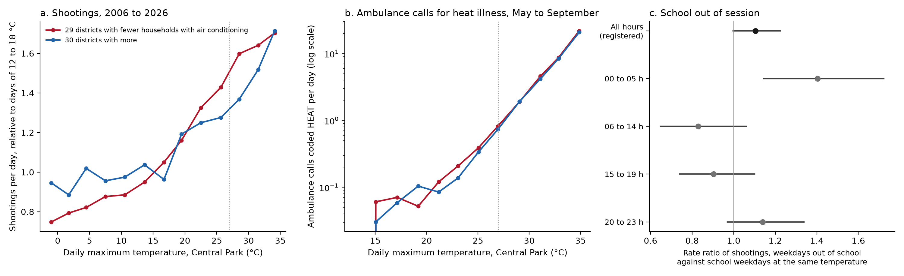

# Heat and shootings: what could be done

Earlier claims in this project found that shootings in New York rise 14.6% for each 5 °C of daily maximum temperature (`heat-shootings`), that measures of people outdoors stop rising at about 27 °C while shootings keep rising (`heat-mech-outdoors`), and that the hot-day excess falls between midnight and 06:00 (`heat-night-minimum`). This note asks what could reduce the excess. It reports three tests that were registered, that is, written down with their conditions for support and refutation and pushed to the repository before their outcome data were read (branches `prereg/heat-ac-shootings`, `prereg/heat-ac-heat-calls`, `prereg/heat-school-out`). It also reports what the System Public Graph, a database of findings extracted from published research, holds on interventions, and which data exist for further tests. Results marked exploratory were computed after the registered results were seen and decide nothing. Scripts are in `analyses/heat_solutions/`, data in `data/derived/heat_solutions/`.

## Corrections after the referees (13 November 2026)

Four blind referee reports changed how these results should be read. No verdict changed (`critique/answers_round6_heat.md`). The air-conditioning result for shootings is confirmed only as a whole-year slope on calendar dates, 0.043 (0.007 to 0.080), and it is not evidence of an air-conditioning effect: the difference comes from days below about 20 °C, and it is 0.025 (-0.011 to 0.061) when a shooting before 06:00 is counted with the preceding day. The heat-call result excludes protection by household air conditioning only if more than about 17% of HEAT calls come from homes. About half of the excess of shootings on days out of school is holiday nights, chiefly the night of 4 July, counted on the following weekday: the ratio is 1.060 (0.957 to 1.173) without those weekdays, against the registered 1.105 (0.997 to 1.224). The exploratory ratio of 1.40 for shootings after midnight during the recess is 1.18 (0.97 to 1.44) without those mornings. Section 6 gives the estimates under both definitions of the day.

## 1. Air conditioning

The Health Department's Heat Vulnerability Index file gives the percentage of households with air conditioning, from the Housing and Vacancy Survey, for each of the 59 community districts. It ranges from 76% (Bronx 3) to 98%. The districts were split at the median of 91.7%: the low half averages 86% and the high half 94%. Each shooting was assigned to a district from its coordinates. The model is a binomial regression of the share of a day's shootings that fall in the low half on that day's maximum temperature, with terms for weekday, month, year, holiday and rain. Each district is compared with itself on warmer and cooler days, so the higher level of violence in poorer districts does not enter. The coefficient is the difference between the two halves' slopes on the log scale.

The registered result (`heat-ac-shootings`, confirmed) is a difference of 0.043 per 5 °C (95% interval 0.007 to 0.080; 24,367 shootings on 6,932 days, 2006 to August 2026). Shootings rise by a factor of 1.157 per 5 °C (1.139 to 1.176) in the low half and 1.105 (1.069 to 1.141) in the high half. The support rule, a lower limit above zero, is met.

The registered secondary results show that this difference is not what air conditioning would produce. Air conditioners run on hot days. On days of 27 °C or more the difference has the opposite sign, -0.178 (-0.329 to -0.027), and from May to September it is -0.028 (-0.095 to 0.039). An exploratory model with separate slopes below and above 27 °C gives +0.073 (0.032 to 0.113) below and -0.123 (-0.237 to -0.009) above. Panel a of the figure shows the same thing: the two halves separate between 0 and 27 °C, and the high half catches up above it. The difference is also absent for shootings between midnight and 06:00 (0.034, -0.027 to 0.095) and after 2019 (-0.023, -0.088 to 0.042). Low-AC districts are poorer (Spearman correlation of air conditioning with median income 0.70; 23 of the 29 low-AC districts are in the low-income half), and within the low-income half the contrast rests on 1,088 shootings in six districts (0.065, -0.006 to 0.135). The comparison can show that the heat slope differs between two groups of districts. It cannot attribute the difference to air conditioning, and the temperature range in which the difference appears argues against that attribution.

The referee's refit places the difference more exactly. It is 0.105 (-0.001 to 0.211) on days below 10 °C, 0.161 (0.033 to 0.288) from 10 to 20 °C and -0.009 (-0.184 to 0.165) from 20 to 27 °C, so it arises below about 20 °C, when air conditioners are off. The income halves pooled give 0.034 (-0.007 to 0.076), which includes zero. The confirmation also depends on the definition of the day. Shootings between midnight and 06:00 are 35% of incidents, and the maximum of their calendar date comes hours later. With the day running from 06:00 to 05:59 the difference is 0.025 (-0.011 to 0.061; 6,902 days), which the registered rule would read as unsettled. That count was chosen after the data and does not change the verdict. The registration's yardstick of 0.042, the difference expected if households without air conditioning carried half of the citywide slope, is close to the estimate by coincidence, because the estimate arises in a temperature range where air conditioning cannot act.

Two sharper designs were considered. Shootings on public housing property (Housing Bureau jurisdiction, 3,963 incidents) have a slope that does not differ from other shootings (0.017, -0.021 to 0.056). Shootings recorded at public-housing buildings have a steeper slope than those at other apartment buildings (0.119, 0.061 to 0.177), but the location field is blank for half of incidents and the contrast, like the district one, lies below 27 °C (exploratory: 0.138 below, 0.017 above). No source was found for the share of public housing apartments with air conditioning, so the premise that it is rarer there was not checked. The Get Cool NYC programme of 2020 installed about 73,000 air conditioners for adults aged 60 and over; that age group commits few shootings, the addresses are not public, and 2020 is the year shootings doubled for other reasons. It cannot serve as a test for violence.

## 2. Electricity as a measure of cooling

NYISO publishes load for Zone J (New York City) at five-minute intervals; the project holds the monthly files for 2015 to 2025 from an earlier claim. This is one series for the city. It follows temperature closely and cannot separate districts, so no test was built on it. Con Edison does not publish network loads as open data. A usable source exists and was not run: the New York State Utility Energy Registry (data.ny.gov `tzb9-c2c6` and `g2x3-izm4`) gives residential electricity use and the number of accounts by ZIP code and month from 2016. The ratio of July and August use to April and May use per account measures how much cooling a ZIP code runs, which the survey does not: the survey counts a household that owns an air conditioner and cannot pay to run it as having one. Local Law 84 monthly data (`fvp3-gcb2`) give the same by large building.

## 3. Complaints about indoor heat

311 has no category for a hot apartment. HEAT/HOT WATER is the winter complaint about no heating (352,000 in January and 21,000 in July since 2020; the summer ones concern hot water). The categories that mention cooling are noise from air-conditioning equipment (about 34,000 in 2010 to 2019), air conditioning problems in schools (2,353 and 1,382 in the two periods), shops with doors open while cooling, and cooling towers. Landlords in New York are not required to provide cooling, so the housing agency has no violation to record. Indoor summer heat is therefore not measured by any complaint series.

## 4. School out of session

The model of `heat-shootings` holds month and year fixed, so temperature is compared within the same month. The school calendar can bias the slope only through June and September, the two months that contain both school days and recess days. Before any outcome was read, the calendar and the weather alone gave the size of this: for the calendar to produce a tenth of the 14.6%, shootings would have to be 3.35 times as frequent when school is out. The fitted model agrees. With a term for the summer recess the slope is 1.144 per 5 °C (1.127 to 1.161) against 1.146 without it; the term removes 1.5% of the log slope. The 14.6% is a temperature effect within months and already excludes the school calendar.

Whether school being out raises shootings at a given temperature is a separate question. The registered test (`heat-school-out`, unsettled) used weekdays that are not public holidays within 42 days of the last and first day of classes, 2006 to 2026 without the remote-teaching transitions of 2020 and June 2021, with temperature, a linear trend on each side of term, weekday and rain. The rate ratio for days out of school is 1.105 (0.997 to 1.224; 2,260 weekdays, 7,199 shootings). The lower limit is 0.003 below 1.00 and the upper limit is above the refutation threshold of 1.10, so neither rule is met. The registrant predicted 0.95 to 1.08, and the estimate is above that. A 21-day window gives 1.217 (1.057 to 1.402), and the recess term in the all-year model is 1.139 (1.047 to 1.238).

The referee found that about half of this excess belongs to holiday nights. Public holidays are left out of the window, but the weekday after one is kept, and a shooting before 06:00 is counted on its calendar date. The twelve weekdays dated 5 July average 6.1 shootings before 06:00 against 0.9 on other days; these are the night of 4 July, counted as days out of school a week after classes end. Without the 74 weekdays that follow a public holiday the ratio is 1.060 (0.957 to 1.173), and on days from 06:00 to 05:59 it is 1.044 (0.951 to 1.146). The registered excess is entirely in shootings before 06:00; from 06:00 to 23:59 the ratio is 1.00 (0.89 to 1.12). The estimate also falls as the window widens, from 1.217 at 21 days to 1.079 (0.981 to 1.186) at 49 and 1.024 (0.945 to 1.109) at 70, so it is a peak of about two weeks around the turn of June and July and not a lasting change of level. The margin of 0.003 is smaller than the effect of the window, of the error estimator, of keeping the remote-teaching years or of moving the dates by one day. The window also stacks 184 dates twice, once after the last day and once before the first; with each date kept once the ratio is 1.114 (1.002 to 1.238).

The rise is not specific to school-age victims: 1.20 (0.90 to 1.59) for victims under 18 (944 victims), 1.11 (0.94 to 1.32) for 18 to 24, and 1.13 (0.97 to 1.31) for 25 and older. A school effect should be largest among the young, and a seasonal effect that temperature does not capture would be equal across ages, which is what the data show within their wide intervals. Exploratory counts by hour, chosen after the data, gave a ratio of 1.40 (1.14 to 1.72) for shootings between midnight and 06:00 on days out of school, and 0.83 (0.65 to 1.06) between 06:00 and 15:00. The first figure should not be quoted as a recess effect: without the mornings after public holidays it is 1.18 (0.97 to 1.44), and the same block rises on weekend dates in the same windows (1.10, 0.93 to 1.31). Victims under 18 are shot at a rate of 17.8 per 100 weekdays between 15:00 and 20:00 on school days and 12.4 on recess days, and 4.9 against 10.6 between midnight and 08:00 (51 and 108 victims). The other age groups move the same way after midnight. In the referee's models victims under 18 shift towards the hours before 06:00 more than adults do (interaction 2.04, 1.25 to 3.33, on 118 victims, without the mornings after holidays). This is an exploratory result found among at least 16 cells, and it needs its own registration.

## 5. Interventions that could help both outcomes

The graph was searched by study-variable name (258 requests) for air conditioning, cooling centres, tree canopy, street trees, vacant lots, green space, summer youth employment, swimming pools, parks, street lighting, heat warnings and school holidays. Abstracts of the findings used here were read in PubMed.

| Intervention | Heat illness or death | Violence |
|---|---|---|
| Home air conditioning | Graph: odds of heat death 0.2 (0.1 to 0.7), 0.3 and 0.03 with a working unit in three heat-wave case-control studies; hospital admission 0.12 with a bedroom unit | Graph: nothing. This note: no support on hot days |
| Trees and green space | Graph: mortality rises less with heat where there is more vegetation (Paris, Michigan). This project: air 0.20 °C cooler per 10 points of vegetation | Graph: maintained vacant lots, odds of adolescent homicide 0.17 (0.03 to 0.81), one case-control study. Outside the graph: a randomised trial of vacant-lot greening in Philadelphia, gun violence -29% |
| Summer youth employment | Graph: no variable. No evidence found | Graph: no variable. Outside the graph: a randomised trial in Chicago, violent-crime arrests -43% over 16 months |
| Cooling centres, pools, park hours | Graph: three variables on cooling centres, none with a heat outcome | Graph: nothing |
| Street lighting | Not applicable | Graph: odds of adolescent homicide 0.24 (0.09 to 0.70), same case-control study |
| Heat warnings | Graph: no fall in deaths on alert days, 1.005 (0.997 to 1.013) | Graph: nothing |

Two graph records were wrong against their abstracts: a hazard ratio for a deprivation index is stored under "no air conditioner", and the Paris relative risk for municipalities with 40% tree cover is stored under "lack of green spaces". Greening is the only intervention with evidence on both sides, and the trial evidence for violence comes from one city. No study in the graph measures one intervention against both outcomes.

Heat illness can be measured daily by district in New York. The EMS dispatch file (`76xm-jjuj`) has a final call type HEAT with 17,688 incidents since 2005 and the community district of each. The syndromic emergency-department series is public only for the city as a whole. The registered test (`heat-ac-heat-calls`, contested) used the same split and model as for shootings, for May to September. The slopes do not differ: -0.032 per 5 °C (-0.088 to 0.024; 15,754 calls). The interval excludes 0.112, the difference expected if every call came from a home and a working air conditioner cut the risk to 0.23, so the refutation rule is met. An exploratory refit gives 6.8 (6.3 to 7.4) per 5 °C in the low half and 7.0 (6.5 to 7.6) in the high half; panel b shows the two curves on top of each other. A call is located where the patient was found, and calls from streets, parks and workplaces do not depend on household air conditioning. The result therefore shows that ambulance calls cannot detect the protection that the case-control studies found, and does not contradict them. The yardstick shrinks with the share of calls that come from homes: it is 0.064 if half do and 0.021 if 15% do. The upper limit of 0.024 excludes household protection of the size the studies report only if more than about 17% of HEAT calls come from homes, and the data do not give that share; 62% of calls fall between 12:00 and 18:00. Of the 17,688 calls, 864 have no usable district. A study of deaths by district in New York did find higher heat mortality among older residents where fewer households had air conditioning (Klein Rosenthal 2014).

The registered joint question was whether low-AC districts have steeper slopes for both outcomes. By the registered rule the answer is that the data cannot tell: the heat-call claim is not confirmed, and the shootings claim is confirmed, on calendar dates, for a temperature range in which air conditioners are off.

## What follows for action

These results do not support air conditioning as a way to reduce shootings. The case for it rests on heat deaths. The hot-day excess falls after midnight (`heat-night-minimum`), which points to interventions that act at night in summer: lighting, late opening of pools and recreation centres, and summer programmes with evening hours. The recess excess after midnight is smaller than first reported, and about half of it is holiday nights, so it adds little to that case. None of these has been tested here, and the graph holds one study on lighting. Greening has trial evidence for violence and observational evidence for heat. Summer employment has trial evidence for violence and none for heat.

## 6. Calendar date against a day from 06:00 to 05:59

Each estimate was refitted with events before 06:00 counted on the previous date (`analyses/critique/round6_six_am_solutions.py`). These refits are exploratory and decide no verdict. One registered condition would change side: the support condition of `heat-ac-shootings` is not met on the 06:00 day. The other estimates, including the citywide slope of earlier rounds (1.146 on calendar dates and 1.135 on the 06:00 day), are in `data/derived/round6_heat/six_am_solutions.json` and in the outcomes' notes.

| Estimate | Calendar date | Day from 06:00 to 05:59 |
|---|---|---|
| Shootings, low-AC minus high-AC half, per 5 °C (registered test of `heat-ac-shootings`) | 0.043 (0.007 to 0.080) | 0.025 (-0.011 to 0.061) |
| Shootings, rate ratio per 5 °C, low-AC half | 1.157 (1.139 to 1.176) | 1.141 (1.122 to 1.160) |
| Shootings, rate ratio per 5 °C, high-AC half | 1.105 (1.069 to 1.141) | 1.109 (1.074 to 1.146) |
| Difference on days of 27 °C or more | -0.178 (-0.329 to -0.027) | -0.133 (-0.284 to 0.017) |
| Difference, May to September | -0.028 (-0.095 to 0.039) | -0.032 (-0.099 to 0.036) |
| Difference, 2006 to 2019 | 0.068 (0.025 to 0.112) | 0.047 (0.002 to 0.091) |
| Difference, income halves pooled | 0.034 (-0.007 to 0.076) | 0.023 (-0.018 to 0.065) |
| Public-housing buildings against other apartment buildings | 0.119 (0.061 to 0.177) | 0.115 (0.058 to 0.172) |
| HEAT calls, low-AC minus high-AC half (registered test of `heat-ac-heat-calls`) | -0.032 (-0.088 to 0.024) | -0.027 (-0.083 to 0.028) |
| Days out of school against school days (registered test of `heat-school-out`) | 1.105 (0.997 to 1.224) | 1.044 (0.951 to 1.146) |
| The same, 21-day window | 1.217 (1.057 to 1.402) | 1.134 (0.997 to 1.290) |
| Victims under 18 | 1.195 (0.897 to 1.593) | 1.189 (0.905 to 1.563) |
| Shootings from 00:00 to 05:59 (exploratory) | 1.404 (1.144 to 1.723) | 1.126 (0.959 to 1.321) |
| Heat slope of all shootings with a recess term | 1.144 (1.127 to 1.161) | 1.133 (1.116 to 1.150) |
| The recess term | 1.139 (1.047 to 1.238) | 1.121 (1.036 to 1.214) |

## Limits

Two lines of the fixed script were changed after registration, each in how the hour of a shooting is read. The archived victim file has 390 times that are not zero-padded, and the registered script stopped there, after the air-conditioning models had been fitted and before anything was printed or saved. The incident file has no such time, and the change alters no hour in it. Temperature comes from Central Park, and low-AC districts are probably hotter than it by a wider margin. Air conditioning is measured once, by a survey of ownership. Districts hold about 140,000 residents and differ by 8 points of households, so a test at this scale can detect only a large household effect. Religious holidays and other closures inside the term are counted as school days; they are about 8% of school-side days, and high schools end regular classes one to two weeks before the registered last day, both of which bias the school estimate towards 1. The age of victims is available to 2024 only. The shootings file stores latitude and longitude in swapped columns for most rows; the scripts correct this.

## Sources

NYPD Shooting Incident Data `5ucz-vwe8` (rows updated 5 November 2026) and archived `833y-fsy8`; EMS Incident Dispatch Data `76xm-jjuj` (7 October 2026); 311 Service Requests `erm2-nwe9` and `76ig-c548`; NOAA GHCN-Daily USW00094728; NYC DOHMH EHDP-data `hvi-nta-2020.csv` (commit 547482b); System Public Graph API v1.0 (`data/derived/heat_solutions/graph.json`). Naughton 2002, PMID 11988377; Semenza 1996, PMID 8649494; Kaiser 2001, PMID 11563746; Zhang 2016, PMID 27256088; Pascal 2021, PMID 33640693; Gronlund 2015, PMID 25460667; Weinberger 2021, PMID 34461376; Culyba 2016, PMID 26954939; Branas 2018, PMID 29483246; Heller 2014, PMID 25477459; Klein Rosenthal 2014, PMID 25199872.
