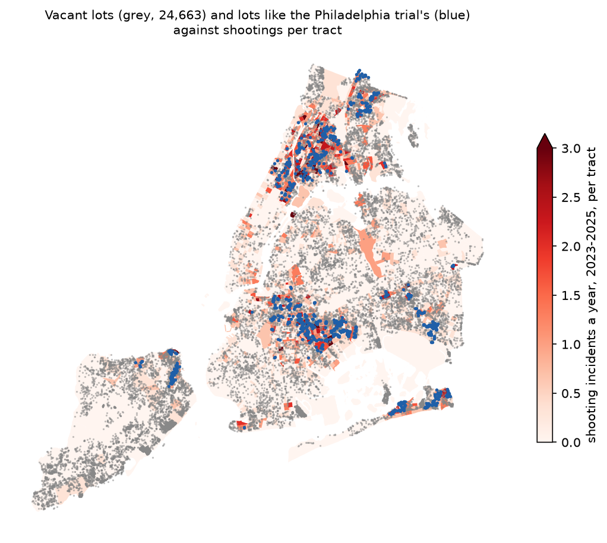
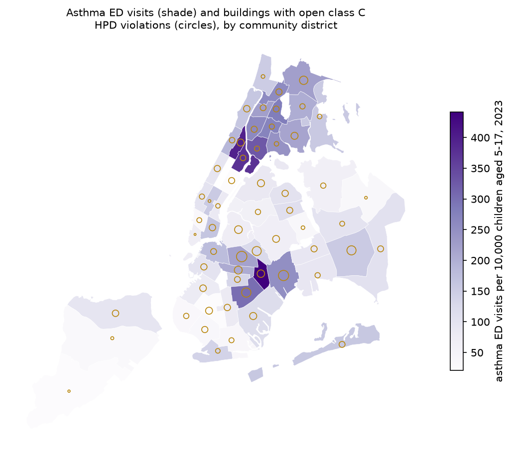
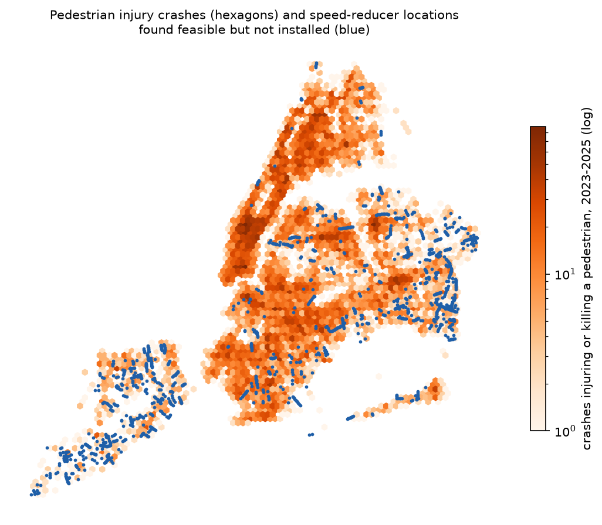

# What a city or a charity could do: levers ranked on five components

This note was written on 13 November 2026. Earlier notes asked what research says and whether New York's data agree. This one asks what a city agency or a private charity could pay for, and how the System Public Graph (called the graph below) and the city's open data can rank the choices. The tool is `tools/levers.py`, and the page is `viz/levers.html`. One prediction was registered and tested (`levers-vacant-lot-trial-match`). Everything else in this note is descriptive and was not registered.

## Corrections after review

A referee rebuilt the vacant-lot count with separate code (`critique/levers-vacant-lot-trial-match.md`). The verdict stays confirmed under rule 1, but the lots are not shown to be like the trial's.

1. The referee finds 1,087 screened lots of 2,678 (0.406) against 1,116 (0.417). The difference is 42 lots with recent DOB NOW filings or permits that the registrant's join missed. The share stays between 0.31 and 0.41 under every open choice tested. Shootings within 300 m (387 a year) and the arithmetic for prevented shootings (about 26 a year) reproduce; the union of buffers avoids double counting.
2. In a random check of 40 screened lots against aerial images, 28 (70%, interval 55 to 82%) are not vacant blighted land. They are mostly yards, roofs, slivers and woodland. On that check the share like the trial's lots is about 0.12, below the registered floor of 0.18. The check was chosen after the data and decides nothing under rule 4, but it means the 1,087 lots are lots that pass a screen, not lots like the trial's. Greening estimates built on them are too high by an unknown factor, possibly about three.
3. The analysis scripts were first committed with the outcome, so rule 9 is not met for this claim. The order of plan and data rests on the registration text.
4. BIS new-building permits do not end in 2020, as the first draft said.
5. The useful product is a screened list for field checking, not a list ready for a programme. A charity or the city would visit lots before randomising.

## Method

The list of levers starts from the 25 interventions in `all_boats.md`. One lever was added that the graph holds under vacant land: remediation of abandoned houses, tested in a Philadelphia trial. Each lever is scored on five components, and the components are kept apart. They are not on a common scale, and any weights that combined them would be arbitrary. The page sorts by any one of them.

1. Effect. This is the headline verified finding for the lever, with its interval, the study design and the population. I re-read the PubMed abstract of each finding used; the abstracts are cached in `data/derived/levers/abstracts/`. Odds ratios are shown as a percentage change in odds, which overstates the change in risk when an outcome is common. Designs are ranked experiment, quasi-experiment, cohort, case-control and cross-section.
2. Breadth. This is the number of the eight outcome domains with a verified benefit and the number with a verified harm, from `data/derived/all_boats/breadth.csv`.
3. Burden in New York. This is the size of the outcome per year, and the share of it held by the tenth of areas (precincts, ZIP codes, community districts or NTAs) with the most.
4. Reach in New York. This is the number of places or households that are eligible.
5. Cost per unit, from a published source, or marked as missing.

Each lever also says whether the population studied resembles New York's: yes, partly or no.

The city figures come from `analyses/levers/city_metrics.py` (`data/derived/levers/city_metrics.json`, with a source record for each query). Shootings are 855 incidents a year in 2023-2025 (5ucz-vwe8), and the tenth of precincts with the most hold 35% of them. Pedestrians injured or killed number 9,392 a year (h9gi-nx95). Asthma emergency visits were 68,746 in 2023 (Environment and Health Data Portal), and the tenth of community districts with the most hold 24%. Buildings with an open class C housing violation number 85,306 (wvxf-dwi5), and buildings with an open mould violation 31,529.

## The ranking

No lever leads on every component. The table gives the eight levers for which the graph holds an experiment or a quasi-experiment. Several other levers have only cross-sectional evidence, from populations unlike New York's.

| Lever | Design | Effect (95% interval) | Breadth (benefit / harm) | Burden in New York | Reach in New York | Cost |
|---|---|---|---|---|---|---|
| Housing repair and insulation | experiment, New Zealand | wheeze OR 0.57 (0.47-0.70) | 4 / 0 | 68,746 asthma ED visits a year | 85,306 buildings with open class C violations | NZ$1,800 per dwelling (2009) |
| Vacant-lot greening | experiment, Philadelphia | shootings −6.8% (−10.6 to −2.7) | 1 / 1 | 855 shootings a year | 24,663 vacant lots; 1,087 pass a screen, perhaps a third of them like the trial's | $5 per m², $0.50 per m² a year |
| Abandoned-house remediation | experiment, Philadelphia | gun assaults −13.1% (−21.3 to −3.0) | 1 / 0 | 855 shootings a year | 4,538 open vacate orders | missing |
| Interior lead hazard control | experiment, US trials | blood lead ≥ 15 µg/dL OR 0.40 (0.21-0.80) | 1 / 0 | not measured | 25,924 buildings with open lead-paint violations | missing |
| Speed humps | quasi-experiment, Toronto | pedestrian collisions IRR 0.78 (0.66-0.91) | 3 / 0 | 9,392 pedestrians hurt a year | 1,409 feasible locations not yet built | $12,000 per hump (2014) |
| Smoke-free laws | quasi-experiment, Massachusetts | heart attack deaths −7.4% (−11.4 to −3.3) | 2 / 0 | not measured | already in force in New York | missing |
| Free bus travel for older people | quasi-experiment, England | depression −0.95 CES-D points (−1.71 to −0.19) | 2 / 2 | not measured | half fare already given | missing |
| Heat alerts (cooling centres) | quasi-experiment, US counties | mortality RR 1.005 (0.997-1.013) | 0 / 0 | 507 heat-illness ED visits a year | not measured | missing |

Housing repair is the only lever with experimental evidence of benefit in several domains, and it acts on the largest measured burden. Its evidence comes from uninsulated detached houses in a mild climate. New York's problem housing is multifamily, often overheated in winter, with mould and pests, so the transfer is uncertain. Vacant-lot greening and abandoned-house remediation have trials in an American city with gun violence. All three are cheap per unit where a cost is known. Speed humps rest on a quasi-experiment in a city like New York, and New York's own programme has a queue of feasible sites. Air conditioning has the largest effect on its outcome (OR 0.2 for heat-wave death), but the evidence is case-control and cohort, and the city burden it acts on is small in count (about 6 heat-stress deaths and 507 heat-illness ED visits a year in recent EHDP years; heat-exacerbated deaths are several times more).

The negative breadth of housing vouchers and public pools is an artefact, as `all_boats.md` explains. Community gardens, third places, broadband and walkability rest on cross-sectional or cohort studies from Taiwan, South Korea, China and South Africa; the page marks them as unlike New York.

## Three levers by place

Housing repair, vacant-lot greening and speed humps rank highest among the levers the city could target by place. For each, the maps in `figures/levers/` show where the lever applies and where the burden is (`analyses/levers/maps.py`, exploratory).

Vacant-lot greening. Of the 24,663 lots recorded as vacant land, 2,678 (11%) lie in the 235 tracts that had 10 or more shootings in 2019-2024. Those tracts are the top tenth of tracts and held 51% of the shootings. The gap that blocks targeting is the condition of the lots. City records say who owns a lot and whether a permit was issued, but not whether the lot is abandoned, overgrown or strewn with trash, which was the trial's condition. The registered test below tried to fill this gap.

Housing repair. Across the 59 community districts, the asthma ED rate of children aged 5-17 and the count of buildings with open class C violations have a rank correlation of 0.29. The 12 districts with the highest asthma rates hold 24% of those buildings. The gap is the link between a building and its residents' health. Asthma visits are published only by district, and no public record gives a building's dampness, insulation or heating. A trial would need building-level health outcomes, which the city's hospital data hold but do not publish.

Speed humps. The 1,409 speed-reducer locations that the Department of Transportation found feasible and has not yet built are placed by residents' requests. Staten Island holds 507 of them (36%) and 3% of the pedestrians injured in 2023-2025; the Bronx holds 23 (1.6%) and 17% of the injured. Only 1.9% of crashes that injured a pedestrian lie within 100 m of a queued location. The gap is a measure of where humps are eligible but not requested. The city's records hold requests, not a list of eligible street segments, and speed humps are limited to certain local streets, which carry a minority of the crashes. These figures were not registered.

## The registered test: how many of New York's vacant lots resemble the Philadelphia trial's?

The Philadelphia trial (Moyer et al. 2019, PMID 30496003) greened or cleaned 541 randomly chosen lots. It excluded lots with insufficient blight, lots larger than 510 m², and paved parking. Its outcome was shootings near each lot, by kernel density with a 500 m bandwidth and by count within 300 m of a cluster. New York's vacant lots are different. Many are held for development, stalled, owned by the city as interim sites, or bought out after Hurricane Sandy (`explore.md` section 3, `stalled.md`). The claim `levers-vacant-lot-trial-match` predicted how many New York lots resemble the trial's lots. It was registered at commit 2a7c4b4 and pushed alone to `prereg/levers-vacant-lot-trial-match`, before any lot-level permit, garden, shooting or imagery data were read.

Each lot in the high-shooting tracts was given the first type that applied: GreenThumb garden; Sandy buyout parcel; active development (a new-building, demolition, foundation or earthwork permit, or a new-building filing, in the last 24 months); stalled (on the DOB stalled-sites list, or such a permit or filing from 2014 to November 2024 with nothing since); city-owned interim; or private idle. Each lot's MapPLUTO polygon was then laid on the 2022 NAIP image, which has a near-infrared band. The share of pixels with NDVI of 0.2 or more is the vegetated share. A lot counted as trial-like if it was private idle or city interim, no larger than 510 m², and at least 20% vegetated, which excludes paved, built-over and excavated lots. The plan called for a sample if more than 2,500 lots needed imagery; 1,705 did, so every lot was read.

| Type, high-shooting tracts | Lots | ≤ 510 m² |
|---|---|---|
| Private idle | 1,471 | 1,251 |
| City-owned interim | 668 | 454 |
| Stalled | 281 | 228 |
| Active development | 258 | 176 |
| Garden or buyout | 0 | 0 |

Of the 1,705 small idle lots, NAIP classed 720 as vegetated (half or more of the pixels), 396 as mixed, 565 as bare or paved, and 24 could not be read.

The verdict is confirmed. 1,116 lots, 42% of the 2,678 in high-shooting tracts, resemble the trial's lots. The registered range was 18% to 45% for the share and 400 to 1,500 for the number. The share is near the top of its range. Of the 1,116, 717 are private, 304 city-owned and 95 owned by other public or exempt bodies; 405 are in Brooklyn, 274 in the Bronx, 274 in Queens, 90 on Staten Island and 73 in Manhattan. Their area is 225,620 m².

In 2023-2025, 388 shootings a year occurred within 300 m of at least one of these lots, out of 855 citywide. If the trial's effect transferred, greening all of them would prevent 26 shootings a year (10 to 41), and mowing and trash cleanup 36 (19 to 51). At the trial's costs, greening would cost about $1.1 million and $113,000 a year to maintain. These intervals carry the trial's uncertainty only. They do not include the doubt that the effect transfers to New York, or the possibility that the effect is smaller where many treated lots share the same 300 m of street.

Three limits apply. NDVI cannot show trash or neglect, so some trial-like lots may be maintained side yards, which the trial excluded. In an exploratory look at 40 random lot images (`figures/levers/lot_contact_sheet.png`), 4 of the 18 lots the rule calls trial-like showed a building roof or a maintained ball field, so the count may be about a fifth too high; the share would still lie in range. The imagery is from summer 2022, and changes since then are caught only through permits. Recent activity rests mainly on DOB NOW foundation, earthwork and demolition permits and on new-building filings.

Two problems in the city data were found during the test. The NYPD shootings dataset (5ucz-vwe8), as fetched on 13 November 2026, has its latitude and longitude columns swapped, so the analysis swaps them back. The stalled-sites view (i296-73x5) ignores the offset parameter and returns the same rows on every page, so it was read as one page.

## What is new and what is practical

The new part is the composition. The trial's eligibility rules, taken from its methods section, were applied to New York's whole vacant-lot inventory, using tax records, four permit systems and aerial imagery with a near-infrared band. As far as we found, no published count says how many New York lots resemble the Philadelphia trial's. A second new result is exploratory: the city's queue of feasible speed humps lies mostly where few pedestrians are hurt.

The practical part is the list. `data/derived/levers/trial_like_lots.csv` gives the 1,116 lots, with owner, address and vegetated share. A city agency could use it to choose city-owned lots (304) for a greening programme. A charity could use it to ask private owners for permission. Either could randomise the order of treatment, which would test whether the Philadelphia effect holds in New York. A street-level survey of a random sample should come first, to remove side yards and maintained lots.

## Files

- `tools/levers.py`: the lever table and its five components; `--json` writes `data/derived/levers/levers.json`, `viz/data/levers.js` and `viz/data/levers_lots.js`.
- `viz/levers.html`: the sortable page, with the maps and lot images.
- `analyses/levers/`: `register_lots.py`, `lots_fetch.py`, `lot_polygons.py`, `lot_ndvi.py`, `lot_test.py`, `outcome_lots.py`, `city_metrics.py`, `maps.py`, `pubmed.py`.
- `data/derived/levers/`: city metrics, lot records, NAIP measurements, test results and the list of trial-like lots. The lot polygons are kept outside Dropbox in `~/opt/nyc-concordance/levers/` and can be fetched again with `lot_polygons.py`.
- `figures/levers/`: maps, the contact sheet and lot images (sRGB).

Aerial imagery: USDA Farm Service Agency, National Agriculture Imagery Program (NAIP), 2022.
