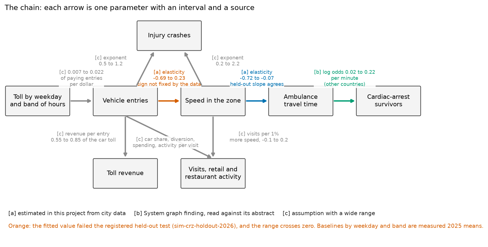

# Simulating a policy before it is made: the weekday toll

Stage one of this project checks published statements against the city's data. This note tries stage two on one example: using the same data and the System Public Graph (a database of findings extracted from published research, called the graph below) to compare versions of a policy before one is chosen. The example is the toll on vehicles entering Manhattan south of 60th Street, which began on 5 January 2025 at $9 on every weekday from 05:00 to 21:00 and $2.25 overnight. The question is whether a toll that varied by weekday or by hour would speed traffic and ambulances more, and what it would cost shops and restaurants.

The simulator composes associations. Two of its fourteen parameters were fitted to New York's data, one comes from five studies of cardiac arrest in other countries, and eleven are assumptions. It is not a causal model of New York. Its outputs say what the chain implies if every link is right within its stated range, and the count of cardiac-arrest survivors is an illustration of that arithmetic, not a forecast.

The result, corrected on 13 November 2026 after a referee's review (`critique/sim-crz-holdout-2026.md`, answered in `critique/answers_round6_crz.md`), is that the simulator separates the schedules on revenue only. The data do not fix the sign of the link from vehicle entries to speed, so for every schedule the 95% intervals for speed, ambulance travel time, survivors, retail activity and injury crashes include zero. An earlier version of this note drew that link at or below zero, which made every schedule that lowered entries raise speed in every draw.

## The model

The model is a table of five weekdays by four bands of hours (21:00-05:00, 05:00-10:00, 10:00-16:00, 16:00-21:00). Each cell starts from its measured 2025 mean: vehicle entries (MTA), taxi speed inside the zone (trip records), ambulance travel time to life-threatening calls and the number of cardiac arrests (EMS dispatch data). A toll schedule changes the cells through the chain in the figure. Each arrow is one parameter with a range and a source of type a (estimated in this project), b (a graph finding read against its abstract) or c (an assumption with a wide range).

Entries that pay the toll fall by a fixed share per dollar, and taxis and for-hire vehicles, which pay per trip, do not respond. Speed changes with entries by an elasticity, ambulance travel time changes with speed by a second elasticity, and survival after cardiac arrest falls by a share for each minute of delay. Retail and restaurant activity falls with the deterred car visitors who do not come by another mode and rises with any visits gained from faster streets. The fourteen parameters are in `data/derived/simulate/parameters.json`, and the simulator reads nothing else. Every result is the 2.5th, 50th and 97.5th percentile of 10,000 draws of the parameters with seed 20261113. The central value of each parameter is the median of its draws, and no distribution is cut off at zero. Where the evidence does not fix the sign of a parameter its range crosses zero. That is the case for the entries-to-speed elasticity, -0.23 (-0.69 to +0.23), and for the assumed gain in visits from faster streets.

The parameter file is built by `analyses/simulate/build_parameters.py`, which loads nine entries of `data/derived/congestion/parameters.json` (the 105 estimates of `docs/congestion_tradeoffs.md`) through one mapping table and records the hash of that file. The loaded entries are the three toll rates, the fall in vehicle-miles and the taxi share of entries (which together anchor the assumed toll response), the monthly elasticity of ambulance travel time to taxi speed from `bridge-crz-ems-travel` (which sets the upper bound of the speed-to-ambulance range), the odds ratio of survival per minute from five graph findings, and the assumed range of survival to discharge. Eleven parameters remain assumptions: the toll response and the retiming response, baseline survival, the car share of visitors, diversion to other modes, spending per car visitor, activity per visit, the amenity term, revenue per entry and the two crash exponents.

## Validation

The two links fitted to city data were tested on months not used to fit them. The test is the claim named `sim-crz-holdout-2026`. In this project a claim is registered, which means that its prediction and the results that would support or refute it are committed and pushed to the repository before the data that test it are read. A claim whose refutation condition is met is called contested. They were fitted on 243 non-holiday weekdays of 2025, within band, month and weekday, and tested on 123 weekdays of January to June 2026.

The entries-to-speed link failed as registered. The fitted elasticity was -0.41 (-0.61 to -0.20). The held-out slope was 0.29 (0.19 to 0.38) of the fitted value, below the registered limit of 0.5, so the verdict is contested. The referee showed that this number does not measure the elasticity on ordinary days. Two storm days, 23 February and 26 January 2026, carry 84% of the variation in entries that identifies the held-out slope. Without 23 February alone the verdict would be unsettled. On the remaining days the held-out elasticity is between +0.1 and -1.1, depending on how 22 winter days are treated, and without the four days of lowest entries it is +0.08 with a standard error of 0.54. Vehicle entries vary by about 3% from day to day once band, month and weekday are accounted for, in 2025 as in 2026, and what variation remains comes from near-holidays and weather, which change the streets as well as the entries. Day-level data therefore cannot identify the relation in either year. The 2025 coefficient falls to -0.09 (standard error 0.11) when the number of taxi trips inside the zone is added to the model.

The level prediction also failed, and the failure cannot be assigned to the link (see the next section). Vehicle entries were 4% to 6% lower by band, as ratios of means, in the first half of 2026 than in the first half of 2025, so the model predicted higher speeds. Observed speeds were 4% to 10% lower in every band. The mean absolute error was 10.5%, against 7.5% for predicting no change.

The speed-to-ambulance link held in slope. The fitted elasticity was -0.57 (standard error 0.08), and the held-out slope was 1.10 (0.72 to 1.48) of it. It does not depend on the storm days. Within weeks or on dry days the held-out elasticity is about -0.4, so part of the fitted slope is weather that slows taxis and ambulances together. Its level prediction missed the registered 4% tolerance: travel times rose by 10% to 15% between the two half-years, and the fall in speed accounts for under half of the rise.

The simulator therefore takes the entries-to-speed elasticity from the ordinary weekdays of both periods together, 362 days without the four days of lowest entries: -0.23 with a standard error of 0.23, a range of -0.69 to +0.23 (`analyses/simulate/fit_pooled.py`, exploratory). In 16% of draws more entries go with higher speed. The speed-to-ambulance elasticity is drawn from -0.72 to -0.07, the span of the day-level fit and of the monthly estimate in `bridge-crz-ems-travel`. The figure `figures/simulate/holdout_levels.png` shows predicted and observed levels. No successor test was registered: on ordinary days about 830 weekdays would be needed before a day-level test could tell the fitted elasticity from zero, so the rise of the toll to $12 in 2028 is the first test.

## An unexplained observation: taxi speeds fell across the city in 2026

From January 2026 yellow-taxi trips take about 8% longer over the same distances, inside the zone and outside it. Trips under three miles that neither start nor end in the zone slowed by 10.1%, 13.1%, 5.4%, 4.0%, 4.3% and 2.6% in the six months from January to June 2026, each against the same month of 2025. Trips inside the zone slowed by 8.5%, 13.2%, 6.0%, 5.9%, 5.4% and 9.4%. In December 2025 both series were within about 2% of the year before. Within 1,344 pairs of origin and destination zones speed fell by 8.9%, recorded miles per trip fell by 1.1% and minutes rose by 8.6%, so a change in the mix of trips does not explain the fall. Both meter vendors show it. Weather explains a small part: with rain, snow and temperature controlled the fall is 6.4% (4.7% to 8.1%). MTA bus speeds do not show the pattern. In the zone they fell 3.9% over the half-year, mostly from January to March, and outside it 0.6%.

The referee found these figures, and this project re-ran the referee's script and obtained the same values. The cause was not found. The candidates are a change in how trip start and end times are recorded, a change in taxi operations, and a citywide change in general traffic from which bus lanes shield buses. Entries to the zone cannot explain a fall outside it. Until the cause is known the taxi speed series should not be compared between 2025 and 2026, and the simulator's baselines, which are 2025 means, are out of date as levels.

The 2025 data also show how little vehicle entries vary across the week. On Mondays and Fridays, daytime vehicle entries are 2.8% lower than from Tuesday to Thursday, taxi speed is 10.1% higher and ambulance travel time is 6.8% lower. Subway entries in the district are 13.8% lower on those days (`transit-weekday-pattern`). In this comparison speed follows subway entries, a proxy for people present, more closely than it follows vehicle entries. The comparison is exploratory, was not registered, and does not show what causes the difference.

## Scenarios

Each row is a schedule compared with the current one, draw by draw. Revenue covers weekdays only; in the model the current schedule raises $452 million a year (359 to 543). The measured 2025 baselines are a mean ambulance travel time of 448 seconds to life-threatening calls and about 1,550 calls a year typed as cardiac arrest on weekdays in the zone. The three scaled rows multiply the daytime tolls of a pattern by one factor so that weekday revenue at the central parameter values is unchanged.

Two columns are informative and five are not. Revenue separates the schedules, given the assumed toll response and the assumed revenue per entry. Entries restate the assumed toll response: a higher toll lowers entries in every draw by assumption. In the other five columns every interval includes zero, so the table does not say whether any schedule raises or lowers speed, ambulance travel time, survivors, retail activity or crashes. The last column is the share of draws in which speed rises. It is 0.84 for every schedule that lowers entries, because it is the share of draws in which the entries-to-speed elasticity is negative. It describes that parameter and does not compare schedules. The same share applies to ambulance time and survivors.

| Schedule | Entries, % (by assumption) | Speed 05:00-21:00, % | Revenue, $M a year | Ambulance time, s | Arrest survivors a year | Retail, % | Injury crashes, % | Share of draws with higher speed |
|---|---|---|---|---|---|---|---|---|
| Tue-Thu $12, Mon and Fri $6 | -0.4 (-0.6 to -0.2) | +0.13 (-0.15 to +0.50) | +18 (+11 to +26) | -0.2 (-1.0 to +0.3) | +0.03 (-0.05 to +0.26) | -0.02 (-0.10 to +0.02) | -0.3 (-0.6 to +0.1) | 0.84 |
| Mon and Fri $12, Tue-Thu $6 | +0.5 (+0.3 to +0.8) | -0.13 (-0.49 to +0.14) | -34 (-42 to -27) | +0.2 (-0.2 to +1.0) | -0.03 (-0.25 to +0.05) | +0.02 (-0.01 to +0.13) | +0.3 (-0.1 to +0.8) | 0.16 |
| $13.50 from 16:00, $9 before | -0.9 (-1.3 to -0.5) | +0.25 (-0.28 to +0.95) | +45 (+34 to +58) | -0.3 (-2.0 to +0.5) | +0.04 (-0.08 to +0.39) | -0.04 (-0.21 to +0.03) | -0.5 (-1.3 to +0.2) | 0.84 |
| $12 every weekday (the 2028 rate) | -2.3 (-3.4 to -1.2) | +0.63 (-0.69 to +2.39) | +118 (+90 to +150) | -0.6 (-3.9 to +1.0) | +0.10 (-0.19 to +0.93) | -0.10 (-0.54 to +0.07) | -1.3 (-3.4 to +0.5) | 0.84 |
| Tue-Thu high, scaled by 0.953 | -0.1 (-0.1 to -0.1) | +0.04 (-0.04 to +0.15) | 0 (-4 to +4) | -0.1 (-0.4 to +0.1) | +0.01 (-0.02 to +0.12) | 0.00 (-0.02 to +0.01) | -0.1 (-0.1 to 0.0) | 0.84 |
| Mon and Fri high, scaled by 1.102 | -0.1 (-0.1 to -0.1) | +0.05 (-0.06 to +0.19) | 0 (-5 to +6) | 0.0 (-0.1 to 0.0) | 0.00 (0.00 to +0.01) | 0.00 (-0.03 to +0.01) | -0.1 (-0.1 to 0.0) | 0.84 |
| Evening high, scaled by 0.889 | 0.0 (0.0 to 0.0) | +0.01 (-0.02 to +0.05) | 0 (-2 to +2) | -0.1 (-0.5 to +0.1) | 0.00 (-0.01 to +0.04) | 0.00 (-0.01 to 0.00) | 0.0 (0.0 to 0.0) | 0.84 |

The scenarios cannot be ranked on anything but revenue. The unscaled schedules differ from the current one mainly because they charge more or less in total: the midweek pattern raises the toll on three days and lowers it on two, and the Monday and Friday pattern does the reverse. The two revenue changes are not mirror images, because a higher toll loses entries and a lower one gains fewer dollars than it gives up. With revenue held equal, every timing pattern changes speed by less than 0.2% in either direction and ambulance travel time by less than one second.

The scaled rows lower entries by construction. The model gives demand an exponential form with one toll response for every weekday and band. Revenue is then concave in the toll, so any pattern that spreads tolls needs a higher traffic-weighted mean toll to raise the same revenue, and total entries fall. The midweek and the Monday and Friday patterns are opposites, and both lower entries for this reason. Their entries figures are a property of the functional form. Revenue is held for weekdays and at the central parameter values only, and only the daytime tolls are scaled.

The project's own before-and-after estimate of the 2025 toll has a 95% interval of about 2.8 points on either side for speed (`mob-crz-traffic`), so none of the differences in the table could be detected if a schedule were tried. The largest change in the table, a $12 toll on every weekday, implies 0.10 more cardiac-arrest survivors a year, with an interval from 0.19 fewer to 0.93 more.

Timing by weekday does little in the model because vehicle entries are nearly the same on every weekday. The slower midweek traffic goes with more people and activity inside the zone, which a toll on entries does not price.

A further scenario, offered as a provocation, is a hot-night surcharge that raises the overnight toll from $2.25 to $9 on nights that follow a day of 30 °C or more. There are 43 such nights a year, and the model covers the 30 that are weekday nights, because its baselines are weekday means. Citywide, shootings are 14.6% more frequent for each 5 °C of daily maximum temperature (`heat-shootings`, an association). The zone had 359 shootings in the ten years 2015 to 2024, about 36 a year against roughly 1,360 in the city, and 32 of them were at night after such a day. In the model the surcharge lowers night entries by 4.6% (2.4 to 6.8), a fall that follows from the assumed toll response, and changes ambulance travel time by -1.1 seconds (-6.7 to +1.7). The number of shooting deaths averted rounds to zero in every draw. It raises $6 million a year (5 to 7) from about 43,000 toll-paying entries on each such night, at the assumed 0.55 to 0.85 of the car toll collected per entry. The surcharge has no measurable effect on safety, because nearly all of the shootings that heat adds occur outside the zone.

## Sensitivity: the research the policy needs

For each output the parameters are ranked by their share of the squared rank correlation with it across the draws.

| Output | Most influential parameters (share) | Source type | What would measure it |
|---|---|---|---|
| Speed | entries-to-speed elasticity (93%), toll response (6%) | a, contested; c | Vehicle and pedestrian counts inside the zone; the $12 step in 2028 |
| Ambulance time | entries-to-speed (80%), speed-to-ambulance elasticity (16%) | a, contested; a | Ambulance and traffic traces on the same streets |
| Survivors | entries-to-speed (73%), speed-to-ambulance (12%), survival per minute (8%) | a, contested; a; b | A New York cardiac-arrest registry linked to EMS times |
| Revenue | revenue per entry, toll response | c; c | Charged transactions by class and hour, which MTA holds |
| Retail | diversion to other modes (40%), spending per car visitor (19%), amenity (12%), car share (11%) | c; c; c; c | A survey of deterred drivers; card spending by area and weekday |
| Injury crashes | entries-to-speed (46%), volume exponent (26%), toll response (19%) | a, contested; c; c | Crash counts against volume inside the zone |

Of the parameters in this table the graph has findings on one. Its searches returned nothing on congestion charging, on vehicle volume and speed, or on footfall and sales. It did supply the link from ambulance time to survival. The parameter is the odds ratio of survival per minute of shorter response, 1.12 (1.02 to 1.24), the median and range of five graph findings that the congestion analysis read against their abstracts (`docs/congestion_tradeoffs.md`). None is from New York, and the simulator applies gradients measured over minutes to changes of a few seconds.

## What a general simulator would need

A simulator for pricing, permitting or zoning is a chain from a lever the city controls to outcomes that residents care about. For each link there is city data, research, both or neither. The table states what this task found; graph counts are from variable-name searches on 13 November 2026 (`graph_links.json`, `graph_general_links.json`).

| Link | City data | Research in the graph |
|---|---|---|
| Price to demand (toll, parking, for-hire fares) | One price change per policy; no second price yet | None |
| Vehicle demand to speed | Daily data; entries vary by about 3%, so the relation is not identified | None |
| Speed to emergency travel time | Daily data; slope held out of sample | None as a dose and response |
| Response time to survival | Outcomes are not open data | Yes, from other countries |
| Visits to sales | No open data on sales by area and day | None |
| Zoning or permit rule to permits filed | Permit records are open (`construction-permit-funnel`) | None: no variables for zoning, building permit or upzoning |
| Permits to completed housing | Open, with multi-year lags (`construction-four-year-completion`) | None |
| Housing supply to rents and displacement | Partly open; under study in this project | Eight findings on housing supply, one of them naming zoning |
| Exposure to health outcomes (air, noise, heat, crowding) | Open at neighbourhood level | Dense: hundreds of findings |

For all three levers the city's data cover the first links, from the lever to behaviour, but only for prices and rules that have already been tried, so every schedule the city has not run is an extrapolation. The $12 and $13.50 tolls above extrapolate from one price change. The graph covers the last links, from an exposure to health, and has almost nothing on the levers. A general simulator would need four things: the dose and direction of each finding stored in the graph, so that a link can be read as a parameter; the transport and housing economics literature added to it; outcome data that the city holds and does not publish (survival after EMS response, charged toll transactions, sales by area); and a registered held-out test of every fitted link, with a calculation in advance of whether the held-out data vary enough to identify it. The entries-to-speed link was fitted on 243 days with a tight interval, and failed its held-out test because of two storm days. Day-level data do not identify it.

## Files

The simulator is the module `sim/`, run as `python -m sim` with the commands `scenarios`, `run`, `sensitivity`, `params`, `export-js` and `check`. The `check` command confirms that each central value is the median of its draws, that the congestion parameter file is the one the parameters were built from, and that the browser's parameter file equals `parameters.json`. The scenario file `data/derived/simulate/scenarios.json` carries the statements above about sign and construction with its numbers. The scripts that build the data, fit the links and register the test are in `analyses/simulate/`. The page `viz/simulate.html` has a slider for the toll on each weekday and recomputes the outputs in the browser from the same parameter file. The only registered result in this note is `sim-crz-holdout-2026` (contested); the scenario results, the sensitivity ranking, the pooled elasticity, the citywide fall in taxi speed and the weekday comparison are exploratory.
