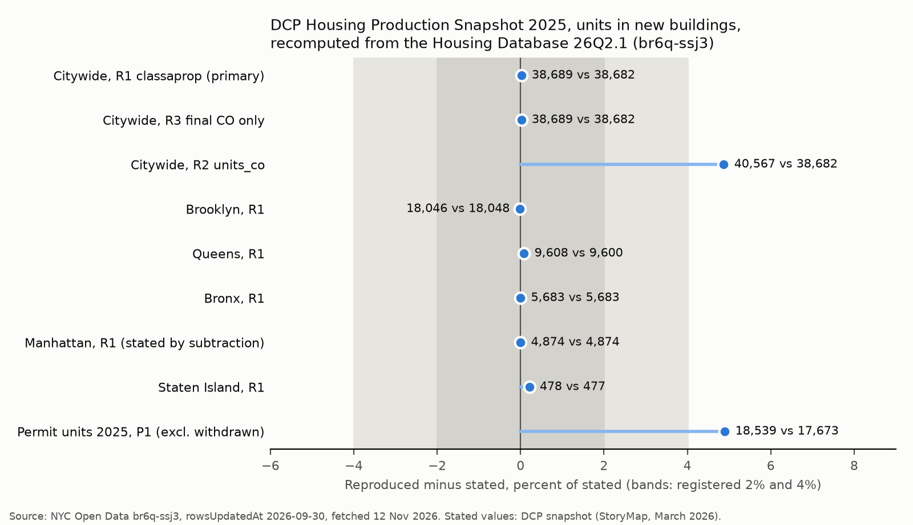
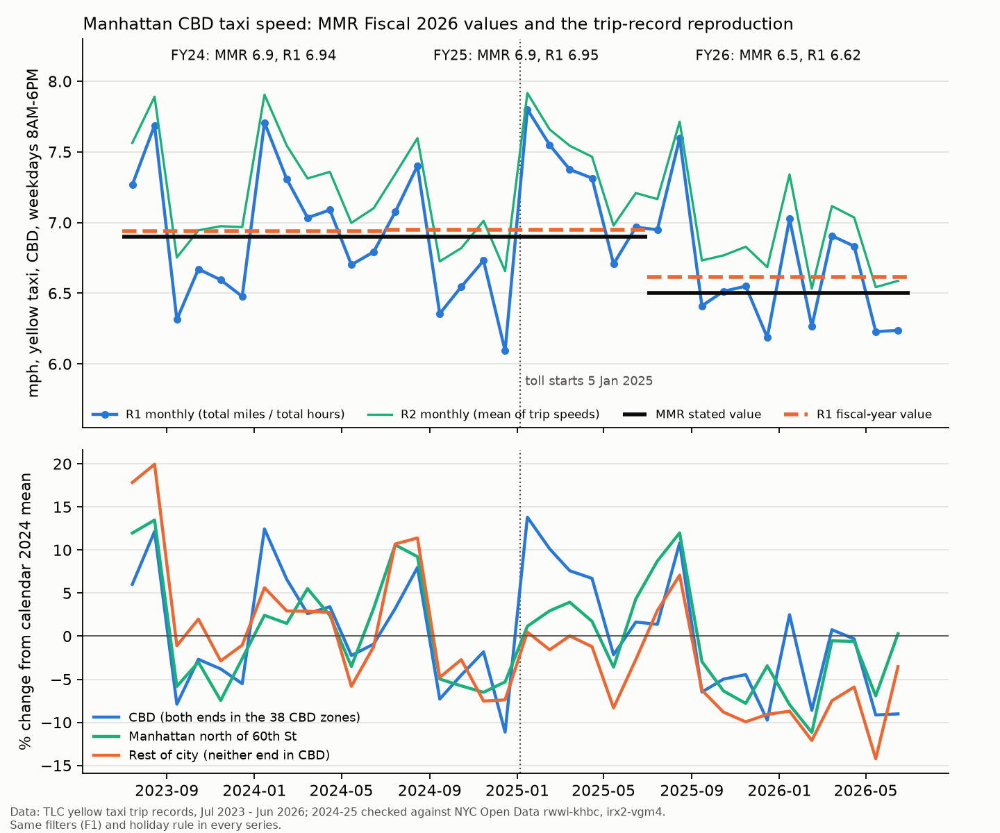

# Reproductions of published city numbers

Each section recomputes a number from a government report with the open data the report names. Each was registered, committed and pushed before the data were queried. Agents append their own sections.

## DCP Housing Production Snapshot 2025: units completed in new buildings

Claim `repro-dcp-2025-completions`, verdict confirmed. The registration was committed locally in 308dd84 and pushed alone to `prereg/repro-dcp-2025-completions` as commit bc791bc on 12 November 2026 at 19:56 EST, before any data value of the Housing Database was queried. The registration discloses that the project's cache already held a fetch of the new-building rows of br6q-ssj3, made for the construction claims, and that only its query record and column headers were inspected.

The Department of City Planning's snapshot states that "38,682 housing units were completed in new buildings" in 2025, and gives 18,048 for Brooklyn, 9,600 for Queens, 5,683 for the Bronx and 477 for Staten Island, which leaves 4,874 for Manhattan. It does not state the completion rule or the unit field. The registered primary reading took new-building jobs whose first certificate of occupancy fell in 2025 (`compltyear`) and summed proposed Class A units (`classaprop`), with a tolerance of 2% for an exact reproduction and 4% to allow for revision between DCP's 25Q4 release, which the snapshot used, and the 26Q2.1 release on the portal.

The primary reading gives 38,689 units in 1,014 jobs, 7 units (0.02%) above the stated figure. Each borough agrees within 8 units: Brooklyn 18,046, Queens 9,608, Bronx 5,683, Manhattan 4,874 and Staten Island 478. Counting only jobs with status "Completed Construction" gives the same 38,689, because every job with a first certificate in 2025 has that status in this release. Counting units on the certificate (`units_co`) gives 40,567, 4.9% above the stated figure, so the snapshot counts proposed Class A units and not the units on the certificate, which can include Class B and hotel units. The same rule gives 33,859 units for 2024, the figure DCP published from the 25Q4 release, so the completion counts did not change between releases.

The snapshot's second number was not reproduced. Units in new-building permits issued in 2025 come to 18,539 excluding withdrawn jobs, 4.9% above the stated 17,673 and outside the registered 4% band. The difference may be permits recorded after the 25Q4 cut-off or a different permit rule in the snapshot. The 25Q4 file (`nychdb_25q4_csv.zip`, 9.3 MB) is on DCP's BYTES of the BIG APPLE page. It was not downloaded in this run, because a download needs Jeff's approval. Computing both numbers on it would settle the question.

On 13 November 2026 Jeff approved the download of that one archive, and both numbers were computed on it. The file is `nychdb_25q4_csv.zip` from DCP's archive on nyc.gov (9,278,590 bytes, SHA-256 `76f16a63535ea661700afd2440f143e718f9ffa4e8685de6e166c4ea208cada2`, last modified 4 March 2026, fetched 13 November 2026 at 07:36 EST), and every one of its 81,708 rows carries the version 25Q4. The registration named one follow-up test in advance: the primary reading on the 25Q4 file, judged by the 2% band alone, as a secondary result that does not change the verdict. That reading gives 38,691 units in 1,014 jobs, 9 units (0.02%) above the stated 38,682 and inside the 2% band, so the verdict stays confirmed. The stated figure is not matched to the unit on its own release. The remaining numbers in this paragraph were not registered for the 25Q4 file and are exploratory. Brooklyn (18,048), the Bronx (5,683) and Manhattan (4,874) equal the stated values, and the 9 units are 8 in Queens (9,608 against 9,600) and 1 in Staten Island (478 against 477); the cause is not known. The permit count on 25Q4 is 17,669 units against the stated 17,673, a difference of 4 units, so the snapshot's permit figure is reproduced on its own release and the 4.9% excess on the portal copy is revision between releases. A job-level comparison shows that the revision is mostly edited unit counts and not late-recorded permits: 22 jobs present in both releases changed their Class A unit count for a net gain of 1,082 units, 6 jobs entered the 2025 permit set with 145 units, and 5 jobs left it with 357 units. For completions the same 1,014 jobs appear in both releases, and one job lost 2 units. The registered permit condition was written for the portal copy and remains unmet there. The scripts are `analyses/reproduction/dcp_2025_25q4.py` and `dcp_2025_release_diff.py`, with results in `data/derived/reproduction/dcp_2025_25q4_results.json`, `dcp_2025_release_diff.json` and `dcp_2025_25q4_sources.json`.

The result bears on the project's construction claims. Of the 38,689 units completed in 2025, 23,669 (61%) were in jobs first permitted in 2022, the year of the 421-a deadline, and 6,875 in jobs permitted in 2023 (exploratory). The high completion count of 2025 is the 2022 permit surge reaching certificates. Units newly permitted in 2025 were less than half the units completed. This agrees with the funnel described in `construction-permit-funnel`, in which a year's permits and a year's completions describe different buildings, and with the two-year median from permit to certificate in `construction-four-year-completion`. It also shows that the 2022 cohort is completing in volume, which is the quantity the prospective claim `construction-2022-rush-units-2027` will test against the June 2027 cut-off; that claim's statistic was not computed here. The aggregate table by community district (dbdt-5s7j) gives 43,654 net units for 2025 across all job types, so it should not be quoted as the new-building figure.

The script is `analyses/reproduction/dcp_2025.py`. Results and source records are in `data/derived/reproduction/dcp_2025_results.json` and `dcp_2025_sources.json`, and the outcome is `claims/outcomes/repro-dcp-2025-completions.json`. The data are NYC Open Data br6q-ssj3 (rowsUpdatedAt 2026-09-30, version 26Q2.1) and dbdt-5s7j, fetched 12 November 2026.

## Mayor's Management Report Fiscal 2026: taxi speed in the Manhattan CBD

Claim `repro-mmr-cbd-speed`, verdict confirmed. The registration was committed locally in 928573e and pushed alone to `prereg/repro-mmr-cbd-speed` as commit 016ac7a on 12 November 2026 at 19:56 EST, before any trip record was queried. Only dataset metadata, the two taxi zone reference tables and the report were read before then.

The DOT table of the MMR (p. 349) gives the average vehicular travel speed in the Manhattan Central Business District as 6.9 mph in fiscal 2024, 6.9 mph in fiscal 2025 and 6.5 mph in fiscal 2026. The indicator definition (p. 256 of the definitions volume) is the average speed of yellow taxis with passengers from 8AM to 6PM, Monday to Friday, south of 60th Street, excluding major US holidays. A fiscal year runs from July to June. The report does not name the data, the zone set, the aggregation or the trip filters, so the registration fixed nine readings with a tolerance of 0.2 mph. The primary reading (R1) takes trips with both pickup and drop-off in the 38 MTA CBD taxi zones, pickups from 08:00 to 17:59 on weekdays, the eleven federal holidays excluded, trips between 1 minute and 3 hours, up to 50 miles and between 0.5 and 50 mph, and divides total miles by total hours over the fiscal year.

R1 gives 6.94 mph for fiscal 2024, 6.95 mph for fiscal 2025 and 6.62 mph for fiscal 2026, from 5.6, 6.1 and 5.9 million trips. Both registered years are within 0.2 mph of the stated values, and the change from fiscal 2025 to 2026 is -0.33 mph against the stated -0.4 mph. The median trip speed (R3), a stricter filter (R7), passengers of one or more with only six major holidays (R8) and the mean of monthly values (R9) also reproduce both years. The mean of trip speeds (R2: 7.24 and 6.92 mph), pickups in the CBD with any drop-off (R4: 8.53 and 8.12 mph), trips with either end in the CBD (R5: 9.58 and 9.13 mph) and a minimal filter (R6: 6.68 and 6.45 mph, which misses fiscal 2025 by 0.22 mph) do not. The level of the indicator therefore depends mainly on the geography rule; DOT's figure behaves like trips that start and end inside the zone.

The trip data are TLC's monthly parquet files for July 2023 to June 2026, which are the only public source for January to June 2026. For 2024 and 2025 they match the NYC Open Data copies (rwwi-khbc, irx2-vgm4) within 0.31% in monthly trip count under the R1 zone, hour and weekday conditions, and exactly in most months of 2024. The MTA's monthly CBD speed series (6p29-6xqn, data.ny.gov) covers all hours and taxis with for-hire vehicles, runs about 1.7 mph higher (8.57 and 8.66 mph in fiscal 2024 and 2025) and ends in August 2025, so it is not the MMR's source.

The MMR series appears to conflict with the project's claim `mob-crz-traffic`, which found zone speeds up 5.7% relative to the rest of the city, and with the MTA's reported 4% gain. The same trip records reproduce both results. The measures differ in three ways. First, the MMR has no comparison area. Second, fiscal 2025 contains six untolled months (July to December 2024, 6.66 mph under R1) and six tolled months (January to June 2025, 7.24 mph), so the gain after 5 January 2025 is averaged with a slow pre-toll autumn and fiscal 2025 equals fiscal 2024. Third, fiscal 2026 includes January to June 2026, when taxi speeds fell across the city: by 9.2% in the CBD, 5.9% in Manhattan north of 60th Street and 6.5% in the rest of the city against January to June 2025. An exploratory check found the fall for both taxi vendors, so it is probably not a change in how one vendor records trips. The fall from 6.9 to 6.5 mph therefore reflects a citywide fall in taxi speed, while the CBD kept its gain relative to the rest of the city. Relative to the rest of the city, the ratio of CBD speed to rest-of-city speed rose 5.1% from calendar 2024 to calendar 2025, close to the 5.7% of `mob-crz-traffic`, and in January to June 2026 it was still 2.9% above January to June 2024. Relative to Manhattan north of 60th Street the gain was smaller and shorter: 2.6% in January to June 2025, and none in the second half of 2025 (-0.5%) or in January to June 2026 (-1.0% against the same months of 2024). These comparison figures are descriptive outputs named in the registration's plan and are not tests. A registered difference-in-differences by half-year would test whether the CBD's gain persists, and the citywide fall in 2026 needs its own explanation.

The scripts are `analyses/reproduction/register_mmr_cbd_speed.py`, `mmr_cbd_speed.py`, `mmr_cbd_speed_checks.py`, `mmr_cbd_speed_figure.py` and `outcome_mmr_cbd_speed.py`. Results are in `data/derived/reproduction/mmr_cbd_speed_*.csv`, the file versions (URL, Last-Modified and ETag of each parquet file) are in `mmr_cbd_speed_files.json`, and the outcome is `claims/outcomes/repro-mmr-cbd-speed.json`. The parquet files (2.2 GB) are kept outside Dropbox in `~/opt/nyc-concordance/tlc_yellow/`, and the script downloads them again if they are absent.

## NYC DOT, 2 January 2026: 2025 traffic deaths and injuries

Claim `repro-dot-2025-deaths`, registered in commit f2fd68b and pushed alone to `prereg/repro-dot-2025-deaths` (commit 95b8927) before any crash data were queried. The verdict is contested.

DOT's release ("Traffic deaths reach all-time low") states 205 traffic deaths in 2025 and 253 in 2024, 111 and 122 pedestrian deaths, a borough split that sums to 205, and 47,557 injuries in 2025 against 51,540 in 2024 "as of December 15". The release does not name its source. DOT's fatality count comes from a reconciled file that is not published at row level, so the NYPD Motor Vehicle Collisions tables (crashes `h9gi-nx95`, persons `f55k-p6yu`, both as updated on 12 November 2026) are the open approximation. The registered tolerances were 5 percent for deaths, 5 percent or 3 deaths for pedestrian and borough counts, and 3 percent for injuries.

| Number | DOT | Open data, primary reading | Other readings |
|---|---|---|---|
| Deaths 2025 | 205 | 229 (persons table, crash date), +11.7% | 229 (crash table) |
| Deaths 2024 | 253 | 268, +5.9% | 268 (crash table) |
| Pedestrian deaths 2025 | 111 | 119, +7.2% | 119 (crash table) |
| Pedestrian deaths 2024 | 122 | 124, +1.6% | 124 |
| Bronx / Brooklyn / Manhattan / Queens / Staten Island 2025 | 33 / 63 / 39 / 57 / 13 | 33 / 70 / 41 / 59 / 7, 19 blank (borough field) | 34 / 74 / 43 / 64 / 10, 4 unplaced (coordinates) |
| Same, 2024 | 54 / 69 / 44 / 74 / 12 | 36 / 53 / 33 / 32 / 11, 103 blank | 46 / 67 / 43 / 64 / 15, 33 unplaced |
| Injuries 2025, 1 Jan to 15 Dec | 47,557 | 47,744 (crash table), +0.4% | 47,744 (persons table); 47,589 to 14 Dec |
| Injuries 2024, 1 Jan to 15 Dec | 51,540 | 51,775, +0.5% | 51,671 to 14 Dec; 54,030 full year |

The injury counts reproduce within half a percent when both years are cut at 15 December, which shows that DOT compared equal partial windows. The death counts do not reproduce under any computable reading, and the open record is higher than DOT's, not lower. Deaths added after the crash report would push DOT above the NYPD count, so they cannot explain the gap. Dating deaths by date of death cannot be done with the open tables, but the NYPD tables record only 17 and 19 deaths for crashes in December 2024 and December 2025, too few to move the 2025 total by 24. The likely explanation is that DOT's reconciled file excludes deaths that the NYPD tables record as traffic deaths. The person types in the NYPD table also shifted in 2025 (occupant deaths 111 to 66, "Other Motorized" 11 to 34), which may be a coding change for e-bikes and mopeds.

The borough comparison for 2024 is not valid with the record's borough field, which is blank for 103 of 268 deaths in 2024 and 19 of 229 in 2025. This is the same geocoding change that affected `bridge-crz-injury-crashes`. Coordinates place most of the blank records, and then 2024 Brooklyn and Manhattan match DOT, but the 2025 counts for Brooklyn, Queens and Manhattan sit above DOT because the citywide total does. DOT's statement that Queens deaths fell from 74 to 57 cannot be checked: by coordinates Queens has 64 deaths in both years.

For the crash claims in the bridges, this means that NYPD death counts and DOT death counts are different series that differ by 6 to 12 percent in these two years, and that a borough comparison across 2024 and 2025 should use coordinates, not the borough field. What would settle the death gap is DOT's row-level fatality list or its exclusion rules. The code is in `analyses/reproduction/dot_2025_deaths.py`, the results in `data/derived/reproduction/dot_2025_deaths.json` and the figure in `figures/reproduction/dot_2025_deaths.png`.
