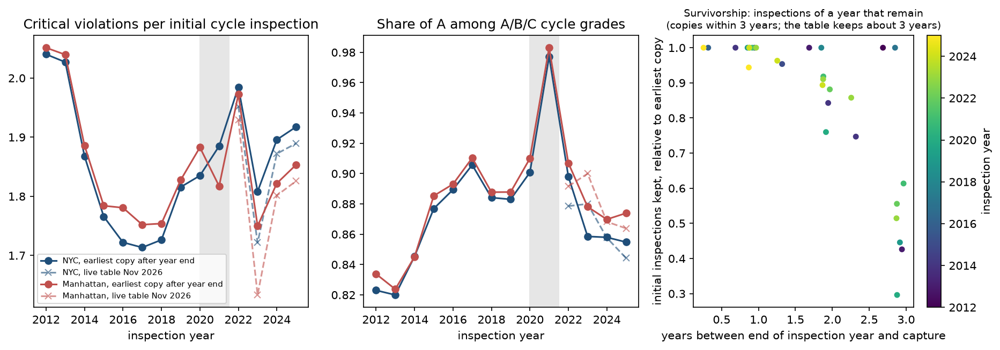
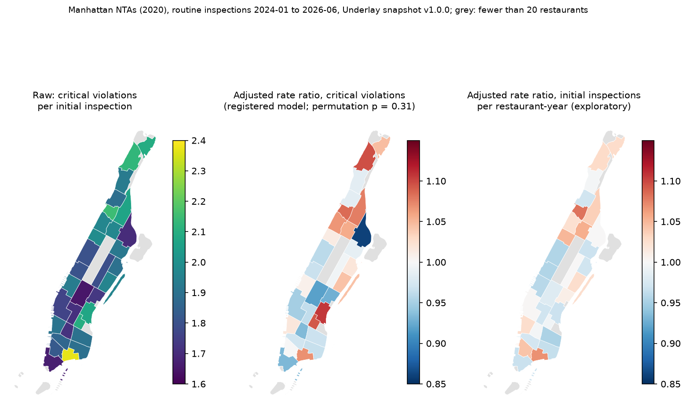

# Restaurant inspections: complaints, trends and evenness across Manhattan

This note covers three questions about the city's restaurant inspections (DOHMH New York City Restaurant Inspection Results, 43nn-pn8j). The first is whether a bad routine inspection is followed by more 311 food-poisoning complaints. The second is how detected violations have changed since 2012, and how the loss of closed restaurants from the table biases that trend. The third is whether violations are detected evenly across Manhattan's neighbourhoods once restaurant mix is adjusted for.

Two claims were registered before their deciding data were read: `restaurants-score-complaints` (branch `prereg/restaurants-score-complaints`, registration a70335a, script 0c147b3) and `restaurants-nta-harshness` (branch `prereg/restaurants-nta-harshness`, registration 55dabf1, script 48147d6). Everything else is exploratory and labelled so. Code is in `analyses/restaurants/`, derived data in `data/derived/restaurants/`, figures in `figures/restaurants/`.

## Corrections after review

A referee rebuilt both deciding numbers with separate code (`critique/restaurants-score-complaints.md`, `critique/restaurants-nta-harshness.md`). Both verdicts stand; the readings are narrower.

1. Score and complaints: IRR 1.130 (0.962 to 1.326) against 1.124, and the placebo 1.672. The verdict is unsettled under rule 2 alone, since the support condition fails before rule 11 is reached. The single-restaurant-lot rule drops 76% of complaints linked to restaurants; matching by address gives 1.26 (1.05 to 1.51) with a placebo of 1.38 (unregistered, also unsettled).
2. Harshness: p 0.323 against 0.307, contested under rule 1. The test refutes only place effects of about 5% or more (between-NTA SD near 0.05 at 80% power); at an SD of 0.025 it would refute 39% of the time. The centred estimate of the SD is 0.024, not 0. The restaurant-count covariate alone moves p from 0.008 to 0.32: it absorbs a density gradient of about 3.5% (r = −0.51), so a place effect that follows restaurant density is not excluded. The statements that neighbourhoods are "as even as random" and that the covariates "account for" the differences are withdrawn; the result is that no place effect of 5% or more independent of density is found.
3. Trends: the 2017 low point comes from the most filtered copy, and 2023 (1.81) should be shown. Without a 2021 coding artefact, the survivorship bias is 1.5 to 3%, up to 0.12 violations per inspection, not about 1%.

## Sources and versions

- Live table: 43nn-pn8j, `rowsUpdatedAt` 2026-11-12T23:06:40Z, fetched 13 November 2026. The city rewrites the whole table each day, keeps only restaurants that are open, and keeps about three years of each restaurant's inspections.
- Fixed snapshot: Underlay `nyc/restaurant-inspections` v1.0.0, hash `ulv2:07a7f08a0d5c85649920f8adc6946d27c17f5e2d75e9ee07c0ad4ae0fcc6739c`, Manhattan inspections from 2024-01-02 to 2026-06-09. The drift audit (`docs/underlay_drift.md`) found that 543 of its 10,536 restaurants have since left the live table and that recent scores and violations were revised downward after hearings. The evenness test therefore uses the snapshot.
- Older copies: ten Internet Archive captures of the CSV export (`https://data.cityofnewyork.us/api/views/43nn-pn8j/rows.csv`), one per year from September 2015 to April 2026, listed with their Wayback URLs in `data/derived/restaurants/trends_sources.json`. The files (92 to 189 MB each) are kept outside Dropbox in `~/opt/nyc-concordance/restaurants_wayback/`.
- 311 Service Requests (erm2-nwe9), complaint types Food Poisoning and Noise - Commercial.
- 2020 NTA boundaries (9nt8-h7nd).

## 1. Do bad inspections predict food-poisoning complaints?

### What the research says

The System Public Graph holds little on restaurants. Variable search found four relevant findings: a protection-from-contamination violation at the last routine inspection and outbreak level in a Minnesota chain outbreak, OR 4.92 (1.57 to 15.39; Firestone 2020, PMID 31928421); evidence of vermin and outbreaks in Miami-Dade, OR 3.3 (1.1 to 13.1), with no difference in overall inspection result or number of critical violations (Cruz 2001, PMID 11344897); a correlation of 0.38 between complaint and outbreak rates across US health departments (Li 2011, PMID 21375880); and fewer violations at chain restaurants in Philadelphia, 6.5 against 9.6 per inspection (Leinwand 2017, PMID 28060568). The concept "restaurant" has no relationships in the graph.

The wider literature is split. Irwin et al. (1989, PMID 2705592) found that restaurants with poor routine scores in Seattle-King County were five times as likely to have an outbreak. Jones et al. (2004, PMID 15200861), with 167,574 Tennessee inspections, and Petran et al. (2012, PMID 23127711) found no overall association between routine scores and outbreaks. For New York, Wong et al. (2015, PMID 25602861) found that letter grading raised the probability of an A-range score by 35% (31% to 40%), and Firestone and Hedberg (2018, PMID 30457518) found that Salmonella rates in the city fell 5.3% a year relative to the rest of the state after grading began. Jin and Leslie (2003, Q J Econ) reported a similar fall in hospitalisations after Los Angeles introduced grade cards; that paper is not in PubMed and its abstract was not read here. The Health Department's Yelp pilot (Harrison 2014, PMID 24848215) found that only 3% of illnesses described in Yelp reviews had been reported to the department, so 311 complaints are a small and self-selected share of illness.

### Design and power

A neighbourhood cross-section would mostly measure restaurant density and who complains. The registered design uses timing at the restaurant level. Each restaurant's first routine initial inspection from January 2023 to June 2025 is the exposure, scored as not A-range (14 points or more) against A-range (0 to 13). The outcome is the number of 311 Food Poisoning complaints at the restaurant's tax lot in the 365 days after the inspection. A complaint is linked to a restaurant only when the lot holds exactly one restaurant. The model is a Poisson regression with robust standard errors, adjusted for borough, cuisine, chain status and quarter. Noise - Commercial complaints at the same lots serve as a placebo for the volume of customers and their readiness to call 311.

Power was computed from marginal counts only, before any join (`data/derived/restaurants/power_complaints.json`). About 2,285 food-poisoning complaints a year at restaurants carry a lot number, or 0.095 per restaurant-year. The 10,360 restaurants on single-restaurant lots would then contribute about 980 complaints in the window. If the literature's midpoint (IRR 1.33) is true, the standard error of the log IRR is 0.08 to 0.10, z is 2.8 to 3.6, and the rule 8 measure D against no effect is 7.7 to 12.8, so the test can separate the midpoint from no effect. It cannot separate an IRR of 1.10 from no effect (z about 1).

### Result

The claim is unsettled. The cohort holds 10,360 restaurants on single-restaurant lots, 42.6% of them not A-range, with 876 food-poisoning complaints in the following year (fewer than the 980 expected). The adjusted IRR for not-A against A-range is 1.12 (0.96 to 1.32). Its lower bound does not exceed 1.00, so support_if is not met; its upper bound is above 1.10, so refute_if is not met either. The placebo decides the matter under rule 11 regardless: Noise - Commercial complaints at the same lots are also higher after a bad inspection, IRR 1.67 (1.11 to 2.52), so the placebo itself meets the first condition of support_if. The ratio of the two IRRs is 0.67 (0.43 to 1.04), and the design cannot tell an effect of hygiene from the fact that busy bars and restaurants both score worse and draw more calls.

The point estimate lies inside the band the literature predicted (1.10 to 1.60) but near its bottom, where the power calculation had shown the test cannot discriminate. Secondary estimates, which decide nothing, point the same way: per 10 score points the IRR is 1.07 (1.02 to 1.14); C-range against A-range 1.22 (1.00 to 1.49); with NTA fixed effects 1.12 (0.96 to 1.31); Manhattan only 1.21 (0.93 to 1.57). Complaints in the 365 days before the inspection are associated with the score about as strongly, 1.17 (1.00 to 1.37), which suggests a stable property of the restaurant (its hygiene or its volume) rather than anything the inspection changes. Raw rates are 0.079 complaints per restaurant-year after an A-range score, 0.085 after B and 0.101 after C (`data/derived/restaurants/complaints_test.json`).

To settle the question a less noisy outcome is needed: confirmed outbreaks attributed to restaurants, or the Health Department's Yelp-classifier reports, and a measure of customer volume (seats or card transactions) to replace the noise placebo.

## 2. Trends in detected violations, 2012 to 2025

The live table holds few inspections before 2022, so it cannot show a trend by itself. The ten archived copies extend the series back to 2012. For each inspection year the figure uses the earliest copy captured after the end of that year, which is the copy least affected by closures (`data/derived/restaurants/trends_pooled.csv`). Measures are critical violations per routine initial inspection and the share of A among A, B and C grades on routine inspections. This part is exploratory and descriptive.

Citywide, critical violations per initial inspection fell from 2.04 in 2012 to 1.71 in 2017, then rose to 1.98 in 2022 and were 1.90 and 1.92 in 2024 and 2025. Manhattan follows the same path. The share of A grades rose from 82% in 2012 and 2013 to 91% in 2017, stayed at 88% to 90% until 2020, and fell to 86% in 2023 to 2025. Grading began in July 2010, so the rise from 2012 to 2017 continues the improvement Wong et al. (2015) measured, and the most recent years have lost part of it. The years 2020 and 2021 are not comparable: inspections were suspended for much of that time (5,847 and 3,920 initial inspections citywide, against about 25,000 in a normal year), and the 2021 copy codes the critical flag differently. The 2017 point comes from a copy captured in November 2020, nearly three years later, because no copy from 2018 or 2019 is in the archive.

Two further caveats apply. Changes in the violation code list or the scoring rules over the period would shift the level of the series; they were not checked here. And the 2012 and 2013 values come from a copy captured 1.7 to 2.7 years later, so they are already filtered by closures.

### Survivorship

Each copy holds only the restaurants open on its capture date. Comparing the same inspection year in copies captured at different dates shows what is lost (`data/derived/restaurants/survivorship.csv`, right panel of the figure). One to two years after the end of an inspection year, 85% to 95% of that year's initial inspections remain; about three years later, between 30% and 60% remain, as closures combine with the table's three-year retention.

Inspections that survive into later copies look slightly better. Among copies that keep at least 30% of a year's initial inspections, critical violations per inspection are lower by 0.019 on average (about 1%, range −0.15 to +0.05), and the share of A is higher by 0.4 points on average (range −1.1 to +4.7 points). The restaurants that close had somewhat worse results. A trend computed from one late copy therefore makes earlier years look cleaner than they were, which understates any improvement and overstates any deterioration. The bias is small next to the changes in the series, about 0.02 to 0.09 violations per inspection against a range of 0.33. Hearings that dismiss violations after the inspection (`docs/underlay_drift.md`) push later copies in the same direction.

## 3. Evenness across Manhattan

### Question and registration

Jeff asked whether some Manhattan neighbourhoods are inspected more harshly or more often relative to how many restaurants they have. The registered test (`restaurants-nta-harshness`) asks whether critical violations per routine initial inspection differ across 2020 NTAs more than a permutation null allows, after adjusting for cuisine, chain status, quarter, day of week, the day's number of Manhattan inspections (workload), whether the restaurant is new, and the NTA's number of restaurants. The prediction was that they do, with a between-NTA standard deviation (tau) of 5% to 20%. Jones et al. (2004) found individual inspectors' mean scores ranging from 69 to 92 in Tennessee, and NYC inspectors work in geographic teams, so differences by place were expected.

The unit is the routine initial inspection in the Underlay snapshot (12,228 inspections at 8,157 restaurants in 31 NTAs with at least 20 restaurants). The statistic sums, over NTAs, the squared excess of observed over expected critical violations divided by the expected count. The null distribution comes from 10,000 permutations of NTA labels across restaurants (seed 20261113). Inspector identifiers are not published, so inspector stringency cannot be separated from place.

### Result

The claim is contested. The permutation p is 0.307 (0.305 to 0.313 with 100,000 draws and four other seeds), which meets the registered refutation condition p > 0.10. The observed statistic is 1.11 times its null mean, and tau is 0.00. After adjustment, the 31 NTAs are as even as a random assignment of restaurants would make them.

The raw rates are not even. They run from 1.65 critical violations per initial inspection in Midtown-Times Square to 2.37 in Chinatown-Two Bridges, and without adjustment the statistic is 4.2 times its null mean (p < 0.001). Adjusting for the number of restaurants alone brings it to 2.6, cuisine alone to 2.4, and the registered set to 1.1. With the registered covariates no neighbourhood difference of about 5% or more remains; smaller effects, and effects that follow restaurant density, are not excluded (see the corrections above). How much each covariate contributes was not separated further.

Inspection frequency is exploratory and was not registered, because its result was seen during a check of the script on synthetic outcomes. Routine initial inspections per restaurant-year average 0.86. Adjusted for the score band of the first inspection (which sets the city's schedule), cuisine, chain status, restaurant count and new status, frequency differs across NTAs by more than chance (p = 0.015) but by little: tau is 0.016, and the adjusted rate ratios run from 0.95 to 1.08. No Manhattan NTA is inspected much more often than its restaurants' scores imply.

## Novelty and practical use

The complaint test is a new design for New York, using the city's own complaint and inspection data at the restaurant level, but its answer is not new: like Jones (2004) and Petran (2012), it finds at most a weak link between routine scores and illness reports, and it cannot separate that link from customer volume. It is not practical as a targeting tool. A not-A score raises the expected number of complaints from about 0.08 to 0.09 a year per restaurant, which would not guide where inspectors go.

The trend series is not new in its components, since DOHMH and Wong et al. (2015) report the early rise in A grades. Joining archived copies to measure survivorship in the city's own table is new as far as this search found, and the result is practical for anyone citing a historical figure from the live table: the bias is about 1.5 to 3% in violations per inspection, in the direction of making the past look cleaner (see the corrections above).

The evenness result is a null result, and its practical consequence is direct. Raw neighbourhood differences in violations, which a map of the live data would show, should not be read as harsher inspection of some neighbourhoods. The test cannot rule out inspector effects that happen to balance within NTAs, and it uses only Manhattan and 2024 to 2026.

## Research needed

- Inspector identifiers (by FOIL request) to separate inspector stringency from restaurant mix.
- OATH hearing outcomes joined to inspections, to see whether dismissals differ by neighbourhood.
- DOHMH outbreak attributions or Yelp-classifier output as a less noisy outcome than 311 complaints.
- Archived copies from 2018 and 2019, which the Internet Archive does not hold.
