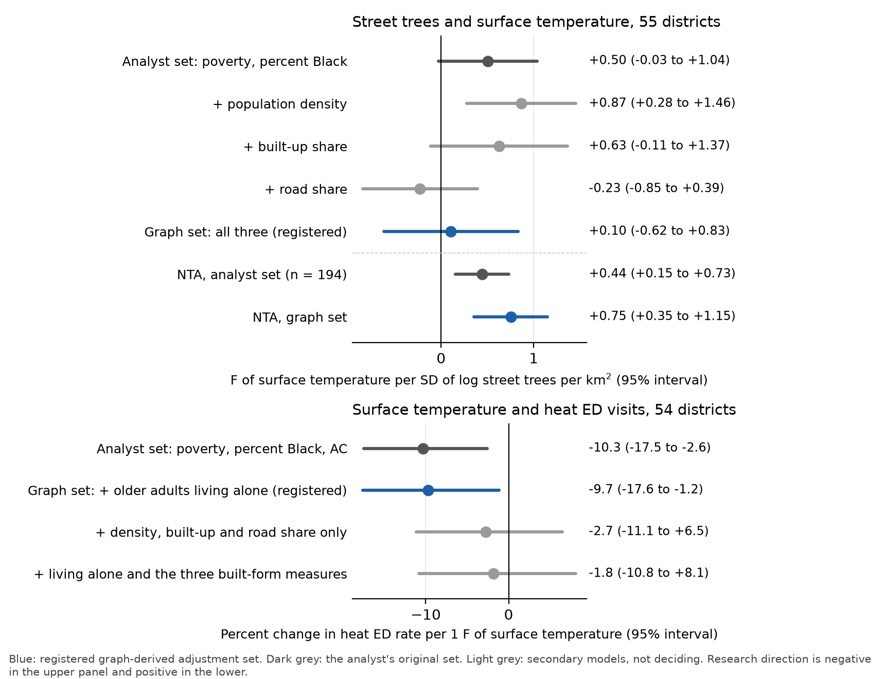
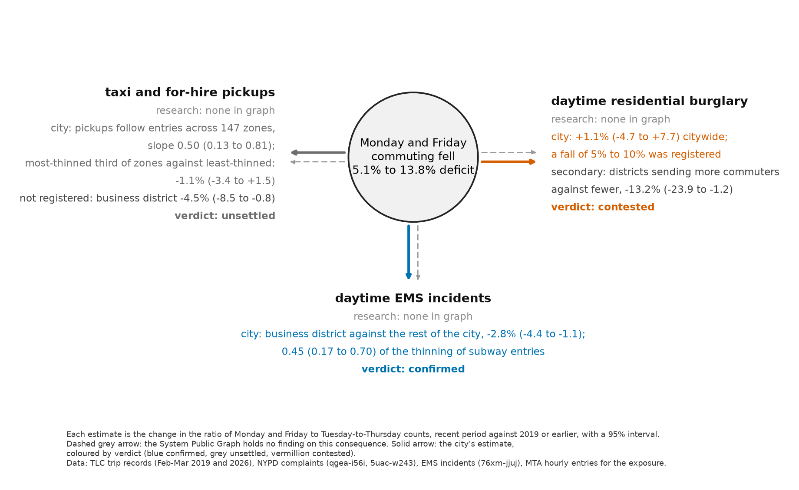
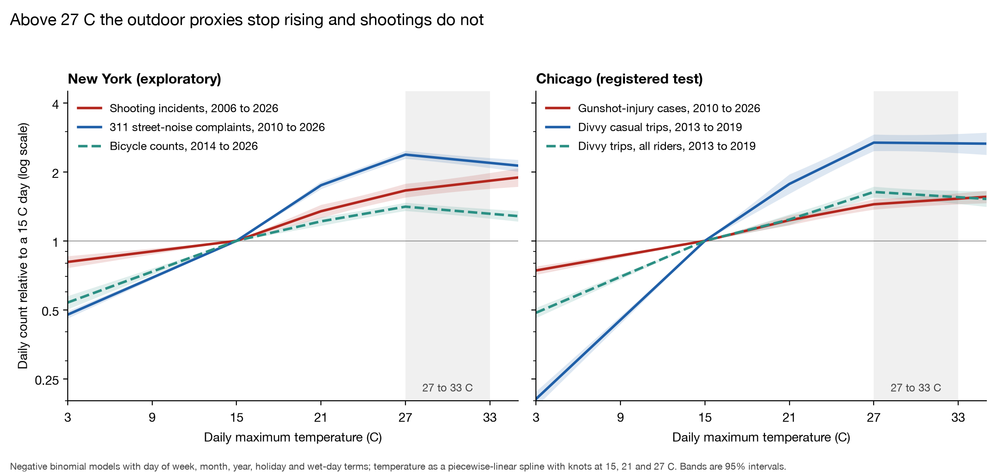

# Round 2 studies

## Data centres' share of Manhattan electricity, second registration

The first test of this question (further-datacentre-share-manhattan) was contested only because its upper bound counted the whole electricity of every building reporting any data-centre floor area, 16.2 percent of Local Law 84 grid electricity, which could not fall below 4.4 percent. The second registration, further-datacentre-share-manhattan-v2 (commit 413d341, pushed alone as prereg/further-datacentre-share-manhattan-v2), replaced that bound with an allocation. The low figure is each building's reported IT site energy times a power usage effectiveness of 1.4, capped at the building's grid electricity. The high figure uses a PUE of 2.0, and for the ten carrier hotels and colocation buildings of the first list it uses the larger of that and the excess of the building's electricity intensity over the median Manhattan office (9.6 kWh per square foot, 538 offices). The registration disclosed the first run's results as seen and named the carrier-hotel excess, the capped allocation and its placebo as the unseen quantities. It also stated that the comparison with 4.4 percent could fail only if the high figure exceeded the sum of two numbers already seen (3.9 percent), so the registrant put the chance of refutation at about 0.03 and rested the test on three further conditions: the low figure between 1.0 and 1.3 percent of D1, the high figure between 1.8 and 3.5 percent, and the listed buildings' excess above the 97.5th percentile of 2000 size-matched office draws.

All four conditions were met and the verdict is confirmed. In calendar year 2024 the allocated data-centre electricity is 173 to 386 GWh. Against D1 (17.06 TWh of benchmarked grid electricity) the share is 1.01 percent (bootstrap 0.96 to 1.06) to 2.26 percent (2.15 to 2.38). Against D2 (Con Edison non-residential electricity in Manhattan ZIP codes, 16.03 TWh) it is 1.08 to 2.41 percent. Against D3, Zone J load for 2024 (49.8 TWh) times Manhattan's 45.4 percent share of Con Edison New York City deliveries (22.6 TWh), it is 0.76 to 1.71 percent. The low figure lies 0.01 point inside its registered range. The carrier-hotel excess alone is 1.70 percent of D1, against a placebo 97.5th percentile of 0.21 percent, but the placebo uses a median baseline and sits near zero by construction. Unreported data-centre electricity would have to be 1.9 times the allocated high figure for the D1 share to reach the 4.4 percent national share (LBNL, December 2024, page re-read on 12 November 2026); the Virginia comparison, a quarter of the state's load in 2023, is from the executive summary of the EPRI white paper of 2024 and is a state figure, not Northern Virginia's.

Several results limit the reading. The cap binds for the Western Union Building: the lot join for 60 Hudson Street returns the 56 Hudson Street property, whose reported IT energy is 90 percent of its grid electricity, and it supplies half of the low figure. Nineteen buildings report positive IT energy; the first run's count of 26 included zero values. The median office intensity is low, probably because landlord figures omit tenant meters, which raises the excess for all listed buildings, 111 Eighth Avenue (53 kWh per square foot) contributing 107 GWh of the 289 GWh total. Tenant meters in the carrier hotels also mean the allocation may understate true data-centre load. The 2023 benchmarking year gives 1.05 to 2.47 percent of D1, but the 2023 Utility Energy Registry file holds only six months, so it supplies no 2023 denominator. Adding area-proportional electricity for 150 further buildings with data-centre floor area gives a high figure of 3.0 percent of D1. Condition (a) could hardly have failed, and the registration said so. Figure: figures/round2/datacentre_share_v2.png. Analysis: analyses/round2/datacentre_v2/. Results: data/derived/round2/datacentre_v2/results.json.

What the graph added. The System Public Graph contributed nothing to this study: concept searches for data centre, data center and server farm return no concept (three uncached requests), so the claim rests on the LBNL and EPRI reports and on city and state open data. The graph's absence is itself a finding for the map of needed research, since the topic is a live public question with no research entry in the graph.

## Graph-derived adjustment sets for the two heat claims

The confounders experiment in `docs/graph_experiments.md` found that the analyst and the graph disagree about what to adjust for in the two district-level heat links. For street trees and surface temperature (`heat-trees-surftemp`) the analyst adjusted for poverty and percent Black, and the graph's findings name population density, built-up area and road area. For surface temperature and heat-stress emergency visits (`heat-surftemp-ed`) the analyst adjusted for poverty, percent Black and air conditioning, and the graph names living alone. This study measured the graph's covariates for the 59 community districts, registered a prediction of how each original estimate would change, and then re-estimated both. The scripts are in `analyses/round2_heat_confounders/` and the data in `data/derived/round2/heat_confounders/`.

### Measures

Population density is the 2015-19 ACS population from the health department's portal (indicator 2325) divided by land area. Built-up area is the building footprint share of land, the sum of floor area divided by number of floors over the tax lots of PLUTO version 26v2. Road area is the share of land that lies in no tax lot, which averages 27% across districts. Older adults living alone is portal indicator 2146 for 2015-19, with a mean of 31% and a range of 16% to 53%. The outcomes, exposures and original covariates were read unchanged from the first study's files. PLUTO describes 2026 and the Landsat scene is from July 2018.

### What the graph findings say, checked

The two living-alone findings match their PubMed abstracts: an odds ratio of 8.1 (1.4 to 48.1) for heat-related death in Chicago in 1999 (PMID 11988377) and an adjusted odds ratio of 42.3 (2.3 to 792.8) for death in the 2009 Adelaide heat wave (PMID 27221967). Both abstracts also report air conditioning as the strongest protective factor (odds ratios 0.2 and 0.004). The earlier experiment said the graph gave the analyst's air-conditioning covariate no support; the two papers the graph points to support it. The population density findings have no PubMed record. Their Crossref abstracts confirm the stored values: r = 0.82 between population density and land surface temperature in Prizren, Kosovo, and R² = 0.64 across the districts of Ho Chi Minh City. The built-up area and road area coefficients come from a 2011 conference paper on Xiamen with no abstract online, and could not be checked.

### Street trees and surface temperature

The registration (`graph-confounders-trees-surftemp`, local commit e0719f9, branch `prereg/graph-confounders-trees-surftemp`) disclosed the original slope of +0.50 °F per standard deviation of log street trees per km² (95% CI −0.03 to +1.04). It predicted that the graph's three covariates would lower the slope by 0.3 to 1.2 °F. The size came from the graph's correlation of 0.8 between population density and surface temperature and an assumed correlation of 0.3 to 0.6 between tree density and population density. Support required a fall of at least 0.3 with a bootstrap interval excluding zero and no variance inflation factor above 10. The registration stated that a change smaller than about 0.76 °F would probably not be detectable with 55 districts.

The slope under the graph set is +0.10 (−0.62 to +0.83), n = 55. The change is −0.40 (paired bootstrap 95% interval −1.11 to +0.34), and the largest variance inflation factor is 3.9. The point estimate is inside the predicted band and the interval includes zero, so the verdict is unsettled.

The change did not come about in the way the graph's numbers implied. Tree density does correlate with population density across districts (r = 0.46), as assumed. Population density does not correlate with surface temperature (r = 0.04 by district and −0.06 by neighbourhood, against the graph's 0.82), and its coefficient in the full model is negative. Adding population density alone raises the slope to +0.87 (+0.28 to +1.46). Road share alone lowers it to −0.23 (−0.85 to +0.39), a change of −0.73 (−1.38 to −0.26). Road share correlates 0.51 with surface temperature and 0.56 with tree density. Part of that is arithmetic, since street trees per km² of land is trees per km² of street multiplied by the road share. At the neighbourhood level (194 rows) the same graph set raises the slope from +0.44 (+0.15 to +0.73) to +0.75 (+0.35 to +1.15), because road share is only weakly related to tree density there (r = 0.20) and population density dominates. The two units disagree on the direction of the change.

With vegetative cover in place of street-tree density, the graph set makes the cooling association larger: −0.62 (−1.17 to −0.07) °F per standard deviation becomes −1.64 (−2.42 to −0.86).

### Surface temperature and heat-stress emergency visits

The registration (`graph-confounders-surftemp-ed`, local commit 0bc45fa, branch `prereg/graph-confounders-surftemp-ed`) disclosed the original slope of −10.3% in the heat emergency rate per 1 °F (−17.5 to −2.6). It predicted that adding living alone would change the slope by between −2.5 and +0.5 percentage points and leave it negative. The size was derived from the two odds ratios. If older adults carry 15% to 25% of the rate, the odds ratios imply a rise of 0.003 to 0.008 in the log rate per percentage point of older adults living alone, which is too little to move the temperature slope by more than about 1.3 points.

The slope under the graph set is −9.7% (−17.6 to −1.2), n = 54. The change is +0.59 points (−1.27 to +3.42), and the largest variance inflation factor is 3.2. The change is small, as predicted, and the test had the precision to exclude a change of half the slope. Its sign is positive, 0.09 points outside the registered band, so the support condition is not met and the verdict is unsettled. The sign was wrong because living alone is slightly less common in hot-surface districts (r = −0.15), where the registrant assumed it was more common. The coefficient of living alone is +0.0065 per point, inside the range derived from the graph, with a standard error of 0.0096. For heat hospitalizations by neighbourhood its coefficient is negative (−0.0063, standard error 0.0031), the opposite of the individual-level finding.

A secondary model, registered as not deciding, gave the largest change in the study. With the three built-form covariates from the tree claim added in place of living alone, the slope is −2.7% (−11.1 to +6.5), a change of +7.6 points (+1.3 to +15.3). Road share has a coefficient of −0.033 in the log rate per point (p = 0.005) when living alone is also in the model. Districts with more street area have hotter surfaces and fewer heat emergency visits per resident. The negative association that made `heat-surftemp-ed` contested is not distinguishable from zero once road share is held fixed. This result was seen after the fact for this claim and needs its own registered test on a different outcome period.

### Whether the within-neighbourhood design already removes these confounders

The claim `heat-trees-canopy-within-nta` compares sensors within the same neighbourhood on the same day. Any covariate measured for a district or a neighbourhood, including the three used here, is constant within those cells and is removed by the fixed effects. That design needs no adjustment set at this scale, and it gave the research direction (−0.20 °C per 10 points of vegetation within 50 m, −0.25 to −0.15) where the district regressions gave the opposite sign or nothing. It does not remove built form that varies inside a neighbourhood. Across 2,163 census tracts, 61% of the variance of footprint share and 79% of the variance of log floor-area ratio lies between neighbourhoods; the standard deviation of footprint share within a neighbourhood is 11.7 points, against 17.8 overall. The sensor study's own placebo agrees: vegetation in the ring 200 to 300 m from a sensor had a coefficient of −0.24 with the 50 m share in the model. Block-scale building and street cover around each sensor is therefore the remaining confounder, and it was not measured.

### What did not work

Neither registered test met its support condition. The district sample cannot detect the lower half of the predicted band for the tree claim. The road measure is a remainder (land not in tax lots) and is negative for district 414, where waterfront lots extend past the shoreline. The Xiamen coefficients could not be checked. The Dataverse copy is not on this machine. No age covariate was added because the outcome is age-adjusted. The derivation for living alone rests on an assumed share of visits by older adults that was not looked up.

### What the graph added

The graph supplied the covariates and, for living alone, two effect sizes from which a prediction could be computed before the data were seen. That prediction was correct in size: living alone moved the slope by 0.6 points, and its coefficient matched the derived range. Without the graph the project would not have measured road area, which turned out to be the one covariate that changed either result, and which accounts for most of the contested association in the second claim. The graph did not rank its candidates usefully. Its best-documented common cause, population density with r = 0.82, has no correlation with surface temperature across New York's districts and moved the tree slope away from the research direction. Road area appears in one unverifiable conference paper under a variable grounded to no concept. The graph's findings come from study areas that run from countryside to city centre, and the comparison here is among districts of one dense city. The graph also did not show that its two living-alone papers support the analyst's air-conditioning covariate; that came from reading the abstracts. The within-neighbourhood sensor design answered the tree question without any adjustment set from the graph.

## Three consequences of the re-timed week that the graph does not cover

The earlier graph experiment (`docs/graph_experiments.md`) found that the System Public Graph holds no research on taxi demand, daytime burglary or any same-day outcome of working at home, and that the city's daily records could test such outcomes. This study registered and tested three of them: `retimed-taxi-fhv-pickups`, `retimed-daytime-burglary` and `retimed-ems-presence`. Each was committed alone and pushed to its own branch (`prereg/<id>`) before its outcome data for the test periods were queried. The code is in `analyses/round2/retimed_consequences/`, the data in `data/derived/round2/retimed_consequences/` and the figure is `figures/round2/retimed_consequences.png`.

### Design

The exposure comes from the dose map (`data/derived/transit/dose_map_long.csv`). For a taxi zone or community district, E is the change since 2019 in the log ratio of Monday-and-Friday to Tuesday-to-Thursday subway entries between 06:00 and 19:59. E is -0.117 for the six community districts of the Manhattan business district (101 to 106) and -0.054 for the other 48 districts with stations. Among taxi zones it runs from -0.22 (Hudson Square) to +0.02. In the morning peak, districts outside the business district range from -0.04 in the Bronx to -0.25 in Brooklyn 1.

Each outcome is measured the same way: Y is the change, between a baseline and a recent period, in the log ratio of Monday-and-Friday to Tuesday-to-Thursday counts. Weeks with a federal holiday or a day from 24 December to 1 January are dropped, as in the dose map, and so are the weeks of 26 January and 23 February 2026, when Monday entries were 38% and 20% of midweek. Intervals are 95% intervals from 2,000 bootstrap draws over weeks, and over units for a slope. Before each registration I estimated the sampling error from data outside the test: random half-splits of January to March 2018 for taxis, 2017 against 2018 for EMS, and a count of burglaries pooled over Monday to Friday. Each registration states the smallest effect the test could detect and the result that would refute it.

### Taxi and for-hire pickups: unsettled

The data are yellow taxi and high-volume for-hire pickups between 06:00 and 19:59 in February and March 2019 (7 retained weeks) and February and March 2026 (6 weeks). This is a sample of months and not a full year, because for-hire records begin in February 2019. The 2026 for-hire months were read by a remote column scan of the TLC parquet files, and only zone-day counts were kept. The 147 zones with a station and at least 200 pickups a weekday had 525,709 pickups a weekday in 2019 and 455,842 in 2026.

Across zones, the change in the Monday-and-Friday share of pickups follows the change in entries with a slope of 0.50 (0.13 to 0.81), inside the registered range of 0.3 to 1.0. The registration also required the most-thinned third of zones to differ from the least-thinned third, and that contrast is -1.1% (-3.4 to +1.5). One of two conditions is met, so the verdict is unsettled. The placebo slope for yellow taxis between 2018 and 2019 is -0.30 (-0.63 to 0.01).

The reason for the split result was found after the data were seen and is exploratory. In the 27 business-district zones, Monday and Friday pickups fell by 4.5% relative to midweek (-8.5 to -0.8), about 0.4 of the thinning of entries there. Outside the business district the relation reverses: the slope is -0.33 (-0.84 to 0.10), and the half of zones whose stations thinned more gained 2.4% (1.1 to 3.9) on Mondays and Fridays relative to the other half. The largest gains are in Williamsburg, at 5% to 11%. Pickups moved from the office end to the home end on the days people stopped commuting. The registered thirds mixed the two groups. For yellow taxis alone, which work mostly in Manhattan, the slope is 0.86 (0.47 to 1.30).

### Daytime residential burglary: contested, at the margin

The data are NYPD complaints for burglary of a residence that began between 08:00 and 17:59 on a weekday: 13,965 in the retained weeks of 2015 to 2019 and 6,660 from January 2023 to September 2026. The registration predicted that the Monday-and-Friday ratio would fall by 5% to 10%, the range between half and all of the fall in morning-peak entries from residential districts.

It did not fall. The ratio of ratios is 1.011 (0.953 to 1.077). Friday is the peak day for these burglaries in both periods, at 1.20 and 1.25 times midweek. The registered refutation condition was a lower bound above 0.95, and it is met by 0.003. That margin is smaller than the Monte Carlo error of the bootstrap: with 20,000 draws, run afterwards, the lower bound is 0.9499. The verdict of contested follows the registered procedure. The reading that does not depend on the draw is that there is no sign of a fall, and that a fall of more than about 5% is excluded.

The comparison between districts was registered as secondary, because its expected standard error (0.06) was as large as its predicted size. In the 24 districts that send more commuters the ratio changed by -4.6% (-13.3 to +5.7), and in the 24 that send fewer by +9.9% (+1.1 to +19.8). The difference is -13.2% (-23.9 to -1.2), against -1.8% (-17.5 to +16.4) in the placebo of 2015-17 against 2018-19. The sign is the registered one. The difference comes from a rise in the Bronx and outer districts and not from a fall where people now work at home, and it loses its significance when only complaints that ended the same day are counted (-12.1%, -24.9 to +3.1). It decides nothing here and should be registered as a primary test on later data.

### EMS incidents: confirmed, at less than half of proportion

The data are EMS incidents between 06:00 and 19:59 by community district, for 2018-19 (84 retained weeks) and October 2024 to September 2026 (79 weeks). The business-district districts had 377 incidents a weekday in the baseline and 354 in the recent period; the other 48 districts had 2,301 and 2,454.

The Monday-and-Friday ratio of incidents fell by 4.0% (2.1 to 5.7) in the business district and by 1.2% (0.1 to 2.2) in the rest of the city. The registered contrast is -2.8% (-4.4 to -1.1), inside the registered range. Divided by the difference in entries it is an elasticity of 0.45 (0.17 to 0.70). Incidents followed people out of the business district on Mondays and Fridays, at about 45% of the rate at which subway entries thinned, and the interval excludes a proportional fall. The placebo (2016-17 against 2018-19) is -0.2% (-2.0 to +1.6). The contrast is -3.6% (-6.2 to -0.9) for high-severity incidents and of similar size in the morning, midday and afternoon bands, and it is larger on Fridays (-5.3% in the business district) than on Mondays (-2.5%). With 2019 and the last 12 months alone it is -2.2% (-4.6 to +0.3). The rest of the city did not gain incidents on those days, so the contrast is a fall in the business district and not a transfer to residential districts.

### What did not work

The taxi test used two months a year and its group contrast was badly chosen, as described above. The burglary verdict rests on a bound that moves across the registered threshold with the bootstrap seed. The slope across districts for EMS, 0.30 (-0.17 to 0.75), is too imprecise to use, as the design check predicted. Subway entries miss commuters who drive, walk or take commuter rail, so every elasticity here is per unit of subway thinning and not per person. Green taxis and non-high-volume for-hire bases were left out. None of the tests separates work at home from the Monday and Friday service changes the MTA made from 2023.

### What the graph added

The graph contributed the boundary of the question and no prediction. Its variable search returned 82 variables on taxis and ride-hailing, 43 on burglary and guardianship and 240 on ambulance calls and daytime population, and reading them showed in a few minutes that none treats demand, burglary or call volume as an outcome of commuting, working at home, weekday or the number of people present. The nearest findings are ride-hail trips as a cause of injury crashes in New York taxi zones (PMID 32253258), restaurant openings and burglary in Oakland (PMID 35491751), and ambulance calls after a hurricane, an epidemic and a smoking law; the six abstracts I read matched the graph's records. Because the graph gave no effect size, the sizes registered here came from the dose map and from an assumed share between 0.2 and 1, which is a weaker basis than a published estimate, and the burglary range in particular was a guess. The graph did not supply any of the three tests' designs or data. What the join produced is three estimates for arrows the earlier map drew as dashed: an elasticity of EMS incidents to subway presence of 0.45, a shift of taxi pickups from the business district to residential zones on Mondays and Fridays, and no fall in daytime burglary. These are candidates for the graph and for the map of research needed. The study made 20 uncached graph requests.

## Tidal flooding and 311, registered again (further-tidal-flooding-trend)

The first tidal claim (further-tidal-flooding-311) returned no_test because only 20 dry days from 2020 to October 2026 reached the NOAA minor flood level, and its secondary rate ratio of 15.7 had been seen. This claim was registered on quantities not yet seen, in a held-out period. The first run read every ZIP code for 2020 onward, so the held-out unit is the period 2010 to 2019 in the separate 311 file (76ig-c548), of which the project had queried only noise complaints. The registration (commit 5fd01ba; outside copy on branch prereg/further-tidal-flooding-trend, commit 9ff568d) fixed a dry-day definition (under 1 mm at Central Park and JFK on the day and the day before), a hinge shape for the dose-response, and the complaint set (street flooding plus catch basin clogged or flooding descriptors). Only 7 dry days in 2010 to 2019 reached the minor flood level, so the knot was set from the tide record alone at 0.35 m above MHHW (1.89 m above MLLW), the highest 5 cm level with at least 150 dry days (173 in the sample). The registration stated that the test could fail in both directions but would often be unsettled: with a baseline of one complaint a day the model-based standard error of the log rate ratio per 10 cm was 0.08 to 0.09.

The dose-response is confirmed. In the 8 coastal ZIP codes (1,882 dry days, 2,042 complaints, Sandy window dropped) complaints rose by a factor of 2.00 (95 percent block-bootstrap interval 1.64 to 2.38) per 10 cm of Battery daily maximum above the knot. In all other ZIP codes the factor was 1.15 (1.03 to 1.26), and the ratio of the two was 1.74 (1.44 to 2.09). The mean was 0.95 complaints a day below 0.30 m and 2.93 a day at 0.45 m or more. The estimate sits at the top of the registered range (1.10 to 2.0) and the other-ZIP estimate is above the registered 0.95 to 1.10, so the placebo prediction missed. Tide shifted by 7 and 100 days gave 0.99 (0.89 to 1.07) and 0.97 (0.89 to 1.05). The 2020 to 2025 period, not held out, gave 2.13 (1.71 to 2.47), close to the held-out value. Knots at 0.30, 0.40 and 0.45 m gave 1.73, 2.38 and 2.88; street flooding alone gave 3.02 (2.36 to 4.22); adding sewer backups gave 1.53 (1.33 to 1.69); a log-linear model over all dry days gave 1.11 (1.06 to 1.15), which is the shape of the first run (1.19). The registered shape was flat below the knot, but the rate ratio is already 1.34 (1.05 to 1.72) between 0.30 and 0.35 m, so the data show a smooth rise and not a threshold. The other-ZIP set contains other waterfront ZIP codes, and wind and local rain that the two airport gauges miss remain untested rivals.

The trend is partly supported and cannot settle the question. The count of dry days a year with a maximum at or above 0.35 m ranged from 11 to 41 (329 over 16 years). An OLS slope on year was 0.63 days per year per year (95 percent interval -0.19 to 1.45), which contains the 0.55 implied by the Battery trend of 2.95 +/- 0.05 mm a year (NOAA, 1856 to 2025, read on 12 November 2026) and also contains zero; the registration had put the standard error at 0.25 and the observed one was 0.38, and 2023 to 2025 (31, 41 and 23 days) account for much of the slope. Removing 2.95 mm a year from the tide gives a slope of 0.01 (-0.79 to 0.81), so the implied rate is what the sea-level trend adds. The gauge's own annual mean daily maximum rose 4.0 mm a year over 2010 to 2025. Dry-day complaints did not follow the annual tide-day count: the Spearman correlation of the tidal-to-other complaint ratio with the count was 0.10 (p = 0.71), and the Poisson rate per extra tide day was 0.6 percent (-1.1 to 2.3). The registration had said this test could not detect effects of the size expected, so it decides nothing. The figure is figures/round2/further-tidal-flooding-trend.png; data are in data/derived/round2/tidal_trend/.

Two departures from the plan are recorded. The Socrata server did not answer the registered upper(...) LIKE query over the 2010 to 2019 file, so the same patterns were run per year with agency = DEP added; the case-sensitive descriptors in that file belong only to DEP. The 2010 to 2019 descriptors matched are the same three as in 2020 onward. The quantity the first run could not test, a dose-response at the minor flood level, remains untested: the 7 dry days at that level give a tidal rate ratio of 6.4 (1.8 to 11.8) with an interval for the other ZIPs that includes 1.

### What the graph added

The graph holds nothing on this claim's own link. The concepts flooding, flood, flood disaster, sea level and sea level rise exist, but sea level rise has no relationships, and sea level has 11 neighbours (groundwater, sea surface temperature, atmospheric pressure) and none is flooding, complaints or reporting, so no prediction rested on a graph finding. It did add the health side, which is what a city would want next. The concept flood has 98 neighbours: diarrhea (20 findings, 10 studies, 19 positive), dysentery (16 findings, 5 studies), bacillary dysentery (13), malaria (11), post-traumatic stress disorder (9 findings, 7 studies, all positive), depression (7), anxiety (6), mortality rate (6 findings, 5 studies, all positive, for example a relative risk of 1.26, 1.10 to 1.46, for all-cause mortality), leptospirosis (5) and respiratory infection (3). I checked one finding against its PubMed abstract: PMID 37782513 reports an odds ratio of 2.07 (1.37 to 3.11) for diarrhea in children under 5 after extreme floods in 43 low- and middle-income countries, as the graph lists it. These studies concern disaster floods, mostly outside the United States, not tidal nuisance flooding, and none is a New York City study, so the graph says what to measure (infection, mental health, mortality) and not how large the effect is for a high-tide street flood. The concept "flooding" is also mis-grounded: 8 of its 12 links to post-traumatic stress disorder are exposure therapy ("flooding" as a treatment), so the concept "flood" is the usable one. The graph work used 11 uncached requests.

## The hot-day excess in shootings, tested in Chicago (transfer-chicago-hot-end)

The heat-mechanisms experiment found in New York that two outdoor proxies stop rising at about 27 C while shootings keep rising, and an exploratory model found that the street-noise proxy removes a third to a half of the rise in shootings from 15 to 21 C and none of the rise from 27 to 33 C. This study registered both results as a test in Chicago. The verdict is unsettled: the shape transfers and the decomposition does not, with the proxy that was registered. Scripts are in `analyses/round2/hot_end/`, data in `data/derived/round2/hot_end/`, and the registration is `claims/registered/transfer-chicago-hot-end.json` (local commit c9f6e41, pushed alone to the branch `prereg/transfer-chicago-hot-end`).

### What had been seen

The earlier Chicago study, `transfer-chicago-heat-shootings`, saw more than the linear slope. It fitted the linear rate ratio (1.131 per 5 C) and eight linear variants, and it also wrote the unadjusted mean daily count by 3 C bin of temperature and drew it. That table shows 8.9 cases a day at 27 to 30 C, 9.5 at 30 to 33 C and 8.9 at 33 to 36 C. The shootings half of the first prediction was therefore partly known, and the registration says so. No model by temperature range had been fitted. No Divvy value had been queried by the project. Before registering I read only catalog metadata for the Divvy and 311 datasets.

### The proxy

The Chicago portal's Divvy Trips dataset (`fg6s-gzvg`) holds 21.2 million trips from 27 June 2013 to 31 December 2019. I counted trips per day from 1 July 2013, 2,374 days with a temperature reading, with a median of 7,688 trips a day; a quarter of trips are by casual riders. All trips were the registered proxy, and casual and subscriber trips were registered as secondary. Chicago's 311 data have no street-noise or gathering request type, and the Park District publishes sensor readings and no attendance, so there is no second proxy. Divvy trips after 2019 exist only as zip archives on the operator's site and were not downloaded.

### A change of spline, made before registration

A simulation on Chicago's weather and calendar, with made-up counts, showed that the spline of the New York exploratory analysis (natural cubic, 4 degrees of freedom, knots at quantiles) overstates the ratio from 27 to 33 C when the true curve bends near 27 C. A true ratio of 1.00 was estimated as 1.07, and 0.98 as 1.05. A piecewise-linear spline with knots at 15, 21 and 27 C was unbiased in the same simulation, and it was registered as the primary basis. New York was recomputed with it before registration. The New York result is unchanged in sign and is larger in contrast: street-noise complaints change by 0.92 (0.89 to 0.96) and bicycle counts by 0.93 (0.90 to 0.96) from 27 to 33 C, and shootings rise by 1.12 (1.05 to 1.20). The same simulation gave the test's power: the smallest detectable rise in shootings from 27 to 33 C is 7.5% on the full Chicago window and 13% on the Divvy window, so the shootings ratio was registered on the full window. The rule for the decomposition was met in 80% of simulated series when 45% of the mild-day rise passed through the proxy and in none when nothing did.

### Result

The first part was supported. From 27 to 33 C Divvy trips change by a factor of 0.95 (0.90 to 1.00), below the registered ceiling of 1.06, and gunshot-injury cases rise by 1.058 (1.014 to 1.105) on the 6,085 days from 2010 to 2026. Below 27 C Divvy trips rise by 1.24 (1.17 to 1.31) from 15 to 21 C and by 1.32 (1.24 to 1.40) from 21 to 27 C. The rise in Chicago shootings on hot days is about half of New York's 12%, and the two intervals overlap. On the Divvy window alone the shootings ratio is 1.053 (0.987 to 1.123), which that window is too short to separate from 1.

The second part was not supported. Adding log(1 + trips) to the shootings model removes 10% (4 to 25) of the rise from 15 to 21 C, where the registration required at least 20%. It removes nothing from the rise from 27 to 33 C: the log rise changes by −0.007 (−0.017 to 0.001), within the registered bound. New York's bicycle counts had removed 2% (−1 to 6), and the registration gave this part a prior of 0.25 for that reason.

| | New York (exploratory) | Chicago (registered) |
|---|---|---|
| Shootings, 33 against 27 C | 1.12 (1.05 to 1.20) | 1.058 (1.014 to 1.105) |
| Outdoor proxy, 33 against 27 C | noise 0.92 (0.89 to 0.96); bicycles 0.93 (0.90 to 0.96) | Divvy, all trips 0.95 (0.90 to 1.00); casual 0.99 (0.92 to 1.07) |
| Share of the 15 to 21 C rise removed | noise 41% (29 to 57); bicycles 2% (−1 to 6) | all trips 10% (4 to 25); casual 30% (17 to 59); subscriber 4% (1 to 12) |
| Share of the 27 to 33 C rise removed | noise none (−20%); bicycles none (−2%) | none (all trips −13%, casual −9%, intervals wide) |

The secondary proxies show why the share differs. Casual trips, which are mostly leisure trips, rise by 1.77 (1.61 to 1.95) from 15 to 21 C, are flat from 27 to 33 C at 0.99 (0.92 to 1.07), and remove 30% (17 to 59) of the mild-day rise in shootings. Subscriber trips, which are mostly commutes, remove 4%. The pattern matches New York, where complaints about people on the street removed 41% and counts of bicycles on bridges and avenues removed 2%. In both cities a proxy for leisure time outdoors accounts for part of the mild-day slope, and a proxy for travel accounts for little. Casual trips were not the registered primary, so this does not change the verdict, and it could be registered as its own claim on the operator's data after 2019.

The registered sensitivity analyses agree on the first part with one exception. With year-by-month terms the Divvy ratio from 27 to 33 C is 0.98 (0.93 to 1.02) and in May to September 0.97 (0.93 to 1.01). With the 4-degree quantile-knot basis it is 1.03 (0.99 to 1.08), and the casual-trip ratio is 1.09 (1.04 to 1.15); the simulation predicted an overstatement of this size for that basis. With that basis the shootings ratio is 1.093 (1.062 to 1.125).

### What remains to explain

In both cities shootings rise by 6 to 12% from 27 to 33 C while every outdoor proxy is flat or falling, and no proxy removes any of that rise. The candidates are the steps the graph listed and the city data could not measure: heat indoors, lost sleep, and drinking. A city would need hourly indoor temperature in housing without air conditioning, a nightly sleep measure, alcohol sales by day and hour, and shootings by hour against hourly temperature. Night-time minimum temperature is a cheap first test of the sleep step, since it is already in the weather record.

The graph, searched in the project's cache of 57,038 associations and 178,637 relationship records with no new request, holds almost nothing on the first arrows of these steps. On ambient heat and sleep there are no findings by day. The relationship records list temperature with sleep quality (6 findings in 3 studies), sleep (2), somnolence (2) and sleep apnea (5), and the associations that could be read concern body temperature or bedroom conditions, as the earlier experiment found. On heat and alcohol there is one retrievable finding, a correlation of −0.5 between a country's mean temperature and its alcohol consumption per person, which says nothing about hot days. The second arrows are well covered (alcohol and violence 110 findings, sleep and aggression 31). So the graph can say that poor sleep and drinking go with violence, and it cannot say that hot days produce either.

### What did not work

The decomposition did not transfer with the registered proxy. The Divvy series ends in 2019, so the proxy and the decomposition rest on 2,374 days, and the shootings ratio on those days alone does not exclude 1. Shares of the hot-day rise have wide intervals because the rise itself is small; the registration used the amount removed for that reason. Midway is inland and many casual trips start at the lakefront, which is cooler on hot afternoons. The portal timed out on a year of Divvy trips grouped by day and rider type, so the fetch is one query per month (79 queries). No uncached graph request was made.

### What the graph added

The graph supplied the prediction that this study carried to a second city: its findings from exercise physiology and a Korean health survey say that heat reduces walking and activity, which is why the first study predicted a flattening and not a single linear link. That prediction has now been met in a registered test in Chicago, with a different proxy and a stricter spline. The graph did not supply a proxy, a threshold or a size; those came from New York's data. It has no finding on temperature and gun violence, and for the question this study leaves open, what raises shootings above 27 C, it holds the second arrows (sleep and alcohol to violence) and none of the first (hot days to sleep loss or drinking). The research needed is therefore on the first arrows, with daily data.
