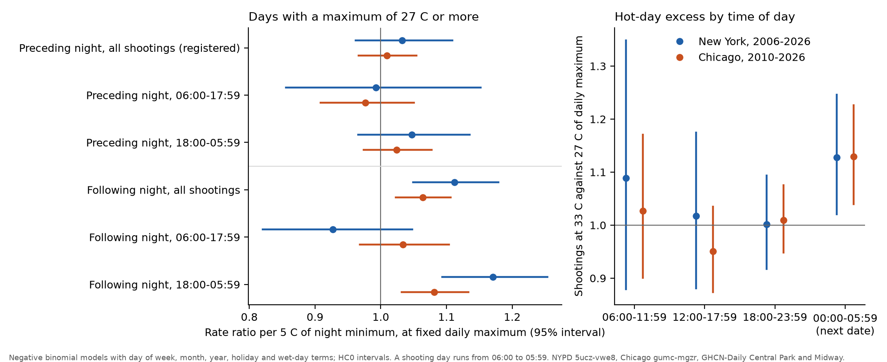
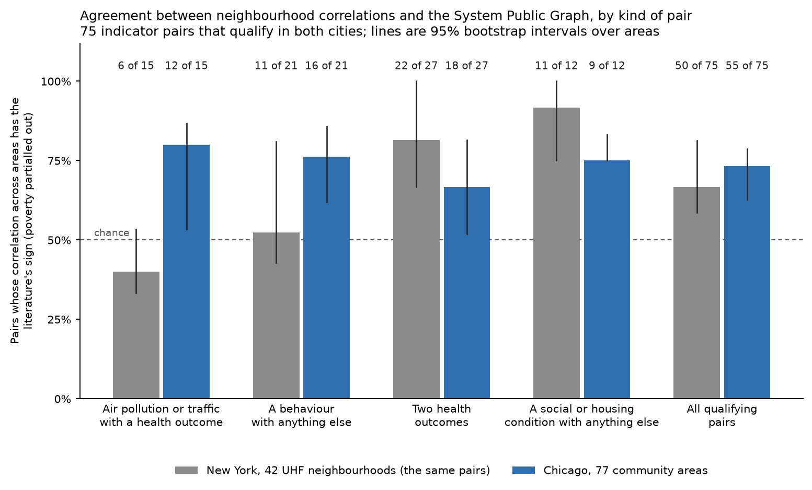

# Round 5: follow-up studies

## Night minimum temperature and the hot-day rise in shootings

Claim `heat-night-minimum` was registered in commit 49a9380 and pushed to the branch `prereg/heat-night-minimum` before any model of shootings with the daily minimum (TMIN) and maximum (TMAX) together, or any count by hour, was run. The scripts are in `analyses/round5/heat_night/` and the data in `data/derived/round5/heat_night/`.

### The question

Earlier claims found that shootings in New York and Chicago keep rising above a daily maximum of 27 C while proxies for people outdoors stop rising. Two of the candidate explanations make different predictions in the weather record. If lost sleep causes the rise above 27 C, shootings should rise with the minimum of the night before, at a fixed daily maximum. If heat carried into the evening causes it, shootings should rise with the minimum of the night that follows, and the rise should occur in the night hours.

### What the graph holds

The System Public Graph, a database of findings extracted from published research, was queried with 124 uncached requests. Variable-name searches for night, nocturnal and minimum temperature, hot nights and bedroom temperature returned about 200 variables. The 23 that name outdoor night heat or bedroom temperature link to preterm birth, mortality, heat hospitalisation, eczema, cholesterol and crop yield. None links outdoor night temperature to sleep duration, aggression or violence. The graph holds two findings on temperature and sleep, both on room temperature. In a randomised crossover trial of 40 sleep apnoea patients, sleep efficiency was 6 points lower at 24 C than at 16 C (Valham 2012, PMID 22467989); the abstract adds 30 minutes less sleep, which the graph does not store. A Bangkok study gives odds of poor sleep quality of 1.46 (1.01 to 2.10) with a warmer bedroom (PMID 29609708). The graph's relationship records for temperature and sleep quality list 8 findings, but its association endpoint returns none of them. On the second link, from sleep to aggression or violence, the graph holds 22 findings. The one with a unit is from 1,878 Boston high school students: odds of moderate physical aggression of 0.90 (0.81 to 1.00) per hour of sleep (Street 2016, PMID 28923255). A meta-analysis gives a correlation of −0.16 (−0.19 to −0.12) between sleep duration and aggression (PMID 36064210). Six abstracts were read in PubMed and match the graph, except that the graph stores an R² of 0.34 between outdoor and bedroom temperature as a correlation (Zuurbier 2021, PMID 33421789).

These findings were chained, by multiplying along the path, with `concordance-kit/kit/bridge.py` before registration. A bedroom is assumed to warm by 0.2 to 0.6 C per degree of outdoor night minimum, since the graph gives no slope. Sleep falls by 3.75 minutes per degree of room temperature, and the odds of aggression are multiplied by 1.111 (1.00 to 1.235) per hour of sleep lost. The composed rate ratio is 1.012 (1.000 to 1.031) per 5 C of night minimum. The expected standard error of the test was 0.037 in New York and 0.021 in Chicago, so the smallest detectable rate ratios were 1.11 and 1.06, and the discrimination statistic D (the squared ratio of the predicted effect to its standard error, which must reach 4 for a test to tell the prediction from no effect) was 0.13 and 0.37. The test cannot detect a sleep effect of the size the graph implies. It was registered as a test of a larger effect: whether the night minimum carries half of the hot-day excess, which needs 1.075 per 5 C in New York and 1.035 in Chicago. The claim is supported if the lower limit of the 95% interval is above 1.00, and refuted if the upper limit is below that threshold.

### Results

A shooting day runs from 06:00 to 05:59, so that the preceding night's minimum comes before every shooting counted. On the 1,667 New York shooting days with a maximum of 27 C or more (7,381 shootings), the rate ratio per 5 C of the preceding night's minimum at a fixed maximum is 1.033 (0.962 to 1.109). The interval includes 1.00 and extends above 1.075, so neither the support rule nor the refutation rule is met, and the verdict is unsettled. In Chicago (1,481 days, 13,519 shootings) the ratio is 1.009 (0.967 to 1.054), which also meets neither rule, so the replication is unsettled as well. The inverse-variance mean of the two cities is 1.016 (0.979 to 1.054).

The registered secondary results show an association with the following night's minimum. It has a rate ratio of 1.112 (1.049 to 1.179) in New York and 1.064 (1.023 to 1.106) in Chicago. With both minima in the model, the preceding night is 1.000 (0.929 to 1.076) and 0.992 (0.948 to 1.038), and the following night 1.112 (1.047 to 1.181) and 1.066 (1.023 to 1.110). The following night's ratio is 1.171 (1.094 to 1.253) for New York shootings between 18:00 and 05:59 and 0.927 (0.820 to 1.048) for those between 06:00 and 17:59; in Chicago it is 1.081 (1.032 to 1.133) and 1.034 (0.968 to 1.104).

| Rate ratio of shootings, daily maximum 33 C against 27 C | New York | Chicago |
|---|---|---|
| 06:00 to 17:59 | 1.037 (0.918 to 1.171) | 0.971 (0.903 to 1.044) |
| 18:00 to 05:59 | 1.058 (0.985 to 1.137) | 1.062 (1.007 to 1.120) |
| Night ratio over day ratio | 1.039 (0.897 to 1.204) | 1.093 (0.998 to 1.196) |
| 18:00 to 23:59 | 1.001 (0.917 to 1.094) | 1.010 (0.948 to 1.075) |
| 00:00 to 05:59 | 1.128 (1.021 to 1.246) | 1.129 (1.040 to 1.226) |
| All hours, with both night minima in the model | 1.011 (0.946 to 1.081) | 1.014 (0.967 to 1.063) |

The night ratio does not differ from the day ratio in either city. Among the six-hour blocks, the interval excludes 1 only between midnight and 06:00. The ratio there is 1.13 in both cities for the 6 C from 27 to 33 C, which is 1.106 (1.017 to 1.201) in New York and 1.107 (1.033 to 1.185) in Chicago per 5 C. The table of blocks was registered, but no prediction said which block would carry the excess, so the choice of this block was made after the data and is exploratory. Corrected for four blocks, the p value is 0.07 in New York and 0.016 in Chicago, and 0.0008 for the two cities together. Once the two night minima are in the model, the daily maximum above 27 C adds nothing.

Counting by shooting day also changes the size of the excess. On shooting days the ratio for all hours is 1.051 (0.988 to 1.118) in New York and 1.035 (0.991 to 1.082) in Chicago. An exploratory refit on calendar days, run after these results, gives 1.102 (1.038 to 1.171) and 1.059 (1.014 to 1.105), close to the 1.122 and 1.058 reported in `docs/round2.md`. About half of New York's published hot-day excess therefore comes from shootings before 06:00 on the hot date, which happen before that day's maximum and during a warm night.

The excess after midnight, the association with the following night's minimum and the difference between calendar days and shooting days are one observation and not three: shootings in the small hours follow the temperature of the night in which they occur.

### After the referee

A blind referee rebuilt both daily series with separate code, reproduced every number above and recommended keeping the verdict (`critique/heat-night-minimum.md`; the answer is in `critique/ANSWERS.md`, "Round 5"). Twelve further specifications of the deciding model give New York estimates from 0.997 to 1.060, all with intervals that include 1.00, so 1.033 is not a measured effect. The corrections to this section are the per 5 C figures, the label on the six-hour blocks and the statement that the three later observations are one.

The referee added four results. The following-night ratio in New York falls from 1.112 to 1.073 (0.989 to 1.164) when the next day's maximum and a wet-day term for the next date are added; in Chicago it is 1.063 (1.006 to 1.122). The next day's maximum and the following night's minimum correlate at 0.76 on hot days, so the daily record cannot separate a warm night from a hot spell that continues. Two placebo checks pass: the minimum two nights later adds nothing (0.984, 0.923 to 1.048, in New York; 0.991, 0.953 to 1.031, in Chicago), and day shootings do not follow the coming night's minimum. The contrast between the block after midnight and the evening block is 1.177 (1.037 to 1.334) in New York and 1.132 (1.023 to 1.252) in Chicago. Humidity, which the registration named as a rival, was not tested, because dew point is not in the daily file.

The script has one error that changes no result. It forms the following night's minimum by shifting rows of the weather file, and the Midway file lacks two dates. With a shift by calendar day, Chicago has 1,479 hot days in place of 1,481 and the estimate is 1.009 (0.966 to 1.054). The script is left as registered. The stance, a number between −1 and +1 that the dashboard draws for agreement with the research, was 0.42 and is now empty, because a test with D of 0.13 cannot show agreement.

The same counting problem applies to the earlier claims, which counted shootings by calendar date. With shootings before 06:00 counted with the previous day, the New York slope is 1.135 (1.118 to 1.152) per 5 C against 1.146 (1.130 to 1.163), and the Chicago slope is 1.134 (1.122 to 1.146) against 1.131 (1.120 to 1.143). The share of the slope that street-noise complaints remove (`heat-mech-outdoors`) is 0.53 (0.41 to 0.66) against 0.44 (0.33 to 0.56). No registered condition of `heat-shootings`, `transfer-chicago-heat-shootings` or `heat-mech-outdoors` changes side, but the rise above 27 C is smaller. From 27 to 33 C it is 1.051 (0.988 to 1.118) in New York and 1.035 (0.991 to 1.082) in Chicago on shooting days, against 1.102 (1.038 to 1.171) and 1.059 (1.014 to 1.105) on calendar days. With the smoother curve of `heat-mech-outdoors` the New York figure is 1.090 (1.041 to 1.141) against 1.122. These re-estimates are exploratory (`analyses/critique/round5_night_of_check.py`).

### What could not be done

The test cannot say whether lost sleep contributes. The composed prediction of 1.012 and no effect both lie inside each city's interval. The following night's minimum is partly a measure of evening and early-morning temperature and partly of humidity, and the daily record cannot separate them. A warm night may also keep people outdoors later, which is a routine-activity explanation: more people outdoors means more encounters. The earlier proxies were daily counts of complaints and bicycle trips and cannot show the hour. The GHCN minimum is the minimum of the calendar day and sometimes falls in the late evening. Each city's temperature comes from one station. The Dataverse copy of the graph is not on this machine, so findings could not be checked against the quality-filtered deposit.

### What the graph added

The graph supplied the two sizes that made a prediction possible: sleep lost per degree of room temperature and aggression per hour of sleep. Composed, they say that a sleep path would raise shootings by about 1% per 5 C of night minimum, which no daily series of one city's shootings can detect. That result was available before any city data were read, and it changed the registration from a test of the sleep path to a test of a large night effect. The graph holds no finding that links outdoor night temperature to sleep or to violence, and it did not indicate that the excess would occur in the hours after midnight or follow the coming night's minimum. The city data suggest both, as one observation found after the data, and a new registration is needed to test it.

## The concordance matrix in Chicago

Claim `transfer-chicago-concordance-matrix` was registered in commit 499547c, with its scripts fixed in commit 0ba7f1a, and pushed to the branch `prereg/transfer-chicago-concordance-matrix` before any Chicago indicator value was loaded. The scripts are in `analyses/round5_chicago_matrix/` and the data in `data/derived/round5/chicago_matrix/`.

### The question

The concordance matrix (`graph-concordance-matrix`, described in `docs/graph_discovery.md`) compared 56 New York neighbourhood indicators pair by pair with the sign of the findings in the System Public Graph, a database of findings extracted from published research. Pairs of two health outcomes agreed with the literature. Pairs that include air pollution, traffic or noise agreed in 10 of 27, fewer than the half expected by chance. The write-up attributed this to residential sorting: New York's most polluted neighbourhoods are its dense and comparatively rich core, so pollution and poor health occur in different places. It proposed running the same matrix in a city whose polluted areas are poor. This study runs it across Chicago's 77 community areas.

### Method

The Chicago Health Atlas publishes indicators by community area through a public API. Thirty-seven of its topics were matched to New York indicators from the topic metadata alone, and each reuses the New York indicator's graph concepts, its direction (whether a higher value means more of the concept) and the signs found in the literature. The graph was not queried again. Each topic was read at its latest period with a value for at least 70 of the 77 areas. Four topics had no such period (serious psychological distress, traffic deaths, hearing difficulty and vision difficulty), which left 33 indicators. Thirteen New York indicators with a concept have no Chicago match, among them nitrogen dioxide, noise, black carbon and child asthma visits.

The qualifying rule and the test are those of the New York study. A pair qualifies when the graph holds signed findings from at least 3 studies and at least 80% of them have one sign. The deciding correlation is the Spearman correlation across areas after adjusting for the poverty rate (poverty partialled out), and the raw correlation for pairs that include poverty. The script reproduces the New York results from the New York files (72 of 109 pairs agreeing overall, 10 of 27 for air, traffic and noise). Intervals come from 2,000 bootstrap resamples of areas with a fixed seed.

The prediction was registered for pairs of an exposure with an outcome and not for the overall rate, because an independent reviewer of the New York claim showed that a rule which always answers "positive" nearly reproduces the overall rate. It required at least 12 qualifying pairs that include PM2.5, ozone or traffic, an agreement share of at least 60% among them, and a lower bootstrap limit above New York's 37% (10 of 27). Fewer than 12 such pairs would have given no test.

### Results

Seventy-five pairs qualify in Chicago, and the same 75 can be computed in New York. Fifteen of them pair PM2.5, ozone or traffic with a health outcome. In Chicago 12 of the 15 have the literature's sign (80%, bootstrap interval 53% to 87%). In New York 6 of the same 15 do (40%, 33% to 53%); New York's 10 of 27 included nitrogen dioxide and noise pairs that Chicago lacks. The difference is 40 points (13 to 47). The registered condition is met, and remains met with 20,000 resamples and under five other seeds, so the claim is recorded as confirmed. The confirmation covers this count and not the explanation by residential sorting, for the reasons given under "After the referee" below.

PM2.5 accounts for the change. Its six pairs agree in none of six in New York and in five of six in Chicago. Across Chicago's community areas PM2.5 correlates at +0.55 with obesity, +0.42 with years of life lost, +0.39 with low birthweight and +0.35 with diabetes, after adjusting for poverty. The same four correlations in New York are −0.51, −0.48, −0.28 and −0.55. Ozone agrees in four of five pairs in Chicago and five of five in New York. Traffic agrees in three of four in Chicago and one of four in New York, but two of the three Chicago agreements are correlations of 0.01.

The second prediction was that PM2.5 rises with poverty across Chicago's areas. The Spearman correlation is +0.29 (0.03 to 0.50) in Chicago and +0.11 (−0.23 to +0.43) in New York. The Chicago bootstrap interval excludes zero by a small margin, and the two intervals overlap. Neighbouring areas have similar values, and when this is counted the correlation rests on about 10 independent areas and has p = 0.43, so the data do not show that Chicago's high-PM2.5 areas are its poor areas. The cities differ more in density. PM2.5 correlates with population density at +0.71 in New York and at −0.53 in Chicago. New York's PM2.5 is highest in the dense core, and Chicago's is highest in the less dense South and Southwest sides.

Over all 75 pairs Chicago agrees in 55 (73%, 63% to 79%) and New York in 50 (67%, 59% to 81%). A rule that always answers "positive" reaches 52 of 75 in Chicago, so the literature's signs add 4.0 points (1.3 to 4.0). That margin comes from the only three pairs with a negative literature sign, which are exercise with diabetes, with difficulty walking and with cognitive difficulty. All three are negative in Chicago. When the literature signs are shuffled among the pairs, agreement reaches the observed value in 2.5% of shuffles; in New York the figure was 14%. Among the 40 pairs of an exposure with an outcome Chicago agrees in 31 (78%, 65% to 83%) against 28 for the always-positive rule, and New York in 22 against 21.

Pairs of two health outcomes agree less often in Chicago (18 of 27) than in New York (22 of 27). Depression is in 11 of the 20 Chicago pairs that disagree among all 75. The Chicago depression figure is a CDC PLACES model estimate, and across community areas it is lower where poverty, obesity and early death are higher.

### What could not be done

Chicago publishes no nitrogen dioxide or noise measure by community area, so 12 of New York's 27 air, traffic and noise pairs have no Chicago counterpart. The Chicago air measures are EPA EJSCREEN surfaces and not a street-level survey. PM2.5 ranges from 8.6 to 9.3 µg/m3 across community areas and ozone from 66.7 to 69.4 ppb, so the differences between areas are small and mostly reflect where an area sits in the region. The outcomes also differ in definition: asthma is survey prevalence in Chicago and emergency visits in New York, and early death is years of life lost in Chicago and deaths before 65 in New York. The fifteen pairs share three exposures and eight outcomes, so they are far from fifteen independent tests. The bootstrap over areas reflects the dependence among pairs but treats neighbouring areas as independent, so its intervals are too narrow. Two cities cannot show that agreement varies with the correlation between pollution and poverty, only that the New York disagreement does not occur in every city.

### After the referee

A blind referee reproduced the counts and the interval with separate code and another seed, and recommended keeping the verdict for the count only (`critique/transfer-chicago-concordance-matrix.md`; the answer is in `critique/ANSWERS.md`, "Round 5"). The verdict is kept because the project's first precedence rule ties a verdict to the registered conditions, and those are written on the count. The outcome now carries a note that the result does not test the sorting explanation.

The difference between the cities is PM2.5 alone. Without the six PM2.5 pairs Chicago agrees in 7 of 9 and New York in 6 of 9. Chicago's PM2.5 varies by 0.7 µg/m3 across the city, and a plane fitted to the positions of the community areas explains 85% of that variation: the measure rises toward the southwest, where health is worse. When position is adjusted for together with poverty, 1 of the 6 PM2.5 pairs agrees. When PM2.5 is replaced by a plane tilted toward each compass direction, 38% of directions give at least 5 of 6 agreeing pairs and 38% give at most 1. A difference of 0.7 µg/m3 could not cause correlations of 0.35 to 0.55 with obesity, diabetes and early death, so agreement in Chicago says no more about the research than disagreement did in New York.

The count is also weaker against chance than 12 of 15 suggests. With the similarity of neighbouring areas counted, each PM2.5 correlation rests on 12 to 31 independent areas (54 for asthma), and none of the fifteen correlations has p below 0.05. When the three exposures are shuffled together across areas, 12 or more agreeing pairs occur with probability 0.04, and a count as far from the expected 7.5 in either direction with probability 0.08. On the other 60 pairs Chicago agrees in 43 and New York in 44, so a city at that general rate would also have passed. Four of the twelve agreeing pairs, not three, have correlations under 0.1. The stance was 0.99 and is now 0.75 (0.10 to 0.83), measured against the shuffled count.

One statement in the report is wrong. The referee wrote that the claim has no prereg branch. The remote holds `prereg/transfer-chicago-concordance-matrix` at commit 2805fb3, committed four seconds before the first Chicago file was fetched. Git records commit times and not push times, so the order of push and fetch cannot be shown for this claim or any other.

### What the graph added

The graph supplied the sign that each of the 75 pairs is expected to have, from 8,792 findings already collected for New York, and so the Chicago test cost no new graph request. The signs give the comparison of the two cities a reference that their correlation tables alone lack. For PM2.5 with obesity, diabetes, low birthweight and early death, New York has the opposite of the published sign and Chicago has the published sign. The graph did not add evidence that its signs beat an always-positive rule within the air pollution pairs, because every one of those signs is positive.
