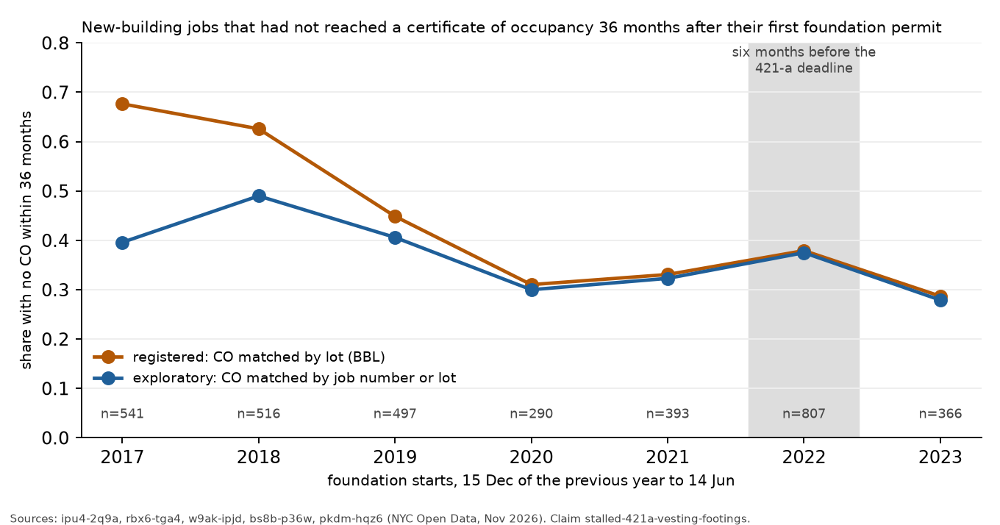

# Stalled construction: the 421-a deadline, flood zones and what the city could change

Jeff's question was why land is bought and not built on, or built as far as a foundation and then left, and whether the city could speed up the restart. This note reports two registered tests on citywide data and one exploratory count. The lot that prompted the question is described in `docs/case_334_van_brunt.md`.

## Corrections after review

A referee rebuilt both deciding numbers from fresh queries with separate code (`critique/stalled-421a-vesting-footings.md`, `critique/stalled-flood-zone-starts.md`). Both verdicts stand under the registered rules, and the reading is narrower than the first draft of this note.

1. Under the registered rule the referee reproduced D1 exactly (−0.208). Matching certificates by job number and keeping jobs that lack a lot number gives −0.083 (−0.122 to −0.044). The registered cohort dropped 14–23% of 2022–2023 jobs for missing lot numbers, and 57% of the lot-matching misses come from certificates that have no lot number.
2. The kind of project changed. In 2022, 28% of jobs had 50 or more units, against 13% in 2017–2019. Among those large jobs the rush window stalled more, by +0.108 (+0.013 to +0.204). This split was chosen after the pooled result was seen and is exploratory, but it means the pooled result cannot show that the rush produced no extra stalls among the large projects that 421-a mattered to most.
3. Counting all new-building starts, about 230 starts were brought forward, not 290.
4. For the flood-zone claim the referee's estimate, matching by job number, is −0.001 (−0.051 to +0.049). The registered lot matching counted a neighbouring house's certificate as completion on large shared lots at the west end of the Rockaway peninsula. Floodplain starts are mostly one- and two-family houses. The test shows no difference, and it does not show that flood rules have no effect.

## What the research and the graph say

The System graph holds findings on vacant land and its consequences, mostly from Philadelphia: more assaults near vacant properties (PMID 23814668), lower homicide near maintained lots (PMID 26954939), and a variable for land vacant 36 months or longer (PMID 36716893). Variable searches for construction, tax, incentive and development on 13 November 2026 returned no finding about construction finance, tax incentives or stalled sites. The graph describes what long-vacant land does to a neighbourhood but not why land stays vacant.

The other sources are trade press and city documents, not peer-reviewed studies.

- Under 421-a(16) a project was "commenced" when its footings and foundations were begun. Projects had to commence by 15 June 2022 and finish by 15 June 2026. The 2024 state budget moved the completion date to 15 June 2031 for projects commenced from 2016 to June 2022, with stricter affordability conditions. The successor, 485-x, was enacted in 2024.
- REBNY reported 689 new-building filings in the first quarter of 2022, the most since 2014. A REBNY survey in January 2023 put about 33,000 units in 72 vested projects at risk of missing the 2026 completion date, partly because lenders wanted a year's margin (The Real Deal, 20 January 2023).
- After 2008 DOB kept a list of about 600 stalled sites and offered permit extensions under a 2009 local law; 364 sites had restarted by May 2010, and the programme ended in 2013 (The Real Deal, 2010 and 2014). The dataset that survives, DOB Stalled Construction Sites (i296-73x5), holds 787 complaints from March 2009 to December 2024. It is driven by complaints and was not used for the tests.
- Vacant land taxes have been proposed in New York repeatedly. De Blasio proposed one for about 10,500 residential vacant lots in 2013 and again in 2017; it needs state legislation and was not enacted. Comptroller Stringer's 2015 audit counted 1,131 city-owned vacant lots and proposed a land bank (City Limits, 2016 and 2018).

The common claim in this material is that the footings rule caused developers to pour foundations before June 2022 to secure the exemption and then wait. We found no study that measured whether these starts stalled more often than others.

## Claim 1: the 421-a rush did not raise the pooled share of stalled foundations

Registered as `stalled-421a-vesting-footings` (commit ea9ff50, branch `prereg/stalled-421a-vesting-footings`) before any completion data were read. The unit is a new-building job, from both DOB systems. Its start is its first initial foundation permit. The outcome is the absence of a certificate of occupancy within 36 months of the start. The rush window is 15 December 2021 to 14 June 2022, and it is compared with the same calendar window in 2017 to 2019 (D1) and in 2023 (D2).

The rush window had 807 foundation starts. The same window had 541, 516 and 497 in 2017 to 2019 and 366 in 2023. The footings rule therefore brought forward about 290 starts by this count, or about 230 counting all new-building starts (see the corrections above).

The verdict is contested. Under the registered matching of certificates by lot (BBL), D1 was −0.208 (95% bootstrap interval −0.248 to −0.167), so the refute condition (upper bound below 0.03) was met. D2 was +0.092 (0.034 to 0.150).

The registered matching has a defect that was found only after the result. For older jobs the lot on the permit often differs from the lot on the certificate, so matching by lot misses many certificates of the 2017 and 2018 jobs: 59% of the 2017 legacy jobs had a certificate under the same job number within 36 months, against 32% found by lot. An exploratory re-run that matches by job number or by lot (`analyses/stalled/vesting_exploratory.py`) gives no-CO rates of 0.40, 0.49 and 0.41 for 2017 to 2019, 0.38 for the rush window and 0.28 for 2023. D1 is then −0.055 (−0.096 to −0.014). The refutation therefore does not depend on the defect. At 48 months the rush window's no-CO rate is 0.235, inside the range of 2017 to 2019 (0.25 to 0.30).

The rush window did stall more than the 2023 window, by 0.10. That difference fits the vesting account, but it also fits a change in the kind of project: the jobs that started in 2023 could not vest in 421-a and are likely to be smaller or condominium projects, which finish sooner. The data used here cannot separate the two.

Of the 807 rush-window jobs, 140 had no certificate of occupancy by November 2026. Of these, 47 have had no DOB permit issued on their lot since 1 November 2025 (`analyses/stalled/rush_dormant.py`, exploratory). These 47 are the closest the data come to a list of foundations poured to vest and then left. They are 6% of the rush window.

## Claim 2: flood-zone starts do not finish later overall

Registered as `stalled-flood-zone-starts` (commit fc819e5, branch `prereg/stalled-flood-zone-starts`). The Red Hook case suggested that flood rules and ground water delay foundations near the shore. Of 3,276 foundation starts in the windows of 2017 to 2023 that match current PLUTO, 401 are in the 2015 preliminary 1% floodplain.

The verdict is unsettled. The borough-stratified difference in the 36-month no-CO rate, floodplain minus elsewhere, is −0.049 (−0.098 to −0.002), the opposite of the predicted direction. The upper bound sits within 0.005 of the threshold, and under rule 9 of `concord/claims.py` it was below zero under 19 of 20 other seeds, so the refute condition is treated as neither met nor unmet. The boroughs differ. In Queens the 198 floodplain starts finished faster than other Queens starts (0.21 against 0.41 not finished at 36 months). In Brooklyn (0.45 against 0.40) and Manhattan (0.83 against 0.54, 30 starts) they finished more slowly. Red Hook is in the Brooklyn group.

## What lever the results point to

The results argue against two levers that the literature and the Red Hook case suggest.

- A deadline that counts footings as commencement brought starts forward, by about 230 to 290 in six months. Pooled over all projects, it did not leave a citywide excess of unfinished buildings three years later. Among projects of 50 or more units an excess of about 11 points is possible (exploratory). The evidence does not settle whether the commencement rule in 485-x or a successor matters for large projects.
- The test found no difference in completion between floodplain starts and others, which are mostly different kinds of building. It cannot say whether flood rules slow particular sites, such as those on the Brooklyn shore.

The lever the evidence does point to is narrower. The city already records the signs of a stall at a single site. At Van Brunt and King Streets these were a satisfied construction loan with no replacement (ACRIS), a superintendent and later a contractor withdrawing (DOB stop-work orders), expired fence and work permits, and inspectors' notes of an "abandoned site" (ECB). These records sit in four datasets that are not linked to each other, and the official stalled-sites list missed the site entirely, because that list depends on complaints. A list built from records instead, of foundation-stage jobs with no permit activity for a year and a satisfied or absent construction loan, could be produced each month from open data. The 47 dormant rush-window jobs are a first version of such a list for one cohort. A list would let the city target the measures it has used before: the 2009 permit-extension and site-maintenance programme, or a higher tax rate on land that holds an expired foundation permit, which would need state legislation as the earlier vacant-land tax proposals did.

This lever is practical only if a dormant foundation responds to these measures. Neither test shows that. The 2009 programme restarted 364 sites in about a year, which suggests that permit relief helps when the cause is a lapsed permit. It does not help when the cause is a lost lender, as the Red Hook case suggests.

## Novelty

The count of foundation starts by window and their completion rates have not, as far as we found, been published. The trade press asserts that the footings rule left foundations stranded; these data do not support that assertion at the scale of the city. Matching permits to certificates by lot (BBL) missed almost half of the certificates that matching by job number found for the 2017 jobs (32% against 59%). This matters for any study that links DOB records by BBL; the earlier construction claims in this repo matched by job number and are not affected. Neither result is a new mechanism. The proposed record-based stalled-site list is a recommendation that follows from one case and has not been tested.

## Research needed

- HPD's list of projects vested in 421-a with their commencement dates, to compare vested and non-vested starts in the same window.
- A completion horizon of six years for the 2022 cohort (2028), to see whether the 2031 extension lets vested projects wait.
- The share of foundation-stage jobs whose construction mortgage was satisfied without a replacement, from ACRIS, and their later completion.
- Foundation work done under alteration jobs, which the new-building counts here exclude; the Red Hook site is one.

## Files

- Scripts: `analyses/stalled/vesting_cohorts.py` (registered test 1), `register.py`, `outcome_vesting.py`, `vesting_exploratory.py`, `rush_dormant.py`, `flood_predictor.py` (registered test 2), `register_flood.py`, `flood_rule9_check.py`, `outcome_flood.py`, `figures.py`, `lot_334_records.py`.
- Data: `data/derived/stalled/` (`vesting_result.json`, `vesting_exploratory.json`, `vesting_jobs.csv`, `vesting_jobs_union.csv`, `flood_result.json`, `flood_rule9_check.json`, `flood_jobs.csv`, `rush_dormant.json`, `rush_no_co_jobs.csv`, `lot_334/`).
- Claims: `claims/registered/` and `claims/outcomes/`, ids `stalled-421a-vesting-footings` and `stalled-flood-zone-starts`.
- Figures: `figures/stalled/vesting_cohorts.png`, `figures/stalled/lot_334_timeline.png`.
