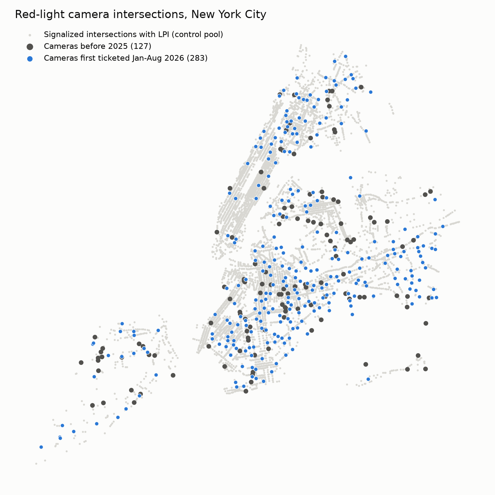
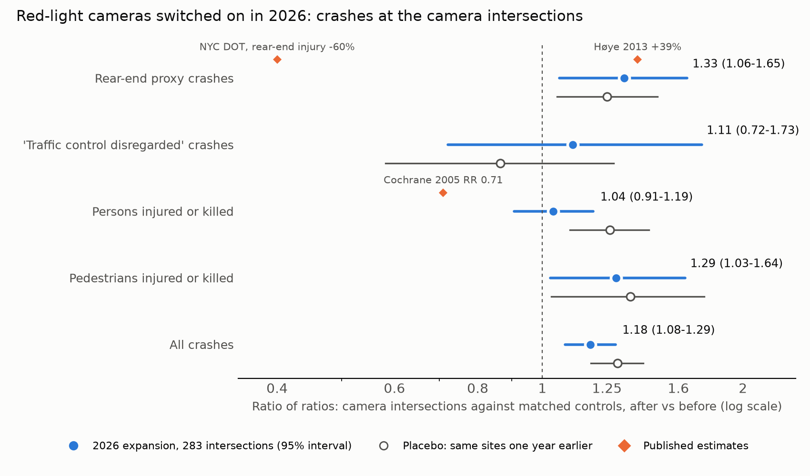
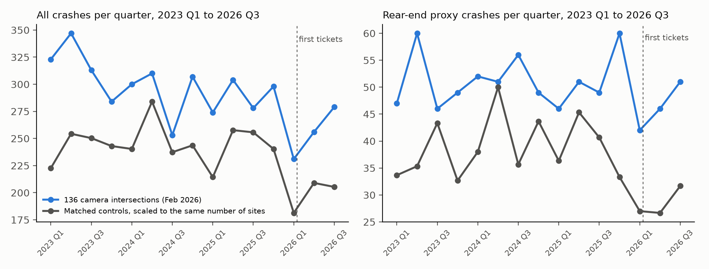

# Pedestrian safety on New York streets: what the research says and a test of the 2026 red-light camera expansion

Street-safety agent, 13 November 2026. Claims: `rlc-expansion-rearend`, `rlc-expansion-injuries`. Code: `analyses/street_safety/`. Data: `data/derived/street_safety/`. Figures: `figures/street_safety/`.

## Corrections after review

A referee rebuilt both ratios with separate code and got the same values (`critique/rlc-expansion-rearend.md`, `critique/rlc-expansion-injuries.md`). The rear-end verdict changes from confirmed to unsettled.

1. The placebo year meets the rear-end support condition on its own (1.250, lower bound 1.052), so the design cannot tell a camera effect from its own bias. Controls matched on pre-window counts were high by chance: their crashes fell to 0.78 of the earlier level while the whole pool stayed at 0.99. Rule 11 in `concord/claims.py`, added after these data, makes such a verdict unsettled.
2. Two comparisons not matched on earlier counts give rear-end ratios of 1.03 and 1.05 and injury ratios of 0.84 (0.75 to 0.93) and 0.81 (0.70 to 0.92), with placebos near 1.0. They were chosen after the data were seen and decide nothing. They point to fewer injuries and no rise in rear-end crashes, and a successor claim should test this on 2027 data, with sites activated later as controls.
3. The result does not contradict DOT's figure. DOT measured injury crashes at the older sites, without controls; this test counts all rear-end crashes at the new sites.
4. The vehicles table is bm4k-52h4. Ticket sampling on two days a month dates activation late at 149 of 283 sites, never early, and 68 new sites could not be located.

## Question

Some New York streets, such as Flatbush Avenue, are known to be dangerous for people on foot. The question is which interventions reduce pedestrian injuries, by how much, and whether the city's own data show it. One concern is specific: red-light cameras may reduce right-angle crashes and pedestrian injuries but increase rear-end crashes.

## What the research says

The table gives the effect sizes found in the literature and in the System Public Graph. A crash modification factor (CMF) of 0.80 means 20% fewer crashes than expected without the treatment.

| Intervention | Effect on crashes | Source | Strength |
|---|---|---|---|
| Red-light cameras | Right-angle crashes about -10%, rear-end crashes about +40%, all crashes about +15% (none significant, best-controlled studies) | Erke 2009, Accid Anal Prev 41:897 | Meta-analysis; effects shrink with control for regression to the mean |
| Red-light cameras | Right-angle -13%, rear-end +39%; right-angle injury crashes -33%, rear-end injury crashes +19% | Høye 2013, Accid Anal Prev 55:77 | Meta-analysis update |
| Red-light cameras | Fatal crashes at signalized intersections -14% after activation, +16% after removal | Hu and Cicchino 2017, J Safety Res 61:141 (graph, PMID 28454859) | 57 camera cities against 33 without |
| Red-light cameras (NYC) | Right-angle injury crashes -70%, rear-end injury crashes about -60% at camera intersections | NYC DOT program addendum (2025 data) and press release of October 2026 | Before-after against a pre-installation average, no control group |
| Speed cameras | Injury crashes near sites -8% to -49% | Wilson et al. 2010, Cochrane CD004607; graph: Barcelona RR 0.73, South Wales RR 0.49 | Systematic review; already tested here in `mob-speedcam-247` (unsettled) |
| Leading pedestrian intervals | Vehicle-pedestrian crashes CMF 0.87 pooled over 3 cities; New York alone 0.91, not significant | Goughnour et al. 2018, FHWA-HRT-18-044 | Empirical Bayes before-after, 105 treated sites (42 in NYC) |
| Leading pedestrian intervals | Serious vehicle-pedestrian conflicts -42% (Bellevue), -18% to -21% (Vancouver) | PMID 36571971, 32949863 (graph values mis-extracted, see below) | Video conflict studies, 3 and a few sites |
| Road diet (4 to 3 lanes) | All crashes CMF 0.81 urban, 0.53 suburban; FHWA quotes 19-47% | FHWA road diet guide and pedestrian countermeasure toolbox | Many before-after studies; not in the graph |
| Speed humps | Pedestrian collisions IRR 0.78 (0.66-0.91); children 0.57 | Rothman et al. 2015, Toronto (graph, PMID 26264227) | Quasi-experimental, 409 roads |
| Multicomponent intersection redesign | Pedestrian crashes RR 0.79 (0.62-0.99) | Pasos Seguros, Mexico City (graph, PMID 36535752) | Difference in differences, 12 months |
| Daylighting | Unhardened daylighting: no significant benefit; hardened daylighting about -0.14 pedestrian injuries per intersection-year | NYC DOT report under Local Law 66 of 2023 (January 2025); disputed by City Council data team (November 2025) | Agency analyses; contested |
| Pedestrian overpass | CMF 0.14 (all), 0.10 (injury) at the crossing | FHWA pedestrian countermeasure toolbox | Older studies; effect depends on use; the graph's one record (Tehran, OR 4.2) is a case-control association, not an effect of building a bridge |

### The graph

The variable search (`graph_collect.py`, 10 topics, about 40 search terms) found 32 associations under "red light", of which 5 concern red-light cameras; the rest are phototherapy, myopia and red-light districts. It found 8 on speed cameras, 7 on leading pedestrian intervals, none on road diets, none on red-light cameras and rear-end or right-angle crashes, and one on pedestrian bridges.

I checked 21 records that this note relies on against their PubMed abstracts (`data/derived/street_safety/graph_check.json`). Thirteen were correct, seven were wrong and one could not be checked from the abstract. Three of the seven errors turn a percentage reduction into an odds ratio with the same digits: a 42% reduction in conflicts became an odds ratio of 0.42, and an 18.1% reduction became 0.181. One reverses the exposure: a Ghana study found pedestrian deaths 1.98 times as likely where traffic calming was absent, and the graph records traffic calming as raising the odds by 1.98. Two attach a comparison-group figure to the intervention, and one gives the figure for a different set of cities. The error rate among these records (7 of 20 checkable, 35%) is higher than the 20% the documentation warns of.

The graph therefore cannot answer the question that matters most for red-light cameras, the trade between right-angle and rear-end crashes. That question is answered by two meta-analyses outside the graph, and they disagree in sign with NYC DOT's own reports on rear-end crashes.

## The city data

NYC Open Data holds the crashes (Motor Vehicle Collisions - Crashes, `h9gi-nx95`; Vehicles, `bm4k-52h4`), leading pedestrian interval signals with installation dates (`xc4v-ntf4`, 6,810 intersections), Vision Zero street improvement projects (`shr7-eqdc` intersections, `if4c-w48d` corridors) and priority corridors. It does not hold red-light or speed camera locations. Red-light camera tickets (violation code 7) appear in Parking Violations Issued, one table per fiscal year, with the approach written as text ("WB AVENUE U @ FLATBUSH AVE").

The tickets show a natural experiment. Until December 2025 about 210 camera approaches issued tickets each month. From January 2026 the number rose, to 489 approaches in February and 783 in August 2026, under the program expansion authorised in October 2024. No evaluation of this expansion has been published.

I read the tickets for the 1st and 15th of each month (grouped queries on these tables time out), parsed the approach names, merged approaches of one intersection, and located 468 of 585 intersection names on OpenStreetMap or in the LPI table (`rlc_sites.py`, `osm_intersections.py`, `geocode_sites.py`). The 2026 expansion gives 283 located intersections first ticketed between January and August 2026, 114 of them in Brooklyn. Two are on Flatbush Avenue, at Avenue U and at Kings Highway.

## Registered test

Both claims were registered before any crash data near these sites were read (commit `3e74706`, pushed to `prereg/rlc-expansion-rearend` and `prereg/rlc-expansion-injuries`). The analysis script, seed and number of draws were committed before them (`793cc32`). The expected discrimination under rule 8, computed from assumed crash rates (`power.py`), was D = 5.9 for the rear-end proxy, 9.8 for persons injured and 1.9 for pedestrians, so pedestrians were registered as a secondary outcome that would not decide the verdict.

The design compares each camera intersection with three LPI intersections in the same borough, at least 300 m from any camera, matched on the count of all crashes in the pre windows. It counts crashes within 50 m in the months after the first ticket (up to nine, to October 2026) and in the same calendar months of 2024 and 2025, and reports the ratio of ratios with a cluster bootstrap interval. A placebo moves every window one year earlier, to a time with no camera at these sites.

| Outcome | 2026 expansion | Placebo, one year earlier |
|---|---|---|
| Rear-end proxy crashes | 1.33 (1.06-1.65) | 1.25 (1.05-1.49) |
| Persons injured or killed | 1.04 (0.91-1.19) | 1.26 (1.10-1.45) |
| Pedestrians injured or killed | 1.29 (1.03-1.64) | 1.36 (1.03-1.75) |
| 'Traffic Control Disregarded' crashes | 1.11 (0.72-1.73) | 0.87 (0.58-1.28) |
| All crashes | 1.18 (1.08-1.29) | 1.30 (1.18-1.42) |

Ratio of ratios with 95% bootstrap intervals; 283 camera intersections, 849 controls, 323,683 geolocated crashes (January 2023 to October 2026). Source: `data/derived/street_safety/rlc_did_results.json`.

`rlc-expansion-rearend` is confirmed under rule 1. Its lower bound, 1.06, is above 1.00 under every seed tried, and D = 6.45. `rlc-expansion-injuries` is unsettled: 1.04 (0.91-1.19) meets neither condition.

The placebo changes how the confirmation should be read. Where no camera existed, the same design finds ratios of 1.25 to 1.36 for every outcome. The likely cause is the matching. Controls were chosen for having as many crashes in the pre windows as the camera sites, which selects controls whose counts were high by chance, and these counts then fell. The quarterly series for the February cohort shows it: the controls drop after mid-2025 while the camera sites stay level.

The rear-end result does not reproduce NYC DOT's report of a 60% fall in rear-end injury crashes at camera sites, which used other sites, injury crashes only and no controls, and it does not show that cameras raised rear-end crashes (see the corrections above). As an exploratory reading, not a test, the ratio of the 2026 estimate to the placebo estimate is 1.06 (0.80-1.40) for rear-end crashes, 0.82 (0.67-0.99) for persons injured and 0.95 (0.66-1.35) for pedestrians. If this adjustment is right, the new cameras reduced injuries by about 18% without a clear rise in rear-end crashes, which matches Høye's finding that the rear-end increase is smaller for injury crashes. I chose the adjustment after seeing the data, so under rule 4 it decides nothing.

## What this means for Flatbush Avenue

The city data do not yet show which intervention to fund on a corridor like Flatbush Avenue. The red-light camera test is too young (four to nine months of post data) and its comparison group is biased by about +25%, so the city data cannot yet measure the cameras' effect on pedestrians. In the literature, physical redesign of the corridor (road diet, refuge islands, hardened daylighting, the Pasos Seguros package) has the most consistent evidence of fewer pedestrian crashes, about 20-45%. Leading pedestrian intervals are cheap and reduce pedestrian crashes by about 13% pooled, with the New York estimate (9%) not significant. Red-light cameras reduce right-angle and fatal crashes at signalized intersections and probably increase rear-end crashes, mostly without injury. Pedestrian bridges remove pedestrians from the crossing where they are used, but they are expensive and the evidence on use and diversion is old.

The practical result of this work is narrower. The city can evaluate its 2026 camera expansion properly if DOT publishes camera locations and activation dates, and a repeat of this test in late 2027 with not-yet-treated cameras as controls would settle the rear-end question for New York.

## Files

- `analyses/street_safety/`: `graph_collect.py`, `rlc_sites.py`, `osm_intersections.py`, `geocode_sites.py`, `power.py`, `register.py`, `rlc_did.py` (registered analysis), `exploratory_placebo_adjusted.py`, `write_outcomes.py`, `figures.py`.
- `data/derived/street_safety/`: `graph_raw.json`, `graph_check.json`, `rlc_sites.json`, `rlc_sites_geo.json`, `lpi_gazetteer.json`, `power.json`, `rlc_did_results.json`, `exploratory_placebo_adjusted.json`. The OSM intersection table and borough boundaries are rebuilt by `osm_intersections.py` from an Overpass download kept outside the repo; PubMed abstracts are not redistributed.
- `claims/registered/` and `claims/outcomes/`: `rlc-expansion-rearend`, `rlc-expansion-injuries`.
