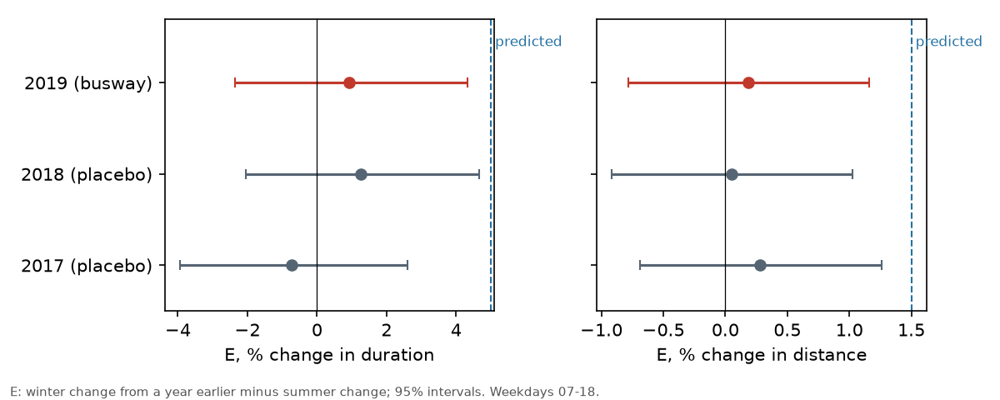
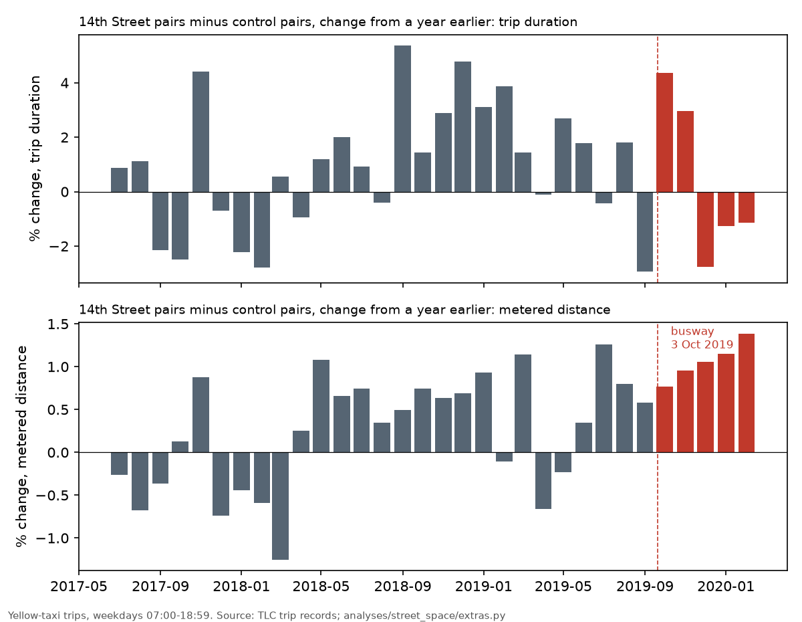
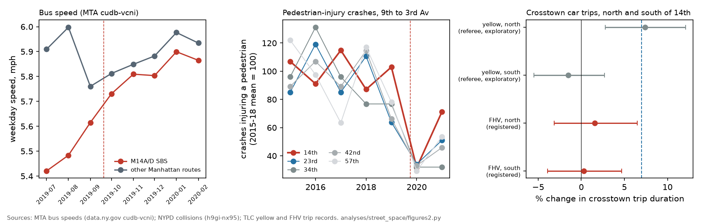

# Giving a street to buses: the 14th Street busway and crosstown taxi trips

On Thursday 3 October 2019 New York City made 14th Street between Third and Ninth Avenues a busway from 06:00 to 22:00 every day. Buses and trucks may drive through. Other vehicles may enter for local access and must turn off at the next avenue. The M14 Select Bus Service had begun on 1 July 2019. The busway was to start on 12 August 2019, but a court order delayed it. When a street is closed to cars, bus riders and pedestrians gain, and the cars that used it go elsewhere. This note asks how much longer the trips of those cars became, in door-to-door time and in distance, using the city's taxi records.

Two claims were registered before any trip after September 2019 was read. Both registrations were committed and pushed to their own branches (`prereg/street-busway14-crosstown-time`, `prereg/street-busway14-crosstown-detour`). The analysis scripts and the design run on pre-busway data were committed before them, in commit `8b0917f`.

| Claim | Prediction | Estimate (95% interval) | Verdict |
|---|---|---|---|
| street-busway14-crosstown-time | crosstown trip duration +5% (+2 to +10) | +0.9% (−2.4 to +4.3) | contested |
| street-busway14-crosstown-detour | crosstown trip distance +1.5% (+0.5 to +4) | +0.2% (−0.8 to +1.2) | contested |
| street-busway14-fhv-north-south | for-hire trips north of 14th St +7% (+3 to +12), south near 0 | north +1.6% (−3.1 to +6.5); south +0.3% (−3.9 to +4.7) | contested |
| street-busway14-m14-speed | M14 weekday speed +10% (+4 to +20) | +5.5% (+1.7 to +9.4) | confirmed |
| street-busway14-ped-injuries | pedestrian-injury crashes on 14th St, ratio 0.65 (a 35% fall) | 1.32 (0.90 to 1.94) | contested |

"Contested" here means that the registered bet lost. Both predictions were for a cost to drivers. The 95% intervals exclude the predicted +5% and +1.5%, but not smaller costs, including the low end of each registered range.

## Corrections after review

A referee rebuilt both deciding numbers with separate code and got the same values (+0.93% and +0.18%), and both verdicts stand. The referee changed the reading in three ways (`critique/street-busway14-crosstown-time.md`, `critique/street-busway14-crosstown-detour.md`).

1. The pooled estimate averages zone pairs whose trips may never use 14th Street. In an exploratory split that was not registered, the four pairs north of 14th Street changed by +7.4% (+2.8 to +12.1) and the southern pairs by −1.5%. Against the downtown controls alone the refutation condition is not met. The statement below that the cost per driver was "a few seconds" therefore applies to the average crosstown trip in these zones, not to trips that crossed or ran along the busway. For those trips a cost of several percent is not excluded.
2. The detour estimate depends on the baseline. Distance in the summer before the busway was already up by 0.6 to 1.3%, and other baselines give estimates from about +0.2% to +1.2%. Yellow-taxi trips in these pairs fell by 20% over the year, and a change in which trips were taken could also move average distance.
3. The registration excludes federal holidays, and the script omitted the summer ones. With all of them excluded the time estimate is +0.87%.

A second referee rebuilt the three follow-up claims (FHV, M14 speed, pedestrian injuries) and reproduced each number exactly (`critique/street-busway14-fhv-north-south.md`, `critique/street-busway14-m14-speed.md`, `critique/street-busway14-ped-injuries.md`).

4. The FHV verdict depends on the standard error. Under the registered one the upper bound is 6.49%, below the 7% threshold. With a correction for serial correlation (rho 0.16) it is 7.08%, and against downtown controls alone 8.49%, and in both cases the refutation condition is not met. The verdict stays contested under rule 1, with this margin stated under rule 10. The borrowed yellow-taxi baseline does not appear biased toward zero: before the busway the two fleets tracked each other with slope 1.00.
5. The M14 gain appeared in September 2019, before the busway opened on 3 October. The busway months are only 0.7% faster than September alone (exploratory). The confirmed verdict stands, but most of the 5.5% gain may belong to the Select Bus Service and to the end of the summer, not to the busway.
6. 14th Street pedestrian injuries were already rising relative to the comparison streets before the busway. A count by street name instead of buffer gives 0.83. Contested stands.
7. Because of item 5, the person-minute figures below are an upper bound for the busway. With the lower bus figures, several of the break-even counts fall below the M14's own ridership, so the comparison of riders' gains with drivers' losses is not settled.

## What the research says

The System Public Graph, a database of findings extracted from published research, has no finding on road-space reallocation, traffic evaporation or displaced traffic. Variable searches for road closure, street closure, busway and car-free return nothing relevant, and "travel time" matches travel to health care. The nearest findings are on the health side. When traffic at the Peace Bridge in Buffalo fell by half after 11 September 2001, respiratory admissions fell with borderline significance (PMID 14743825). Traffic control during the 2002 Asian Games in Busan lowered pollutant levels by 1% to 25%, with a relative risk of childhood asthma admission of 0.73 (0.49 to 1.11) (PMID 17824287). In Lima, crossings at bus stops on bus-only lanes had more pedestrian collisions, odds ratio 2.36 (1.02 to 5.42) (PMID 24357516). I read the three abstracts. None of them bears on travel time.

The graph does not include the transport literature. Cairns, Atkins and Goodwin (2002, *Municipal Engineer* 151:13-22) collected more than 70 cases of road-space reallocation in eleven countries. They found that the traffic problems predicted before a scheme were often not seen afterwards, and that part of the traffic disappeared from the network. NYC DOT's first report on the busway (December 2019, with Sam Schwartz Engineering) found bus travel times on 14th Street 22% to 47% shorter. Car travel times on 12th to 19th Streets rose by 0 to 2 minutes at weekday peaks, except on 17th Street, where they rose by 3.4 minutes between Third and Ninth Avenues. Travel times on most avenues changed by less than a minute, and Third Avenue rose by 1.6 minutes. Those figures come from test runs along single streets. They do not show what happened to a whole trip from one side of the corridor to the other.

## Design

The data are the TLC's yellow-taxi trip records, July 2016 to February 2020, 7 to 10 million trips a month in the source files. A trip is kept if its metered distance is above 0 and at most 50 miles, it lasts from 60 seconds to 3 hours, and its average speed is from 0.5 to 50 mph. The treated trips run between taxi zones on the west side of the corridor (Meatpacking/West Village West, West Village, East Chelsea, Greenwich Village North) and zones on the east side (East Village, Stuy Town/Peter Cooper Village, Alphabet City, Gramercy), in either direction. The control trips make the same kind of east-west crossing in Midtown, between Clinton, the Garment District and Times Square on one side and Murray Hill and Turtle Bay on the other, and downtown, between TriBeCa, Hudson Square and SoHo and the Lower East Side, Chinatown and Little Italy. The primary sample is weekdays other than federal holidays, with pickups from 07:00 to 18:59, when the busway was in force and the L train ran normally. On weekdays in October 2018 to February 2019 a treated trip took 11.5 minutes on average and covered 1.26 miles.

The design run on pre-busway data showed that a plain comparison of the same months a year apart is not reliable. The contrast between the 14th Street pairs and the control pairs drifted by +3.4% between the winters of 2017-18 and 2018-19 with no busway. The registered estimator therefore takes, for each month, the change in the contrast from a year earlier, and subtracts the mean of that change over the summer just before the busway (July to September 2019) from its mean over October 2019 to February 2020. The standard error comes from the spread of the monthly year-over-year changes from July 2017 to September 2019 (standard deviation 2.3% for duration and 0.7% for distance), which gives a standard error of the estimate of 1.7% and 0.5%. The same estimator applied to the winters of 2017-18 and 2018-19 gives −0.7% and +1.3% for duration and +0.3% and +0.1% for distance. An estimate at the predicted size would have been about three standard errors from zero, so the tests could detect an effect of the predicted size (D = 8.4 for duration and 9.0 for distance under rule 8 of `concord/claims.py`, which requires at least 4).

## Results

Door-to-door duration on the 14th Street pairs changed by +0.9% (−2.4 to +4.3) relative to the control pairs. That is about 6 seconds on an 11.5-minute trip, and the upper bound is about 30 seconds. The upper bound, 4.3%, is 0.7 points below the registered refutation threshold of 5%, less than one standard error. Over all busway hours of every day the estimate is +0.8% (−3.5 to +5.3), and overnight, when the busway was not in force, it is −1.3% (−5.0 to +2.5). The estimate is −0.2% against the Midtown pairs alone and +2.5% (−1.2 to +6.4) against the downtown pairs alone.

The monthly series (second figure) may show a pattern, but single months are noisy. The contrast rose by 4.4% and 3.0% against a year earlier in October and November 2019 and fell by 2.8%, 1.3% and 1.1% in December to February. That is consistent with a short disruption followed by adjustment, but single months vary with a standard deviation of 2.3%.

Metered distance changed by +0.2% (−0.8 to +1.2). The upper bound, 1.2%, is 0.3 points below the registered refutation threshold of 1.5%, less than one standard error. The figure also shows a feature that the registered estimator removes. All five months after the busway show a rise in distance against a year earlier, from +0.8% to +1.4% and increasing month by month. But the summer of 2019 had already risen by +1.3%, +0.8% and +0.6%, and the year before had a drift of about +0.6%. The unadjusted series is consistent with a detour of 0.5% to 1%, 35 to 65 feet per trip, but this cannot be separated from drift or from route changes made during the summer of the bus lanes and the court case.

Taxi demand in the corridor did not fall visibly. Weekday trip counts in the treated pairs changed by −0.6% relative to the control pairs on the same estimator, against placebo values of +1.6% and +2.3%.

## Conflict, confirmation and what is new

The time claim was registered as a conflict: it predicted a 5% lengthening, against the evaporation literature and DOT's summary. The result is consistent with the literature and with DOT's report, although it does not test evaporation. Removing through traffic from the main two-way crosstown street in lower Manhattan did not lengthen door-to-door taxi trips across it by 5%, and lengthened them by no more than about 30 seconds (upper 95% bound). This agrees with DOT's probe runs, which found 0 to 2 minutes on single side streets. One likely reason is that a delay on one block is a small part of a whole trip, and many trips between these zones do not use the slowed streets.

DOT measured travel times along single streets. This test measures trips between neighbourhoods, from public records anyone can rerun, with placebo years and a registered prediction. It also estimates the detour, the added distance, which is what turns displaced traffic into added vehicle-miles and emissions. I found no earlier estimate of it in the sources I searched. The upper 95% bound of the detour is 1.2% of a crosstown trip.

The city's open data do not test evaporation itself. The automated traffic volume counts (`7ym2-wayt`) hold only four counts on 12th to 18th Streets between 2017 and 2021, all in October 2019, which cannot show whether traffic on parallel streets rose by less than the traffic removed from 14th Street.

## What this implies for the next closure

The cost that opponents of a closure usually predict, longer car trips on the parallel streets, was small here when averaged over crosstown taxi trips between these zones: under half a minute on a typical trip. The referee's exploratory split (see the corrections above) shows that trips between the zones just north of 14th Street may have lengthened by several percent, so the average hides a larger cost for the drivers most exposed. This case suggests that the door-to-door cost to drivers of the next busway or pedestrian block may be of that order where the grid offers parallel streets one block away, as Manhattan's does; it is one corridor, one five-month window and one class of vehicle. The case is weaker where no parallel street exists, such as a bridge approach or a river crossing, and this test says nothing about those.

The test also shows what the city should measure before the next closure. A probe-vehicle run on one street measures a different quantity from a door-to-door trip, because drivers spread over many streets. Taxi and for-hire trip records between zone pairs give a door-to-door measure for free, but only if a comparison corridor and at least two years of history are chosen before the closure. The city publishes too few traffic counts to test evaporation; counts on the parallel streets for two months before and after a closure would test it. The Broadway blocks closed to cars in the Flatiron district (25th to 27th Streets in 2023, 17th to 21st Streets in 2024) are candidates, though Broadway carries southbound traffic only and does not cut a crosstown route.

## The tradeoff: bus riders, drivers and pedestrians

After the referee's review, three more claims were registered, each before its outcome data were read, and each pushed to its own branch (`prereg/street-busway14-fhv-north-south`, `prereg/street-busway14-m14-speed`, `prereg/street-busway14-ped-injuries`). The scripts and design runs were committed first (`073d33f`, `832efc5`).

### Drivers: a held-out test on for-hire trips

The referee's exploratory split suggested that the cost to drivers is concentrated in the four zone pairs north of 14th Street, between East Chelsea and Stuy Town or Gramercy (+7.4%, +2.8 to +12.1), with nothing in the pairs south of it. I tested that split on the TLC's high-volume for-hire records (Uber, Lyft and others), which had not been read when the claim was registered. These trips are more numerous than taxi trips in these zones (143,600 weekday trips between the corridor zones in October 2019 to February 2020, against 102,600 by yellow taxi), and their routes are chosen by apps. The records begin in February 2019, so there is no year-earlier winter. The estimator takes the change in the contrast from summer to winter in 2019-20 and subtracts the average summer-to-winter change in the yellow-taxi contrast for the same pairs in the three earlier seasons. The design run on February to September 2019 gave a standard error of 2.4% for the north pairs, so an estimate at the predicted +7% would have been 2.8 standard errors from zero on the log scale.

The north pairs lengthened by +1.6% (−3.1 to +6.5) and the south pairs by +0.3% (−3.9 to +4.7). The upper bound for the north pairs is 0.5 points below the registered refutation threshold of 7%, much less than one standard error, and the verdict is contested. The held-out data do not reproduce the referee's +7.4%. They do not exclude a lengthening of up to 6.5%, about 70 seconds on the 17.6-minute average north trip. The verdict rests on a borrowed seasonal baseline: if for-hire trips swing less from summer to winter than taxi trips, the estimate is too low.

### Bus riders

The MTA's monthly bus speeds (data.ny.gov `cudb-vcni`) begin for Manhattan in January 2019, and the M14A and M14D Select Bus Service rows begin in June 2019, so the only clean comparison is the busway winter against the summer in which the Select Bus Service ran without the busway. On weekdays the M14 ran at 5.50 mph in July to September 2019 and 5.82 mph in October 2019 to February 2020, while the other 39 Manhattan routes stayed at 5.9 mph. Relative to them, M14 speed rose by 5.5% (1.7 to 9.4), which meets the registered support condition (at least 4% with a lower bound above zero), and the verdict is confirmed. The interval was set from 119 placebo estimates in which each other route (39 or 40 in each season) was treated as if it were the M14 in the seasons 2021 to 2023. The M14 was already speeding up in the summer (5.42, 5.48 and 5.62 mph in July, August and September), so part of the gain may be the Select Bus Service settling in rather than the busway. The MTA speed is a route average. DOT's corridor figure, 22% to 47% shorter bus travel times than in 2018, includes the effect of the Select Bus Service.

Weekday M14 boardings averaged 24,826 in October 2018 to February 2019 and 29,486 in October 2019 to February 2020, 19% more (MTA Bus Hourly Ridership, `98u6-vmgs` and `kv7t-n8in`; exploratory). DOT reported +24% on weekdays for its own comparison.

### Pedestrians

The NYPD collision records (`h9gi-nx95`) give about 26 crashes a year that injured or killed a pedestrian on 14th Street between Ninth and Third Avenues before the busway. A test over the five months before the pandemic could detect only a change of about half, so the registered test used three years after the busway (October 2019 to September 2022) against five years before, with 23rd, 34th, 42nd and 57th Streets over the same avenues as comparison. It predicted a fall of 35% relative to them (ratio 0.65). Crashes on 14th Street fell from 25.6 to 14.7 a year, but on the comparison streets they fell further, from 112.8 to 49.0. The ratio of rate ratios is 1.32 (0.90 to 1.94), the predicted fall is excluded, and the verdict is contested. Against 23rd Street alone, the most similar street outside Midtown, the ratio is 1.04 (0.63 to 1.73). The pandemic emptied Midtown more than the residential streets around 14th Street. That makes crashes on the comparison streets fall for reasons unrelated to the busway, so the ratio overstates 14th Street's relative rate; pedestrian counts would be needed to compare risk per pedestrian. The data do not show a safety gain for pedestrians on 14th Street relative to other crosstown streets.

### Weighing the three

The bus riders' gain can be put in person-minutes, with one assumption. An M14 boarding that rides 1.5 miles took 16.4 minutes at the summer speed, and 5.5% faster saves 0.85 minutes. With 29,486 weekday boardings that is about 25,000 person-minutes a weekday, or 416 person-hours. This treats the whole gain as the busway's, so it is an upper figure for the busway alone. The figure ranges from 16,600 to 41,600 person-minutes for rides of 1 to 2.5 miles, and from 8,000 to 41,000 across the speed interval. The ride length is my assumption; the MTA does not publish it by route.

The drivers' loss cannot be put in person-minutes from open data, because no open count says how many vehicles crossed the corridor. It can be put as a break-even. At the registered point estimates, 0.9% of an 11.5-minute taxi trip (6 seconds) or 1.6% of a 17.6-minute north for-hire trip (17 seconds), drivers and passengers would have to make about 240,000 or 90,000 affected occupant-trips a weekday (about half as many vehicle trips at two occupants a vehicle) to lose as much time as bus riders gained. At the upper bounds, 30 seconds for the pooled taxi trips and 70 seconds for the north for-hire trips, the break-even is about 50,000 or 21,000 occupant-trips a weekday. The first pair is three to eight times the M14's weekday ridership; the second is of the same order as that ridership. At the point estimates, drivers would lose more time than bus riders gained only if 90,000 to 240,000 affected occupant-trips crossed the corridor each weekday. At the upper bounds the answer depends on the traffic count that the city does not publish.

The safety side shows no measurable gain. Pedestrian-injury crashes on 14th Street fell after the busway, but not by more than on the comparison streets.

The gain to bus riders in the next closure can be measured from the MTA's open data, but a clean estimate needs a year of route speeds, and of segment speeds, which the MTA has published only since 2023, before the change. The cost to drivers is small on average and uncertain for the most exposed trips, and a traffic count on the street and its parallels is the missing number for any person-minute comparison. A safety benefit should not be promised from removing through traffic alone; on 14th Street it did not appear in three years of crash records.

## Limits

The post-busway window is five months long because the pandemic began in March 2020. The taxi zones are large, and some treated trips never touched 14th Street. Yellow taxis are a minority of vehicles on these streets. If their drivers find new routes faster than other drivers, the estimate understates the cost to other drivers. The L train slowdown (27 April 2019 to 26 April 2020) affected nights and weekends; the primary sample avoids those hours, and both netted periods include it. October 2019 includes two days before the busway. Both refutation conditions were met by less than one standard error.

## Files

Scripts are in `analyses/street_space/`: `common.py` (zones and dates), `extract.py` (trip aggregation), `series.py` and `test.py` (the registered estimator), `estimate.py` and `design.py` (design run), `extras.py` (secondary numbers and figures), `register.py` and `outcomes.py`; for the follow-up, `fhv.py`, `bus.py`, `ridership.py`, `peds_common.py`, `peds_power.py`, `peds_test.py`, `register2.py`, `register3.py`, `outcomes2.py`, `outcomes3.py` and `figures2.py`. The for-hire aggregates are written to `~/opt/nyc-concordance/street_space/` from `https://d37ci6vzurychx.cloudfront.net/trip-data/fhvhv_tripdata_YYYY-MM.parquet`. Derived data are in `data/derived/street_space/`. The trip aggregates (about 50 MB each) are written to `~/opt/nyc-concordance/street_space/` and rebuilt from the TLC files at `https://d37ci6vzurychx.cloudfront.net/trip-data/yellow_tripdata_YYYY-MM.parquet`.
