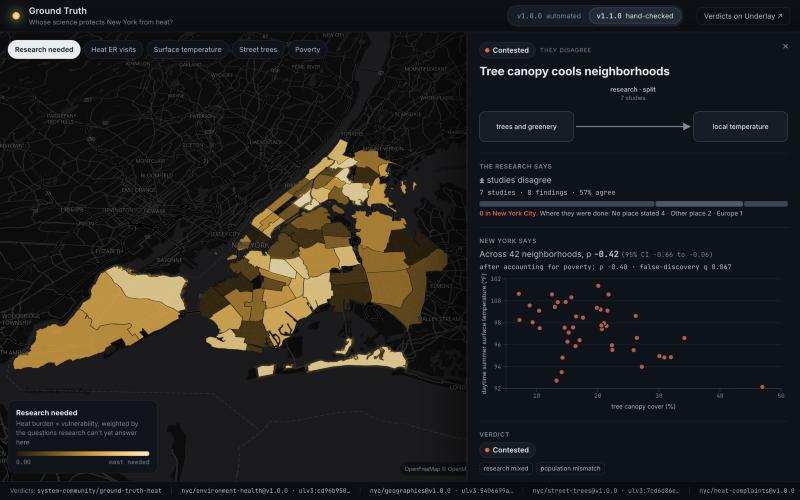

# Ground Truth

**Team:** Neural Forge
**Members:** Ali G, Muhammad Kone
**Challenge:** Build 4: What can the research and New York City's own data confirm, question, and connect together?
**Pitch slides:** LINK

## What it does

New York protects people from heat using published research, but almost none of that research is about New Yorkers:
of 767 heat-and-health studies in the System Public Graph, 4 are about New York City. Ground Truth tests that
borrowed evidence against the city's own data, district by district, labels each relationship **confirmed**,
**contested**, **bridged** or **inconclusive**, says what data would settle each open question, maps where new
research is needed most, and publishes every verdict to Underlay with citations to the exact versions and records
it rests on. It is for city health analysts deciding which research they can lean on, and for funders deciding what
to study next.

## How we used the System Public Graph

- **Whose evidence.** We found every study with a heat-exposure variable (a variable-name pattern, because heat is
  fragmented across concepts) and tagged each study's `population_string` for place, human or animal, age, income
  and race/ethnicity. We did the same for 17 health problems New York tracks, using their concepts.
- **Claims.** Each claim names two or three "ends" (concept ids and variable-name patterns, listed in
  `pipeline/claims.py`) and collects every association linking them, in either variable order. Direction rules:
  ratios (OR, HR, RR, IRR, PR) count when the CI lies wholly above or below 1; coefficients and correlations by sign
  when the CI excludes 0 or p < 0.05; estimates with no CI or p count by their sign and are flagged untested.
  Variables named "lack of", "low", "no" count in the opposite direction; "income" counts opposite to poverty.
  Animal studies are excluded. The research direction is the majority sign if at least 70% agree, otherwise "mixed".
- **What we excluded.** Tree-ring climate studies (temperature makes trees grow, which is not about cooling),
  body and skin temperature, sleep deprivation, livestock heat stress.
- **City tests.** Spearman correlation across community districts (59), UHF42 neighborhoods (42) or years (22),
  a partial correlation controlling for poverty, a bootstrap 95% CI and a Benjamini–Hochberg false discovery rate of
  10% across all tests. Verdict rules are in `pipeline/build.py` (`RULES`) and in the output JSON.
- **Bridges.** A chain of links (for example street trees → temperature → heat ER visits). The graph's
  greenery-temperature evidence is thin and split, so the trees-to-temperature link comes from NYC's own canopy
  data and the temperature-to-ER link from the graph. That is the bridge: no single dataset holds it.

## How to run it

Python 3.12.

```
python -m venv .venv && .venv/bin/pip install -r requirements.txt
.venv/bin/python -m pipeline.run          # downloads ~1.5 GB on first run, then ~20 s
python -m http.server 8000 -d web         # open http://localhost:8000
```

`pipeline.run` downloads the pinned inputs if missing (`pipeline/data.py`; set `DATA_DIR` in `.env` to store them elsewhere
than `../data`), builds `web/data/ground_truth.json` and
`web/data/districts.geojson`, and writes the Underlay collection to `out/underlay/`. To publish it, put a write-scope
`UNDERLAY_API_KEY` in `.env` and run `.venv/bin/python -m pipeline.publish --push`. No System API key is needed: we
read the curated Dataverse release, which drops associations System flagged as extraction errors.

Hand-checking: `review/to_check.csv` lists the directional findings behind the claims, by priority, with a link to each paper. We marked each `ok`, `wrong` or `unclear`; `wrong` findings are excluded on the next build. We checked 27: 21 held up, 1 was wrong in the graph (a cold effect recorded as "air temperature"), 5 were unclear, and 2 of those showed our own code misreading "poor mental health", which we fixed. No verdict changed. Underlay v1.0.0 is the automated run and v1.1.0 the hand-checked one; the compare page shows the 4 records that changed.

## Data sources

All inputs are pinned; the pipeline refuses to run on any other version.

| Source | Version | Version id | License |
|---|---|---|---|
| System Public Graph, Harvard Dataverse doi:10.7910/DVN/7V6JDO (July 2026 release) | v2.1 | (Underlay copy: `system/public-graph` v1.0.0 `ulv3:cf73c4f9d7452909fa2b796791feac01a99de09eeb21b277744b0e5e96f272e0`) | CC BY-NC 4.0 |
| Underlay `nyc/environment-health` (NYC Environment & Health Data Portal) | v1.0.0 | `ulv3:cd96b9507b2f4e362ac4d7dbbf40a8c00ef01cc7787bb7d5d7758951e3c2352e` | as published by NYC DOHMH |
| Underlay `nyc/geographies` | v1.0.0 | `ulv3:5406699a873a2f9ec89abbfa691a631c6876b1826eed5605709e31d66ca0950c` | Apache-2.0 / NYC Open Data terms |
| Underlay `nyc/street-trees` (2015 Street Tree Census) | v1.0.0 | `ulv3:7cd6d86ebcfbe1d514139bf8d6650885ec34c82816d6bfdb742aab5d0bb0477d` | NYC Open Data terms |
| Underlay `nyc/heat-complaints` (311 no heat / no hot water) | v1.0.0 | `ulv3:4ce37f3ea3f54c5e0fb80267ef04026d6da61b324d851aee92aa6311c8312f48` | NYC Open Data terms |
| Underlay `noaa/nyc-daily-weather` (NOAA GHCN-Daily, 3 stations) | v1.0.0 | `ulv3:4ff0c069903f66a9d1de596658d54745f1487ad74c5178b6a1213dcd18ede656` | public domain |

Output: Underlay collection `system-community/ground-truth-heat` (CC BY-NC 4.0, derived from the graph).

Citation: System, Inc. (2026). System Public Graph (Version 2.1) [Data set]. https://doi.org/10.7910/DVN/7V6JDO

## Limitations

- Neighborhood-level correlations, not causal effects; they cannot say anything about individuals.
- 59 districts and 42 neighborhoods give limited power; many verdicts are honestly "inconclusive".
- Population tags come from regular expressions over free text; every New York City hit was checked by hand.
- The graph's directions come from automated extraction; we hand-checked the findings behind headline claims
  (`review/to_check.csv`), not all of them.
- Heat outcomes are ER visits and hospitalizations; there is no heat-death data by district on Underlay.

## AI coding tools

We used Claude to write boilerplate code for the pipeline and front-end. We designed the
claims, the evidence rules and the verdict logic, chose what to present, and hand-checked findings against the papers.

## Screenshot


