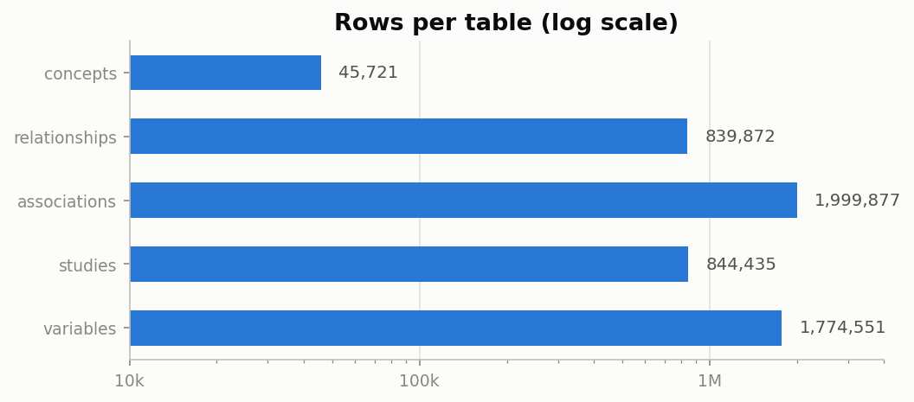
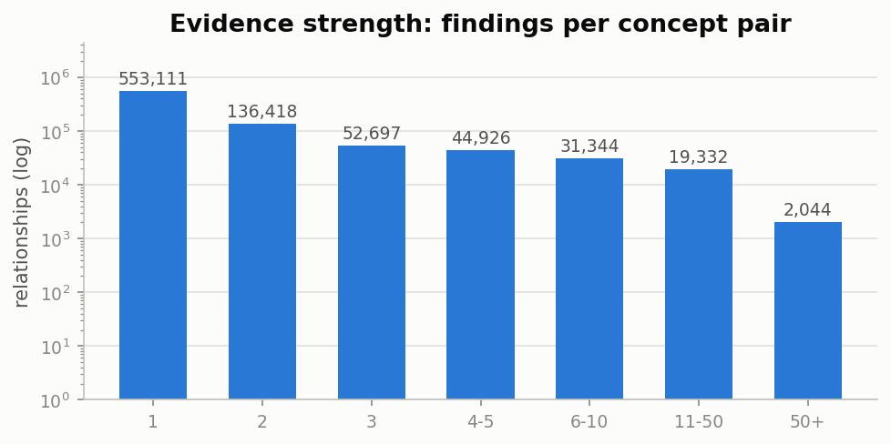
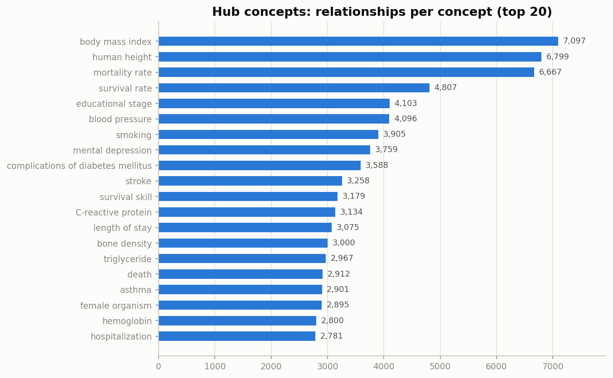
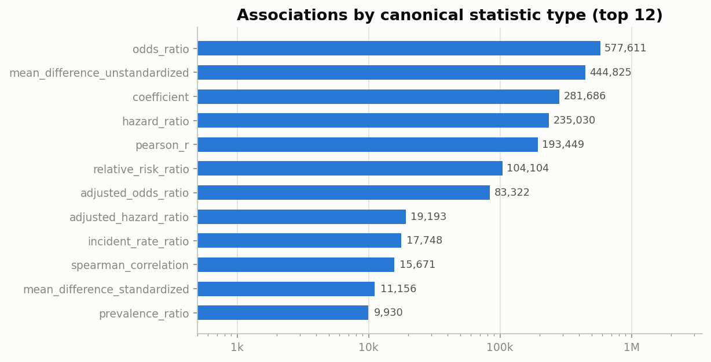
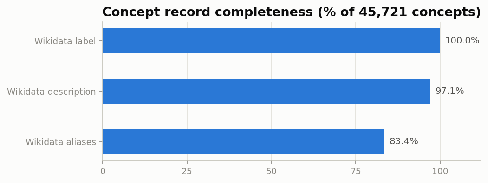
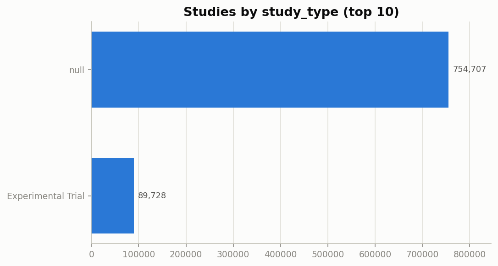
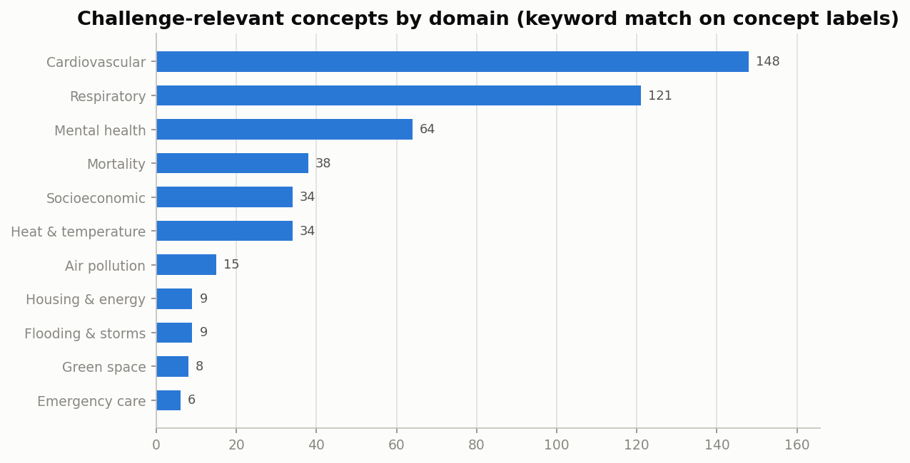
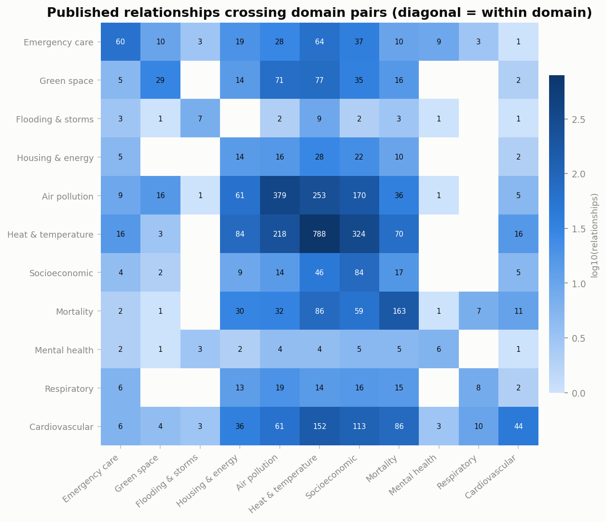
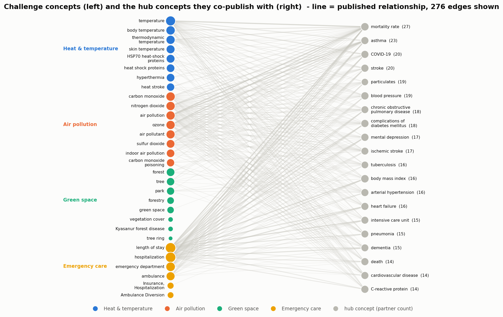

# System Public Graph v1 — Exploratory Data Analysis

EDA of the Dataverse deposit of the System Public Graph (`dataverse_files/`, generated 2026-07-08),
framed for **Build Challenge 4**: what published research and NYC open data can confirm, contest,
and bridge — heat, air quality, green space, and emergency care.

Reproduce with `python3 -I eda/eda_profile.py` (runs in ~2 min; writes everything under `eda/out/`).

---

## 1. What the dataset is

Five CSVs describing a **concept-level evidence graph** built from published health research:

| table | rows | what one row is | grain |
|---|---:|---|---|
| `concepts` | 45,721 | a Wikidata entity (label, description, aliases) | 1 row per Wikidata ID — no duplicates |
| `variables` | 1,774,551 | a study-specific *variable* ("heatwaves", "emergency hospital admissions (in Brisbane…)") mapped to a concept | operationalization of a concept in one study |
| `studies` | 844,435 | a published study (DOI, PubMed ID, population string, study_type) | 100% have a DOI, 99.6% a PubMed ID |
| `associations` | 1,999,877 | one *statistic* (OR, RR, r, …) linking two variables from one study | the evidence leaf — carries the numbers |
| `relationships` | 839,872 | a concept *pair* (source → target) with rolled-up evidence counts | the graph edge |

Flow: `studies` → measure `variables` → produce `associations` (statistics) → variables resolve to
`concepts` → concept pairs aggregate into `relationships`.

**Referential integrity is perfect** — every foreign key resolves (relationship endpoints, association
variables and studies, variable→concept mappings all join at 100%). Row counts match the MANIFEST exactly.

## 2. Evidence shape

- **65.9% of concept pairs rest on a single finding**; only 8.2% have ≥5 findings (max: 1,542).
  Most edges are thin evidence; the robust ones are the exception — important when citing
  "confirmed" relationships.
- 97.3% of relationships carry a `last_published_date` (temporal filtering is possible).

- The graph is **hub-heavy**: median degree is 5, but `body mass index` (7,097), `human height`
  (6,799), `mortality rate` (6,667) act as universal connectors. The hubs are clinical/epidemiologic —
  environmental concepts are fringe nodes.

- 17 canonical statistic types; `odds_ratio` (578k), `mean_difference` (456k), `coefficient`
  (282k), `hazard_ratio` (254k), `pearson_r` (193k) dominate. **47.8% of associations carry a CI**,
  68.6% a p-value, 100% a point estimate.

- `study_type` is sparse: 89.4% null, and the only populated value is `Experimental Trial` (89.7k).
  Observational-vs-trial filtering is **not** possible from this field.

## 3. What concepts exist (Challenge-4 lens)

Keyword groups matched on **concept labels only** (matching descriptions pulled in noise — e.g.
cardiac valve "vegetations" landed in green space). Homonym labels (`decision tree`, `tea tree oil`,
`tree nut allergy`, `Barmah Forest virus`) were excluded from green space. These are approximate
groupings for orientation, not a curated ontology.

The environment side of the challenge is **thin**: green space (8 concepts), emergency care (6),
air pollution (15), heat & temperature (34) vs. 121 respiratory and 148 cardiovascular concepts.
Sampled core concepts that do exist: `urban heat island`, `heat stroke`, `heat exhaustion`,
`extreme heat`, `body temperature`, `thermoregulation` · `air pollution`, `ozone`, `nitrogen dioxide`,
`particulates`, `sulfur dioxide`, `smog`, `indoor air pollution` · `tree`, `park`, `forest`,
`green space`, `vegetation cover`, `forestry` · `hospitalization`, `emergency department`,
`ambulance`, `length of stay`.

Full lists: `out/domain_concepts.csv`.

## 4. Cross-domain structure — where the confirmations and gaps are

9,566 relationships cross a domain boundary. The matrix is directed (source→target) and asymmetric —
concepts can belong to several domains, and diagonal cells are within-domain pairs. Strongest
crossings by relationship count: heat↔air pollution (253/218), heat↔socioeconomic (324/84),
air pollution↔socioeconomic (170/46), cardiovascular↔heat (152), cardiovascular↔air pollution (61).
Association-level counts for the challenge-critical pairs (`out/associations_*.csv` holds each
pair's rows):

| association pair | rows | read |
|---|---:|---|
| air pollution × respiratory | 478 | strong, citable |
| heat × mortality | 305 | strong, citable |
| air pollution × cardiovascular | 315 | strong, citable |
| heat × cardiovascular | 253 | strong, citable |
| heat × **emergency care** | **70** | the challenge's example confirmation exists — with effect sizes |
| air pollution × emergency care | 56 | exists |
| green space × heat | **12** | **all dendrochronology/forest-ecology** (tree-ring width vs temperature) — *not* urban cooling |
| green space × respiratory | 3 | negligible |
| green space × **emergency care** | **0** | the bridge is empty |

Sample of the heat × emergency-care evidence (from `out/associations_heat_temperature_x_emergency_care.csv`):

| PubMed | statistic | value | 95% CI | variable 1 | variable 2 |
|---|---|---|---|---|---|
| 33932207 | relative risk | 1.415 | 1.295–1.546 | extremely low temperature | respiratory emergency room visits |
| 20730050 | odds ratio | 1.03 | — | heatwaves | emergency hospital admissions (Brisbane, Australia) |
| 27454572 | relative risk | 1.03 | — | extreme heat and heatwaves | emergency ambulance dispatches |
| 24932702 | relative risk | 1.56 | 1.23–1.97 | low temperature (14°C) exposure | emergency room visits for cerebrovascular diseases |
| 27117324 | odds ratio | 1.23 | 1.15–1.33 | extreme heat events (summer) | hospitalization for asthma |
| 30256842 | relative risk | 1.74 | 1.06–2.84 | average temperature (14°C) | ER visit for out-of-hospital cardiac arrest (<65y) |

Left: challenge concepts grouped by domain (size = log degree). Right: the hub concepts they
co-publish with (count = distinct challenge-concept partners). Heat and air pollution fan out into
the clinical core; **green space barely attaches** — the visual gap is the bridge Challenge 4 asks to build.

## 5. NYC readiness

- **No geography column anywhere.** Location lives only inside free text: `studies.population_string`
  and variable names ("…among… in Brisbane, Australia").
- **3,115 studies (0.4%) mention New York** in their population string. Any research↔NYC alignment
  has to be mined from text, then matched against NYC Open Data geography (NTA / PUMA / census tract).

## 6. Gotchas for downstream work

1. **Associations link *variables*, not concepts** — the concept-level edge is an inference. Variable
   names embed populations and places; never quote an association without reading both names.
2. **7,606 self-loop relationships** (source = target, 0.9% of edges; ~77.7k findings) — filter them
   in any graph work.
3. **Heterogeneous statistics**: OR vs RR vs r vs coefficients are not comparable; normalize before
   combining evidence across studies.
4. **Semantic homonyms** in any keyword tagging: `heat shock proteins` (cell biology), `sea surface
   temperature`, `Kyasanur forest disease`, `hot` (a generic temperature concept). Curate before citing.
5. **`study_type` is unusable** for observational/trial splits (89% null, one populated value).
6. **Direction of relationships is not semantically typed** — there is no "increases/decreases"
   predicate; the sign lives in the association's statistic value and variable names.

## 7. Implications for Challenge 4

- **Confirmations** are reachable: heat ↔ ER/utilization (70 associations with effect sizes),
  air pollution ↔ respiratory/cardiovascular, heat ↔ mortality. Compare against NYC syndromic
  surveillance / ED visit data by temperature decile.
- **Conflicts**: expect them in *magnitude and population*, not direction — the graph's estimates are
  global (Brisbane, China, Spain…), NYC data is local. The population strings enable at least coarse
  provenance labeling.
- **Bridges**: the graph holds `trees × temperature` only as dendrochronology. The chain
  *NYC tree census → local temperature → heat → ED visits* must be assembled from outside the graph
  (NYC Tree Census + NOAA + the graph's heat↔ED evidence) — which is exactly the challenge's premise.
  Research-need map should flag: urban green space → local heat mitigation (absent in v1), green
  space → health outcomes (3 associations), flooding → emergency care (thin).

## Files produced

- `eda/eda_profile.py` — the profiler (rerun to regenerate everything)
- `eda/out/summary.json` — every number quoted above
- `eda/out/charts/01…09*.png` — the figures in this report
- `eda/out/domain_concepts.csv` — domain → concept membership (label, Wikidata ID, system ID)
- `eda/out/domain_pair_relationship_counts.csv` — relationship counts per domain pair
- `eda/out/associations_<pair>.csv` — the association rows for each challenge-critical domain pair
