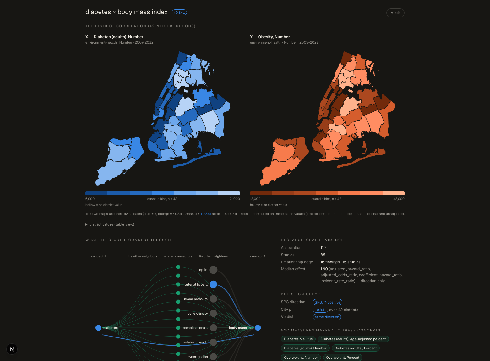

# Panacea: SPG × NYC Open Data dashboard

**Team:** Panacea
**Members:** Sanjana Mohan, Saksham Mrig
**Challenge:** Build Challenge 4 
**Pitch slides:**  

## What it does

A five-tab dashboard that puts the System Public Graph next to NYC's own
public-health data, for analysts, journalists, and anyone curious about
environmental health in the city. Pick a pair of concepts and see, in one
place: what published research confirms about them, where the city's
district-level data points the other way (contested), which measure pairs the
city correlates strongly while the research graph has no direct link
(bridges), and which chains only exist when both datasets are combined
(mediated). Every claim is clickable down to its evidence: associations,
studies, PubMed links, and the 42-district correlation with choropleth maps.

## How we used the System Public Graph

- Downloaded the SPG v1 deposit (concepts, relationships, associations,
  studies) and built a typed concept map from SPG system ids to NYC measure
  ids (Wikidata anchors plus adjudication), so every SPG concept knows which
  city measures it can be checked against.
- Evidence = association count + findings + studies per concept pair, with
  the median effect and its statistic type. Expected direction is inferred
  only from ratio/correlation-type effects (OR/HR/RR/r) by majority sign
  (≥3 signable effects, ≥60% share); mean differences are excluded, since
  their sign depends on unstated variable coding.
- City check = Spearman ρ of the two mapped measures across the 42 UHF42
  districts (first observation per district), computed from NYC Open Data on
  Underlay (environment-health + geographies v1.0.0). Each checked pair is
  labeled same / opposite / flat / ambiguous against the inferred direction;
  checks that use modeled EHDP burden measures are flagged (ρ⚠).
- Bridges: measure pairs with |ρ| ≥ 0.45 (non-modeled) whose concepts have
  zero direct SPG relationships and associations; the graph then supplies
  the 1- and 2-step paths that connect them.
- Mediated chains: one documented SPG hop (≥2 findings, ≥2 studies) plus one
  hop carried entirely by NYC data (|ρ| ≥ 0.45, no or negligible SPG edge for
  that same link) — endpoint connections that exist in neither dataset alone.
- PubMed ids from the associations table back every citation link in the UI.
- Everything derives into a committed JSON bundle (`web/data/`), so the app
  runs fully offline.

## How to run it

1. Install Node.js 20+ and pnpm (`npm i -g pnpm`; npm works too).
2. `cd web && pnpm install`
3. `pnpm dev` and open http://localhost:3000 (or `pnpm build && pnpm start`).

No API keys or `.env` file needed: the derived data
(`web/data/bundle.json`, `web/data/districts.json`) is committed, so the app
builds and runs offline.

## Data sources

- System Public Graph, July 1, 2026 release (CC BY-NC 4.0): concepts,
  relationships, associations, studies (Dataverse deposit)
- NYC Open Data on Underlay v1.0.0: environment-health and geographies
  (UHF42 boundaries) — https://www.underlay.org/ (underlying NYC Open Data)
- PubMed: citation links point to pubmed.ncbi.nlm.nih.gov

## Limitations

- City correlations are cross-sectional and ecological (42 districts,
  unadjusted): directional evidence only, never causal.
- Median effects mix OR/RR/r: compare directions, not magnitudes.
- An opposite-direction ρ is a question, not a refutation: the mapped city
  measure can be inverted relative to the study's coding, and modeled EHDP
  burden measures (ρ⚠) reproduce the model, not the city.
- Measurement vintages misalign across datasets (tree census 2015,
  single-day surface temperature 2018, heat outcomes 2000–2022, 311
  complaints 2024–2026); every claim inherits those year ranges.
- Mediated chains are correlation chains: neither hop establishes the
  direction of the endpoint relationship.
- The concept map decides what can be checked: pairs outside it have no

## AI coding tools

Yes: Claude (Opus 5) via Claude Code drove the data pipeline and the Next.js
app, pair-programming style. The analysis choices (direction inference,
matching rules, thresholds, what counts as evidence) were specified and
reviewed by the team.

## Screenshot

More in `screenshots/`: the bridges connection view (`bridges.png`) and the
mediated chains (`mediated.png`).
