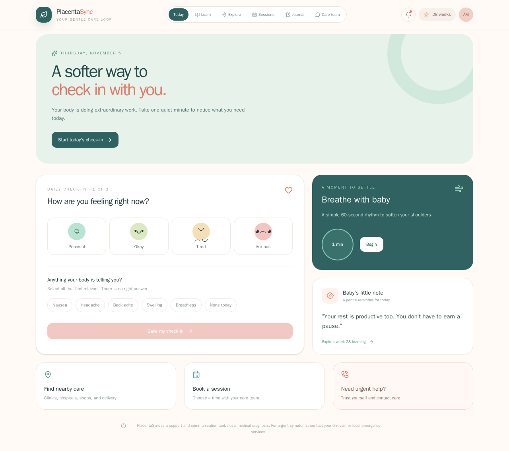

# PlacentaSync

**Team:** PlacentaSync
**Members:** Senushi Dinara
**Challenge:** Explore 2: What makes a good job?
**Pitch slides:** https://github.com/senushidinara/PlacentaSync

## What it does

PlacentaSync is a mobile-first maternal care companion that helps expectant parents do quick daily check-ins, practice calming breathing, and connect with care support quickly.

## How we used the System Public Graph

We used the System Public Graph to explore maternal-care-adjacent concepts and grouped evidence into practical support themes (daily wellbeing check-ins, care access, education, and support pathways). We filtered toward signals useful for non-diagnostic support experiences, then translated those themes into product sections (Today, Learn, Explore, Sessions, and Care Team). We combined graph-informed framing with product UX prototyping and safe care-handoff flows (maps, WhatsApp, and sandbox payments).

## How to run it

1. Install requirements in this folder:
   ```bash
   npm install
   ```
2. Create a file called `.env` in this folder containing:
   ```env
   SYSTEM_API_KEY=your-key-here
   ```
3. Run locally:
   ```bash
   npm run dev
   ```
4. Optional checks:
   ```bash
   npm run lint
   npm run build
   npm run preview
   ```

## Data sources

- System Public Graph, July 1, 2026 release (CC BY-NC 4.0)
- Project-authored UX flows and interface content for maternal care support prototyping
- External service links used by the app at runtime (not bundled datasets):
  - Google Maps search links for nearby care and nutrition access
  - WhatsApp handoff links for care-team communication
  - PayPal JavaScript SDK (Sandbox) for test checkout flow

## Limitations

This is a prototype support tool, not a medical device. It does not diagnose conditions or replace clinician advice. Nearby care and nutrition results depend on external map search quality and user location context. Payment is sandbox-only and production-ready payment capture would require a secure backend.

## AI coding tools

Yes. AI coding tools were used during development, including GitHub Copilot.

## Screenshot


