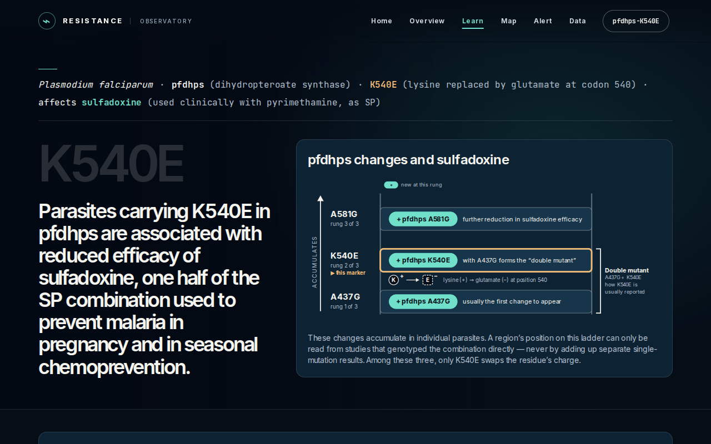

# Resistance Observatory

Team: Resistance Observatory  
Members: Solayman Ararba, David Steinberger, Benjamin Gatica Morales  
Challenge: Build 3: When does new evidence change the picture for a malaria drug resistance marker?  
Pitch slides: https://docs.google.com/presentation/d/14Pf7EBcu342gcFyR_Quo6vvOm-tNH7X9pXxYQcqEHXE/edit?usp=sharing  
Live site: https://resistance-observatory.vercel.app/  
Repository: https://github.com/dmsteinberger2-oss/Resistance-Observatory

## What it does

Resistance Observatory is for a researcher tracking one malaria drug-resistance
marker, pfdhps K540E (drug: sulfadoxine, used with pyrimethamine as SP). It
shows how much evidence the System Public Graph actually holds for that marker,
where the marker has been observed over time, and replays real publication
history so the researcher can see when a new finding would have changed the
picture, with every finding linked to its paper.

## How we used the System Public Graph

We used release v2.1 (CC BY-NC 4.0, doi:10.7910/DVN/7V6JDO) through API v1.0 at
`https://public-api.system.com/v1/`, and the vetted Dataverse files as a
cross-check. Everything below is reproducible from `scripts/graph-stats.ts`,
which writes `data/graph-stats.json`; the app reads that pinned file.

### What we searched for

Only `name` is searchable on variables, so we ran
`GET /variables?search=name:<term>&limit=50&offset=<n>&include_total=true`, one
term at a time, always setting `limit` (the default is 10). Hits per term:

| Term | Variables returned |
| --- | --- |
| `dhps` | 31 |
| `pfdhps` | 11 |
| `dihydropteroate` | 9 |
| `K540E` | 0 |
| `540E` | 1 |
| `sulfadoxine` | 190 |
| `sulfadoxine-pyrimethamine` | 149 |

That is 241 distinct variables. For each we counted associations with
`GET /variables/{id}/associations?limit=1&include_total=true`, then pulled the
associations for the ones we kept.

`search=name:K540E` returns nothing. The marker is in the graph, but written as
"A437G/K540E", "K540 E:", "540K/E" or "Glu-540", so we matched on variable
**name text** with the pattern `540\s*E|540\s*K\/E|Glu-540`. That found 8
variables that name codon 540 of pfdhps.

### Keyword noise we excluded

A name search for `dhps` also returns things that have nothing to do with
malaria. For the wider "pfdhps overall" set we kept only variables whose name
says `pfdhps`, or says dhps / dihydropteroate together with "falciparum" or a
pfdhps codon (437, 540, 581). That drops:

- the steroid 16-DHPS (16-dehydropregnenolone sulfate);
- dihydropyridine calcium-channel blockers, abbreviated "DHPs";
- "Dental Health Professionals (DHPs)";
- *Pneumocystis* / *P. carinii* DHPS;
- bare "DHPS mutations" variables that the name does not tie to malaria.

The rule deliberately undercounts: an ambiguous name is left out.

### What counted as evidence

A finding is one association: two variables linked by a statistic. We count a
finding for the marker only if one of its variables names codon 540, and only
if it has not been found mis-extracted (below). Each count on screen is
labelled with the question it answers, because different tabs ask the graph
different questions and get different counts:

- **Findings that name codon 540 directly: 4, from 2 studies** (5 variables).
- **Findings that name K540E on its own, with no other codon: 0.** All four
  remaining findings name codon 540 inside a combination (for example the
  A437G/K540E double mutant) or compare how common it is between two groups.
- **Findings that cover pfdhps overall, any alteration: 28, from 21 studies.**
- No graph finding gives a prevalence figure for K540E.

### The vetted-CSV cross-check

System's documentation says roughly 20% of the associations the API serves are
known-bad extractions. We streamed `system-public-graph-v1-associations.csv`
from the Dataverse record and looked up every finding we pinned by `system_id`.

- **Only 2 of our 32 pinned finding ids are in the vetted CSV**, both in the
  wider pfdhps set.
- The reason is structural. Of about 2.0 million rows in that file, 1 has an
  empty concept id: the vetted CSV holds associations whose two variables are
  **both** matched to a concept. Most findings the API returns for this marker
  have one unmatched variable, so they cannot appear in it. Absence from the
  CSV is therefore not a verdict on its own.
- The Alert tab applies the same check server-side: its API route returns only
  associations whose id is in the vetted list (4,912 ids) and counts the rest
  as quarantined.

### The OpenAlex date join

The graph has no per-finding publication date; it carries `last_published_date`
only on concept-level relationships. To put findings in publication order we
resolved each finding's `pubmed_id` through OpenAlex
(`GET https://api.openalex.org/works?filter=pmid:<ids>&select=id,doi,ids,publication_date`).
All 4 remaining codon-540 findings resolved; the most recent was published
January 21, 2023. The DOIs OpenAlex returned match the graph's for those
papers.

### Coverage observations

- **The graph indexes K540E only lightly.** 4 findings name codon 540, none
  names K540E alone.
- **The graph has read 10 of the 372 papers** that mention K540E in PubMed
  (searched 14 November 2026; the Alert tab's data pack).
- **Study type is recorded for none of them.** `study_type` is null for every
  study behind the codon-540 findings, so each finding shows "type not
  recorded".
- **No geography field.** A finding can be tied to a place only by a text
  match on the study's population text; the Map tab's locations come from
  MalariaGEN Pf8, not from the graph.
- **Two dates for one release.** The Dataverse record gives a distribution
  date of July 1 2026; the v2.1 files were generated on 8 July 2026. Our tabs
  show one or the other and the README explains both.

### Findings we excluded after review, and how each was found

The live API returned 8 findings naming codon 540. Four were found
mis-extracted. They stay in `data/graph-stats.json` flagged `vetted: false`
with a note and a method, are shown on the Data tab under "Caught in review",
and are left out of every count.

| Finding id | Paper | What was wrong | Found by |
| --- | --- | --- | --- |
| `paFNq6MPX5` | PMID 25564249 | The prevalence ratio belongs to the A581G sextuple mutant, not K540E; K540E appears in that sentence only as a proxy definition. | Checking the source abstract; also absent from the vetted CSV |
| `AeI-laBxXr` | PMID 25564249 | Same paper, same error. | Checking the source abstract; also absent from the vetted CSV |
| `iD_4aq3uIs` | PMID 29854394 | The abstract reports no difference in 540E; the recorded value equals the drop of a different, non-antifolate marker. | AI-assisted spot-check against the source papers |
| `QIrkddNp_j` | PMID 16023986 | The odds ratio belongs to the quintuple mutant in all children, not to the genotypes and age group the finding names. | AI-assisted spot-check against the source papers |

The spot-check compared each finding with its paper's PubMed abstract, and
open-access full text where there was any. **It was AI-assisted and has not
been reviewed by a human.** Of the 4 findings that remain on screen it marked
2 supported and 2 partly supported (the value matches the paper, but the
graph's label or population does not fully); each finding shows its result.

This is the extraction-error rate System's documentation warns about, found in
our own data. It is not a criticism of the graph: it is why every finding in
the app keeps its `system_id`, `pubmed_id` and `doi` and links to its paper.

## How to run it

Requires Node 22.18 or newer.

```bash
git clone https://github.com/dmsteinberger2-oss/Resistance-Observatory.git
cd Resistance-Observatory
npm install
npm run dev     # http://localhost:3000
```

No key is needed. The story, Overview, Learn, Data and Map read pinned data.
Alert takes an optional `SYSTEM_API_KEY` (live graph calls) and
`RESEND_API_KEY` (email) in `.env.local`; without them it shows the pinned
snapshot and email is off. Learn's 3D structure viewer needs network access to
cdnjs and RCSB; if either is unreachable it shows a link instead.

## Data sources

- **System Public Graph** — v2.1, July 1 2026 snapshot, CC BY-NC 4.0,
  doi:10.7910/DVN/7V6JDO; API v1.0. The primary evidence source. Work deriving
  from the graph inherits CC BY-NC.
- **System Public Graph, vetted Dataverse release** — same DOI, file
  `system-public-graph-v1-associations.csv`. The verification layer.
- **OpenAlex** — `https://api.openalex.org`, CC0. Publication dates, matched
  on `pubmed_id`.
- **MalariaGEN Pf8** — genome counts by country and collection year, 33
  countries, 1966–2022. doi:10.5281/zenodo.18681980, CC BY 4.0. Cite:
  MalariaGEN et al., Wellcome Open Research 2025; 10: 325,
  doi:10.12688/wellcomeopenres.24031.1. Used by Alert and Map.
- **PubMed** (NCBI E-utilities) — 372 papers mentioning K540E, searched 14
  November 2026. Abstract fields were extracted by a language model and not
  checked by hand. Also used for the spot-check, with Europe PMC open-access
  full text.
- **WHO guidelines for malaria, 13 August 2025**, and the WHO compendium of
  molecular markers — the source of the resistance bands Alert shows. Citing
  them is not a WHO endorsement, and the bands are not a clinical action rule.
- **RCSB Protein Data Bank** — crystal structures 6JWX and 6KCL
  (doi:10.1111/febs.15196), loaded live in the browser. Not linked to the
  graph in either source; we connect them through our own marker definition
  and say so on screen.
- **3Dmol.js** 2.4.2 — viewer library, loaded from the cdnjs CDN.
- **Natural Earth** — country shapes and city names for the Map. Public
  domain.
- **Resend** — email delivery for Alert. A service, not a data source.

## Limitations

- **One marker.** pfdhps K540E and sulfadoxine (SP) only.
- **A snapshot, not live surveillance.** The graph is a July 1 2026 release.
  The alert demo replays real publication history in the order findings were
  published; nothing after the snapshot is in it.
- **No prevalence prediction and no forecast.** The graph holds statistical
  associations, not prevalence measurements. The Map shows observed history
  only.
- **No clinical guidance.** A marker association does not establish treatment
  failure for any patient.
- **Thin evidence.** 4 findings from 2 studies name codon 540, and none names
  K540E alone.
- **Verification is partial and AI-assisted.** No human has checked the 4
  findings that remain against their papers.
- **Name-text matching.** A relevant variable with an unusual name can be
  missed, and the pfdhps filter undercounts on purpose.
- **Absence is not evidence.** A missing relationship may reflect extraction
  gaps, grounding failures, or no published study.
- **Position 437 is not resolved** in either crystal structure, so the
  structure viewer can only show and compare residue 540.

## AI coding tools

- **Claude Code (Anthropic)** wrote most of the code in this repository under
  the team's direction: the app shell and the Overview, Learn and Data pages,
  the data-pull script `scripts/graph-stats.ts`, the Alert tab, and the Map
  tab with its data scripts. The sessions for the shell, Overview, Learn and
  Data ran on the Claude Fable 5.2 model.
- The team used no other AI coding tool that is recorded in the repository.
- **AI was also used on the data, not only the code:**
  - Alert's PubMed abstract fields were extracted by a language model; a
    program kept only quotes that appear word for word in the abstract. They
    were not checked by hand.
  - The spot-check of graph findings against their papers was run by a Claude
    subagent and has not been reviewed by a human.
- **No language model runs in the shipped app.** Alert explanations are
  templates filled from matched fields.
- The science content (Learn's marker text and the Data tab's background) was
  drafted with AI assistance. A review gate originally held it back from
  display; that gate was removed, and no human review of the content is
  recorded in the repository. Its source docs say the claims were written from
  general knowledge and should be checked against the literature.

## Screenshot


