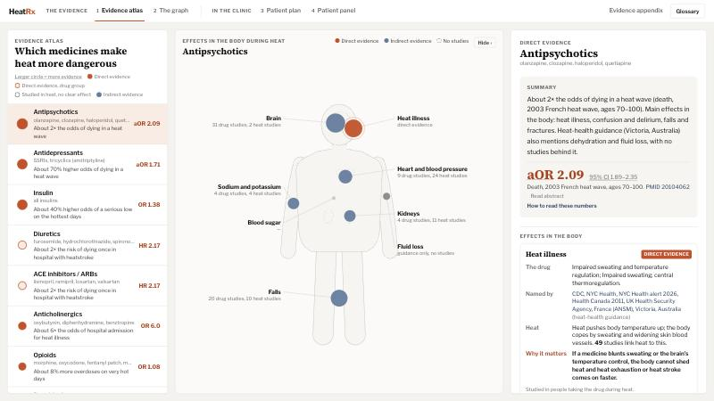
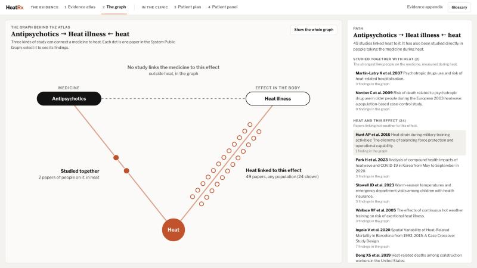
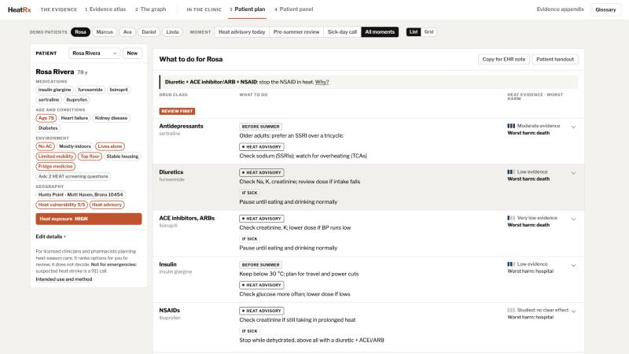
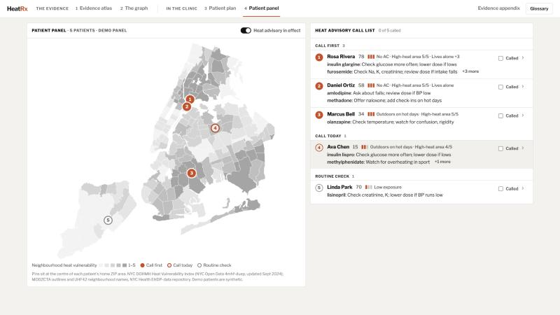

# HeatRx

**Team:** Second Ferment
**Members:** Stella Lee, Alex Deng
**Challenge:** Visualize 3: Which common medications make heat more dangerous, and what should prescribers and health systems do about it?
**Pitch slides:** [HeatRx-pitch-deck.pptx](HeatRx-pitch-deck.pptx)

## What it does

HeatRx is for prescribers, pharmacists and clinic teams. It shows which medicines make heat more dangerous and why, and
turns that evidence into action:

- **Evidence atlas:** 16 drug classes mapped to effects in the body, each with the studies behind it.
- **Graph:** any drug → body effect ← heat path, opened down to the individual papers and their findings.
- **Patient plan:** mitigation-first actions for one patient.
- **Patient panel:** a ranked outreach list for a clinic when a heat advisory is issued.

## How we used the System Public Graph

1. **The graph.** We loaded the 2.0M-finding vetted snapshot into SQLite. From the live API (5.9M findings) we pulled
   every finding that touches a heat variable, and tagged rows outside the vetted release as unvetted. Each finding
   links two measured variables and carries a statistic, a confidence interval and a PubMed ID.
2. **Match and filter (Python).** We grouped drug and heat variables by name, using pattern rules in
   `scripts/heat_meds_lib.py`. We grouped body effects (kidney injury, low sodium, low blood pressure and so on) by
   concept, because traversing concepts alone loses the heat context.
   - We kept three kinds of path:
     - the drug studied during heat (direct evidence);
     - drug → effect ← heat, built from separate studies (indirect evidence, a hypothesis rather than a measured
       interaction);
     - the drug in a heat-study population.
   - Each drug-side finding is classed as raised, lowered or unclear risk from its confidence interval.
   - We read matched rows to drop false hits (for example "ARB" as a river basin, or fever control matched as
     "temperature").
   - We checked headline numbers against the PubMed abstracts, and corrected labels the graph got wrong
     (`reference/corrections.csv`).
3. **Evidence database.** The result is `bundle/evidence.json`: about 3,300 findings from about 2,000 papers, linked
   to drug classes, body effects, guidance and actions, with each link tiered by its strength of evidence.
4. **App.** Built with React 19, TypeScript and Vite. Paper abstracts load live from PubMed.

Details: `docs/MAPPINGS.md` (vocabularies), `docs/DATA.md` (tables and quirks), `docs/GROUNDING.md` (where every part
of the app comes from), `docs/CAVEATS.md` (known noise).

## How to run it

**The app** (needs Node 20 or later):

```bash
cd app
npm install
npm run dev
```

Open http://localhost:5173. The evidence database ships in `bundle/`, so no API key is needed to run the app.

**Rebuilding the evidence** (optional; Python 3.9 standard library only):

1. Create a file called `.env` in this folder containing `SYSTEM_API_KEY=your-key-here`.
2. Download the snapshot and build the local database (1.1 GB): `sh scripts/fetch_data.sh`
3. Rebuild, in this order:
   - `python3 -I scripts/evidence.py`
   - `python3 -I scripts/pubmed_meta.py`
   - `python3 -I scripts/merge_papers.py`
   - `python3 -I scripts/merge_outside.py`
   - `python3 -I scripts/merge_v2.py`

## Data sources

- System Public Graph, July 1, 2026 release (CC BY-NC 4.0), plus the live System Public API
- Heat-health guidance: CDC, NYC Health, UKHSA, Health Canada, ANSM (France), WHO Europe
- FDA drug labels via openFDA (public domain)
- Medicare Part D Prescribers by Provider and Drug, CMS (public)
- NYC Heat Vulnerability Index by ZIP, NYC DOHMH via NYC Open Data
- CDC PLACES, ZIP-level estimates
- National Weather Service alerts and Central Park observations (via the Iowa Environmental Mesonet)
- CDC HEAT questionnaire
- PubMed / NCBI E-utilities, for titles and abstracts

## Limitations

- Few direct studies link drugs to specific heat effects: 20 findings from 15 papers, many from the 2003 French heat
  wave. Most links are associations from separate studies (drug → body effect ← heat), not tested interactions.
- Guidance names some drugs where the studies in heat found no clear effect (lithium, NSAIDs), and others with no study
  at all.
- Patient prioritisation is a transparent rule set, not a validated risk score.
- The demo patients are synthetic.

## AI coding tools

Yes. We used Claude Code (Anthropic) for data exploration, the pipeline scripts, the app and the documentation.

## Screenshot





